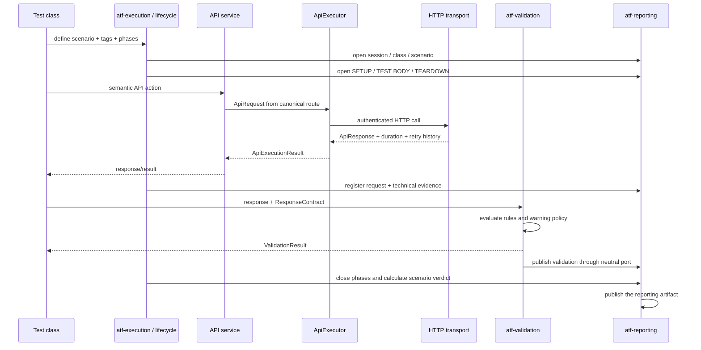
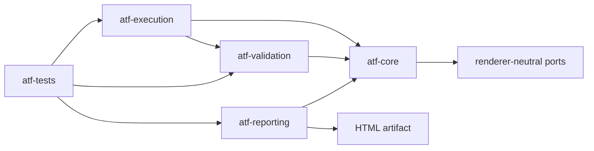
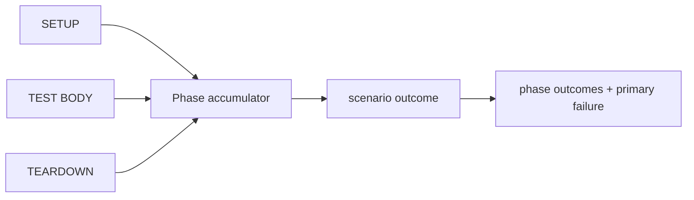

# ATF Java — framework pentru automatizare API

ATF Java este un framework standalone pentru automatizarea și validarea
scenariilor API. README-ul rădăcină explică numai arhitectura, componentele,
fluxurile și responsabilitățile. Contractele detaliate de raportare, staging,
build și verificare a artifactului sunt documentate în modulele și documentele
specializate către care trimite această pagină.

## Secvența completă a unui test API

Testul exprimă intenția, API layer-ul produce acțiunea, execuția coordonează
lifecycle-ul, validarea produce verdictul semantic, iar raportarea înregistrează
evidence-ul printr-un port neutru.



### Ownership pe fiecare pas

| Pas | Owner | Responsabilitate | Nu face |
|---:|---|---|---|
| 1 | `atf-tests` | definește scenariul, tag-urile și fazele | nu construiește HTTP sau HTML |
| 2 | `atf-execution` | coordonează sesiunea, lifecycle-ul și precedence-ul | nu evaluează contracte |
| 3 | API services | exprimă acțiuni semantice (`UsersService`, `PostsService`) | nu cunosc JUnit/Extent |
| 4 | `atf-core` | modelează request, transport, auth, retry și rezultat | nu deține servicii de business |
| 5 | `atf-validation` | evaluează response-ul și produce verdict/evidence | nu depinde de Extent/HTML |
| 6 | `atf-reporting` | consumă porturile și publică evidence-ul | nu inventează verdicturi |

## Arborele semantic al testului

Acesta este contractul de ownership al execuției, nu un detaliu de CSS:

```text
TestCase
├── SETUP
│   └── Request(s)
├── TEST BODY
│   ├── Request
│   │   ├── Technical trace
│   │   ├── Response details
│   │   └── Response JSON
│   └── Validation — sibling direct al request-ului owner
│       └── aggregate assertion table
└── TEARDOWN
    └── Request(s)
```

Request-ul și validation-ul sunt noduri surori în aceeași fază. API service-ul
nu știe de raportare, validatorul nu decide layout-ul, iar reporting-ul nu
calculează verdictul. O implementare care sare peste un owner sau inversează
această ordine încalcă arhitectura.

## Arhitectura modulelor



| Modul | Deține | Nu deține |
|---|---|---|
| `atf-core` | request/response, transport contracts, statusuri, config, retry, redaction și porturi | HTML, JUnit, business services |
| `atf-validation` | `ResponseContract`, reguli, evaluator, verdict și evidence prin port neutru | HTTP, Extent, HTML, CSS |
| `atf-execution` | rute, modele, API services, executor, lifecycle și cleanup | validare de contract, CSS, JavaScript |
| `atf-reporting` | integrarea Extent, documentul semantic, theme, fallback și publicarea artifactului | transport, business validation, verdicturi inventate |
| `atf-tests` | teste unitare, contract, componentă și scenarii de integrare | implementarea framework-ului |

### Direcția dependențelor

```text
atf-core
   ↑
atf-validation  ←  atf-execution  ←  atf-tests
   ↑                    ↓              ↓
   └──────────────  atf-reporting  ────┘
```

Porturile comune sunt renderer-neutral. Extent este o implementare a boundary-
ului de reporting, nu o dependență transversală. Composition root-ul leagă
transportul, configurația, serviciile, lifecycle-ul, validarea și raportarea.

## Lifecycle și calculul rezultatului



`ApiScenarioLifecycleRunner` păstrează ordinea fazelor, precedence-ul și cauza
primară; executorul de fază deține invocarea și maparea semnalelor. `TEARDOWN`
se încearcă atunci când este definit, chiar după failure/skip. Verdictul final
nu este recalculat de renderer.

Regula semantică este:

```text
FAIL > SKIP > WARNING > PASS
```

Warning-ul rămâne evidence și poate fi soft assertion; nu devine failure doar
pentru că este publicat în raport. Validarea și lifecycle-ul trebuie să păstreze
aceeași decizie în execuție și în artifact.

## Principii de design

- fiecare clasă are un owner unic și o responsabilitate observabilă;
- fațadele publice coordonează, nu absorb implementarea tuturor subsistemelor;
- modelele de domeniu sunt immutable unde reprezintă configurație, identity sau
  evidence;
- timpul, retry-ul, auth-ul și redaction-ul sunt politici injectabile și
  testabile determinist;
- modulele renderer-neutral nu importă Extent, JUnit sau HTML;
- testele de contract protejează API-ul și semantica înaintea refactorizării;
- o abstracție nouă este justificată numai când reduce coupling sau duplicare;
- limita de clase per package este semnal de coeziune, nu motiv pentru directoare
  artificiale;
- documentația permanentă descrie contracte stabile, nu rapoarte intermediare.

## Unde găsești detaliile

- [docs/README.md](docs/README.md) — harta documentației și regulile comune;
- [docs/ATF_Architecture.md](docs/ATF_Architecture.md) — boundary-uri și
  dependențe detaliate;
- [atf-core/README.md](atf-core/README.md) — kernel, porturi și politici;
- [atf-execution/README.md](atf-execution/README.md) — API layer, services și
  lifecycle;
- [atf-validation/README.md](atf-validation/README.md) — contracte și
  evaluare renderer-neutrală;
- [atf-reporting/README.md](atf-reporting/README.md) — contractul vizual,
  conținutul și navigarea artifactului Extent;
- [atf-tests/README.md](atf-tests/README.md) — compunerea unui test end-to-end;
- [docs/ATF_API_TEST_GUIDE.md](docs/ATF_API_TEST_GUIDE.md) — pașii practici
  pentru adăugarea unui test API;
- [docs/ATF_Reporting_Contract.md](docs/ATF_Reporting_Contract.md) — arborele
  și contractul observabil al raportului;
- [docs/ATF_REPORTING_REFERENCE_GUARD.md](docs/ATF_REPORTING_REFERENCE_GUARD.md)
  — reperul vizual/funcțional și procedura de comparație;
- [docs/ATF_BUILD_AND_EXECUTION_SAFETY.md](docs/ATF_BUILD_AND_EXECUTION_SAFETY.md)
  — sync live, staging, build și verificare MCP;
- [docs/README_Atf_BestPractices.md](docs/README_Atf_BestPractices.md) —
  reguli OOP, testabilitate și mentenanță;
- [docs/feedback/README.md](docs/feedback/README.md) — numai ToDo-urile active.

README-ul rădăcină nu repetă contracte de culori, layout, tab-uri, navigare,
staging sau validare vizuală. Acestea au un singur owner documentar în
`atf-reporting` sau în `docs/` și sunt referite de aici.
