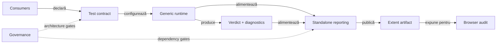
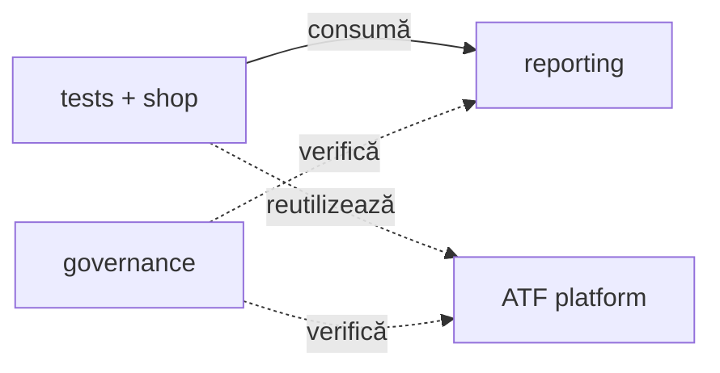
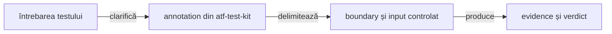
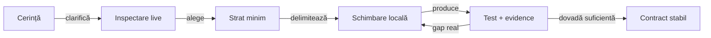
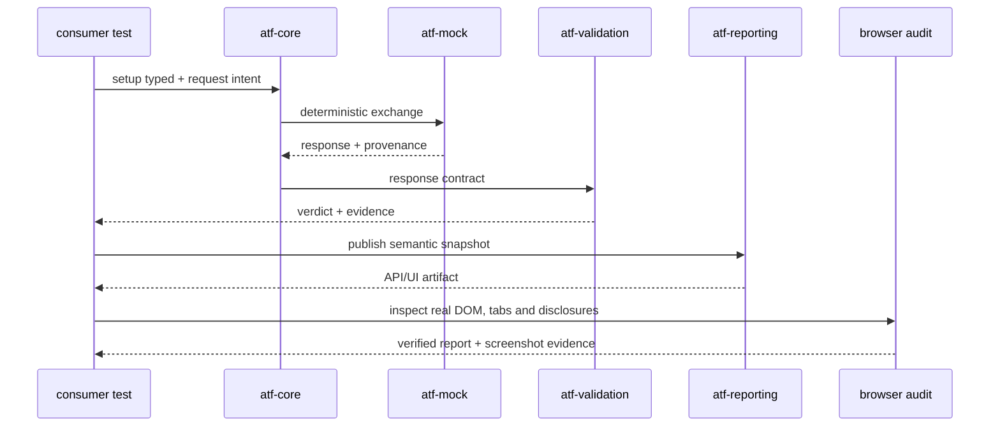
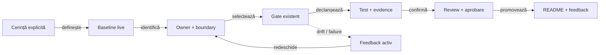

# ATF — platformă modulară pentru testare și rezultate verificabile

`API determinist → validare semantică → raport Extent → audit UI`

## ATF Java — overview executiv

ATF Java este platforma care leagă execuția deterministă a testelor API de
validarea semantică, publicarea artefactului Extent și auditul UI al rezultatului.
Pentru orientare rapidă, modulele sunt grupate după întrebarea la care răspund,
nu enumerate ca un inventar Maven:

| Zonă | Module live | Responsabilitate | Întrebarea cititorului |
|---|---|---|---|
| **Contract & foundation** | `atf-test-kit`, `atf-core` | adnotări de layer, modele neutre, lifecycle, transport ports | ce poate fi reutilizat fără reporting sau business? |
| **Execution & verdict** | `atf-mock`, `atf-validation`, `atf-console` | schimb determinist, verdict semantic și diagnostic | cum devine un test reproductibil și explicabil? |
| **Reporting & UI audit** | `atf-reporting`, `atf-ui`, `atf-debug-ui` | artifact standalone, browser audit și publicare read-only | cum devine rezultatul observabil și verificabil? |
| **Consumers** | `atf-reporting-tests`, `atf-test-practice-shop` | composition roots, fixture-uri, flows și testele concrete | cine compune platforma pentru un scop real? |
| **Governance** | `atf-tests` | graph-ul reactorului și boundary gates | cine protejează separarea modulelor? |

## Diagramă de bază

<strong>Legendă — flux, ownership și limite</strong>

**Fluxul**

- **Consumers** furnizează intenția, configurația și fixture-urile;
- **Contract** fixează layer-ul testului și boundary-ul reutilizabil;
- **Runtime** execută schimbul generic și, când este necesar, transportul fake;
- **Verdict** evaluează răspunsul și produce diagnostic/evidence;
- **Reporting** publică artifactul Extent standalone;
- **Artifact** este rezultatul HTML/CSS/JavaScript inspectabil;
- **Audit** verifică DOM-ul, tab-urile, filtrele și randarea în browser;
- **Governance** protejează direcția dependențelor fără să intre în producție.

Diagrama răspunde rapid la întrebarea „ce face ATF și unde se oprește fiecare
modul?”. Detaliile de implementare, contractele claselor și pașii de rulare
continuă în documentele ownerilor de mai jos.

**Ownership și verificare**

Tabelul de mai jos explică responsabilitatea fiecărui boundary și nivelul de
verificare asociat. Nu este o a doua hartă de navigare; este partea operațională
a aceleiași legende.

| Boundary | Owner | Rol | Verificare |
|---|---|---|---|
| test contract | `atf-test-kit` | adnotări unit/component/integration/e2e și guard transversal | architecture/unit |
| kernel | `atf-core` | modele neutre, lifecycle, transport și porturi | unit |
| transport determinist | `atf-mock` | rute și răspunsuri fake configurabile | component |
| verdict | `atf-validation` | contracte response, evaluare și evidence | unit |
| diagnostic | `atf-console` | proiecție de consolă și formatter | unit |
| reporting library | `atf-reporting` | renderer Extent, HTML, CSS/JS și artifact | standalone unit/component |
| browser runtime | `atf-ui` | sesiune Playwright și politici generice | component |
| debug inspector | `atf-debug-ui` | servește read-only un HTML pe loopback | component |
| reporting composition | `atf-reporting-tests` | probe API/UI/E2E ale librăriei reporting | integration/E2E |
| aplicație consumatoare | `atf-test-practice-shop` | config, locatori, pages, flows și purchase journey | component/E2E |
| whole-ATF governance | `atf-tests` | module graph și boundary-uri ale reactorului | component/architecture |

## Harta modulelor

Harta modulelor arată relațiile reale dintre consumatori, platformă și
guvernanță. Contractele interne continuă în README-ul fiecărui modul.

<strong>Legendă — module, ownership și relații</strong>

- `Consumers` grupează `atf-reporting-tests` și `atf-test-practice-shop`;
- `Reporting` înseamnă `atf-reporting`, iar `Platform` grupează modulele ATF
  reutilizabile;
- `Governance` înseamnă `atf-tests` și guard-urile whole-ATF;
- săgeata solidă = consum de bibliotecă/runtime în composition root;
- săgeata punctată = reutilizare sau verificare de boundary;
- nodul `Platform` grupează modulele reutilizabile; tabelul de mai jos
  păstrează modulele și ownership-ul lor fără a încărca schema principală;
- `atf-reporting-tests` folosește modulele platformei numai în test scope;
- `atf-test-practice-shop` este consumer de aplicație și nu mută pages, flows
  sau fixture-uri în reporting;
- `atf-tests` verifică reactorul și boundary-urile, nu devine composition root
  pentru raportare sau pentru Practice Shop;
- `atf-reporting` rămâne standalone în producție și nu primește browser,
  mock sau JUnit.

| Grup | Module | Deține | Nu deține |
|---|---|---|---|
| platform | `atf-test-kit` | layer annotations și guard-uri | runtime sau fixture-uri de business |
| platform | `atf-core` | request/response, lifecycle, transport și porturi | HTML, Extent, business services |
| platform | `atf-mock` | fake transport și catalog determinist | HTTP live sau verdicturi |
| platform | `atf-validation` | response contracts, verdict și evidence | transport sau HTML |
| platform | `atf-console` | diagnostic output | reporting UI sau transport |
| platform | `atf-reporting` | renderer, document semantic și artifact | module ATF, mock sau browser |
| platform | `atf-ui` | sesiune Playwright și politici browser | page objects de produs |
| platform | `atf-debug-ui` | publicare read-only pentru investigație | generare sau modificare de HTML |
| consumer | `atf-reporting-tests` | testele librăriei reporting și fixture-urile lor | testarea unei aplicații reale |
| consumer | `atf-test-practice-shop` | testele aplicației Practice Shop | guvernanță whole-ATF |
| governance | `atf-tests` | graph-ul reactorului și boundary gates | YAML, pages, flows sau purchase E2E |

Detaliile despre dependențele Maven sunt în
[`docs/ATF_Architecture.md`](docs/ATF_Architecture.md). Harta de mai sus nu
înlocuiește POM-ul; ea explică ownership-ul și direcția de citire.

## Harta straturilor de test

Stratul este ales explicit prin adnotarea din `atf-test-kit`, nu dedus din
numele folderului. Aceeași regulă se aplică testelor API, UI și reporting:

<strong>Legendă — cum alegem stratul</strong>

- alegem cel mai mic strat care poate demonstra contractul;
- promovăm la component/integration/e2e doar când boundary-ul verificat o cere;
- `support` furnizează input, locatori, fixture-uri sau helpers, dar nu produce
  un verdict independent;
- același raport poate avea teste unitare pentru markup/CSS/JS, teste component
  pentru contracte și teste E2E pentru comportamentul observabil în browser.

| Strat | Adnotare | Boundary verificat | Verdictul trebuie să demonstreze |
|---|---|---|---|
| unit | `@AtfUnitTest` | regulă, model, markup, CSS/JS sau asset pur | comportament determinist, fără boundary extern |
| component | `@AtfComponentTest` | renderer, loader, auditor, locator sau fixture controlat | contractul componentei și evidence-ul produs |
| integration | `@AtfIntegrationTest` | două sau mai multe module reale + transport/mock | integrarea și artifactul rezultat |
| e2e | `@AtfE2eTest` | artifact publicat + browser/Playwright | DOM, tabs, filtre, disclosure și randare observabilă |
| support | — | fixture-uri, locatori, loaders, flows și assertion helpers | nu are verdict independent și nu devine test implicit |

Compoziția plug-and-play urmează aceeași axă: un test declară stratul și
scope-ul, suportul îi furnizează inputul, iar modulul verificat rămâne ownerul
contractului. Testele E2E validează fluxul observabil; nu înlocuiesc testele
unitare/componentă pentru fiecare combinație internă.

## Model de evoluție și verificare

ATF-ul se dezvoltă prin întărirea unei platforme existente, nu prin adăugarea
unui test izolat și a unei abstracții paralele. Fiecare schimbare trebuie să
poată fi urmărită de la contractul observat până la dovada produsă:

<strong>Legendă — disciplină de evoluție</strong>

- **inspectare live**: citim implementarea, POM-ul, testele și contractul
  documentat înainte să presupunem că un TODO mai este activ;
- **stratul minim**: alegem unit/component/integration/e2e în funcție de
  boundary-ul demonstrat, nu în funcție de cât de vizibil este testul;
- **schimbare minimă**: modificăm ownerul responsabil și nu duplicăm
  vocabulary, configuration, fixture-uri sau renderer logic în consumer;
- **verificare**: rulăm testul cel mai îngust care poate dovedi schimbarea,
  apoi verificăm artifactul dacă rezultatul este HTML/UI;
- **hardening**: promovăm soluția în contract reutilizabil doar după ce
  dovada rămâne stabilă și poate fi reluată fără contextul run-ului inițial.

Un test nou este util chiar și când nu adaugă funcționalitate de business:
poate demonstra o limită reală a reporting-ului, a unui boundary sau a unei
proiecții UI. În acest caz, testul devine dovadă pentru întărirea ATF-ului, nu
un motiv pentru a păstra o clasă duplicată.

## Secvența executivă API → raport → audit

<strong>Legendă — secvența API → raport → audit</strong>

- consumerul compune setup-ul typed și intenția request-ului;
- `atf-core` execută contractul generic prin transportul ales;
- `atf-validation` transformă răspunsul în verdict și evidence;
- `atf-reporting` publică snapshot-ul semantic ca artifact API/UI;
- browserul verifică DOM-ul, tab-urile, disclosure-urile și evidence-ul vizibil;
- body-ul, header-ele, secțiunile, screenshot-urile, CSS-ul și tab-urile sunt
  definite în [ATF_Reporting_Contract.md](docs/ATF_Reporting_Contract.md) și
  validate de consumerul reporting, nu duplicate aici.

## Coerență și modificări guvernate

ATF-ul rămâne coerent când o schimbare este tratată ca o decizie controlată,
nu ca o editare locală. README-urile ownerilor, testele existente și gate-urile
arhitecturale sunt contracte de întreținere; nu se modifică, relaxează,
dezactivează, redenumesc sau elimină incidental. Feedback-ul este excepția
intenționată: registrul său se actualizează dinamic pe măsură ce apar dovezi
noi, se închid TODO-uri sau se schimbă limita rămasă.

<strong>Legendă — ce protejează procesul</strong>

- **Cerința explicită** stabilește ce este autorizat; nu deducem o
  refactorizare majoră dintr-un failure local și nu schimbăm un gate doar ca să
  obținem verde;
- **baseline-ul live** se citește înainte de editare: codul, POM-ul, testele,
  README-urile și feedback-ul curent au prioritate față de o copie veche sau un
  raport generat;
- **ownerul și boundary-ul** decid unde intră soluția: `atf-tests` apără
  reactorul, `atf-test-kit` clasifică layerele, iar modulele își păstrează
  contractele locale;
- **gate-ul existent** nu este material de refactorizare incidentală. Orice
  schimbare a unui README normativ sau a unui test-gate existent cere cerință
  explicită, aprobare explicită, motiv documentat și dovadă nouă pentru
  contractul schimbat;
- **feedback-ul activ** este registrul dinamic al lucrului: poate fi actualizat,
  restrâns, reorganizat sau închis când codul și testele confirmă progresul;
  nu devine însă contract permanent doar pentru că a fost notat acolo;
- **failure-ul** este semnal de analiză: se repară ownerul sau implementarea,
  nu se șterge, relaxează ori se maschează assertion-ul ca să dispară problema;
- **review-ul și sincronizarea** închid incrementul numai după testul relevant,
  artifactul nou când există UI/reporting și actualizarea selectivă a README-ului
  ownerului și a feedback-ului.

Detaliile despre staging, procese active, promovare și anti-undo sunt în
[`ATF_Build_And_Execution_Safety.md`](docs/ATF_Build_And_Execution_Safety.md),
nu se repetă în overview.

## Aprofundare pe module și contracte

Overview-ul fixează fluxul și ownership-ul; documentele de mai jos păstrează
detaliile locale. Cititorul poate intra direct în ownerul care îl interesează,
fără să parcurgă aceeași explicație în root și în fiecare modul; indexul documentației este în [`docs/README.md`](docs/README.md).

<strong>Deschide harta README-urilor de modul</strong>

| Zonă | Document owner | Întrebarea la care răspunde |
|---|---|---|
| contract transversal | [`atf-test-kit/README.md`](atf-test-kit/README.md) | cum declarăm și protejăm nivelul unui test? |
| kernel reutilizabil | [`atf-core/README.md`](atf-core/README.md) | ce modele, lifecycle și porturi sunt neutre? |
| transport determinist | [`atf-mock/README.md`](atf-mock/README.md) | cum obținem schimburi API reproducibile? |
| verdict semantic | [`atf-validation/README.md`](atf-validation/README.md) | cum se transformă un response într-un verdict? |
| diagnostic | [`atf-console/README.md`](atf-console/README.md) | cum ajung evenimentele neutre în consolă? |
| reporting standalone | [`atf-reporting/README.md`](atf-reporting/README.md) | cum se construiește artifactul fără module ATF? |
| browser runtime | [`atf-ui/README.md`](atf-ui/README.md) | cum este controlat browserul fără logică de produs? |
| inspector read-only | [`atf-debug-ui/README.md`](atf-debug-ui/README.md) | cum investigăm un HTML deja generat? |
| reporting composition | [`atf-reporting-tests/README.md`](atf-reporting-tests/README.md) | cum sunt compuse testele API/UI/E2E pentru reporting? |
| consumer aplicație | [`atf-test-practice-shop/README.md`](atf-test-practice-shop/README.md) | cum folosește o aplicație reală infrastructura ATF? |
| guvernanță reactor | [`atf-tests/README.md`](atf-tests/README.md) | cine apără modulele și direcția dependențelor? |

Contractele transversale, regulile de documentație și protocolul de execuție sunt
în lista de referințe normative de mai jos; nu se duplică în această hartă.

## Referințe normative

| Subiect | Document |
|---|---|
| arhitectură, module și dependențe | [`docs/ATF_Architecture.md`](docs/ATF_Architecture.md) |
| reporting, evidence și randare | [`docs/ATF_Reporting_Contract.md`](docs/ATF_Reporting_Contract.md) |
| build, staging și verificare MCP | [`docs/ATF_Build_And_Execution_Safety.md`](docs/ATF_Build_And_Execution_Safety.md) |
| reguli OOP, naming și layers | [`docs/README_Atf_BestPractices.md`](docs/README_Atf_BestPractices.md) |
| scrierea README-urilor și diagramelor | [`docs/README_Atf_DocumentationBestPractices.md`](docs/README_Atf_DocumentationBestPractices.md) |
| feedback activ, reconciliere live și criterii de închidere | [`docs/feedback/README.md`](docs/feedback/README.md) |

Root README-ul descrie sistemul de sus în jos. Nu păstrează lifecycle-ul intern,
schema completă YAML, class contracts, CSS sau jurnalul unui run; acestea aparțin
ownerului și sunt protejate de testele lui.

