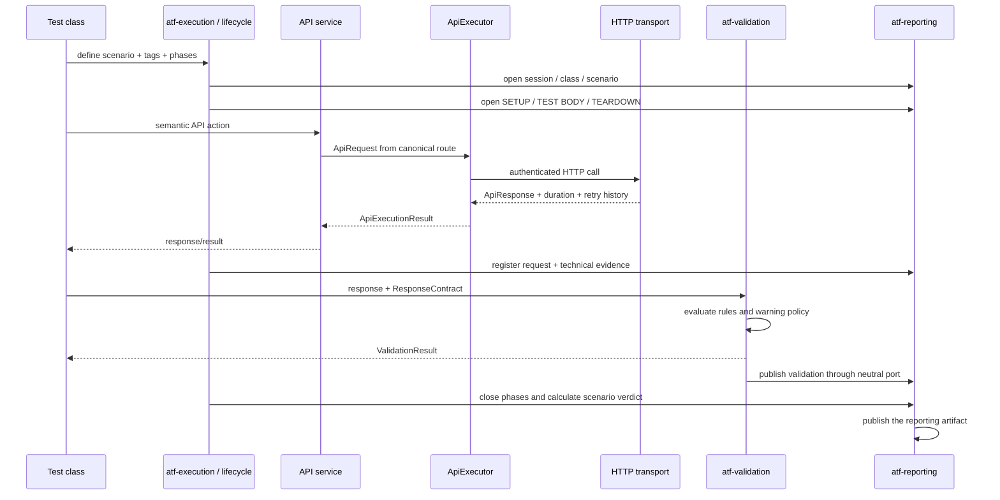
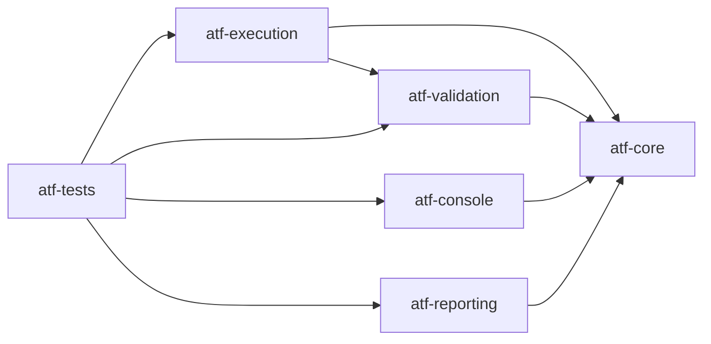
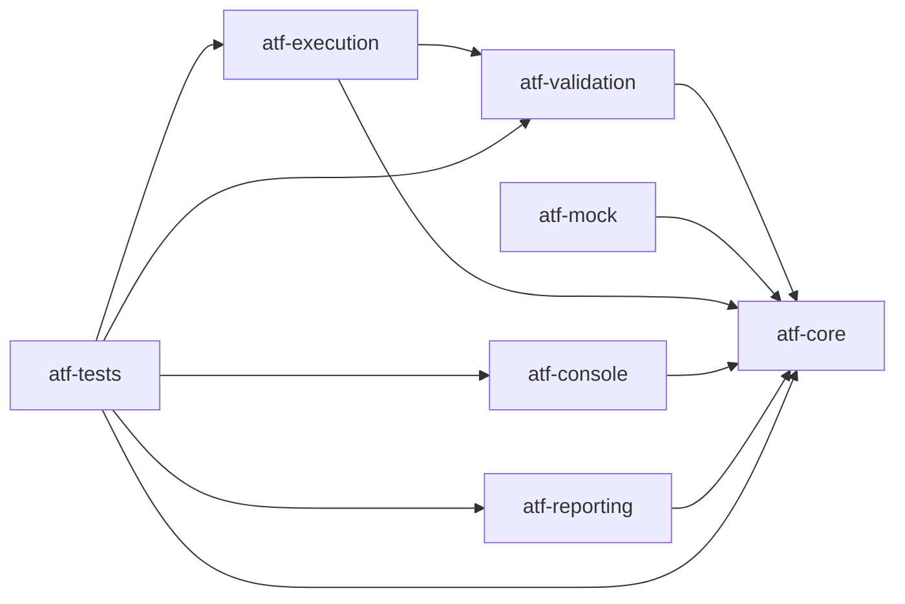
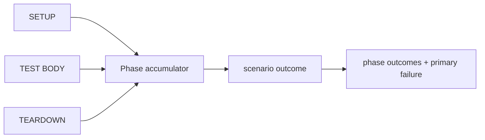

# ATF Java — framework pentru automatizare API

ATF Java este un framework standalone pentru automatizarea și validarea
scenariilor API. README-ul rădăcină explică numai arhitectura, componentele,
fluxurile și responsabilitățile. Contractele detaliate de raportare, staging,
build și verificare a artifactului sunt documentate în modulele și documentele
specializate către care trimite această pagină.

## Secvența completă a unui test API

Testul exprimă intenția, API layer-ul produce acțiunea, execuția coordonează
lifecycle-ul, validarea produce verdictul semantic, iar raportarea înregistrează
evidence-ul printr-un port neutru.



### Ownership pe fiecare pas

| Pas | Owner | Responsabilitate | Nu face |
|---:|---|---|---|
| 1 | `atf-tests` | definește scenariul, tag-urile și fazele | nu construiește HTTP sau HTML |
| 2 | `atf-execution` | coordonează sesiunea, lifecycle-ul și precedence-ul | nu evaluează contracte |
| 3 | API services | exprimă acțiuni semantice (`UsersService`, `PostsService`) | nu cunosc JUnit/Extent |
| 4 | `atf-core` | modelează request, transport, auth, retry și rezultat | nu deține servicii de business |
| 5 | `atf-validation` | evaluează response-ul și produce verdict/evidence | nu depinde de Extent/HTML |
| 6 | `atf-reporting` | consumă porturile și publică evidence-ul | nu inventează verdicturi |

## Arborele semantic al testului

Acesta este contractul de ownership al execuției, nu un detaliu de CSS:

```text
TestCase
├── SETUP
│   └── Request(s)
├── TEST BODY
│   ├── Request
│   │   ├── Request details
│   │   │   ├── URL / method / path / headers / params / auth
│   │   │   └── Request JSON body, dacă există
│   │   ├── Response details
│   │   │   ├── Technical trace
│   │   │   └── Response JSON body, dacă există
│   │   └── Execution evidence
│   └── Validation — sibling direct al request-ului owner
│       └── aggregate assertion table
└── TEARDOWN
    └── Request(s)
```

Request-ul și validation-ul sunt noduri surori în aceeași fază. API service-ul
nu știe de raportare, validatorul nu decide layout-ul, iar reporting-ul nu
calculează verdictul. O implementare care sare peste un owner sau inversează
această ordine încalcă arhitectura.

## Arhitectura modulelor



`atf-reporting` produce artifactul HTML prin porturile neutre definite de
`atf-core`; artifactul este un output al modulului, nu o dependență Maven.

| Modul | Deține | Nu deține |
|---|---|---|
| `atf-core` | request/response, transport contracts, statusuri, config, retry, redaction și porturi | HTML, JUnit, business services |
| `atf-mock` | transport fake configurabil, catalog de rute și răspunsuri deterministe | HTTP real, Extent, JUnit, business validation |
| `atf-validation` | `ResponseContract`, reguli, evaluator, verdict și evidence prin port neutru | HTTP, Extent, HTML, CSS |
| `atf-execution` | rute, modele, API services, executor, lifecycle și cleanup | validare de contract, CSS, JavaScript |
| `atf-console` | adaptorul, formatterul diagnostic, politica de stil, nesting-ul, `ConsoleSettings` și loaderul YAML al consolei | HTML, Extent, verdicturi, transport |
| `atf-reporting` | integrarea Extent, documentul semantic, theme, fallback și publicarea artifactului | transport, business validation, verdicturi inventate |
| `atf-tests` | teste unitare, contract, componentă și scenarii de integrare; `src/main/java` păstrează scenarii reutilizabile, `src/test/java` păstrează clasele JUnit executabile | implementarea framework-ului |

### Direcția dependențelor

Săgeata înseamnă „modulul din stânga depinde de modulul din dreapta”.



`atf-core` nu depinde de modulele superioare. `atf-validation` nu depinde de
`atf-reporting`; publicarea se face prin porturi neutre. `atf-reporting` nu
depinde de `atf-execution`. `atf-tests` le compune în testele de integrare și
acceptance, dar nu devine runtime dependency a framework-ului.

Porturile comune sunt renderer-neutral. Extent este o implementare a boundary-
ului de reporting, iar consola este o proiecție diagnostică separată. Nici
`atf-reporting` nu depinde de implementarea JUnit sau de alte module superioare,
`atf-core` de implementări concrete. Composition root-ul injectează explicit
sink-ul dorit. Configurația YAML a consolei este responsabilitatea
`atf-console`; lifecycle-ul JUnit este inclus în același modul, iar configurația
Extent rămâne în `atf-reporting`.

## Configurația runtime

Fișierul `atf.yaml` aparține proiectului consumator și stă la rădăcina lui; nu
aparține unui singur modul. În starea actuală, loaderul din `atf-reporting`
citește numai secțiunea `reporting.extent` pentru output-ul HTML. Este o
utilizare corectă pentru configurația rendererului, dar nu este încă snapshot-ul
complet al execuției.

Separarea țintă este:

| Responsabilitate | Owner | Regula |
|---|---|---|
| modele typed și snapshot-uri immutable | `atf-core` | fără YAML, filesystem, env sau `user.dir` în request |
| încărcarea și validarea sursei YAML | `atf-tests` / proiectul consumator | o singură citire la bootstrap, cu erori fail-fast |
| API timeout/retry/auth/routes | `atf-core` + `atf-execution` | executorul primește doar snapshot-ul |
| output, timestamp și renderer | `atf-reporting` | consumă setările de reporting, nu API settings |
| override-uri de test | `atf-tests`/consumator | explicite, locale și fără mutarea configurației globale |

În acest repository, composition root-ul
este `atf-tests`; pentru un consumator extern este proiectul de teste al acelui
consumator. `atf-core` definește contractele, composition root-ul asamblează
configurația, iar reporting adaptează numai partea sa. `atf-reporting` păstrează
loaderul său pentru `reporting.extent`; acesta nu devine loaderul configurației
API complete. Parserul YAML nu se mută în `atf-core`, deoarece ar transforma
kernelul într-un owner de filesystem și surse externe.

Schema actuală a sursei este un singur document cu secțiuni separate:

```yaml
api:
  baseUri: https://gorest.co.in
  defaultAuthProfile: default
  timeout: PT30S
  retryStatuses: [429, 503]
  maxAttempts: 2
validation:
  warningMode: false
reporting:
  assertionMaxDisplayCharacters: 240
  console:
    enabled: true
    detailsEnabled: false
  extent:
    enabled: true
    outputDirectory: artifacts/reports
    fileName: api-atf-extent-report.html
    timestampEnabled: true
```

### Contractul de transport pentru testele acceptance

`ApiAcceptanceReportTest` folosește în mod intenționat `AtfMockTransport` din
modulul `atf-mock`, un fake determinist injectat în composition root. El nu execută DNS, TLS sau
request-uri de rețea. De aceea `api.baseUri` din YAML descrie baseline-ul unei
compoziții API și URL-ul afișat în evidence, dar nu pornește HTTP și nu
schimbă transportul acceptance.

Testele care trebuie să contacteze un serviciu real sunt separate în
`ApiLiveReportTest`, folosesc `HttpClientTransport` și sunt opt-in prin:

```text
-Datf.liveApi.enabled=true
-Datf.liveApi.baseUri=https://host-ul-real
```

Această diferență este o invariantă de arhitectură, nu o convenție de naming:

```text
acceptance -> AtfMockTransport -> artifact reproductibil offline
live       -> HttpClientTransport -> endpoint HTTP disponibil
```

Nu adăugăm încă `transport: live` în YAML, deoarece loaderul YAML consumă
astăzi efectiv doar `reporting.extent`. Când configurația API va fi integrată,
transportul implicit trebuie să rămână `acceptance`, iar `live` să fie o
alegere explicită, validată o singură dată la composition root.

Secretele nu se păstrează în YAML; se injectează printr-un provider/env
explicit. Căile relative se rezolvă față de fișierul YAML, configurația se
validează strict, iar după bootstrap snapshot-ul nu se mai modifică și nu se
recitește pentru fiecare request.

`ExtentReportSession.openConfigured()` rămâne entry point-ul rendererului, iar
testele JUnit orientate pe resursă îl folosesc prin adaptorul comun
`ApiResourceTestBase`. Astfel `UsersApiTests` sau `PostsApiTests` pot fi rulate
direct din IntelliJ și pot produce artifactul Extent fără un runner separat.
`reporting.extent.enabled` activează/dezactivează numai publicarea HTML; nu
schimbă transportul, validarea sau verdictul testului. Loaderul descoperă
`atf.yaml` din working directory în sus, iar `outputDirectory` și timestamp-ul
decid destinația.

## Lifecycle și calculul rezultatului



`ApiScenarioLifecycleRunner` păstrează ordinea fazelor, precedence-ul și cauza
primară; executorul de fază deține invocarea și maparea semnalelor. `TEARDOWN`
se încearcă atunci când este definit, chiar după failure/skip. Verdictul final
nu este recalculat de renderer.

Regula semantică este:

```text
FAIL > SKIP > WARNING > PASS
```

Warning-ul rămâne evidence și poate fi soft assertion; nu devine failure doar
pentru că este publicat în raport. Validarea și lifecycle-ul trebuie să păstreze
aceeași decizie în execuție și în artifact.

## Principii de design

- fiecare clasă are un owner unic și o responsabilitate observabilă;
- fațadele publice coordonează, nu absorb implementarea tuturor subsistemelor;
- modelele de domeniu sunt immutable unde reprezintă configurație, identity sau
  evidence;
- timpul, retry-ul, auth-ul și redaction-ul sunt politici injectabile și
  testabile determinist;
- modulele renderer-neutral nu importă Extent, JUnit sau HTML;
- testele de contract protejează API-ul și semantica înaintea refactorizării;
- o abstracție nouă este justificată numai când reduce coupling sau duplicare;
- limita de clase per package este semnal de coeziune, nu motiv pentru directoare
  artificiale;
- documentația permanentă descrie contracte stabile, nu rapoarte intermediare.

## Unde găsești detaliile

- [docs/README.md](docs/README.md) — harta documentației și regulile comune;
- [docs/ATF_Architecture.md](docs/ATF_Architecture.md) — boundary-uri și
  dependențe detaliate;
- [atf-core/README.md](atf-core/README.md) — kernel, porturi și politici;
- [atf-execution/README.md](atf-execution/README.md) — API layer, services și
  lifecycle;
- [atf-validation/README.md](atf-validation/README.md) — contracte și
  evaluare renderer-neutrală;
- [atf-reporting/README.md](atf-reporting/README.md) — contractul vizual,
  conținutul și navigarea artifactului Extent;
- [atf-console/README.md](atf-console/README.md) — proiecția diagnostică,
  loaderul YAML și politica ASCII/UTF-8;
- [atf-tests/README.md](atf-tests/README.md) — compunerea unui test end-to-end;
- [docs/ATF_API_TEST_GUIDE.md](docs/ATF_API_TEST_GUIDE.md) — pașii practici
  pentru adăugarea unui test API;
- [docs/ATF_Reporting_Contract.md](docs/ATF_Reporting_Contract.md) — arborele
  și contractul observabil al raportului;
- [docs/ATF_REPORTING_REFERENCE_GUARD.md](docs/ATF_REPORTING_REFERENCE_GUARD.md)
  — reperul vizual/funcțional și procedura de comparație;
- [docs/ATF_BUILD_AND_EXECUTION_SAFETY.md](docs/ATF_BUILD_AND_EXECUTION_SAFETY.md)
  — sync live, staging, build și verificare MCP;
- [docs/README_Atf_BestPractices.md](docs/README_Atf_BestPractices.md) —
  reguli OOP, testabilitate și mentenanță;
- [docs/feedback/README.md](docs/feedback/README.md) — ToDo-uri active și
  decizii de refactorizare închise recent.

README-ul rădăcină nu repetă contracte de culori, layout, tab-uri, navigare,
staging sau validare vizuală. Acestea au un singur owner documentar în
`atf-reporting` sau în `docs/` și sunt referite de aici.
