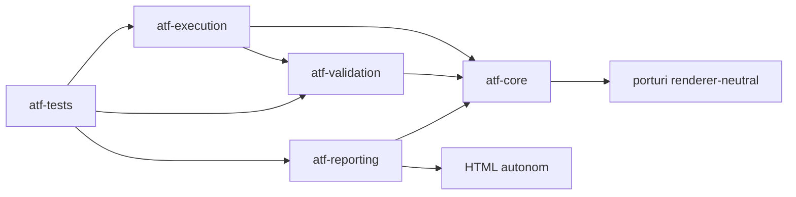
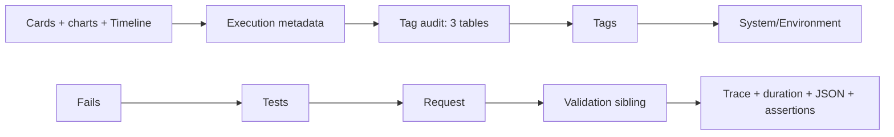
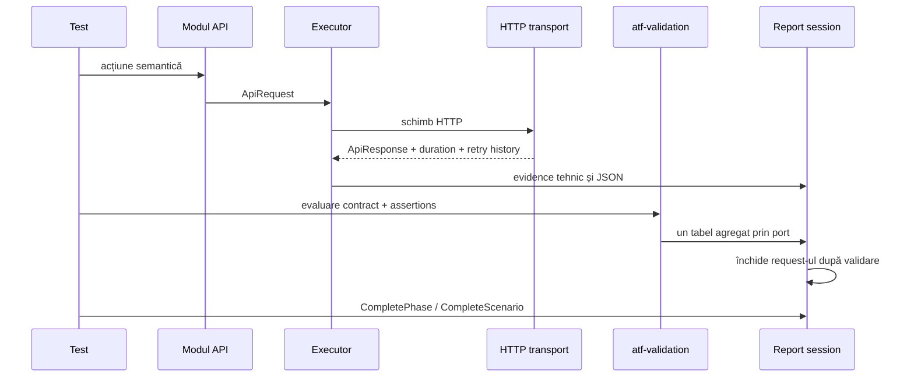
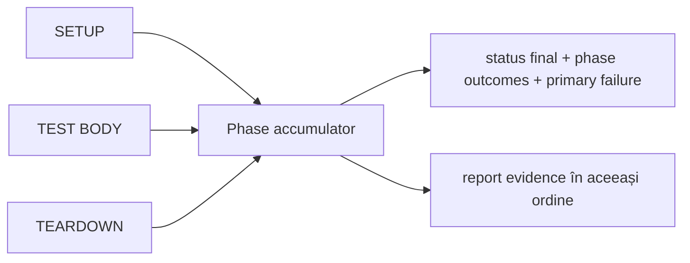

# ATF Java — framework pentru automatizare API

ATF Java este un framework standalone pentru automatizarea și validarea
scenariilor API. Oferă aceeași familie de capabilități observabile ca implementarea
externă de referință, dar are propriile module, modele, politici și teste.
Proiectul se numește `atf` și nu modifică proiectele Java existente din `demo`
sau `other`.

## Scopul framework-ului

ATF Java urmărește comportamente verificabile, nu copierea unei implementări.
Contractele publice sunt:

- kernel fără dependență de xUnit sau de un renderer concret;
- request, transport, autentificare, retry, redaction și configurație separate;
- modul API cu rute, modele și servicii semantice;
- validare de contracte separată, renderer-neutrală, publicată printr-un port
  îngust către raportare;
- scenariu compus din `SETUP`, `TEST BODY` și `TEARDOWN`;
- execuția unei faze este izolată într-un executor intern, iar runner-ul păstrează
  doar ordinea, precedence-ul și acumularea rezultatului;
- proprietarii testelor sunt rădăcini de navigare, iar scenariile sunt copii sub
  proprietarul lor;
- request-ul coordonează ordinea de închidere, iar validation-ul este fratele lui
  direct în aceeași fază, pentru ca arborele randat să rămână lizibil;
- o validare publică un singur tabel agregat de assertions;
- `FAIL > SKIP > WARNING > PASS` la calculul verdictului;
- raport HTML autonom, cu JSON în bloc de cod scrollabil și noduri închise implicit;
- tab-urile de raportare păstrează contractul aprobat, cu Overview la final;
- testele verifică atât semantica, cât și structura observabilă a raportului.

## Module



| Modul | Responsabilitate | Nu deține |
|---|---|---|
| `atf-core` | contracte HTTP, statusuri, configurație, retry, redaction și porturi | HTML, JUnit, servicii de business |
| `atf-validation` | contracte response, reguli, evaluator, verdict și publicare prin port neutru | HTTP, Extent, HTML, CSS, transport |
| `atf-execution` | rute, modele, servicii, lifecycle și cleanup | validare de contract, CSS, JavaScript |
| `atf-reporting` | boundary-ul Extent, finalizarea HTML autonomă și renderer-ul fallback | transport și decizii de validare |
| `atf-tests` | teste unitare, contract și scenarii de verificare | implementarea framework-ului |

## Documentația de lucru

Documentele stabile sunt centralizate în [docs/README.md](docs/README.md):

- [ATF_Architecture.md](docs/ATF_Architecture.md) — module, ownership și
  dependențe;
- [atf-validation/README.md](atf-validation/README.md) — contracte de validare,
  portul către raportare și granițele reutilizabile ale JAR-ului;
- [ATF_API_TEST_GUIDE.md](docs/ATF_API_TEST_GUIDE.md) — pașii pentru un test API
  nou;
- [ATF_Reporting_Contract.md](docs/ATF_Reporting_Contract.md) — contractul
  observabil al raportului;
- [atf-reporting/README.md](atf-reporting/README.md) — contractul vizual complet
  al artifactului Extent: paletă, suprafețe, faze, evidence, tab-uri și
  criterii de acceptare;
- [ATF_BUILD_AND_EXECUTION_SAFETY.md](docs/ATF_BUILD_AND_EXECUTION_SAFETY.md) —
  build și sincronizare în staging fără oprirea execuțiilor existente;
- [README_Atf_BestPractices.md](docs/README_Atf_BestPractices.md) — reguli OOP,
  testabilitate și review.

Lucrările rămase și deciziile de îmbunătățire rămân în docs/feedback/; README-ul
principal păstrează contractul stabil al framework-ului.

Orice refactorizare urmează protocolul live → staging → teste → artifact →
TAB MCP → sincronizare selectivă. Rulările existente nu se opresc, iar un
artifact verificat nu înlocuiește recitirea codului live înainte de următorul
increment. Detaliile sunt în
[ATF_BUILD_AND_EXECUTION_SAFETY.md](docs/ATF_BUILD_AND_EXECUTION_SAFETY.md).

## Contractul vizual comun

`atf-reporting` are o singură compoziție de prezentare, construită din token-uri
vizuale și reguli comune de randare. Extent și fallback folosesc aceeași
compoziție; nu își definesc separat fundalul, fonturile, liniile sau
dimensiunile tabelelor. Contractul comun este:

```text
body       Segoe UI / Inter / Helvetica Neue / Arial · 14px · line-height 1.55
tables     12.6px · 16.884px · padding 7px 9px · header 11.2px / body 12.6px
JSON       ui-monospace / Consolas · 12.5px · 18.75px · padding 10px 12px
surface    #101723 · border #29364d · code #070a0e
tabs       Tests → Category → Fails → Overview · Overview implicit
```

Overview-ul include și un bloc `System/Environment` cu metadate de execuție
locale în ordine stabilă: mediu, base URL configurat prin `ApiExecutor`,
runtime, sistem de operare, client HTTP, autentificare, modulul de teste și
rendererul offline. Aceste metadate descriu execuția și nu înlocuiesc evidence-ul
tehnic al request-ului.

Fonturile de iconițe sunt incluse în HTML-ul final; raportul nu depinde de
folderul `spark`, de fișiere externe sau de rețea. Testele de reporting verifică
token-urile, structura request/validation, tab-urile și faptul că artifactul nu
lasă resurse externe neîncărcate.

### Contractul navigabil al artifactului

Overview-ul nu este o a doua sursă de adevăr. Ordinea vizibilă este intenționată:



Metadata și auditul sunt secundare și colapsate implicit. Auditul folosește
aceeași populație neutră de teste și afișează trei tabele paralele, nu tabele
imbricate. `Tags` folosește eticheta `WARNING` pentru categoria agregată
`Others`, pentru ca verdictul vizual să rămână consecvent cu nodurile de raport.
În Test Body, request-ul și `Contract validation` sunt frați; evidence-ul
tehnic rămâne în request, iar assertions sunt publicate într-un singur tabel
agregat sub validation.

Duratele din Tests și din detaliile nodurilor se afișează cu unitatea (`N ms`).
Frunzele folosesc durata măsurată; un părinte folosește durata proprie exclusivă,
dacă există, plus suma totalurilor copiilor structurali direcți. O durată Extent
deja inclusivă nu se adună din nou cu descendenții. Badge-urile `Pass`, `Warning`
și `Fail` păstrează aceeași geometrie și aceeași paletă în toate tab-urile;
detaliile permanente sunt în [`docs/ATF_Reporting_Contract.md`](docs/ATF_Reporting_Contract.md).

Pentru verificarea automată există `ReportArtifactInspector`; I/O-ul și politica
de freshness rămân în inspector, iar catalogul pur al regulilor HTML este
izolat în `ReportArtifactContractChecks`. Astfel verificările pot fi testate
unitar fără filesystem și pot rămâne stabile când se schimbă doar mecanismul
de publicare. Pentru verificarea comportamentului vizibil se folosesc TAB MCP:
se deschide Overview,
se expandă auditul, se navighează la Fails și se deschide testul sursă. Un test
care verifică doar substring-uri nu este suficient pentru un contract de UI.

## Fluxul unei execuții



### Contractul lifecycle-ului

`ApiScenarioLifecycleRunner` păstrează precedence-ul și ownership-ul fazelor într-un
accumulator intern comun pentru ambele intrări publice ale runner-ului:



Regulile sunt deliberate și testate: `TEARDOWN` se încearcă întotdeauna când este
definit, `TEST BODY` devine `SKIP` dacă setup-ul a eșuat sau a fost omis, iar primul
failure real rămâne `primaryFailure`; warning-urile și skip-urile rămân evidence,
nu sunt promovate artificial în failure. Orice schimbare aici trebuie să păstreze
și testele din `atf-execution`, și contractul HTML verificat de `ReportArtifactInspector`.

În reporting, `ExtentReportFinalizer` este fațada publică, iar
`ExtentReportPublicationPipeline` compune publicația. `ExtentReportAssets`
deține exclusiv inline-ul și cleanup-ul directorului Spark. Acest boundary este
verificat separat prin teste unitare, astfel încât o schimbare de asset lifecycle
să nu modifice accidental CSS-ul, JavaScript-ul sau arborele Extent randat.

## Starea proiectului și criteriul de evoluție

ATF Java este tratat ca un produs propriu. Un comportament este considerat
stabil numai când există implementare, test determinist și artifact verificabil;
compilarea singură nu este criteriu de acceptare.

Fluxul de evoluție este: `atf-core` → `atf-validation` → `atf-execution` → `atf-reporting` →
scenarii și integrare → validare structurală și interactivă a artifactului.

Observațiile de compatibilitate cu reperul extern și lucrările rămase sunt
păstrate în [`docs/feedback/README.md`](docs/feedback/README.md), câte un
document ToDo pentru fiecare responsabilitate. Documentația permanentă descrie
ATF Java prin propriile contracte, modele și teste.

## Adăugarea și verificarea unui test API

Fluxul minim este intenționat scurt:

1. definește ruta în `atf-execution`;
2. expune operația printr-un serviciu semantic;
3. execută operația prin `ApiExecutor`, nu prin HTTP construit în test;
4. evaluează response-ul prin `atf-validation`;
5. deschide fazele `SETUP`, `TEST BODY` și `TEARDOWN` în aceeași sesiune;
6. în `TEST BODY`, deschide request-ul, pornește validarea prin contractul
   request-ului și închide request-ul numai după publicarea validării;
7. adună toate assertions pentru response într-un singur tabel, publicat sub
   nodul validation frate al request-ului;
8. închide fazele și scenariul cu statusul calculat;
9. scrie raportul și verifică: request, durată, JSON, tabel, Category/tag metadata,
   Fails și Overview.

Testul de referință este
`atf-tests/src/test/java/atf/api/tests/ApiReportSmokeTest.java`. El folosește
un transport fake determinist, deci verifică traseul API, lifecycle-ul și
raportarea fără dependență de rețea sau de date externe. Raportul rezultat este
publicat numai cu nume timestamped, de forma
`target/api-atf-extent-report_yyyy-MM-dd_HH-mm-ss-SSS.html`; nu se mai publică
un alias canonic fără timestamp.
Raportul este generat de Extent și apoi
finalizat într-un singur HTML autonom: asset-urile Spark sunt incluse, nodurile
sunt închise implicit, Overview este deschis inițial, iar Fails oferă legături
înapoi către testul original. Transportul HTTP real are boundary și teste
separate; nu trebuie să facă raportarea dependentă de loopback. Testele offline
folosesc contractele reale ale framework-ului și nu introduc un runner sintetic
separat pentru raportul Extent. Pentru un artifact bazat pe trafic
real, rulează explicit `ApiLiveReportTest` cu
`-Datf.liveApi.enabled=true`; acesta rămâne separat de suita implicită tocmai
pentru ca build-ul normal să nu depindă de rețea.

### Raport Extent din IntelliJ

Orice test care dorește să publice raportul poate deschide sesiunea configurată:

```java
try (var report = ExtentReportSession.openConfigured()) {
    var scenario = report.startScenario("UsersTests", "item contract", List.of("api"));
    // SETUP / TEST BODY / TEARDOWN și evidence-ul testului
    scenario.complete(AtfReportStatus.PASS);
}
```

Închiderea sesiunii face `flush`, finalizează HTML-ul Extent și elimină asset-urile
intermediare, astfel încât testul rulat direct din IntelliJ produce un singur
artifact HTML autonom, timestamped. Configurația implicită este în `atf.yaml`:

```yaml
reporting:
  extent:
    outputDirectory: artifacts/reports
    fileName: api-atf-extent-report.html
    timestampEnabled: true
    timestampPattern: yyyy-MM-dd_HH-mm-ss-SSS
    timestampZone: system
```

`outputDirectory` relativ este rezolvat față de `atf.yaml`, nu față de working
directory-ul IntelliJ. Pentru altă configurație se poate folosi
`-Datf.report.config=C:\path\to\atf.yaml` sau variabila `ATF_REPORT_CONFIG`.
`timestampEnabled` este activ implicit și diferențiază rulările prin inserarea
timestamp-ului înainte de extensie. `timestampPattern` folosește sintaxa `DateTimeFormatter`, iar
`timestampZone` acceptă `system` sau un identificator IANA, de exemplu
`UTC` ori `Europe/Bucharest`. Timestamp-ul este calculat o singură dată când
se deschide sesiunea, nu la fiecare `flush` sau la închiderea raportului.
Astfel, `report.reportPath()` rămâne aceeași cale pe tot parcursul rulării.
`timestampEnabled: false` rămâne disponibil numai pentru teste interne care
cer explicit o destinație stabilă; nu este format de publicare al raportului
ATF. Dacă nu există YAML, fallback-ul este tot timestamped în `target`, în
working directory-ul procesului.

Testele de configurație validează separat numele timestamped, zona, pattern-ul
și fallback-ul stabil. Orice output auxiliar al unei sesiuni este temporar și
nu devine raport public separat.

### Staging paralel și workspace-uri abandonate

Fiecare sesiune Extent scrie întâi într-un director privat, marcat și protejat
de un lease exclusiv; `flush()` nu publică un HTML parțial. Publicarea finală
este atomică și serializată pe calea raportului. După o întrerupere forțată,
curățarea se face explicit și bounded, numai pentru directoare ATF marcate și
mai vechi decât pragul ales:

```java
var sweep = ReportStagingWorkspace.sweep(
        report.getParent(),
        Duration.ofHours(1));
```

Rezultatul separă workspace-urile scanate, șterse, păstrate și eșuate; cele
active, fresh, malformate sau nemarcate nu sunt atinse. Acest contract este
testat în `ReportStagingWorkspaceTest` și este compatibil cu rulări paralele.
Metadata, Category, Fails și tag audit numără scenariile reale, nu containerele
de clasă. `RetryPolicy` respectă `Retry-After` și păstrează fiecare
`RetryEvent`; parsing-ul este izolat în `RetryAfterParser`, iar overload-urile
cu `Clock` permit teste deterministe pentru secunde, ISO și HTTP-date.
`ApiExecutor` observă cancellation în timpul transportului și
anulează future-ul pending la timeout/cancellation. Evidence-ul Extent trece
prin redactorul implicit înainte de publicare: detail, JSON, query/path,
exception și valorile expected/actual ale assertion-urilor nu expun secrete;
redacția PII rămâne explicit opt-in prin configurație.

Politica de timp a executorului este separată de transport: `ApiExecutionClock`
furnizează timpul monotonic și sleep-ul, `ApiExecutionDeadline` păstrează
bugetul comun al execuției și retry-urilor, iar `ApiRetryWaiter` aplică delay-ul
în slices bounded, respectând cancellation și deadline-ul. Implementarea
implicită folosește clock-ul sistemului; testele pot injecta un clock
determinist fără a aștepta timp real. Astfel, timeout-ul de transport, timeout-ul
în delay și istoricul încercărilor rămân reguli verificabile independent de
`ApiExecutor`.

Template-urile rutelor sunt centralizate în `atf-execution/routing/RoutePaths`,
iar `ApiRoutes` compune metadata auth/tag/operation fără path-uri duplicate.
`ApiModuleFactory` este composition root-ul recomandat pentru scenarii: creează
un snapshot immutable al setărilor, un executor cu timeout/retry și serviciile
users/posts în același context scoped. Astfel testele nu reconstruiesc manual
graful de servicii și păstrează timeout-ul definit în YAML/configurație.

## Comenzi

```powershell
mvn -f C:\work\ex\java\atf\pom.xml test
mvn -f C:\work\ex\java\atf\pom.xml verify
```

Build-ul ATF Java se execută într-un workspace separat când există rulări active
în alt checkout. Nu se copiază `bin`, `obj`, `artifacts` sau rapoarte istorice
în proiectul Java.

Pentru validări paralele, output-ul testelor se poate izola fără schimbarea
codului live:

```powershell
mvn '-Datf.test.reportDirectory=C:\work\ex\.tmp\atf-validation\artifacts\reports' `
    '-Datf.report.config=C:\work\ex\.tmp\atf-validation\atf.yaml' test
```

Ambele proprietăți sunt opționale și afectează doar testele de verificare;
raportul configurat din IntelliJ continuă să fie rezolvat relativ la YAML.
