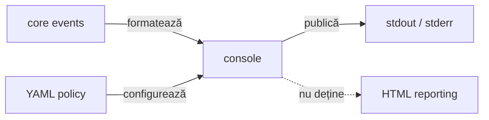

# ATF Console — proiecție diagnostică

`atf-console` este implementarea separată și configurabilă YAML a proiecției de
consolă pentru evenimentele neutre ATF. Nu produce HTML, nu cunoaște
ExtentReports și nu calculează verdicturi.

## Pe scurt

Politica declarativă a mesajelor de consolă este o evoluție propusă, urmărită
prin ANN-CONSOLE-11/12/13 în [feedback-ul infrastructurii](../docs/feedback/ATF_Test_Infrastructure_Annotations_Feedback.md).
API-ul implementat folosește în continuare `ConsoleSettings`, configurația
YAML și extensia `AtfConsoleTestExtension`.

| Intrare | Output | Limită |
|---|---|---|
| `AtfConsoleEvent` + `ConsoleSettings` | diagnostic stdout/stderr | nu produce artifact |
| lifecycle execution | evenimente formatate | nu decide verdictul |
| YAML `reporting.console` | detalii configurabile | nu schimbă execuția |

## Diagramă de bază



<details>
<summary><strong>Legendă — proiecția de consolă</strong></summary>

- atf-core definește evenimentul neutru și portul; atf-console îl formatează;
- configurația reporting.console controlează numai această proiecție;
- ieșirea este diagnostică (stdout/stderr), nu artifact HTML și nu verdict;
- muchia punctată este o limită: consola nu deține rendererul atf-reporting.
</details>

## Limite de responsabilitate

```text
atf-core       definește AtfConsoleEvent și AtfConsoleSink
atf-core        publică evenimente prin sink-ul opțional
atf-console    formatează evenimentele și citește reporting.console din YAML
atf-console    include lifecycle-ul și extension-ul JUnit opțional
atf-reporting  produce numai artifacte HTML/Extent
```

### Contracte de consum

- `AtfConsoleReporter` consumă doar `AtfConsoleEvent` din `atf-core` și
  `ConsoleSettings` din propriul modul;
- consola și detaliile sunt active implicit, inclusiv când YAML-ul lipsește;
- `reporting.console.detailsEnabled: false` ascunde detaliile și body-urile;
  `reporting.console.enabled: false` oprește întreaga proiecție;
- consola nu modifică statusul și nu cauzează un test.

### Responsabilitatea asupra fluxurilor de ieșire

- `atf-console` deține singur referințele la `System.out`/`System.err` și
  singurul `println` din proiecția de consolă;
- launcher-ele și test-kit-ul nu primesc `PrintStream` și nu scriu direct;
- consumatorii folosesc `AtfConsoleReporter.configuredStdout()` sau un
  `AtfConsoleSink` injectat;
- `AtfDebugUiLauncher` folosește `info(...)` pentru bootstrap;
- raportarea HTML rămâne renderer-neutrală.

### Responsabilități OOP

- `AtfConsoleReporter` — adaptor thread-safe către `PrintStream`;
- `AtfConsoleFormatter` — renderer pur al unui eveniment;
- `ConsoleOutputStyle` — glyph-uri în funcție de stream;
- `ConsoleLifecycleState` — nesting și numai nesting;
- niciuna dintre componente nu calculează verdicturi și nu cunoaște HTML/Extent.

Formatterul păstrează secvența:

```text
scenario → phase → request → validation → complete(status, duration-ms)
```

Pentru stream-uri UTF-8 sunt folosite glyph-urile `▶`, `•` și statusurile
vizuale. Pentru `System.out` pe Windows/IDE se folosește fallback ASCII (`>`,
`-`, `PASS`, `FAIL`, `WARNING`) când encoding-ul real nu poate reda glyph-urile.
Body-urile trebuie să fie deja redacted înainte de publicare.

## Configurație YAML

Loaderul `AtfConsoleConfigurationLoader` citește numai secțiunea consolei din
`atf.yaml`; nu parsează `reporting.extent` și nu are dependență către
`atf-reporting`:

```yaml
reporting:
  console:
    enabled: true
    detailsEnabled: true
```

Ordinea de rezolvare este explicită: context injectat, proprietatea
`atf.report.config`, variabila `ATF_REPORT_CONFIG`, apoi căutare ascendentă după
`atf.yaml`/`atf.yml`. Configurația este citită o singură dată la bootstrap și
devine `AtfConsoleConfiguration` immutable.

Lansarea din Maven și IntelliJ folosește aceeași politică. Nu sunt necesare
VM options pentru detalii; fișierele temporare ori testele de renderer care
cer liniște pot injecta explicit un sink `noOp`. Body-urile publicate trebuie
să fie deja redactate înainte să ajungă la formatter.

- `ConsoleDefaultsGovernanceTest` din `atf-tests` protejează fallback-ul,
configurația rezolvată din directoarele modulelor și composition root-urile
UI/API. Testele modulului verifică efectiv output-ul și override-ul `false`.

## Integrare

Un composition root injectează explicit sink-ul:

```java
var settings = AtfConsoleConfigurationLoader.load().settings();
var console = AtfConsoleReporter.configuredStdout();
var module = ApiModuleFactory.create(config, console);
```

Suportul JUnit este opțional și se află în subpachetul
`atf.api.console.junit` din același artefact; folosește loaderul consolei și nu
importă `atf-reporting`. `HtmlReportSession` și
`ExtentReportSession` acceptă în continuare un `AtfConsoleSink` explicit, dar
constructorii lor impliciți folosesc `noOp`.

## Testare

Testarea este împărțită după responsabilitate:

- `AtfConsoleReporterTest` — nesting, statusuri, durată (`ms` până la `300 ms`,
  apoi `s`), redaction boundary, pretty-print, detalii și fallback ASCII/UTF-8;
- `ConsoleLifecycleStateTest` — tranziții de nesting și completarea defensivă
  la adâncime zero;
- `AtfConsoleConfigurationLoaderTest` — discovery, precedence, path resolution
  și validarea boolean-urilor;
- testele de lifecycle JUnit — integrarea extension-ului opțional;
- testele de execuție — publicarea separată a evenimentelor.
