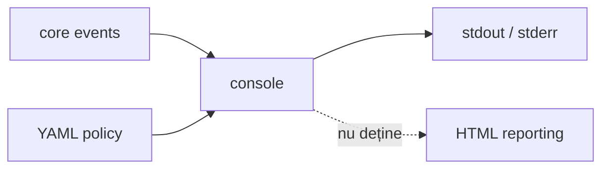

# ATF Console — proiecție diagnostică

`atf-console` este implementarea separată și configurabilă YAML a proiecției de
consolă pentru evenimentele neutre ATF. Nu produce HTML, nu cunoaște
ExtentReports și nu calculează verdicturi.

## Overall

| Intrare | Output | Limită |
|---|---|---|
| `AtfConsoleEvent` + `ConsoleSettings` | diagnostic stdout/stderr | nu produce artifact |
| lifecycle execution | evenimente formatate | nu decide verdictul |
| YAML `reporting.console` | detalii configurabile | nu schimbă execuția |

## Diagramă de bază



<details>
<summary><strong>Legendă — proiecția de consolă</strong></summary>

- atf-core definește evenimentul neutru și portul; atf-console îl formatează;
- configurația reporting.console controlează numai această proiecție;
- ieșirea este diagnostică (stdout/stderr), nu artifact HTML și nu verdict;
- muchia punctată este o limită: consola nu deține rendererul atf-reporting.
</details>

## Boundary

```text
atf-core       definește AtfConsoleEvent și AtfConsoleSink
atf-core        publică evenimente prin sink-ul opțional
atf-console    formatează evenimentele și citește reporting.console din YAML
atf-console    include lifecycle-ul și extension-ul JUnit opțional
atf-reporting  produce numai artifacte HTML/Extent
```

`AtfConsoleReporter` consumă doar `AtfConsoleEvent` din `atf-core` și
`ConsoleSettings` din propriul modul. Detaliile sunt opt-in prin
`reporting.console.detailsEnabled`, iar
consola nu poate modifica statusul sau cauza unui test.

`atf-console` este singurul owner al stream-urilor procesului: numai aici
există referințe la `System.out`/`System.err` și numai aici se face `println`.
Launcher-ele și test-kit-ul nu primesc `PrintStream` și nu scriu direct; folosesc
`AtfConsoleReporter.configuredStdout()` sau un `AtfConsoleSink` injectat.
`AtfDebugUiLauncher` folosește `info(...)` pentru mesajele de bootstrap, iar
raportarea HTML rămâne renderer-neutrală.

Implementarea este OOP și are responsabilități separate: `AtfConsoleReporter`
este adaptorul thread-safe către `PrintStream`, `AtfConsoleFormatter` este
renderer-ul pur al unui eveniment, `ConsoleOutputStyle` decide glyph-urile în
funcție de stream, iar `ConsoleLifecycleState` gestionează exclusiv nesting-ul.
Niciuna dintre aceste componente nu calculează verdicturi sau nu cunoaște
HTML/Extent.

Formatterul păstrează secvența:

```text
scenario → phase → request → validation → complete(status, duration-ms)
```

Pentru stream-uri UTF-8 sunt folosite glyph-urile `▶`, `•` și statusurile
vizuale. Pentru `System.out` pe Windows/IDE se folosește fallback ASCII (`>`,
`-`, `PASS`, `FAIL`, `WARNING`) când encoding-ul real nu poate reda glyph-urile.
Body-urile trebuie să fie deja redacted înainte de publicare.

## Configurație YAML

Loaderul `AtfConsoleConfigurationLoader` citește numai secțiunea consolei din
`atf.yaml`; nu parsează `reporting.extent` și nu are dependență către
`atf-reporting`:

```yaml
reporting:
  console:
    enabled: true
    detailsEnabled: true
```

Ordinea de rezolvare este explicită: context injectat, proprietatea
`atf.report.config`, variabila `ATF_REPORT_CONFIG`, apoi căutare ascendentă după
`atf.yaml`/`atf.yml`. Configurația este citită o singură dată la bootstrap și
devine `AtfConsoleConfiguration` immutable.

## Integrare

Un composition root injectează explicit sink-ul:

```java
var settings = AtfConsoleConfigurationLoader.load().settings();
var console = AtfConsoleReporter.configuredStdout();
var module = ApiModuleFactory.create(config, console);
```

Suportul JUnit este opțional și se află în subpachetul
`atf.api.console.junit` din același artefact; folosește loaderul consolei și nu
importă `atf-reporting`. `HtmlReportSession` și
`ExtentReportSession` acceptă în continuare un `AtfConsoleSink` explicit, dar
constructorii lor impliciți folosesc `noOp`.

## Testare

`AtfConsoleReporterTest` protejează nesting-ul, statusurile și politica de
durată (`ms` până la `300 ms`, apoi `s`),
redaction boundary, body-ul pretty-print, opțiunea de detalii și fallback-ul
ASCII/UTF-8. `ConsoleLifecycleStateTest` protejează tranzițiile de nesting,
inclusiv completarea defensivă la adâncime zero. `AtfConsoleConfigurationLoaderTest`
protejează discovery, precedence, path resolution și validarea boolean-urilor.
Testele de lifecycle JUnit sunt în același modul; testele de execuție verifică
separat că evenimentele sunt publicate.
