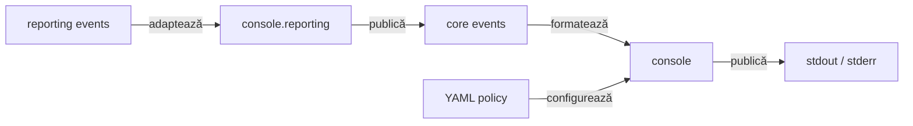

# ATF Console — proiecție diagnostică

`atf-console` este implementarea separată și configurabilă YAML a proiecției de
consolă pentru evenimentele neutre ATF. Nu produce HTML și nu calculează
verdicturi. Pachetul `atf.api.console.reporting` găzduiește adaptorul unic care
traduce evenimentele renderer-neutral din `atf-reporting` în portul Core;
adaptorul nu apelează rendererul și nu schimbă semantica raportului.

## Pe scurt

Politica declarativă per clasă este implementată prin
`@AtfConsoleMessages` din TestKit și aplicată de `AtfConsoleTestExtension` peste
`ConsoleSettings`/YAML. Testele dinamice folosesc helperul explicit descris mai jos;
concurența și lifecycle-ul sunt acoperite de o probă JUnit Platform. Contractul
API și precedența sunt în
[documentația adnotărilor](../docs/ATF_Test_Infrastructure_Annotations.md), iar
comportamentul specific consolei este descris în acest README.

| Intrare | Output | Limită |
|---|---|---|
| `AtfConsoleEvent` + `ConsoleSettings` | diagnostic stdout/stderr | nu produce artifact |
| `AtfReportingConsoleSinkAdapter` | evenimente Reporting → sink Core | compoziție; nu redă HTML |
| lifecycle execution | evenimente formatate | nu decide verdictul |
| YAML `reporting.console` | detalii configurabile | nu schimbă execuția |
| `@AtfConsoleMessages` | policy per clasă, inclusiv meta/inheritance | nu reactivează consola dezactivată global |

Publicarea căii raportului este opt-in și independentă de detaliile testului:

- `REPORT_PUBLISHED` poartă calea absolută a artifactului Extent confirmat;
- `AtfConsoleReporter` o afișează numai dacă primește explicit opțiunea de path;
  constructorii standard și `configuredStdout()` o lasă oprită;
- `reporting.console.enabled: false` oprește și această linie;
- `@AtfConsoleMessages` controlează detaliile de test, nu publicarea căii;
- adnotarea și agregarea pentru raportul partajat sunt implementate; contractul
  și adopția sunt descrise în
  [feedback-ul Reporting](../docs/feedback/ATF_Reporting_Feedback.md#report-path-01--închis-cale-absolută-după-publicarea-raportului).

## Diagramă de bază



<details>
<summary><strong>Legendă — proiecția de consolă</strong></summary>

- atf-core definește evenimentul neutru și portul; atf-console îl formatează;
- adaptorul din `atf.api.console.reporting` este singura conversie dintre
  evenimentele Reporting și portul Core; numai `atf-console` depinde de
  `atf-reporting`, niciodată invers;
- extensia JUnit din atf-console consumă opțional declarația neutră din
  TestKit; dependența nu este propagată pe classpath-ul aplicațiilor;
- configurația reporting.console controlează numai această proiecție;
- ieșirea este diagnostică (stdout/stderr), nu artifact HTML și nu verdict;
- adaptorul traduce contracte, dar nu depinde de ExtentReports și nu deține
  lifecycle-ul ori randarea HTML.
</details>

## Limite de responsabilitate

```text
atf-core       definește AtfConsoleEvent și AtfConsoleSink
atf-core        publică evenimente prin sink-ul opțional
atf-console    formatează evenimentele și citește reporting.console din YAML
atf-console    include lifecycle-ul și extension-ul JUnit opțional
atf-console    adaptează evenimentele atf-reporting către sink-ul Core
atf-reporting  produce numai artifacte HTML/Extent
```

### Contracte de consum

- `AtfConsoleReporter` consumă doar `AtfConsoleEvent` din `atf-core` și
  `ConsoleSettings` din propriul modul;
- `AtfReportingConsoleSinkAdapter` este composition boundary-ul unic pentru
  consumatorii care conectează Reporting la un sink Core; modulele consumer nu
  reimplementează mapping-ul și acesta nu se mută în Core/Test Kit;
- consola și detaliile sunt active implicit, inclusiv când YAML-ul lipsește;
- `reporting.console.detailsEnabled: false` ascunde detaliile și body-urile;
  `reporting.console.enabled: false` oprește întreaga proiecție;
- consola nu modifică statusul și nu cauzează un test.

### Responsabilitatea asupra fluxurilor de ieșire

- `atf-console` deține singur referințele la `System.out`/`System.err` și
  singurul `println` din proiecția de consolă;
- launcher-ele și test-kit-ul nu primesc `PrintStream` și nu scriu direct;
- consumatorii folosesc `AtfConsoleReporter.configuredStdout()` sau un
  `AtfConsoleSink` injectat;
- `AtfDebugUiLauncher` folosește `info(...)` pentru bootstrap;
- raportarea HTML rămâne renderer-neutrală.

### Responsabilități OOP

- `AtfConsoleReporter` — adaptor thread-safe către `PrintStream`;
- `AtfConsoleFormatter` — renderer pur al unui eveniment;
- `ConsoleOutputStyle` — glyph-uri în funcție de stream;
- `ConsoleLifecycleState` — nesting și numai nesting;
- niciuna dintre componente nu calculează verdicturi și nu cunoaște HTML/Extent.

Formatterul păstrează secvența:

```text
scenario → phase → request → validation → complete(status, duration-ms)
```

Pentru stream-uri UTF-8 sunt folosite glyph-urile `▶`, `•` și statusurile
vizuale. Pentru `System.out` pe Windows/IDE se folosește fallback ASCII (`>`,
`-`, `PASS`, `FAIL`, `WARNING`) când encoding-ul real nu poate reda glyph-urile.
Body-urile trebuie să fie deja redacted înainte de publicare.

## Configurație YAML

Loaderul `AtfConsoleConfigurationLoader` citește numai secțiunea consolei din
`atf.yaml`; nu parsează `reporting.extent` și nu are dependență către
`atf-reporting`:

```yaml
reporting:
  console:
    enabled: true
    detailsEnabled: true
```

Ordinea de rezolvare este explicită: context injectat, proprietatea
`atf.report.config`, variabila `ATF_REPORT_CONFIG`, apoi căutare ascendentă după
`atf.yaml`/`atf.yml`. Configurația este citită o singură dată la bootstrap și
devine `AtfConsoleConfiguration` immutable.

Lansarea din Maven și IntelliJ folosește aceeași politică. Nu sunt necesare
VM options pentru detalii; fișierele temporare ori testele de renderer care
cer liniște pot injecta explicit un sink `noOp`. Body-urile publicate trebuie
să fie deja redactate înainte să ajungă la formatter.

- `ConsoleDefaultsGovernanceTest` din `atf-tests` protejează fallback-ul,
configurația rezolvată din directoarele modulelor și composition root-urile
UI/API. Testele modulului verifică efectiv output-ul și override-ul `false`.

## Integrare

Un composition root injectează explicit sink-ul:

```java
var settings = AtfConsoleConfigurationLoader.load().settings();
var console = AtfConsoleReporter.configuredStdout();
var module = ApiModuleFactory.create(config, console);
```

Suportul JUnit este opțional și se află în subpachetul
`atf.api.console.junit` din același artefact; folosește loaderul consolei și nu
importă `atf-reporting`. `HtmlReportSession` și
`ExtentReportSession` acceptă în continuare un `AtfConsoleSink` explicit, dar
constructorii lor impliciți folosesc `noOp`.

### Calea raportului publicat

`@AtfReportPath` din `atf-test-kit` controlează separat mesajul final cu calea
raportului. Extension-ul JUnit rezolvă declarațiile directe, meta-adnotările și
moștenirea.

- Fără opt-in, calea nu este afișată.
- Mesajul apare numai după închiderea sesiunii Reporting și verificarea fișierului final.
- `reporting.console.enabled` rămâne autoritar; `@AtfConsoleMessages` nu activează opt-in-ul pentru cale.

Pentru o sesiune partajată între clase, fiecare owner trebuie înregistrat într-un
`AtfReportPathOptIn`; agregatorul emite o singură notificare dacă oricare owner
a activat opțiunea, independent de ordinea execuției. `ShopE2eTestSupport` folosește
acest pattern pentru raportul comun al suitei.

## Testare

Testarea este împărțită după responsabilitate:

- `AtfConsoleReporterTest` — nesting, statusuri, durată (`ms` până la `300 ms`,
  apoi `s`), redaction boundary, pretty-print, detalii și fallback ASCII/UTF-8;
- `ConsoleLifecycleStateTest` — tranziții de nesting și completarea defensivă
  la adâncime zero;
- `AtfConsoleMessagePolicyResolverTest` și `AtfConsoleMessagePolicyTest` —
  rezolvare, precedență și maparea policy-ului la `ConsoleSettings`;
- `AtfConsoleConfigurationLoaderTest` — discovery, precedence, path resolution
  și validarea boolean-urilor;
- testele de lifecycle JUnit — integrarea extension-ului opțional;
- `AtfReportPathPolicyResolverTest`, `AtfReportPathOptInTest` — adnotări,
  conflicte și agregare indiferent de ordinea ownerilor;
- testele de execuție — publicarea separată a evenimentelor.

- Jupiter nu rulează `BeforeEachCallback`/`TestWatcher` pentru fiecare copil din `@TestFactory`.
- Pentru verdict și lifecycle per copil, folosește `AtfConsoleTestContext.dynamicTest(owner, displayName, body)`.
- Factory-ul nu primește un start/end fals; helperul finalizează fiecare copil cu PASS, SKIP sau FAIL.
- Copiii construiți direct cu `DynamicTest.dynamicTest` nu au proiecție console per-copil.
