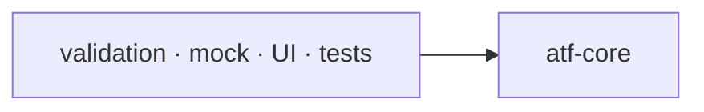

# ATF Core — kernel neutru și porturi

`atf-core` este stratul de bază al ATF Java. Conține modele, contracte și
abstracții reutilizabile, fără să decidă cum este orchestrat un scenariu sau
cum este randat un raport.

## Pe scurt

| Deține | Consumatori | Limită |
|---|---|---|
| lifecycle, ports, HTTP vocabulary și module IDs | validation, mock, UI și guvernanță | nu publică HTML |
| snapshot-uri și politici neutre | composition roots | nu deține scenarii concrete |

## Diagramă de bază



<details>
<summary><strong>Legendă — poziția kernelului</strong></summary>

- săgeata înseamnă „modulul din stânga depinde de modulul din dreapta”;
- atf-core este ultimul boundary comun din această hartă;
- atf-core nu depinde de modulele care îl consumă;
- fixture-urile concrete, browserul, JUnit-ul și rendererul rămân în modulele consumatoare.
</details>

<details>
<summary><strong>Harta de lectură</strong></summary>

- [responsabilități](#responsabilități) și
  [lifecycle](#ciclu-de-viață-generic-și-reutilizabil) — boundary-ul kernelului;
- [vocabular HTTP](#coeziune-și-responsabilitate-pentru-vocabularul-http) și
  [decuplare](#regula-de-decuplare) — ownership și direcția dependențelor;
- [selecție API](#contractul-reutilizabil-pentru-selecția-api),
  [catalog live](#catalogul-live-explicit) și
  [promovare guarded](#manifest-și-promovare-guarded);
- [determinism](#determinism-și-concurență) și
  [teste](#teste) — protecțiile executabile.

</details>

## Responsabilități

| Zonă | Owner în `atf-core` | Nu face |
|---|---|---|
| HTTP | `ApiRequest`, `ApiResponse`, `ApiTransport`, `ApiExecutor` | nu definește scenarii sau assertions |
| routing neutru | `ApiPathTemplate`, `ApiRoute`, `ApiUrlBuilder` | nu deține serviciile Users/Posts sau rutele concrete |
| timp și retry | `ApiExecutionClock`, `ApiExecutionDeadline`, `ApiRetryWaiter`, `RetryPolicy` | nu decide verdictul testului |
| configurație typed | `AtfConfiguration`, `AtfRuntimeSnapshot`, `ApiSettings`, `ReportingSettings` și snapshot-uri | nu recitește configurația în fiecare request |
| source adapters | `config.source.ApiBootstrapConfigurationLoader`, `ApiEnvironment` | nu execută request-uri și nu deține catalogul Users/Posts |
| statusuri | `AtfReportStatus`, `ReportStatusAggregator` | nu randă badge-uri |
| file/source discovery | `AtfPathLocator` | nu expune căi absolute sau traversal duplicat către consumatori |
| reporting ports | `AtfReportPorts`, `ValidationSink`, `ReportStepScope`, `AtfConsoleEvent`, `AtfConsoleSink` | nu importă Extent, HTML, `System.out` sau implementarea `atf-console` |
| redaction | `Redactor`, `RedactionContext`, strategiile de redaction | nu modifică input-ul original |
| selecție API neutră | `ApiScenarioSelection` | declarațiile test-only `ApiScenarioSetup` și `ApiTestRef` aparțin TestKit; catalogul rămâne la consumator |
| live transport adapter | `ApiLiveTransportCatalog` și `ApiTransportPolicy` | nu activează rețeaua din URL, default sau un flag implicit |
| guarded sync | `AtfPromotionManifest`, `AtfPromotionGuard` | nu promovează fișiere în afara manifestului și nu șterge surse |
| reactor vocabulary | `config.module.AtfModuleIds` | nu orchestrează modulele și nu introduce dependențe în sus |

`AtfConsoleEvent.fromExternalEnums(...)` primește explicit câmpurile unui
eveniment și convertește enumurile compatibile după nume. Core păstrează
validarea statusului, duratei și căii publicate, fără reflection sau dependențe
către sursa externă; compoziția de test transmite câmpurile evenimentului Reporting.

`AtfPathLocator.locateSourceFile(...)` rezolvă un fișier relativ din source root-uri
candidate, fie când testul pornește din directorul modulului, fie din reactor.
Validarea respinge căi absolute și traversal; caller-ul declară explicit layout-ul
acceptat în loc să reproducă bucla de ancestor-walk în fiecare test.

## Ciclu de viață generic și reutilizabil

Pachetul `atf.api.core.lifecycle` deține mecanica neutră a scenariului:

- plan și orchestration: `ApiScenarioPlan`, `ApiScenarioLifecycleRunner`,
  `ApiScenarioPhaseExecutor`;
- rezultat: `ApiScenarioOutcome` și `ApiScenarioSkipException`;
- ordine: `SETUP → TEST BODY → TEARDOWN`, cu precedence pentru cauze și
  `PASS/WARNING/SKIP/FAIL`;
- boundary: fără servicii Users/Posts, rute concrete, YAML, Extent sau JUnit.

```text
test adapter / library consumer
             ↓
core lifecycle ports + immutable outcome
             ↓
execution service | reporting publisher | another consumer
```

Boundary-ul lifecycle-ului se citește astfel:

- `CleanupRegistry` rămâne în core ca mecanism generic;
- fixture-urile concrete (`ApiModule`, servicii, `RoutePaths`) și adapter-ele
  lor rămân în test scope-ul `atf-reporting-tests`;
- orice consumer API/UI poate reutiliza lifecycle-ul fără a importa fixture-uri
  în production;
- `atf-reporting` rămâne standalone și nu depinde de core;
- un lifecycle nou intră în core numai dacă este endpoint-neutral și are teste
  unitare fără browser sau transport real.

## Coeziune și responsabilitate pentru vocabularul HTTP

Pachetele production au cel mult opt clase și grupează o singură responsabilitate:

| Pachet | Deține |
|---|---|
| `http.request` | forma request-ului: `ApiRequest`, `ApiPathTemplate`, `ApiRoute`, `ApiUrlBuilder`, `HttpMethod`, `HttpHeader`, `MediaTypes` |
| `http.response` | rezultatul response-ului, politica JSON și diagnosticul neutru `ApiBodyEvidence` pentru corpuri indisponibile |
| `http.auth` | autentificarea, tipurile standard și numele normalizate de profil prin `AuthProfiles` |
| `http.protocol` | URI-uri absolute și profile reutilizabile de headere, fără host-uri de produs |
| `http.execution` | execuția și rezultatul ei |
| `http.transport` | boundary-ul transportului |
| `diagnostics` | mesaje de excepție compacte și bounded, independente de Playwright sau produs |

`ApiPathTemplate` face join, validare și rezolvare sigură a segmentelor; nu este
catalogul de rute al unui produs.

### Cataloge concrete și direcția dependency-ului

- `atf-reporting-tests` deține `RoutePaths`, `ApiRoutes` și serviciile Users/Posts
  în test scope;
- `atf-mock` deține `MockRoutePaths` pentru fixture-ul built-in;
- reporting production nu deține endpoint-uri și nu devine dependent de un catalog
  de business;
- `ApiPaths` a fost eliminat din core pentru a nu prezenta un catalog concret ca
  platformă generică;
- direcția corectă este `consumer → atf-core`, iar reporting rămâne standalone.

```text
ApiPathTemplate (core, generic)
        ├── RoutePaths / ApiRoutes (reporting-tests, concrete API fixtures)
        ├── MockRoutePaths (mock, built-in fixture)
        └── reporting tests consume semantic references; no raw URL literals
```

### Vocabular și guard-uri

- **HTTP vocabulary** — verbe, headere, media type-uri, scheme URI și profile
  auth sunt constante/enum-uri cu owner semantic; `ApiUris`,
  `HttpHeaderProfiles` și `AuthProfiles` elimină copiile din consumatori;
- **diagnostics** — `ThrowableDiagnostics` produce mesaje single-line bounded;
  consumatorul decide unde sunt publicate și nu mută politica de business în core;
- **fără bucket global** — nu se introduce un `AtfConstants` global;
- **write requests** — `HttpHeader.CONTENT_TYPE`,
  `MediaTypes.APPLICATION_JSON`, `HttpMethod.POST` și `HttpMethod.PUT` sunt
  folosite de request, mock și validare; contractul JSON este verificat la
  transport și în raport;
- **reactor** — `AtfModuleIds` deține string-urile Maven, `REACTOR_MODULES`
  reprezintă modulele root POM, iar `SOURCE_GOVERNED_MODULES` reprezintă modulele
  inspectate de guardul global;
- **test-kit** — rămâne în reactor și își guvernează separat test-layer-ul;
- **config keys** — enum-ul `AtfModule` rămâne separat pentru cheile logice;
- **package cohesion** — `AtfPackageCohesionGovernanceTest` verifică inventarul
  de producție și source-set-urile; peste 8 clase înseamnă separare după
  responsabilitate, iar excepțiile rămân explicite;
- **controlled discovery** — `AtfPathLocator` caută în directoarele părinte și
  rezolvă source root-ul numai când markerul relativ există;
- **single owner** — `locateAtfTestSourceRoot(...)` păstrează candidatele
  suportate într-un singur loc; testele și composition roots nu repetă traversal-ul;
- **relocatabilitate** — utilitarul nu expune root-ul în evidence și nu introduce
  căi locale în raport.

## Regula de decuplare

```text
ApiRequest / ApiResponse / ValidationResult / Report ports
                         ↓
              modulele de execuție și reporting
```

Core poate defini porturi și source adapters fail-closed, dar nu implementează
Extent, HTML, CSS, JavaScript, formatarea consolei, scrierea în `System.out`,
JUnit sau servicii de business.
Un port trebuie să fie mic, semantic și
testabil cu fake-uri în memorie.

Configurația de execuție este typed și immutable:

- `config.source` citește o singură dată YAML, properties sau environment;
- loaderul produce snapshot-ul validat și nu intră în transport;
- fiecare sesiune păstrează propriile timeout, retry, auth și redaction policy;
- rulările paralele nu își pot suprascrie configurația reciproc.

Exemple de direcții corecte:

```text
ApiExecutor → ApiExecutionResult
Validator    → ValidationResult
Reporting   → AtfReportPorts
```

Direcții interzise:

```text
core → ExtentTest
core → JUnit
core → HTML/CSS
core → UsersService / PostsService
```

## Contractul reutilizabil pentru selecția API

Modelul `ApiScenarioSelection` din `atf-core` este neutru față de consumer:

- declarațiile `@ApiScenarioSetup` și `@ApiTestRef` sunt în `atf.api.testkit.setup.api`, consumate în test scope;
- `ApiScenarioSelection` transmite snapshot-ul immutable către composition root;
- UI testele, acceptance runner-ele și alți consumatori pot reutiliza contractul;
- catalogul concret al testelor nu intră în `atf-core`.

```text
consumer annotation
  → ApiScenarioSetup / ApiTestRef (TestKit)
  → consumer catalog resolves owner + method
  → ApiScenarioSelection
  → API/reporting composition root
```

| Responsabilitate | Owner |
|---|---|
| mapping `UsersApiScenarios`, `PostsApiScenarios`, `LifecycleApiScenarios` | composition scope-ul `atf-reporting-tests` |
| loader generic pentru `atf.yaml` | `config.source` din core |
| catalog concret, YAML mock, JUnit și orchestration | modulele consumatoare |

Catalogul de servicii este compoziție de produs, nu platformă generică.
Contractul adnotărilor este în [documentația de infrastructură](../docs/ATF_Test_Infrastructure_Annotations.md);
Core main nu depinde de TestKit.

`RecordingApiTransport` este decoratorul generic pentru evidence:

- capturează ultimul `ApiRequest` și delegă execuția;
- nu cunoaște reporting, mock sau JUnit;
- poate fi reutilizat pentru API report, component tests și replay, fără a copia
  fixture-uri din test scope.

## Catalogul live explicit

`ApiLiveTransportCatalog` este adaptorul public pentru request-uri reale; regulile
sale sunt:

- ține endpoint-uri numite;
- produce un `ApiTransport` numai după `ApiTransportPolicy` cu profil `LIVE` și
  opt-in explicit;
- politica `ACCEPTANCE` nu consultă catalogul;
- placeholder-ul acceptance (`ApiEnvironment.MOCK_BASE_URI`) este respins chiar
  dacă operatorul a activat opt-in-ul.

```text
ApiBootstrapConfiguration
  → ApiTransportPolicy.LIVE + explicit opt-in
  → ApiLiveTransportCatalog.open(endpoint)
  → ApiBootstrap.live / ApiTransportBinding.live
  → ApiExecutor
```

Catalogul aplică limitele de siguranță înainte de a crea transportul:

- acceptă numai `http/https` și profile endpoint neambigue;
- limitează fiecare transport la originea endpoint-ului numit;
- delegă autentificarea la `ApiAuthenticator` și nu expune token-uri;
- nu construiește cURL sau HTML; redaction-ul replay-ului aparține reporting-ului;
- factory-ul injectabil permite verificarea contractului fără rețea reală.

Mock-ul rămâne default-ul sigur și este compus separat prin `atf-mock`. Faptul
că o configurație conține `baseUri` nu este niciodată suficient pentru a deschide
network-ul.

## Manifest și promovare guarded

`AtfPromotionManifest` fixează baseline-ul fișierelor aprobate înainte de staging:

- căile sunt relative; fișierele existente păstrează dimensiunea și SHA-256;
- o intrare absentă aprobă crearea acelui fișier și detectează crearea paralelă;
- rădăcina checkout-ului nu este persistată, iar manifestul nu ajunge în HTML.

Promovarea reutilizabilă:

```text
live root + approved relative files
  → AtfPromotionManifest.capture(...)
  → build/test în staging extern
  → AtfPromotionGuard.promote(staging, live, baseline)
  → verificare drift + copiere atomică numai a fișierelor aprobate
```

Guard-ul eșuează înainte de prima copiere dacă live-ul s-a schimbat paralel,
folosește un lock extern per rădăcină pentru promotori cooperanți, păstrează
sursele din staging și nu implementează ștergeri implicite. Un manifest poate fi
scris ca JSON portabil pentru auditul procesului, însă nu este evidence de
raport și nu se sincronizează ca output generat.

## Determinism și concurență

- **snapshot și timp** — fiecare execuție primește setări snapshot-uite;
- **clock injectabil** — timpul monotonic, deadline-ul request-ului și delay-ul
  de retry nu cer timp real în teste;
- **modele immutable** — obiectele ieșite din core nu expun colecții mutabile și
  nu păstrează state static de rulare;
- **write contracts** — `ApiRoute.request(...)` respinge `POST` și `PUT` fără
  body, iar `requestBody(...)` cere JSON valid, ne-gol și normalizează
  `Content-Type: application/json`;
- **verdict observabil** — invariantă aparține construcției transportului și este
  verificată din nou de publisher/auditor în evidence;
- **redaction** — `RedactionContext` immutable protejează evidence-ul trimis către
  reporting fără să modifice request-ul, response-ul sau assertion-ul original.

## Teste

Testele din `atf-core` verifică separat:

- request/response și autentificare;
- timeout, cancellation, retry și `Retry-After` cu clock injectabil;
- snapshot-uri și precedence-ul configurației;
- status aggregation și precedența `FAIL > SKIP > WARNING > PASS`;
- redaction pe JSON, headers, query, path și PII;
- contractele porturilor fără Extent concret.
- `ApiScenarioSelection` și contractele de annotation fără JUnit/browser;

Un test core nu generează raport HTML. Dovada vizuală și scenariile end-to-end
ale raportării aparțin composition scope-ului `atf-reporting-tests`; `atf-tests` este doar
shell de compatibilitate.
