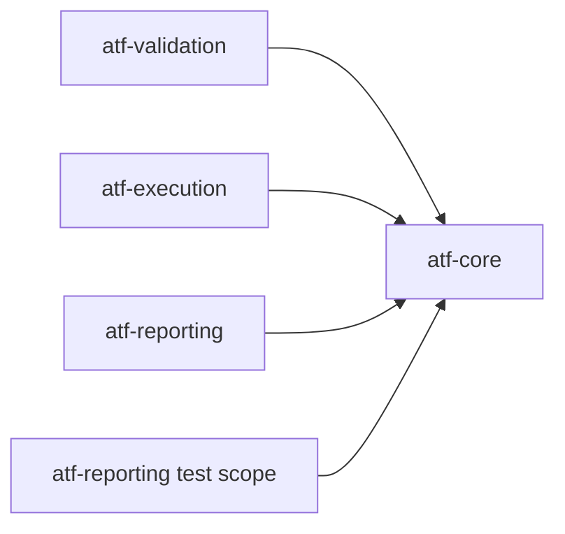

# ATF Core — kernel neutru și porturi

`atf-core` este stratul de bază al ATF Java. Conține modele, contracte și
abstracții reutilizabile, fără să decidă cum este orchestrat un scenariu sau
cum este randat un raport.

## Diagramă de bază



Săgeata înseamnă „modulul din stânga depinde de modulul din dreapta”.
`atf-core` nu depinde de modulele de deasupra lui. El furnizează vocabularul
comun prin care modulele comunică fără să se cunoască implementările concrete.

## Responsabilități

| Zonă | Owner în `atf-core` | Nu face |
|---|---|---|
| HTTP | `ApiRequest`, `ApiResponse`, `ApiTransport`, `ApiExecutor` | nu definește scenarii sau assertions |
| routing neutru | `ApiPathTemplate`, `ApiRoute`, `ApiUrlBuilder` | nu deține serviciile Users/Posts sau rutele concrete |
| timp și retry | `ApiExecutionClock`, `ApiExecutionDeadline`, `ApiRetryWaiter`, `RetryPolicy` | nu decide verdictul testului |
| configurație typed | `AtfConfiguration`, `AtfRuntimeSnapshot`, `ApiSettings`, `ReportingSettings` și snapshot-uri | nu recitește configurația în fiecare request |
| source adapters | `config.source.ApiBootstrapConfigurationLoader`, `ApiEnvironment` | nu execută request-uri și nu deține catalogul Users/Posts |
| statusuri | `AtfReportStatus`, `ReportStatusAggregator` | nu randă badge-uri |
| file/source discovery | `AtfPathLocator` | nu expune căi absolute sau traversal duplicat către consumatori |
| reporting ports | `AtfReportPorts`, `ValidationSink`, `ReportStepScope`, `AtfConsoleEvent`, `AtfConsoleSink` | nu importă Extent, HTML, `System.out` sau implementarea `atf-console` |
| redaction | `Redactor`, `RedactionContext`, strategiile de redaction | nu modifică input-ul original |
| test-platform ports | `ApiScenarioSetup`, `ApiTestRef`, `ApiScenarioSelection` | nu cunoaște catalogul Users/Posts, JUnit, YAML, browserul sau fixture-urile |
| live transport adapter | `ApiLiveTransportCatalog` și `ApiTransportPolicy` | nu activează rețeaua din URL, default sau un flag implicit |
| guarded sync | `AtfPromotionManifest`, `AtfPromotionGuard` | nu promovează fișiere în afara manifestului și nu șterge surse |
| reactor vocabulary | `config.module.AtfModuleIds` | nu orchestrează modulele și nu introduce dependențe în sus |

## Lifecycle generic reutilizabil

`atf-core/src/main/java/atf/api/core/lifecycle` deține mecanica neutră a unui
scenariu: `ApiScenarioPlan`, `ApiScenarioLifecycleRunner`,
`ApiScenarioPhaseExecutor`, `ApiScenarioOutcome` și
`ApiScenarioSkipException`. Aceste clase coordonează ordinea
`SETUP → TEST BODY → TEARDOWN`, precedence-ul cauzelor și semnalele de
`PASS/WARNING/SKIP/FAIL`, dar nu cunosc servicii Users/Posts, rute concrete,
YAML, Extent sau JUnit.

```text
test adapter / library consumer
             ↓
core lifecycle ports + immutable outcome
             ↓
execution service | reporting publisher | another consumer
```

`atf-execution` păstrează numai responsabilitățile de execuție concrete
(`ApiModule`, servicii, `RoutePaths` și `CleanupRegistry`). `atf-reporting`
poate utiliza lifecycle-ul din core în producție fără să depindă de execution;
testele sale pot atașa un adapter de test separat când verifică scenarii
existente. Un lifecycle nou se adaugă în core numai dacă rămâne endpoint-neutral
și este acoperit de teste unitare fără browser sau transport real.

## Cohesiune și ownership pentru vocabularul HTTP

Pachetele de producție din core respectă maximum 8 clase: `http.request` deține
forma request-ului (`ApiRequest`, `ApiPathTemplate`, `ApiRoute`, `ApiUrlBuilder`,
`HttpMethod`, `HttpHeader`, `MediaTypes`), `http.response` deține rezultatul și
politica JSON, iar `http.auth`, `http.execution` și `http.transport` dețin câte
un boundary distinct. `ApiPathTemplate` este mecanismul generic pentru join,
validare și rezolvare sigură a segmentelor; nu este catalogul unui produs.

Catalogul concret este deținut de consumerul care execută sau simulează ruta:
`atf-execution` deține `RoutePaths` pentru serviciile Users/Posts și metadatele
`ApiRoutes`, iar `atf-mock` deține `MockRoutePaths` pentru fixture-ul built-in.
Testele `atf-reporting` consumă aceste referințe prin test scope; reporting
production nu deține endpoint-uri și nu devine dependent de un catalog de
business. `ApiPaths` a fost eliminat din core tocmai pentru a evita ca un
catalog concret să pară platformă generică și pentru a evita o dependență
ciclică `atf-reporting → atf-execution → core`.

```text
ApiPathTemplate (core, generic)
        ├── RoutePaths / ApiRoutes (execution, concrete API)
        ├── MockRoutePaths (mock, built-in fixture)
        └── reporting tests consume semantic references; no raw URL literals
```

Verbele HTTP, headerele, media type-urile și identificatorii fizici ai reactorului
sunt constante/enum-uri cu owner semantic; nu se introduce un `AtfConstants` global.
`HttpHeader.CONTENT_TYPE`,
`MediaTypes.APPLICATION_JSON`, `HttpMethod.POST` și `HttpMethod.PUT` sunt
folosite de construcția request-ului, mock și validare, iar contractul JSON
pentru write requests este verificat la transport și în raport.

`AtfModuleIds` deține string-urile Maven (`atf-core`, `atf-reporting`,
`atf-tests` etc.) folosite de testul whole-ATF din `atf-tests`. Catalogul
`REACTOR_MODULES` reprezintă toate modulele din root POM, iar
`SOURCE_GOVERNED_MODULES` reprezintă modulele inspectate de guardul global;
`atf-test-kit` rămâne inclus în reactor, dar își guvernează separat test-layer-ul.
Enum-ul `AtfModule` rămâne separat pentru cheile logice de configurație.

`ArchitectureCohesionBoundaryTest` verifică inventarul de producție și source-set-urile
de test. Orice pachet care depășește 8 clase trebuie împărțit după responsabilitate,
nu după line count.

`AtfPathLocator` este utilitarul comun pentru discovery controlat: caută configurații
în directoarele părinte și rezolvă un source root numai când markerul relativ
cerut există. Convenția reutilizabilă `locateAtfTestSourceRoot(...)` păstrează
candidatele suportate într-un singur owner; testele, loader-ele și composition
root-urile nu mai repetă `user.dir` traversal. Utilitarul nu expune root-ul în
evidence și nu introduce căi locale în raport.

## Regula de decuplare

```text
ApiRequest / ApiResponse / ValidationResult / Report ports
                         ↓
              modulele de execuție și reporting
```

Core poate defini porturi și source adapters fail-closed, dar nu implementează
Extent, HTML, CSS, JavaScript, formatarea consolei, scrierea în `System.out`,
JUnit sau servicii de business.
Un port trebuie să fie mic, semantic și
testabil cu fake-uri în memorie.

Configurația consumată de execuție este typed și immutable în core. Când un
consumer are nevoie de integrare plug-and-play, `config.source` citește o
singură dată YAML/proprietăți/env și produce exact același snapshot validat;
loaderul nu intră în transport. Astfel
un test paralel nu poate schimba timeout-ul, retry-ul, auth-ul sau politica de
redaction a unei alte sesiuni.

Exemple de direcții corecte:

```text
ApiExecutor → ApiExecutionResult
Validator    → ValidationResult
Reporting   → AtfReportPorts
```

Direcții interzise:

```text
core → ExtentTest
core → JUnit
core → HTML/CSS
core → UsersService / PostsService
```

## Contractul reutilizabil pentru selecția API

`atf-core` deține doar vocabularul neutru pentru selecția programatică a unor
scenarii API. `@ApiScenarioSetup` permite unui consumer să aleagă familii sau
referințe exacte prin `@ApiTestRef`; `ApiScenarioSelection` este snapshot-ul
immutable transmis mai departe către composition root. Astfel același contract
poate fi folosit de un test UI, un runner de acceptance sau un alt consumer fără
ca `atf-core` să importe catalogul concret al testelor.

```text
consumer annotation
  → ApiScenarioSetup / ApiTestRef
  → consumer catalog resolves owner + method
  → ApiScenarioSelection
  → API/reporting composition root
```

Catalogul care știe cum se mapează `UsersApiScenarios`, `PostsApiScenarios` sau
`LifecycleApiScenarios` rămâne în test scope-ul `atf-reporting`: este o
compoziție de produs, nu platformă. Loaderul generic pentru `atf.yaml` este însă în `config.source`,
fiind reutilizabil de orice composition root; catalogul concret, YAML-ul mock,
JUnit și orchestration-ul rămân în modulele consumatoare.

`atf.api.core.testing.http.RecordingApiTransport` este un decorator de platformă
pentru evidence: capturează ultimul `ApiRequest`, delegă execuția și nu cunoaște
reporting, mock sau JUnit. Un consumer îl poate folosi pentru API report,
component test ori replay fără să copieze fixture-ul din test scope-ul
`atf-reporting`.

## Catalogul live explicit

`ApiLiveTransportCatalog` este adaptorul public pentru request-uri reale. El
ține endpoint-uri numite și produce un `ApiTransport` numai după ce primește o
`ApiTransportPolicy` cu profil `LIVE` și opt-in explicit. Politica `ACCEPTANCE`
nu consultă catalogul. Un endpoint care este încă placeholder-ul acceptance
(`ApiEnvironment.MOCK_BASE_URI`) este respins chiar dacă operatorul a activat
opt-in-ul.

```text
ApiBootstrapConfiguration
  → ApiTransportPolicy.LIVE + explicit opt-in
  → ApiLiveTransportCatalog.open(endpoint)
  → ApiBootstrap.live / ApiTransportBinding.live
  → ApiExecutor
```

Catalogul validează schema `http/https`, elimină profilele ambigue, limitează
fiecare transport la originea endpoint-ului numit și lasă autentificarea în
`ApiAuthenticator`. Nu expune token-uri și nu construiește cURL sau HTML;
redaction-ul replay-ului rămâne la boundary-ul de reporting. Pentru teste,
factory-ul de transport este injectabil, astfel încât contractul catalogului
se verifică fără rețea reală.

Mock-ul rămâne default-ul sigur și este compus separat prin `atf-mock`. Faptul
că o configurație conține `baseUri` nu este niciodată suficient pentru a deschide
network-ul.

## Manifest și promovare guarded

`AtfPromotionManifest` este baseline-ul portabil al fișierelor aprobate înainte
de lucrul în staging. Pentru fiecare cale relativă reține prezența, iar pentru
fișierele existente dimensiunea și SHA-256; o intrare absentă aprobă explicit
crearea unui fișier nou și protejează împotriva unei creații paralele. Nu
persistă rădăcina checkout-ului și nu ajunge în HTML. Fluxul
reutilizabil este:

```text
live root + approved relative files
  → AtfPromotionManifest.capture(...)
  → build/test în staging extern
  → AtfPromotionGuard.promote(staging, live, baseline)
  → verificare drift + copiere atomică numai a fișierelor aprobate
```

Guard-ul eșuează înainte de prima copiere dacă live-ul s-a schimbat paralel,
folosește un lock extern per rădăcină pentru promotori cooperanți, păstrează
sursele din staging și nu implementează ștergeri implicite. Un manifest poate fi
scris ca JSON portabil pentru auditul procesului, însă nu este evidence de
raport și nu se sincronizează ca output generat.

## Determinism și concurență

Fiecare execuție primește setări snapshot-uite. Timpul monotonic, deadline-ul
comun al request-ului și delay-ul de retry sunt injectabile; testele nu trebuie
să aștepte timp real pentru a verifica timeout-ul sau retry-ul. Modelele care
ies din core nu expun colecții mutabile și nu păstrează state static de rulare.

Pentru write contracts, `ApiRoute.request(...)` respinge `POST` și `PUT` fără
body, iar `requestBody(...)` cere JSON ne-gol, valid și normalizează
`Content-Type: application/json`. Această invariantă aparține construcției
transportului; publisher-ul și auditorii o verifică din nou în evidence, pentru
ca un fixture sau un mock configurat greșit să nu poată produce un raport aparent
valid.

Redaction-ul este compus prin `RedactionContext` immutable. Orice evidence
trimis către reporting trebuie să treacă prin politica de redaction fără să
modifice request-ul, response-ul sau assertion-ul original.

## Teste

Testele din `atf-core` verifică separat:

- request/response și autentificare;
- timeout, cancellation, retry și `Retry-After` cu clock injectabil;
- snapshot-uri și precedence-ul configurației;
- status aggregation și precedența `FAIL > SKIP > WARNING > PASS`;
- redaction pe JSON, headers, query, path și PII;
- contractele porturilor fără Extent concret.
- `ApiScenarioSelection` și contractele de annotation fără JUnit/browser;

Un test core nu generează raport HTML. Dovada vizuală și scenariile end-to-end
ale raportării aparțin test scope-ului `atf-reporting`; `atf-tests` este doar
shell de compatibilitate.
