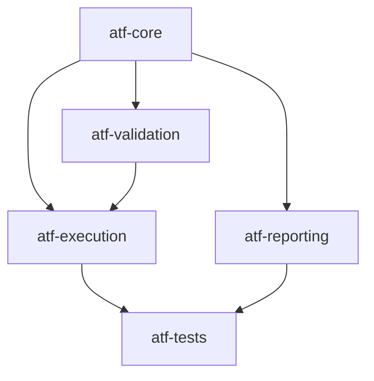

# ATF Core — kernel neutru și porturi

`atf-core` este stratul de bază al ATF Java. Conține modele, contracte și
abstracții reutilizabile, fără să decidă cum este orchestrat un scenariu sau
cum este randat un raport.

## Locul în arhitectură



`atf-core` nu depinde de modulele de deasupra lui. El furnizează vocabularul
comun prin care modulele comunică fără să se cunoască implementările concrete.

## Responsabilități

| Zonă | Owner în `atf-core` | Nu face |
|---|---|---|
| HTTP | `ApiRequest`, `ApiResponse`, `ApiTransport`, `ApiExecutor` | nu definește scenarii sau assertions |
| routing neutru | `ApiRoute`, `ApiUrlBuilder` | nu deține serviciile Users/Posts |
| timp și retry | `ApiExecutionClock`, `ApiExecutionDeadline`, `ApiRetryWaiter`, `RetryPolicy` | nu decide verdictul testului |
| configurație | `ApiSettings`, snapshot-uri și setări de raportare | nu citește configurație în fiecare request |
| statusuri | `AtfReportStatus`, `ReportStatusAggregator` | nu randă badge-uri |
| reporting ports | `AtfReportPorts`, `ValidationSink`, `ReportStepScope` | nu importă Extent |
| redaction | `Redactor`, `RedactionContext`, strategiile de redaction | nu modifică input-ul original |

## Regula de decuplare

```text
ApiRequest / ApiResponse / ValidationResult / Report ports
                         ↓
              modulele de execuție și reporting
```

Core poate defini porturi, dar nu implementează Extent, HTML, CSS, JavaScript,
JUnit sau servicii de business. Un port trebuie să fie mic, semantic și
testabil cu fake-uri în memorie.

Exemple de direcții corecte:

```text
ApiExecutor → ApiExecutionResult
Validator    → ValidationResult
Reporting   → AtfReportPorts
```

Direcții interzise:

```text
core → ExtentTest
core → JUnit
core → HTML/CSS
core → UsersService / PostsService
```

## Determinism și concurență

Fiecare execuție primește setări snapshot-uite. Timpul monotonic, deadline-ul
comun al request-ului și delay-ul de retry sunt injectabile; testele nu trebuie
să aștepte timp real pentru a verifica timeout-ul sau retry-ul. Modelele care
ies din core nu expun colecții mutabile și nu păstrează state static de rulare.

Redaction-ul este compus prin `RedactionContext` immutable. Orice evidence
trimis către reporting trebuie să treacă prin politica de redaction fără să
modifice request-ul, response-ul sau assertion-ul original.

## Teste

Testele din `atf-core` verifică separat:

- request/response și autentificare;
- timeout, cancellation, retry și `Retry-After` cu clock injectabil;
- snapshot-uri și precedence-ul configurației;
- status aggregation și precedența `FAIL > SKIP > WARNING > PASS`;
- redaction pe JSON, headers, query, path și PII;
- contractele porturilor fără Extent concret.

Un test core nu generează raport HTML. Dovada vizuală aparține lui
`atf-reporting`, iar scenariile end-to-end aparțin lui `atf-tests`.
