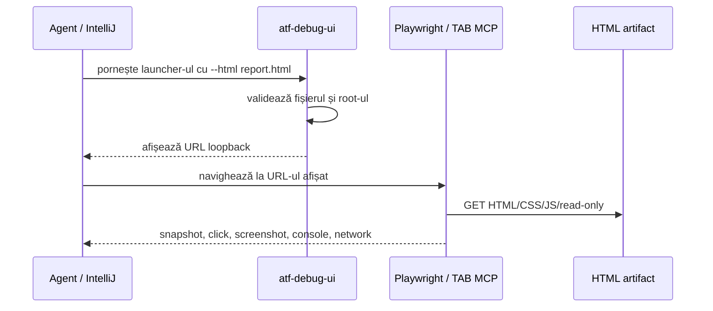

# ATF Debug UI

`atf-debug-ui` este un modul de infrastructură pentru investigarea manuală a
unui HTML deja generat. Nu generează raportul, nu îl modifică și nu conține
teste executabile. Publică numai pe `127.0.0.1` directorul care conține
artifactul ales și tipărește URL-ul care trebuie deschis în Playwright/TAB MCP.

## Fluxul de investigare



Responsabilitățile rămân separate:

| Componentă | Responsabilitate |
|---|---|
| `atf-reporting` | generează și publică HTML-ul Extent |
| `atf-debug-ui` | servește read-only artifactul local pe loopback |
| `atf-ui` | deține configurația și adaptorul Java Playwright |
| `atf-tests` / `atf.ui.tests.extent` | verificări automate UI pentru rapoarte Extent |
| agentul + TAB MCP | investigație manuală interactivă |

## Pornire

Din IntelliJ rulează `atf.api.debugui.AtfDebugUiLauncher` cu argumentele:

```text
--html artifacts/reports/api-atf-extent-report-TIMESTAMP.html
--port 0
```

Launcher-ul afișează URL-ul efectiv, de exemplu:

```text
[ATF DEBUG UI] Target for Playwright/TAB MCP: http://127.0.0.1:PORT/report.html
```

Agentul deschide exact acel URL cu Playwright MCP și poate investiga manual
taburile, filtrele, nodurile expandabile, DOM-ul, console errors, network și
randarea. Serverul rămâne activ până la `Ctrl+C`; `--port 0` alege automat un
port liber și permite rulări paralele în directoare diferite.

Pentru compilare și testul de contract:

```text
mvn -pl atf-debug-ui -am test
```

Testul verifică publicarea HTML și blocarea traversal-ului către fișiere din
afara root-ului. Nu se adaugă un modul separat pentru teste: testele automate
UI de audit Extent rămân în `atf-tests/src/test/java/atf/ui/tests/extent`.

### Rulări paralele și memorie

Fiecare sesiune Debug UI este un JVM separat. Launcher-ul aplică fail-fast dacă
JVM-ul are un heap peste limita bounded implicită (512 MB), iar pentru rulări
paralele se pornește cu o limită explicită de memorie, astfel încât sesiunile
abandonate sau pornite de alți agenți să nu poată provoca `hs_err_pid` prin
rezervarea heap-ului implicit al JVM-ului:

```text
java -Xms16m -Xmx128m -XX:MaxMetaspaceSize=64m \
  -cp atf-debug-ui/target/classes \
  atf.api.debugui.AtfDebugUiLauncher \
  --html artifacts/reports/api-atf-extent-report-TIMESTAMP.html --port 0
```

Nu se opresc procesele altui agent. Dacă hostul este deja saturat, testele
reporting pot fi rulate izolat cu `-DforkCount=0`; acest mod este o măsură de
diagnostic/resurse, nu schimbă contractul testelor și nu devine implicit pentru
execuțiile normale.
