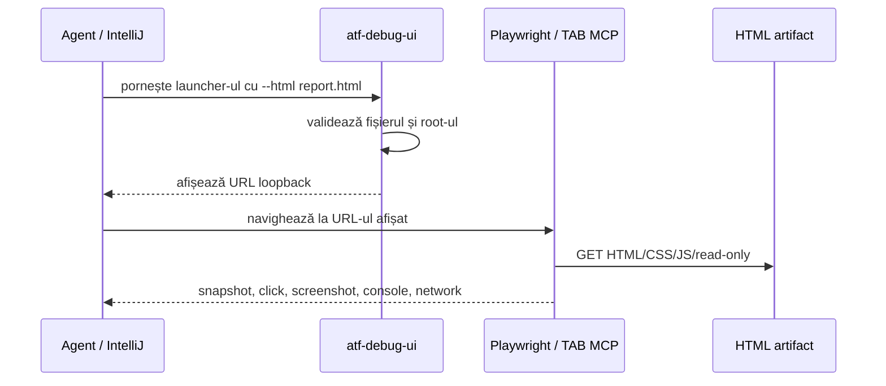

# ATF Debug UI

`atf-debug-ui` este un modul de infrastructură pentru investigarea manuală a
unui HTML deja generat. Nu generează și nu modifică raportul; testele sale
verifică boundary-ul loopback, traversal-ul, pornirea paralelă și politica de
memorie, nu un produs UI. Publică numai pe `127.0.0.1` directorul care conține
artifactul ales și tipărește URL-ul care trebuie deschis în Playwright/TAB MCP.

## Pe scurt

| Pas | Owner | Rezultat |
|---:|---|---|
| 1 | launcher | validează path-ul și root-ul |
| 2 | loopback server | servește read-only HTML/CSS/JS |
| 3 | Playwright/TAB MCP | verifică DOM, click, screenshot și consolă |

Nu este browser de produs și nu înlocuiește gate-ul E2E.

## Diagramă de bază



<details>
<summary><strong>Legendă — investigație read-only</strong></summary>

- launcher-ul validează inputul și publică numai loopback;
- Playwright/TAB MCP observă artifactul, nu îl repară și nu îl rescrie;
- HTML/CSS/JavaScript-ul aparține artifactului produs de atf-reporting;
- testul E2E rămâne gate-ul pentru comportamentul observabil, iar debug UI este instrumentul de explorare.
</details>

Responsabilitățile rămân separate:

| Componentă | Responsabilitate |
|---|---|
| `atf-reporting` | generează și publică HTML-ul Extent |
| `atf-debug-ui` | servește read-only artifactul local pe loopback |
| `atf-ui` | deține politicile generice și adaptorul Java Playwright |
| `atf-reporting-tests` / `atf.ui.tests.extent` | verificări automate UI pentru rapoarte Extent |
| agentul + TAB MCP | investigație manuală interactivă |

## Pornire

Din IntelliJ rulează `atf.api.debugui.AtfDebugUiLauncher` cu argumentele:

```text
--html <configured-report-path>
--port 0
```

Launcher-ul afișează URL-ul efectiv, de exemplu:

```text
[ATF DEBUG UI] Target for Playwright/TAB MCP: http://127.0.0.1:PORT/report.html
```

Agentul deschide exact acel URL cu Playwright MCP și poate investiga manual
taburile, filtrele, nodurile expandabile, DOM-ul, console errors, network și
randarea. Serverul rămâne activ până la `Ctrl+C`; `--port 0` alege automat un
port liber și permite rulări paralele în directoare diferite.

## Verificare pentru raport static sau dinamic

ATF Debug UI este ultima verificare interactivă, nu un simplu server de fișiere.
Pentru un raport `GENERATED_API`, se deschide mai întâi raportul API generat de
setup/mock și apoi raportul UI generat de audit. Pentru `STATIC_PATH` sau
`STATIC_RESOURCE`, se deschide inputul existent read-only și apoi artifactul UI
derivat. În ambele cazuri se păstrează aceeași dovadă:

```text
source report → ATF Debug UI → browser MCP
  → DOM + accessibility tree + console/network + computed style
  → UI audit report → ATF Debug UI → browser MCP → verdict
```

Checklist-ul obligatoriu pentru închiderea unei schimbări de raport:

- se investighează exact artifactul fresh din staging, nu un raport istoric;
- se verifică taburile și deep-link-urile, un caz pozitiv și unul negativ,
  expand/collapse, JSON scrollabil și screenshot link;
- `Screen validation` păstrează acțiuni, observații și assertions ca zone-soră
  fără linii orizontale decorative, iar `📷 base64 img` rămâne inline și
  aliniat vertical cu statusul;
- POST/PUT au request și response JSON valid/nevid, iar statusul, headerele,
  mock expectation-ul și validările sunt vizibile în raport;
- nu se folosește browser Windows real și nu se opresc procesele sau rulările
  altui agent.

Build-ul și testele rulează în staging extern, de exemplu
`${ATF_STAGING_ROOT}/atf-debug-ui-<id>`, nu în staging-ul proiectului. Artifactele aprobate se copiază ulterior în
`${ATF_REPORT_OUTPUT_DIR}` sau subdirectorul UI configurat al acestuia.

Pentru compilare și testul de contract:

```text
mvn -pl atf-debug-ui -am test
```

Testul verifică publicarea HTML și blocarea traversal-ului către fișiere din
afara root-ului. Nu se adaugă un modul separat pentru teste: testele automate
UI de audit Extent rămân în `atf-reporting-tests/src/test/java/atf/ui/tests/extent`;
`atf-tests` deține doar testul de guvernanță globală; nu conține teste de browser.

### Rulări paralele și memorie

Fiecare sesiune Debug UI este un JVM separat. Launcher-ul aplică fail-fast dacă
JVM-ul are un heap peste limita bounded implicită (512 MB), iar pentru rulări
paralele se pornește cu o limită explicită de memorie, astfel încât sesiunile
abandonate sau pornite de alți agenți să nu poată provoca `hs_err_pid` prin
rezervarea heap-ului implicit al JVM-ului:

```text
java -Xms16m -Xmx128m -XX:MaxMetaspaceSize=64m \
  -cp atf-debug-ui/target/classes \
  atf.api.debugui.AtfDebugUiLauncher \
  --html <configured-report-path> --port 0
```

Nu se opresc procesele altui agent. Dacă hostul este deja saturat, testele
reporting pot fi rulate izolat cu `-DforkCount=0`; acest mod este o măsură de
diagnostic/resurse, nu schimbă contractul testelor și nu devine implicit pentru
execuțiile normale.

Classpath-ul launcherului trebuie să includă `atf-console`, `atf-core` și
dependențele lor runtime. În PowerShell, pregătește-l înainte de o rulare
independentă; valoarea din `<report-path>` este calea artifactului aprobat:

```powershell
mvn -pl atf-debug-ui -am -DskipTests package
mvn -q -pl atf-debug-ui dependency:build-classpath '-Dmdep.outputFile=target/debug-classpath.txt' '-Dmdep.includeScope=runtime'
$runtimeDependencies = Get-Content -Raw 'atf-debug-ui/target/debug-classpath.txt'
$launcherClasspath = 'atf-debug-ui/target/classes;atf-console/target/classes;atf-core/target/classes;' + $runtimeDependencies
$report = '<report-path>'
java -Xms16m -Xmx128m -XX:MaxMetaspaceSize=64m -cp $launcherClasspath atf.api.debugui.AtfDebugUiLauncher --html $report --port 0
```

În IntelliJ, o configurație `Application` pentru `AtfDebugUiLauncher` include
automat classpath-ul runtime al modulului; setează aceleași limite în
`VM options` și `--html <report-path> --port 0` în `Program arguments`.
