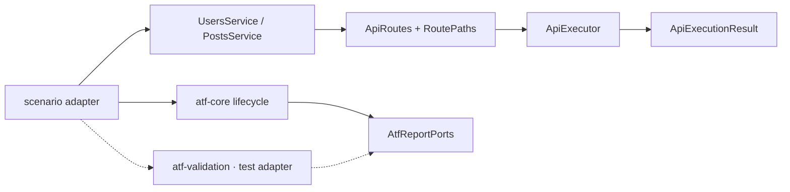
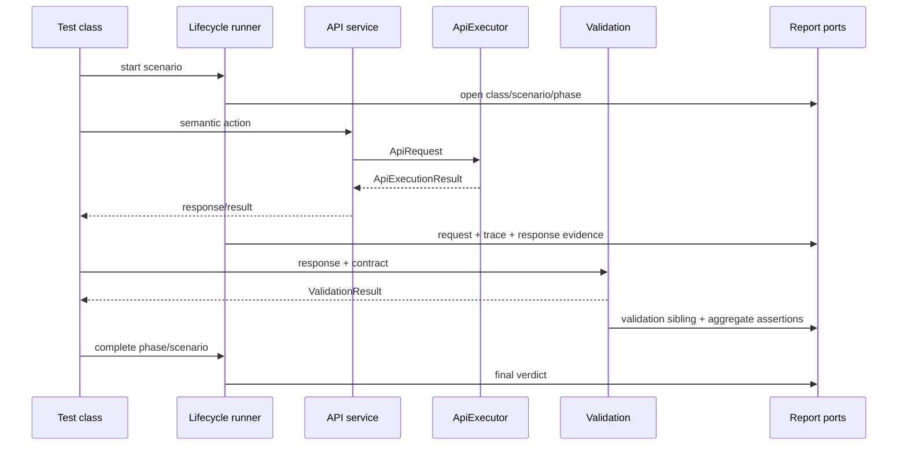

# ATF Execution — API layer și lifecycle

`atf-execution` este API layer-ul concret al ATF Java. Construiește servicii și
acțiuni API semantice peste `atf-core`, deține catalogul de rute al aplicației
și conectează transportul. Lifecycle-ul generic al scenariului este reutilizabil
și locuiește în `atf-core`; execution îl consumă, nu îl definește ca mecanism
de platformă.

## Diagramă de bază

Diagrama de mai jos descrie colaborarea runtime, nu direcția dependențelor
Maven. Direcția dependențelor este documentată în README-ul rădăcină și în
`docs/ATF_Architecture.md`.



## Cele două responsabilități ale modulului

### 1. API layer

`ApiModuleFactory` creează un graph izolat pentru o execuție. Composition
root-ul preferat îi transmite `AtfRuntimeSnapshot`; overload-ul cu
`ApiSettings` rămâne pentru compatibilitate:

```text
AtfRuntimeSnapshot
        ↓
ApiSettingsSnapshot
        ↓
ApiExecutor
        ↓
UsersService / PostsService
```

Serviciile expun acțiuni intenționate:

```java
module.users().get(1);
module.posts().forUser(1);
module.users().create(request);
```

Serviciile nu construiesc URL-uri în test, nu validează response-ul și nu
scriu raportul. Rutele sunt centralizate în `ApiRoutes` și `RoutePaths`, iar
modelele request/response rămân în package-urile lor semantice.

Acțiunile de scriere folosesc `ApiRoute.requestBody(...)` și transmit payload-ul
JSON prin serviciul semantic; testul nu construiește manual URL-ul, header-ul
sau evidence-ul. `POST` și `PUT` trebuie să producă request și response JSON
ne-goale, iar publisher-ul/auditorul raportează explicit orice încălcare între
transport, mock și raport.

### 2. Scenario lifecycle adapter

`ApiScenarioLifecycleRunner` este implementat în `atf-core` și deține numai
ordinea și precedence-ul fazelor:

```text
SETUP → TEST BODY → TEARDOWN
```

`ApiScenarioPhaseExecutor` din core execută o singură fază, mapează semnalele la
`PASS`, `WARNING`, `SKIP` sau `FAIL`, închide faza și păstrează cauza primară.
Runner-ul nu duplică această logică.

Reguli obligatorii:

- `TEARDOWN` se încearcă după failure sau skip;
- `TEST BODY` devine `SKIP` dacă setup-ul nu permite continuarea;
- primul failure real rămâne cauza primară;
- warning-ul este evidence și nu devine automat failure;
- reporting-ul se face prin porturi neutre, nu prin Extent.

`CleanupRegistry` rămâne în execution deoarece gestionează cleanup-ul asociat
resurselor și serviciilor de execuție. Nu este mutat în core doar pentru că
poartă numele de lifecycle: core-ul deține doar orchestration-ul generic.

## Secvența unui test API



Validatorul produce decizia; execution-ul coordonează momentul și ordinea;
reporting-ul doar înregistrează. Nu se adaugă assertions sau logică de business
în `UsersService`, `PostsService` ori în runner.

## Teste

Testele modulului trebuie să acopere independent:

- route metadata și request construction;
- serviciile Users/Posts cu transport fake;
- composition root și snapshot settings;
- phase order, setup/body/teardown și primary failure;
- warning, soft skip, teardown failure și cleanup;
- publicarea prin `AtfReportPorts` fake, fără renderer concret.

Pentru fluxul complet se folosesc testele din test scope-ul `atf-reporting`,
unde aceeași execuție poate produce și artifactul Extent. `atf-tests` nu mai
deține scenarii executabile.
