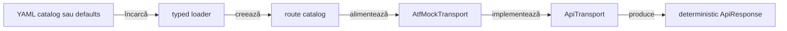
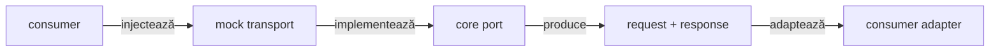
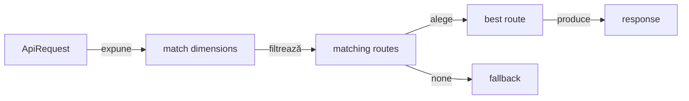

# ATF Mock Transport

`atf-mock` este transportul API determinist pentru compoziții de test offline.
Înlocuiește portul `ApiTransport` fără DNS, TLS, socket sau server local și
produce un `ApiResponse` reproductibil pentru fiecare request configurat.

## Overall

- **Input**: catalog de rute din `atf-mock.yaml` sau configurație built-in;
- **Matching**: metodă, path, profil de autentificare, query, headere și body;
- **Output**: status, headere, body, durată și URL păstrat pentru evidence;
- **Owner**: modulul de mock deține transportul fake și vocabularul rutelor;
- **Boundary**: `atf-reporting` nu este dependency de producție;
- **Scope**: acceptance, component și integration tests offline;
- **Live HTTP**: se activează separat prin `HttpClientTransport`, explicit.



<details>
<summary><strong>Legendă — cum se produce răspunsul fake</strong></summary>

- `Source` furnizează doar date de test, nu configurație de producție;
- `Loader` validează schema și construiește modele imutabile;
- `Catalog` decide ruta câștigătoare sau fallback-ul;
- `AtfMockTransport` implementează portul neutru din `atf-core`;
- `ApiResponse` păstrează forma observabilă a schimbului fără trafic HTTP;
- orice publisher, auditor sau renderer este responsabilitatea consumerului.
</details>

## Contractul modulului

| Întrebare | Răspuns contractual |
|---|---|
| Ce înlocuiește? | portul `ApiTransport` pentru execuții offline |
| Ce execută? | matching determinist și construirea unui `ApiResponse` |
| Ce nu execută? | DNS, TLS, socket, server, retry real sau browser |
| Ce deține? | schema `atf-mock`, rutele fake, fallback-ul și fixture-urile proprii |
| Ce consumă? | `atf-core` și Jackson YAML în producție |
| Cine îl folosește? | composition roots și testele consumatoare, prin injecție explicită |

**Regula de boundary:** `atf-mock` nu importă `atf-reporting`, `atf-ui`, JUnit
sau fixture-uri ale unei aplicații. Reporting-ul poate consuma datele produse de
transport, dar nu devine o responsabilitate a acestui modul.



<details>
<summary><strong>Legendă — direcția dependency-ului</strong></summary>

- consumerul alege transportul și îl injectează;
- `atf-mock` depinde de portul din `atf-core`, nu invers;
- evidence-ul este o consecință a execuției, nu o integrare ascunsă cu reporting;
- adapterul pentru `atf-reporting-tests` rămâne în test scope-ul consumerului;
- `atf-test-practice-shop` nu folosește `atf-mock`; decizia este documentată în
  feedback-ul modulului său.
</details>

## Configurația YAML

Catalogul mock este intenționat separat de `atf.yaml`:

- `atf.yaml` — configurație generală API, validation și reporting;
- `atf-mock.yaml` / `atf-mock.yml` — rute, răspunsuri și fallback offline;
- schema obligatorie — root `mock` și lista `mock.routes`;
- valori sensibile — niciodată hardcodate în catalog.

### Ordinea surselor

| Prioritate | Sursă | Comportament |
|---:|---|---|
| 1 | `-Datf.mock.config=<path>` | override explicit JVM |
| 2 | `ATF_MOCK_CONFIG` | override explicit de mediu |
| 3 | discovery ascendent | caută `atf-mock.yaml` și `atf-mock.yml` |
| 4 | defaults built-in | se folosește doar când nu există catalog configurat |

<details>
<summary><strong>Reguli de încărcare și fail-fast</strong></summary>

- calea explicită poate fi relativă la working directory-ul procesului;
- calea explicită inexistentă sau invalidă oprește încărcarea;
- un catalog generic `atf.yaml` nu este interpretat ca mock catalog;
- loader-ul caută în directorul curent și apoi în părinți;
- configurația este încărcată la composition root și reutilizată ca snapshot;
- lipsa unui fișier extern nu activează HTTP real; folosește defaults;
- pentru rulări paralele, consumerul poate furniza o cale explicită proprie.
</details>

### Forma minimă a unui catalog

```yaml
mock:
  routes:
    - method: GET
      path: /public/v2/users
      status: 200
      duration: PT0.012S
      headers:
        Content-Type: application/json
      body: '[{"id":1,"name":"ATF User"}]'
  fallback:
    status: 500
    body: '{"message":"Unexpected mock route"}'
```

- `duration` este ISO-8601 Java: `PT0.012S` înseamnă 12 ms;
- `headers` descrie response-ul, nu headerele request-ului;
- fallback-ul explicit previne false-green pentru rute uitate;
- `status` trebuie să fie în intervalul HTTP `100..599`;
- body-ul rămâne textul care va fi livrat în `ApiResponse`.

## Matching și prioritatea rutelor



<details>
<summary><strong>Legendă — cum este aleasă ruta</strong></summary>

- metoda și path-ul trebuie să corespundă;
- path-ul poate fi exact sau wildcard-ul `/*`;
- `auth-profile` poate fi exact sau wildcard-ul `*`;
- query-ul configurat este un subset obligatoriu al query-ului request-ului;
- când mai multe rute corespund, câștigă ruta cu mai multe query parameters;
- numele headerelor request-ului se compară case-insensitive;
- valorile headerelor request-ului se compară exact;
- body-ul și `request-body-mode` pot restrânge suplimentar potrivirea;
- fără match se livrează fallback-ul, nu un status de succes inventat.
</details>

| Dimensiune | Regulă | Owner |
|---|---|---|
| method | verb normalizat uppercase | `HttpMethod` + `MockRoute` |
| path | slash leading, exact sau wildcard | `MockRoutePaths` + `ApiPathTemplate` |
| auth | profil metadata, fără secret | `MockRoute` |
| query | obiect simplu sau listă cu duplicate | `ApiQueryParameters` |
| request headers | nume insensitive, valori exacte | `HttpHeader` + `MockRoute` |
| request body | JSON valid/non-gol pentru POST/PUT | `MockRequestBodyMode` + `MockRoute` |
| fallback | status explicit, implicit 500 | `AtfMockConfiguration` |

### Matching variat prin YAML

```yaml
mock:
  routes:
    - method: POST
      path: /public/v2/bulk-import
      auth-profile: api-key
      query:
        mode: validate
      request-headers:
        Content-Type: application/json
        X-Client: atf-java
      status: 202
      body: '{"accepted":true}'
```

<details>
<summary><strong>Detalii pentru query, headere și body</strong></summary>

- query-ul poate fi map sau listă de perechi `name`/`value`;
- forma listă păstrează explicit valori goale și duplicate;
- `auth-profile` nu conține credentiale; este doar discriminator de matching;
- `headers` din response sunt distincte de `request-headers`;
- `POST` și `PUT` cer request body JSON non-gol și `Content-Type` JSON;
- un body lipsă, invalid sau cu media type greșit ajunge la fallback;
- response-ul configurat pentru write contract trebuie să fie JSON valid și
  non-gol;
- un expected request body poate fi comparat structural, nu doar textual.
</details>

## Vocabular și ownership

Valorile stabile trebuie să aibă un owner semantic. Nu introducem un bucket
global de constante și nu copiem endpoint-uri între module.

- **protocol** — `HttpMethod`, `HttpHeader`, `MediaTypes` din `atf-core`;
- **query** — `ApiQueryParameters` și `ApiQueryParameter` din `atf-core`;
- **path template** — `ApiPathTemplate` din `atf-core`;
- **mock routes** — `MockRoutePaths` în `atf-mock`;
- **body mode** — enum-ul închis `MockRequestBodyMode`;
- **test-only payloads** — `MockTransportTestFixtures` în test scope;
- **scenarii reporting** — fixture-urile din `atf-reporting-tests`, nu în
  producția `atf-mock`.

`MockRoutePaths` deține rutele built-in ale mock-ului și construiește ID-urile
dinamice prin `ApiPathTemplate`. Nu este catalog de endpoint-uri live și nu
trebuie mutat în `atf-core` sau în reporting doar pentru că este reutilizat de
teste.

## Utilizare în composition root

Consumerul decide explicit dacă folosește defaults sau un catalog propriu:

```java
var transport = AtfMockTransport.fromConfiguration(mockConfigPath);
```

Consumerul injectează transportul în propriul composition root și decide cum
construiește executorul, serviciile și evidence-ul. `atf-mock` nu publică un
composition root pentru scenariile altui modul.

Pentru izolare rapidă:

```java
var transport = AtfMockTransport.defaults();
```

- factory-ul este orchestration, nu loc pentru aserțiuni;
- configurația se încarcă o singură dată per composition root;
- transportul rămâne reutilizabil pentru mai multe scenarii;
- consumerul decide cum publică request/response evidence;
- consumerul decide dacă un raport este `ACCEPTANCE / MOCK` sau `LIVE_HTTP`.

În `atf-reporting-tests`, catalogul de integrare este în
`src/test/resources/atf-mock.yaml` și este încărcat prin resursele testului.
Aceasta este o alegere de test scope; nu transformă YAML-ul într-o resursă de
producție a `atf-mock`.

## Testarea modulului

`atf-mock` se testează jos și rapid. Nu are browser și nu adaugă E2E doar pentru
a verifica un transport care este deja observabil prin modele și răspunsuri.

| Layer | Locație | Dovezi principale |
|---|---|---|
| component | `src/test/java/atf/api/mock` | loader YAML, matching, fallback, response |
| support | `.../mock/fixtures` | payload-uri, rute și request-uri reutilizabile |
| consumer integration | `atf-reporting-tests/src/test` | adaptarea datelor către reporting |
| browser/E2E | în afara `atf-mock` | efect observabil în consumer, dacă este necesar |

Suitea locală protejează explicit:

- status și body pentru rute built-in;
- păstrarea URL-ului în response;
- statusul fallback-ului pentru request necunoscut;
- parsing YAML și durata ISO-8601;
- query simplu, query gol și query duplicat;
- headere request case-insensitive și headere response;
- auth profile și request body modes;
- respingerea JSON-ului invalid pentru write routes;
- identitatea stabilă a rutelor cu query parameters sortate.

<details>
<summary><strong>Comenzi de verificare</strong></summary>

```text
mvn -pl atf-mock -am test
```

Gate-ul trebuie să ruleze fără network și fără a cere un artifact HTML. Testele
care verifică integrarea cu reporting aparțin consumerului
`atf-reporting-tests`, nu se copiază în acest modul.
</details>

## Ce rămâne în afara modulului

- **`atf-core`** — porturi HTTP, modele neutre și utilități reutilizabile;
- **`atf-reporting`** — publisher, HTML/Extent, contracte și audit static;
- **`atf-reporting-tests`** — adapter, fixture de reporting și composition root;
- **`atf-test-practice-shop`** — teste ale aplicației, fără `atf-mock`;
- **`atf-tests`** — governance whole-reactor, nu test double concret.

Această delimitare păstrează `atf-mock` compilabil și reutilizabil fără să
tragă după el rendererul, browserul sau un domeniu de business.

## Documente asociate

- [`atf-core`](../atf-core/README.md) — porturile consumate de transport;
- [`atf-reporting`](../atf-reporting/README.md) — biblioteca standalone;
- [`atf-reporting-tests`](../atf-reporting-tests/README.md) — consumer și
  composition root pentru contractele de reporting;
- [`ATF Architecture`](../docs/ATF_Architecture.md) — boundary-urile reactorului;
- [`Bune practici de cod`](../docs/README_Atf_CodeBestPractices.md) — ownership,
  modele și stratificarea testelor.
