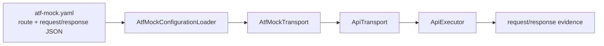

# ATF Mock Transport

`atf-mock` este modulul decuplat pentru răspunsuri API deterministe. Depinde
doar de `atf-core` și implementează `ApiTransport`; nu cunoaște Extent, JUnit,
serviciile Users/Posts sau validarea de business.

## Diagramă de bază



## Contract

```text
test composition root -> AtfMockTransport -> ApiTransport -> ApiExecutor
                                             -> ApiResponse determinist
```

Mock-ul nu face DNS, TLS sau conexiuni HTTP. URL-ul primit de transport este
păstrat în `ApiResponse` pentru evidence, astfel încât raportul poate afișa
ruta completă fără să pretindă că serverul a fost contactat.

Publisher-ul adaugă `ACCEPTANCE / MOCK — network was not executed` și marchează
replay-ul manual ca `NOT EXECUTABLE`. Faptul că `api.baseUri` este un endpoint
public real nu schimbă comportamentul mock; pentru request real se folosește
separat `HttpClientTransport`, configurație `live` și opt-in explicit.

## Ownership pentru vocabularul de test

Valorile protocolului și ale catalogului nu se repetă direct în testele de
transport. `HttpMethod` deține verbele HTTP, `HttpHeader` numele headerelor,
`MediaTypes` media type-urile, iar fixture-urile locale dețin rutele,
payload-urile și profilele de autentificare ale scenariului. Un fixture este
extras numai când valoarea are ownership semantic sau este reutilizată;
payload-urile negative strict locale rămân lângă testul care le explică. Nu se
introduce o clasă globală `AtfConstants` ca sertar pentru valori fără owner.
În testele acestui modul, `MockTransportTestFixtures` este owner-ul local pentru
URL-ul mock, payload-uri și query-shape-uri, deoarece `atf-mock` nu depinde de
scenariile din test scope-ul `atf-reporting`. Pentru fixture-ul built-in,
`MockRoutePaths` este owner-ul rutelor concrete; el compune segmentele prin
`ApiPathTemplate` și nu expune catalogul mock în `atf-core`. Default-ul neutru
`ApiEnvironment` este în `atf-core/config.source`, fără ca mock-ul să depindă
de test-kit.

`MockRoutePaths` este vocabularul mock-ului, nu o sursă de endpoint-uri de
producție. Când `atf-reporting` este testat independent, testul importă această
clasă numai în test scope și citește răspunsul efectiv din `atf-mock.yaml`.
Reporting production nu vede nici ruta, nici loader-ul; primește request/response
ca date deja executate și poate fi livrat ca librărie endpoint-neutrală.

## Configurație YAML

Catalogul mock este separat intenționat de configurația generală ATF:
`atf.yaml` păstrează doar API, validation și reporting. `atf-mock.yaml` deține
rutele, răspunsurile și fallback-ul fake. `AtfMockConfigurationLoader`
caută implicit `atf-mock.yaml`/`atf-mock.yml` în directorul curent și părinții
lui. Pentru o compoziție explicită, ordinea este:

1. proprietatea JVM `-Datf.mock.config=cale/catre/atf-mock.yaml`;
2. variabila `ATF_MOCK_CONFIG`;
3. descoperirea ascendentă a `atf-mock.yaml`/`atf-mock.yml`;
4. fixture-ul built-in, numai când nu există un fișier configurat.

Calea explicită poate fi relativă la working directory-ul procesului, ceea ce
permite rulări directe din IntelliJ, CI sau workspace-uri paralele. Dacă o cale
explicită există dar este invalidă, încărcarea eșuează fail-fast; nu revine
silențios la fixture-ul built-in și nu pornește HTTP real.

În acest repository, catalogul folosit de raportare este mutat explicit în
`atf-reporting/src/test/resources/atf-mock.yaml`. Este încărcat prin
`ReportingTestResources.mockConfiguration()` sau `.mockTransport()`, astfel
încât testele de raportare nu depind de working directory și nu concurează cu
un catalog folosit de o altă rulare. Loader-ul, schema și transportul rămân în
`atf-mock`; YAML-ul din reporting este fixture-ul de integrare al modulului
consumator. Pentru consumatori externi, override-ul `-Datf.mock.config=...`
rămâne mecanismul explicit recomandat; lipsa unui catalog extern folosește
fixture-ul built-in.

```yaml
mock:
  routes:
    - method: GET
      path: /public/v2/users
      status: 200
      duration: PT0.012S
      headers:
        Content-Type: application/json
      body: '[{"id":1,"name":"ATF User"}]'
  fallback:
    status: 500
    body: '{"message":"Unexpected mock route"}'
```

## Matching pentru request-uri variate

O rută mock poate restrânge potrivirea la un profil de autentificare și la
parametri query. Aceste constrângeri sunt utile pentru testele API care trebuie
să dovedească faptul că raportul păstrează forma reală a request-ului:

```yaml
mock:
  routes:
    - method: POST
      path: /public/v2/bulk-import
      auth-profile: api-key
      query:
        mode: validate
      request-headers:
        Content-Type: application/json
        X-Client: atf-java
      status: 202
      body: '{"accepted":true}'
```

`auth-profile` este metadata de matching, nu un secret. Valorile sensibile nu
se pun în YAML-ul de test; auth-ul este reprezentat prin `AuthType` și prin
headerele redacted din evidence. Dacă profilul sau un parametru nu corespunde,
mock-ul nu acceptă ruta și ajunge la fallback-ul configurat.

`request-headers` adaugă aceeași regulă pentru headerele trimise de client.
Numele sunt comparate case-insensitive, dar valoarea trebuie să corespundă
exact. Headerele din `headers` sunt headerele primite în response și pot
simula `X-Request-Id`, `ETag`, `Retry-After`, rate-limit sau alte metadata de
transport. În raport, headerele trimise și primite apar în rânduri distincte
din `TECHNICAL TRACE`.

Suitea `RequestVariantsApiTests` folosește patru forme distincte: Bearer +
query, API key + body mare, Basic + body nested și Custom + parametri. Fiecare
are o rută YAML proprie, pentru ca testele să poată verifica izolat metoda,
URL-ul complet, query string-ul, tipul de auth și răspunsul nested. Aceasta
rămâne o simulare deterministă; nu transformă accidental testele offline în
apeluri către `https://atf.local`.

Toate rutele `POST` și `PUT` din catalogul proiectului sunt write-contracts
JSON: request-ul trebuie să aibă body JSON non-gol și `Content-Type` JSON, iar
response-ul configurat trebuie să fie un document JSON non-gol și valid. `ApiRoute`
adaugă automat header-ul `Content-Type: application/json` pentru
`requestBody(...)`, iar mock-ul face fail-closed către fallback pentru body lipsă
sau invalid. Publisher-ul și auditorul UI verifică apoi aceleași două canale în
raport, astfel încât mock-ul să fie sursa de adevăr pentru validarea UI.

`duration` este o durată ISO-8601 Java (`java.time.Duration`): 12 ms se scrie
`PT0.012S`, nu `PT12MS`. Forma este intenționată și este verificată de testul
YAML al transportului, pentru ca fixture-urile să nu depindă de un parser
permisiv sau de unități inventate.

Configurația este încărcată o singură dată la composition root. Un fallback
explică rutele uitate fără să transforme un request necunoscut într-un 200.
Scenariile API și `ApiReportAuditSetup` folosesc configurația proiectului;
`ApiReportSetupFlow` este doar fațada de compatibilitate;
testele unitare pot folosi `AtfMockTransport.defaults()` pentru izolare.

`atf-mock` nu este live HTTP. Pentru un endpoint real se folosește separat
`HttpClientTransport` și profilul live opt-in configurat la execuție.

## Adaptor pentru testarea reporting-ului

`atf-mock` nu importă `atf-reporting` și nu devine dependent de renderer. Când
raportarea este testată independent, test classpath-ul `atf-reporting` poate
adapta `MockRoute` la portul `ApiReportContractCatalog`. Direcția este:

```text
MockRoute / atf-mock.yaml
        → catalog adapter (test only)
        → atf.api.reporting.api.contract.ApiReportContractAuditor
        → ValidationResult
```

Adaptorul nu copiază reguli: `POST`/`PUT` JSON, headers, query, status și
compararea JSON sunt verificate de motorul de reporting. În test scope-ul
`atf-reporting`, bridge-ul DOM→contract face aceeași conversie pentru auditul
Playwright. Astfel mock-ul
poate testa reporting-ul ca modul independent, fără ca reporting-ul să execute
transport sau să cunoască fixture-uri de produs.

Auditul static al documentelor JSON publicate este de asemenea deținut de
`atf-reporting` (`ApiReportJsonEvidenceAuditor`). Testele reporting adaptează
`MockRoute` la `ApiReportContractCatalog`; `atf-tests` deține doar auditorul de
guvernanță globală și nu conține un auditor
duplicat doar pentru că inputul provine din mock.
