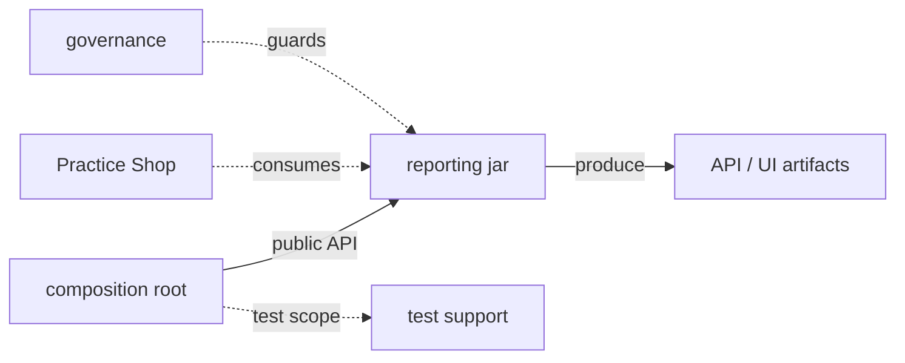
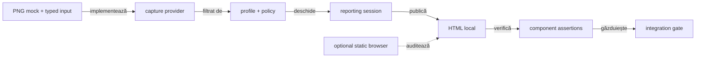
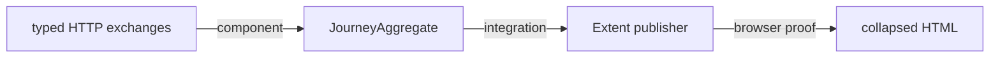

# ATF Reporting Tests — compoziție izolată pentru biblioteca de raportare

## Pe scurt

`atf-reporting-tests` verifică `atf-reporting` ca librărie reutilizabilă:

- acoperă setup API/mock, renderer, publisher, browser read-only și ATF Debug;
- nu deține testele de business ale unei aplicații;
- testele business aparțin modulului consumer, precum `atf-test-practice-shop`;
- `atf-tests` rămâne dedicat guvernanței whole-ATF.



<details>
<summary><strong>Legendă — composition root pentru reporting</strong></summary>

- atf-reporting este biblioteca verificată, nu un test fixture;
- suportul grupat în diagramă reprezintă dependențele de test scope;
- artifactele API/UI sunt rezultate ale compoziției, nu fișiere normative;
- atf-test-practice-shop și atf-tests sunt consumatori cu responsabilități separate, nu extensii ascunse ale librăriei.
</details>

| Surface | Owner | Dependențe |
|---|---|---|
| renderer, model, CSS/JS, publication | `atf-reporting` | zero module ATF |
| contracte API/mock care produc evidence pentru reporting | `atf-reporting-tests` | core/mock/validation/console |
| browser E2E și ATF Debug pentru raport | `atf-reporting-tests` | ui/debug-ui/Playwright |
| testele Practice Shop | `atf-test-practice-shop` | reporting jar, UI și setup-ul aplicației |
| guvernanță whole-ATF | `atf-tests` | nu deține teste de aplicație |

## Regula limitelor de responsabilitate

`atf-reporting` trebuie să treacă singur:

```text
mvn -f atf-reporting/pom.xml test
```

Fără reactor, fără module ATF locale și fără fixture-uri de business. Testele
din acest modul verifică numai contractele publice ale reportingului. Testele
API/UI/E2E de aici sunt vehicule deterministe pentru a demonstra că reportingul
poate fi consumat; nu sunt suita unei aplicații reale.

Înlocuirea modulului cu un jar nu schimbă consumerii: aceștia depind de
interfețele și contractele publice `atf-reporting`, nu de clasele testului sau
de directoarele locale ale repository-ului.

Locatorii UI sunt centralizați în `src/test/.../support/locators`:

- preferă un selector semantic cu atribut stabil, de exemplu
  `button[data-atf-action='expand']`;
- selectorii structurali sau `nth(...)` rămân în ownerul locatorului când
  markup-ul nu oferă o identitate mai bună;
- testele, flow-urile și auditorii nu compun direct `page.locator(...)`.

## Contractul de titlu pentru request-uri API

Orice request publicat de un consumer trebuie să fie recognoscibil fără
deschiderea imediată a disclosure-ului:

```text
HTTP_METHOD relativePath — very-short business intent
```

`relativePath` este ruta observată; valorile dinamice rămân în path-ul runtime,
nu în enum-uri. Dacă este necesară intenția de business, consumerul poate folosi
un descriptor typed (`ApiOperationDescriptor`) cu method și route template.

Boundary-ul rămâne independent:

- `atf-reporting` publică titlul primit și nu parsează semantica din el;
- consumerul deține vocabularul aplicației și corelarea cu ruta dinamică;
- example Practice Shop: `SEARCH` → wire `GET` →
  `GET /products/search — find configured product`;
- aliasul browser `QUERY`, dacă apare, rămâne metodă observată la capture
  boundary și nu înlocuiește metoda/titlul request-ului;
- `OPERATION KIND` și `ROUTE TEMPLATE` oferă auditorului contextul stabil
  al execuției Practice Shop.

Contractul este verificat pe două seam-uri:

| Seam | Verificare |
|---|---|
| core vocabulary | `ApiOperationDescriptorContractTest` validează formatul și input-ul invalid |
| reporting fallback/Extent | `HtmlReportComponentContractTest` și `ExtentReportSessionContractTest` validează titlul publicat în artifact |
| consumer Practice Shop | `PracticeShopApiOperationTest` și `PracticeShopStandaloneApiReportTest` validează method/path/intent, absența `QUERY`, operation kind și route template |

## Ordinea testelor și responsabilitatea protecțiilor

1. `atf-reporting` — unit/component pentru model, renderer, artifact și CSS/JS;
2. `atf-reporting-tests` — component pentru compoziția controlată mock →
   reporting, integration pentru boundary-urile dintre module și E2E numai
   pentru browser/rendering-ul contractului librăriei `atf-reporting`;
3. `atf-test-practice-shop` — testele consumer pentru journey-ul Practice Shop.
4. `atf-tests` — boundary și guvernanță whole-reactor, inclusiv verificările
   globale de documentație, ownership, coeziune și vocabular.

`atf-reporting-tests/src/test/java/atf/api/tests/architecture` rămâne limitat la
verificări care au ca subiect compoziția reporting. Nu duplică guard-uri de
reactor și nu validează README-urile întregului proiect; acestea sunt executate
central prin [`WholeAtfGovernanceSuiteTest`](../atf-tests/README.md#suita-whole-atf-și-reziduul-de-compatibilitate).

### Selecția scenariilor pentru un raport API

`@ApiScenarioSetup(tests = ...)` declară metodele exacte; resolver-ul validează
selecția înaintea colecțiilor mai largi.

Ordinea fallback-ului, când nu sunt declarate metode exacte:

1. proprietatea JVM cu familii API;
2. proprietatea suitei;
3. familiile din adnotare;
4. configurația YAML.

Ownerii și scenariile așteptate nu sunt deduși din DOM-ul rezultat.

| Contract | Proof component | Limită |
|---|---|---|
| selecția exactă și proiecția semantică | `ApiScenarioManifestTest` | verifică owner, titluri, statusuri, ordine și respinge scenarii nealese față de fallback-ul YAML |
| precedence-ul setup-ului și fallback-urilor | `ApiReportAuditSetupTest` | verifică direct că override-ul JVM pentru familii are prioritate față de `tests = ...`, apoi verifică fallback-urile de suite, adnotare și YAML |
| selecție exactă → mock/lifecycle → publisher | `ApiSelectionMockPublisherComponentTest` | verifică răspunsul JSON al mock-ului, request/response/execution evidence în artifact și excluderea scenariilor nealese; selecția invalidă este respinsă înainte de publicare |

Aceste proof-uri sunt complementare: manifestul verifică proiecția, resolver-ul
verifică precedence-ul, iar testul compus dovedește verticala până la artifact.
`SelectedApiTestsReportUiTest` rămâne separat pentru interacțiunea de browser;
nu este folosit ca substitut pentru contractele lower-level.

<details>
<summary><strong>Niveluri de testare și independență</strong></summary>

- **`atf-reporting/src/test`** — boundary standalone al librăriei; verifică
  compilarea independentă și contractele locale fără ATF, mock sau browser;
- **`atf-reporting-tests`** — composition root pentru component, integration/API
  și E2E; leagă reporting-ul de mock, execution, validation, Playwright și
  ATF Debug;
- **`atf-test-practice-shop`** — consumer de aplicație; nu este parte din
  verificarea bibliotecii reporting;
- **`atf-tests`** — governance pentru reactor; nu deține fixture-uri sau flows;
- **regula de independență** — testul E2E verifică numai comportamentul care
  depinde de browser; contractele statice, modelul și asset-urile se verifică
  la nivelurile mai mici;
- **regula de boundary** — mock-ul și browserul nu intră în production JAR-ul
  `atf-reporting`.

</details>

## Capturare generică — suport verificat înaintea modulului consumator

Contractul transversal pentru flow mode, screenshot policy și capture source este
în [`docs/ATF_Evidence_Capture_Contract.md`](../docs/ATF_Evidence_Capture_Contract.md).
Acest modul îl probează prin fixture-uri deterministe; nu mută politica într-un
consumer și nu cere Practice Shop pentru testarea suportului.



<details>
<summary><strong>Legendă — testare pe niveluri</strong></summary>

- unit: policy înainte de provider, target, provenance, PNG și cardinalitate `0/1/N`;
- component: markup, status, disclosure, referință media și păstrarea acțiunilor;
- integration: session → model semantic → HTML, fără endpoint sau browser extern;
- browser opțional: captura reală pe artifact HTML static;
- E2E consumer: dovedește integrarea, nu reimplementează suportul generic;
- fixture-ul poate reprezenta `PASS`, `FAIL`, `WARNING` sau `SKIP`.

</details>

- `ReportEvidenceProfileTest` verifică filtrarea înainte de captură, potrivirea sursei,
  payload-ul PNG și selecția typed a detaliilor acțiunilor.
- `ExtentReportUiEvidenceRenderingTest` verifică tabelul implicit și că
  `SUMMARY_ONLY` păstrează un disclosure colapsat, fără tabelul detaliat sau
  schimbarea capturii; rendererul nu execută acțiuni UI.
- `ReportEvidenceProfileIntegrationTest` dovedește provider mock → sesiune → HTML local pentru ambele flow mode-uri.
- `UNIFIED_FLOW` păstrează un singur request cu propoziția Gherkin finală, fără checkpoint-uri numerotate sau Gherkin duplicat; UI actions și assertions sunt agregate, iar `API validation` este soră cu `UI validation` sub același checkpoint Gherkin și deține exchange-urile sale. Sub `FINAL_ONLY` se publică doar captura `FINAL`.
- `SCREEN_CHECKPOINTS` păstrează request-urile Gherkin independente.
- Profilul typed combină flow mode, screenshot policy, capture source și action-details mode.
  Grouping-ul aparține lifecycle/publisher-ului din `atf-reporting`; alegerea modului
  pentru o adnotare de consumer rămâne responsabilitatea acelui consumer.

## Matricea de integrare și limitele verificate

Integration tests rămân grupate după boundary-ul observat, nu după numele
modulului consumat:

| Familie | Clase reprezentative | Boundary verificat |
|---|---|---|
| API scenarios | `UsersApiTests`, `PostsApiTests`, `RequestVariantsApiTests`, `ApiHeadersAndEdgeCasesTests`, `ApiNegativeMatrixTests`, `ApiRequestFlowsTests` | mock → core → validation → reporting evidence |
| reporting API | `MockApiReportIntegrationTest`, `ApiReportArtifactAuditTest`, `ApiManualReplayTest` | fixture API → renderer/publisher → artifact și replay |
| UI composition | `SelectedApiTestsReportUiTest`, `StaticUiExtentReportContractTest` | artifact → ATF Debug/Playwright → DOM/CSS/disclosure |

`StaticUiExtentReportContractTest` include verificările `SCREEN_VALIDATION` și
`INLINE_SCREENSHOT`; inputul trebuie să aibă evidence de screenshot conform
policy-ului declarat. Un raport cu `Screenshot policy = Disabled` nu este input
pentru acest screenshot gate și nu se interpretează ca defect al rendererului.

Fiecare clasă declară layer-ul prin adnotare; package-ul exprimă domeniul și
boundary-ul, nu nivelul de testare. Setup-ul, mock-ul și validatorii comuni
rămân în `support`, ca o clasă nouă să compună scenariul fără copiere.

Boundary-urile suportului rămân mici și verificabile:

- `support.api` ține selecția și publicarea precondiției API;
- `support.config` ține loader-ele, resursele și configurația UI;
- `support.config.environment` deține snapshot factory-urile typed pentru Overview/System;
- Network Inspector aparține `atf.api.reporting.ui.network`; nu se adaugă excepții de coeziune pentru clase fără legătură;
- guard-ul whole-ATF limitează fiecare package la maximum opt clase.

`ReportingCoverageMatrixTest` este harta executabilă a seam-urilor publice:

| Verificare | Dovadă obligatorie | Limită intenționată |
|---|---|---|
| coverage | fiecare seam are test `unit`, `component`, `integration` sau `e2e` | un seam nou fără dovadă lower-level e regresie de guvernanță |
| Network Inspector | `ReportNetworkInspectorTest` (`unit`) pentru proiecție/markup; `NetworkInspectorSummaryRoleTest` (`component`) pentru rolul și ordinea summary-ului; `ExtentReportUiEvidencePublishingTest` (`unit`) pentru publicarea aggregate-ului | matricea cere clasele, metodele executabile și adnotările ATF; publicarea rămâne proof separat |
| audit semantic | `Overview`, `Categories`, `Fails`, `Screen validation` și `ReportExecutionProjections` | `ReportAuditSnapshot` rămâne renderer-neutral; aceleași proiecții typed pot fi verificate fără browser |
| convergență | JSON și visual sunt verificate împreună | browserul observă; regulile se verifică fără Playwright |
| browser proof | `E2eSuiteBudgetArchitectureTest` plafonează la 8 clase `@AtfE2eTest` | orice clasă nouă cere justificare în feedback și modificarea bugetului |

### Verificarea randării responsive

`SelectedApiTestsReportUiTest` este entry-point-ul configurabil pentru raportul
Extent generat. `CategoryCardinalityBrowserFixtureTest` este browser gate-ul
dinamic: verifică 0/1/multe categorii și măsoară fixtures autentice UI și API
pentru conținut scurt/lung, la viewport-ul configurat și la `591px`. Raportul de
audit se publică prin `ReportAuditContext` / ATF Debug.

Invarianturile browser sunt:

- în toate cele șapte suprafețe (Overview categories, System/Environment, tag
  audit, Playwright actions, Audit/Assertions, Unique request signatures,
  Technical diagnostics), `scrollWidth <= clientWidth`, `max-height` folosește
  plafonul comun `500px`, iar conținutul scurt rămâne natural, fără înălțime goală;
- pentru conținut lung, ultimul rând rămâne accesibil, header-ul tabelului rămâne
  sticky, iar viewport-ul nu depășește plafonul comun;
- rândurile Network Inspector `Unique request signatures` și
  `Technical diagnostics` măsoară `34px` la ambele viewport-uri și sunt
  collapsed implicit, aliniate cu celelalte detalii API/UI;
- auditul browserului nu observă erori console/page/request când deschide
  artifactele UI și API selectate; aceasta este dovadă de randare, nu evidence
  publicată în raport;
- raportul păstrează secțiunile, disclosure-urile collapsed la sosire,
  `SETUP → TEST BODY → Screen validation`, request/response JSON și glyph-ul
  `＋/−` inline înaintea propoziției, fără `<hr>` decorativ.

Artifactele sunt output de run și nu se copiază în README. Sursa `.js`/`.css`
rămâne formatată în `atf-reporting/src/main/resources`; numai copia publicată în
HTML este compactată de `ReportAssetCompactor`. Astfel testele component pot
verifica fragmentele native, iar browserul verifică efectul compoziției finale.

### Dovezi pentru inspectorul fluxului

Inspectorul de rețea se verifică în două trepte, fără a transforma E2E în owner
al modelului:



<details>
<summary><strong>Legendă — ce trebuie să treacă la fiecare nivel</strong></summary>

- `ReportNetworkInspectorTest` verifică ordered facts, authentication,
  correlation, transport counters, unique signatures și deduplicarea
  diagnosticelor derivate din exchange-uri HTTP eșuate; testul unit verifică și
  markup-ul nested, inclusiv aggregate gol/parțial;
- `NetworkInspectorSummaryRoleTest` este proof-ul component pentru rolul de
  summary, ordinea în flow și toate mode-urile de evidence;
- `ExtentReportUiEvidencePublishingTest` rămâne proof separat pentru publicarea
  aggregate-ului în artifactul Extent; schimbarea lui nu înlocuiește proiecția
  unit sau contractul component de renderer;
- component/integration publisher tests verifică faptul că body-urile rămân în
  disclosures canonical și aggregate-ul nu primește credentiale sau mesaje
  volatile;
- publisher proof trebuie să verifice și shape-ul, nu numai prezența label-urilor:
  pentru `0..N` exchange-uri, fiecare pereche request/response și execution
  evidence trebuie să rămână scanabilă ca unitate API; un tabel comun cu prefixe
  `API 1/API 2` nu este suficient;
- UI trace proof trebuie să verifice ierarhia `un singur Gherkin checkpoint →
  UI validation + API validation → disclosures`, cu cele două validation nodes
  ca frați semantici și fără repetarea propoziției Gherkin;
- execution disclosure-ul trebuie să fie identificabil pentru exchange-ul lui;
  două apariții `Execution evidence · 1 attempts` fără context sunt ambigue chiar
  dacă numărul de attempts este corect;
- retry-ul aceluiași request trebuie verificat ca un singur exchange logic:
  attempts/history se păstrează în execution disclosure și nu generează un nou
  `API n`;
- contractul de layout trebuie să păstreze URL-ul complet lizibil la viewport
  îngust, fără break arbitrar în identificator și fără overflow;
- browser/debug verifică numai structură vizibilă, expand/collapse, ordine și
  navigare; nu este necesar pentru fiecare variație de method/status;
- dacă renderer-ul publică fields flat în loc de disclosure-uri nested, modelul
  semantic poate rămâne verde, dar publisher gate-ul trebuie să rămână roșu până
  la corectarea proiecției;
- testele HTML trebuie să selecteze zona semantică a inspectorului și să verifice
  celule/atribute/ordine, nu să folosească `contains` global sau casing vendor.

</details>

Entry-point-urile selectabile direct din IntelliJ sunt separate pe layer:

| Entry point | Include | Rol |
|---|---|---|
| `AtfReportingUnitSuite` | `unit` din `atf.api.reporting` | model, policy, parser, renderer seam și vocabular |
| `AtfReportingComponentSuite` | `component` din reporting și UI extent | boundary HTML/CSS/JS, contracte și fixture-uri controlate; snapshot-ul de navigation performance este mapat prin `ReportRuntimePerformanceSnapshot`, iar `ReportRuntimePerformanceBudget` verifică fixture-uri configurabile fără verdict business |
| `AtfReportingIntegrationSuite` | `integration` din `atf.api.reporting` | session, publication, replay și contracte de integrare ale librăriei |
| `AtfReportingApiFixtureSuite` | `integration` din `atf.api.tests.api` | mock API → core → validation → reporting evidence, fără browser |
| `AtfReportingUiAuditSuite` | `e2e` din `atf.ui.tests.extent.e2e` | audit browser/debug al artifactului Extent, cu owner UI explicit |
| `ExtentReportingE2eSuite` | `e2e` din `atf.ui.tests.extent.e2e` | browser/debug, click-uri, disclosure și randare observabilă |

Fiecare layer are un launcher dedicat și selectează numai package-ul lui. `ExtentReportingE2eSuite`
rămâne entry-point-ul agregat pentru întregul E2E; `AtfReportingUiAuditSuite`
este entry-point-ul îngust pentru auditul UI al reportingului. Astfel un run
rapid nu pornește browserul, un run API fixture nu pornește UI, iar un run E2E
nu ascunde failure-uri lower-level.

- importă root `pom.xml` ca proiect Maven și folosește **Reload All Maven Projects** înainte de prima rulare sau după schimbări de module;
- run configuration-ul suitei reporting folosește modulul `atf-reporting-tests`, nu modulul legacy `atf-tests`;
- pentru `NoClassDefFoundError` în IntelliJ, verifică modulele `atf-reporting` și `atf-reporting-tests` și dependency graph-ul testului; nu duplica sau muta clasa pentru a compensa un model IDE stale;
- reproduce întâi cu testul forked `ReportStagingWorkspaceTest` în reactorul Maven.

## Limitele de responsabilitate ale aplicațiilor consumatoare

`atf-reporting-tests` nu deține adaptere de aplicație. Practice Shop este izolat
în modulul dedicat:

```text
atf-test-practice-shop/src/test/resources/atf-practice-shop.yaml
atf-test-practice-shop/src/main/java/atf/ui/practiceshop/
├── api/         client, request factory și screen API flows
├── config/      configurare și credențiale typed
├── flow/        acțiuni semantice
├── locators/    singurul owner al selectorilor
├── pages/       page objects
└── support/     context și evidence adapters
atf-test-practice-shop/src/test/java/atf/ui/tests/practiceshop/
├── component/       teste rapide de module
├── api/component/   variații fake pozitive/negative
├── api/integration/ precondiție login live, opt-in
└── e2e/             journey complet
```

`atf-tests` nu mai conține YAML, page objects sau flow-uri Practice Shop.
Nu se copiază fixture-uri în `atf-reporting-tests`; acesta rămâne strict
composition root pentru contractul librăriei reporting.

### Reutilizare neutră între module

- `ReportModelAdapters` convertește modelele core (`ApiExecutionResult`,
  retry/provenance, assertions și UI actions) fără ca `atf-reporting` să depindă
  la compilare de `atf-core`; vocabularul necunoscut eșuează explicit, nu este
  ghicit sau transformat în `INFO`;
- `ReportQueryParameters.fromUri(...)` este decodorul comun al query-urilor.
  Practice Shop îl folosește în mapper și în assertions, păstrând doar
  semantica de business în jurul lui;
- `AtfPathLocator.locateSourceFile(...)` și `locateModuleRoot(...)` centralizează
  descoperirea generică folosită de testele component; rădăcinile candidate și
  fișierul cerut rămân inputuri explicite, relative și validate;
- capturarea pe host, alegerea endpoint-urilor, recovery-ul login-ului,
  corelarea checkpoint-urilor și redactarea datelor de identitate rămân în
  consumerul Shop. Nu sunt promovate în reporting/core fiindcă depind de
  aplicația testată;
- `ReportModelAdaptersTest` verifică modelul real core și compatibilitatea
  strictă; `ReportQueryParameters` este verificat pentru decoding și duplicate,
  iar testele Shop dovedesc că integrarea folosește același contract.

Rapoartele sunt output de run, nu fixtures păstrate în documentație.

Browser proof-ul folosește un singur seam generic, `StaticHtmlScreenshotAdapter`:

- input: HTML local generat de reporting;
- output: PNG capturat headless prin Playwright;
- integration test: verifică semnătura PNG și viewport-ul;
- limită: nu pornește endpoint, nu cunoaște Practice Shop și nu intră în
  production JAR;
- contractele DOM/CSS rămân în component validators și ATF Debug.

Detaliul normativ al normalizării evidence este în
[`atf-reporting/README.md`](../atf-reporting/README.md#normalizarea-evidence-în-artifact).
Aici rămâne numai dovada de consumer: `ExtentReportRuntimeEvidenceComponentTest`
și browser proof-ul verifică faptul că request/response JSON supraviețuiesc
împreună cu execution trace în DOM-ul raportului deschis.
