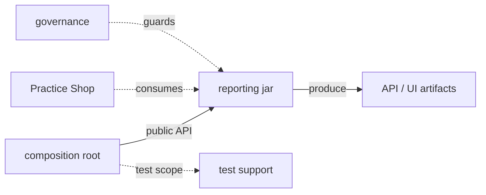
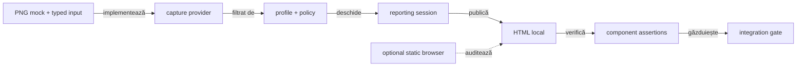
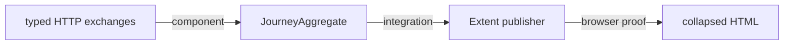

# ATF Reporting Tests — compoziție izolată pentru biblioteca de raportare

## Pe scurt

UI și API afișează implicit detalii la consolă atât din IntelliJ, cât și din Maven.

- Auditul UI folosește `ReportingTestConsole` pentru browser și raport.
- Testele API direct-runnable declară `@AtfConsoleMessages(DETAILS)`; fixture-ul
  API reutilizează sink-ul lifecycle-ului, astfel încât request/validation apar
  prin aceeași proiecție `[ATF]`, fără reporter duplicat.
- API-ul folosește consola configurată și fără lifecycle JUnit curent.
- `reporting.console.detailsEnabled: false` restrânge detaliile;
  `enabled: false` oprește proiecția. [ATF Console](../atf-console/README.md)
  deține politica și output-ul.

Schimbarea testelor, suportului sau resurselor din acest modul cere un control
tehnic `testChanges` eligibil; [guvernanța whole-ATF](../atf-tests/README.md#guvernanța-schimbării-testelor)
verifică diferența Git și probele negative ale regulii.

`atf-reporting-tests` verifică `atf-reporting` ca librărie reutilizabilă:

- acoperă setup API/mock, renderer, publisher, browser read-only și ATF Debug;
- nu deține testele de business ale unei aplicații;
- testele business aparțin modulului consumer, precum `atf-test-practice-shop`;
- `atf-tests` rămâne dedicat guvernanței whole-ATF.

<details>
<summary><strong>Harta de lectură</strong></summary>

- [limitele librăriei](#regula-limitelor-de-responsabilitate) — separarea
  harness-ului de codul de producție;
- [contractul titlurilor API](#contractul-de-titlu-pentru-request-uri-api) și
  [reconcilierea evidence-ului](#reconcilierea-dovezilor-api-și-navigarea-fazei);
- [matricea de integrare](#matricea-de-integrare-și-limitele-verificate) —
  legătura dintre seam, probă și limită;
- [limitele consumerilor](#limitele-de-responsabilitate-ale-aplicațiilor-consumatoare)
  — ce rămâne specific aplicațiilor.

</details>

`UiFailureReportContractTest` este proba browser annotation-driven pentru
failure UI în Extent:

- SETUP, timeout Playwright, observație și assertion păstrează leaf-ul FAIL sub
  ownerul semantic, apar în Fails/deep-link și rămân collapsed la sosire;
- scenariul Playwright verifică `TimeoutError`, locatorul, durata și redacția;
  UI failure nu trebuie să creeze disclosure HTTP;
- `ExtentReportUiFailureEvidenceTest` și `UiFallbackFailureEvidenceTest`
  verifică fallback-ul și izolarea unui scenariu-frate;
- renderer-ul redă targetul locatorului prin redactor; fără cauză, publicarea o
  derivează dintr-o acțiune FAIL sau respinge input-ul fără diagnostic;
- contractul browser păstrează timeout-ul în scenariul curent și îl exclude din
  scenariile sibling; istoricul cerinței este în
  [feedback-ul Reporting](../docs/feedback/ATF_Reporting_Feedback.md).

Contractul stabil pentru ierarhia vizibilă, layout, responsive viewport,
disclosure-uri și dovezile browser este
[ATF Reporting — contract de display și layout](../docs/ATF_Reporting_Display_Contract.md).
Acest README deține matricea probelor și responsabilitățile suitei; nu
redefinește regulile vizuale în feedback sau în fixture-uri.

Helper-ele reutilizate de probele HTML UI stau în
`atf.api.reporting.ui.support`, nu în pachetul testelor de renderer. De exemplu,
`ExtentReportUiEvidenceTestSupport` centralizează fixture-ul și verificările
comune fără să devină un test sau să mute ownership-ul din
`atf-reporting-tests`. Limita de coeziune per pachet rămâne verificată de
`AtfPackageCohesionGovernanceTest`; pragul nu se ajustează pentru a acomoda un
hotspot.

Proiecția contextului UI este verificată la componentă:

| Probă | Contract protejat |
|---|---|
| `UiCheckpointEvidenceProjectionTest` | identitatea checkpoint-ului și `evidence.type`/`evidence.policy` rămân în model; proiecțiile typed/legacy și fallback nu le publică și nu le mută în response |
| `ExtentReportUiEvidencePublishingTest` | publisher-ul UI nu adaugă un request HTTP sintetic; exchange-ul nested păstrează request/response/JSON/execution |
| `ExtentReportDisclosureBrowserComponentTest` | artifact controlat cu PASS/WARNING/FAIL; niciun tabel introductiv la checkpoint, validări și screenshot disponibile, API exchange complet, close fără subarbore vizibil și titluri custom identificate semantic; captură deduplicată deschisă prin click/Enter cu sursa colapsată, fără salt la ancoră |
| `ReportPhaseDiagnosticTest` | conversie explicită, statusul fazei sursă, chei legacy delimitate, context nemodificat și rezultat imutabil; portul diagnostic nu creează HTTP |
| `ReportPhaseAuditBrowserComponentTest` | Extent/fallback cu zero/unul/mai multe exchange-uri și cu/fără metadata; eșec JUnit, asociere lipsă, redacție și închiderea diagnosticului; Fails exclude notele fazei PASS; probe negative pentru bandă ascunsă, redenumită sau goală |

Fixture-ul browser este local și determinist; nu cere o nouă achiziție în
Practice Shop. Raportul timestamped este dovadă de componentă, iar stările
FAIL/WARNING sunt date deliberate ale fixture-ului.

Testele JUnit declară intențiile; `support/inspection/disclosure` deține fixture-ul
și proba browser. Auditul reutilizabil folosește facade-ul din `support/locators`:
identifică validarea UI după rol și acțiunile incluse, nu după titlu, și deschide
ancestorii scenariu → fază → checkpoint → validare înaintea inspecției.



<details>
<summary><strong>Legendă — composition root pentru reporting</strong></summary>

- atf-reporting este biblioteca verificată, nu un test fixture;
- suportul grupat în diagramă reprezintă dependențele de test scope;
- artifactele API/UI sunt rezultate ale compoziției, nu fișiere normative;
- atf-test-practice-shop și atf-tests sunt consumatori cu responsabilități separate, nu extensii ascunse ale librăriei.
</details>

| Surface | Owner | Dependențe |
|---|---|---|
| renderer, model, CSS/JS, publication | `atf-reporting` | zero module ATF |
| contracte API/mock care produc evidence pentru reporting | `atf-reporting-tests` | core/mock/validation/console |
| browser E2E și ATF Debug pentru raport | `atf-reporting-tests` | ui/debug-ui/Playwright |
| testele Practice Shop | `atf-test-practice-shop` | reporting jar, UI și setup-ul aplicației |
| guvernanță whole-ATF | `atf-tests` | nu deține teste de aplicație |

## Regula limitelor de responsabilitate

`atf-reporting` trebuie să treacă singur:

```text
mvn -f atf-reporting/pom.xml test
```

Fără reactor, fără module ATF locale și fără fixture-uri de business. Testele
din acest modul verifică numai contractele publice ale reportingului. Testele
API/UI/E2E de aici sunt vehicule deterministe pentru a demonstra că reportingul
poate fi consumat; nu sunt suita unei aplicații reale.

Înlocuirea modulului cu un jar nu schimbă consumerii: aceștia depind de
interfețele și contractele publice `atf-reporting`, nu de clasele testului sau
de directoarele locale ale repository-ului.

Locatorii UI sunt centralizați în `src/test/.../support/locators`:

- preferă un selector semantic cu atribut stabil, de exemplu
  `button[data-atf-action='expand']`;
- selectorii structurali sau `nth(...)` rămân în ownerul locatorului când
  markup-ul nu oferă o identitate mai bună;
- testele, flow-urile și auditorii nu compun direct `page.locator(...)`.

## Contractul de titlu pentru request-uri API

Orice request publicat de un consumer trebuie să fie recognoscibil fără
deschiderea imediată a disclosure-ului:

```text
HTTP_METHOD relativePath — very-short business intent
```

`relativePath` este ruta observată; valorile dinamice rămân în path-ul runtime,
nu în enum-uri. Dacă este necesară intenția de business, consumerul poate folosi
un descriptor typed (`ApiOperationDescriptor`) cu method și route template.

Boundary-ul rămâne independent:

- `atf-reporting` publică titlul primit și nu parsează semantica din el;
- consumerul deține vocabularul aplicației și corelarea cu ruta dinamică;
- example Practice Shop: `SEARCH` → wire `GET` →
  `GET /products/search — find configured product`;
- aliasul browser `QUERY`, dacă apare, rămâne metodă observată la capture
  boundary și nu înlocuiește metoda/titlul request-ului;
- `OPERATION KIND` și `ROUTE TEMPLATE` oferă auditorului contextul stabil
  al execuției Practice Shop.

Contractul este verificat pe două seam-uri:

| Seam | Verificare |
|---|---|
| core vocabulary | `ApiOperationDescriptorContractTest` validează formatul și input-ul invalid |
| reporting fallback/Extent | `HtmlReportComponentContractTest` și `ExtentReportSessionContractTest` validează titlul publicat în artifact |
| consumer Practice Shop | `ShopApiOperationTest`, `ShopStandaloneApiReportTest` și `ShopApiMethodFidelityTest` validează method/path/intent, absența `QUERY`, operation kind și route template |

### Fidelitatea metodei și a timpilor API

- metoda observată rămâne fidelă în snapshot, titlu, semnătură și replay; aliasul
  operației business rămâne separat;
- durata necapturată este distinctă de `0 ms`, iar response time, totalul cu retry
  și durata publicării nu se substituie între ele;
- corp absent, JSON literal `null` și corp necapturat rămân stări distincte;
- `ReportTransportTimingTest` și `ApiExchangeParityComponentTest` verifică
  proiecția Reporting, iar `ShopApiMethodFidelityTest` protejează adaptorul
  consumerului;
- semantica este în [`ATF_Reporting_Contract.md`](../docs/ATF_Reporting_Contract.md),
  iar forma vizibilă este în
  [`ATF_Reporting_Display_Contract.md`](../docs/ATF_Reporting_Display_Contract.md).

## Reconcilierea dovezilor API și navigarea fazei

| Boundary | Contract | Probă |
|---|---|---|
| Câmpuri randate | `ApiReportEvidenceField` deține eticheta canonică și aliasurile legacy explicite; aliasurile contradictorii nu ascund o valoare greșită | `ApiReportContractAuditorTest` |
| Query | se extrage din `URL` al request-ului, nu din path sau din URL-ul răspunsului; un răspuns corect nu repară artificial un request incomplet | `ApiReportRenderedEvidenceComponentTest` — nominal și query lipsă |
| Ownership tabel | câmpurile response provin numai din disclosure-ul `Response details`, nu din trace-ul tehnic al execuției | aceeași componentă cere exact un tabel pentru fiecare canal de evidence |
| Fază | binding-ul se verifică pe header, apoi se așteaptă starea open pe card; nu se mărește timeout-ul și nu se face toggle repetat fără citirea stării | aceeași componentă: reselectare, tab round-trip, reîncărcare și TEST BODY absent |
| Captură de audit | publisherul reutilizează tab-ul deja inspectat fără reload sau resetarea acțiunilor; schimbarea tab-ului pentru evidence păstrează istoricul | aceeași componentă verifică identitatea paginii, trace-ul și disclosure-ul deschis |
| Compoziție | setup exact → mock → API artifact → toate secțiunile randate și reconciliere | `SelectedApiTestsReportUiTest` |

Probele de componentă folosesc o publicație Extent controlată și aceleași
locatoare/extractoare ca E2E, fără endpoint extern. Scenariile negative sunt
date ale fixture-ului, nu motive de a dezactiva verificări sau de a inventa PASS.

## Ordinea testelor și responsabilitatea protecțiilor

1. `atf-reporting` — unit/component pentru model, renderer, artifact și CSS/JS;
2. `atf-reporting-tests` — component pentru compoziția controlată mock →
   reporting, integration pentru boundary-urile dintre module și E2E numai
   pentru browser/rendering-ul contractului librăriei `atf-reporting`;
3. `atf-test-practice-shop` — testele consumer pentru journey-ul Practice Shop.
4. `atf-tests` — boundary și guvernanță whole-reactor, inclusiv verificările
   globale de documentație, ownership, coeziune și vocabular.

`atf-reporting-tests/src/test/java/atf/api/tests/architecture` rămâne limitat la
verificări care au ca subiect compoziția reporting. Nu duplică guard-uri de
reactor și nu validează README-urile întregului proiect; acestea sunt executate
central prin [`WholeAtfGovernanceSuiteTest`](../atf-tests/README.md#suita-whole-atf-și-reziduul-de-compatibilitate).

### Selecția scenariilor pentru un raport API

`@ApiScenarioSetup(tests = ...)` declară metodele exacte; resolver-ul validează
selecția înaintea colecțiilor mai largi.

Ordinea fallback-ului, când nu sunt declarate metode exacte:

1. proprietatea JVM cu familii API;
2. proprietatea suitei;
3. familiile din adnotare;
4. configurația YAML.

Ownerii și scenariile așteptate nu sunt deduși din DOM-ul rezultat.

| Contract | Proof component | Limită |
|---|---|---|
| selecția exactă și proiecția semantică | `ApiScenarioManifestTest` | verifică owner, titluri, statusuri, ordine și respinge scenarii nealese față de fallback-ul YAML |
| precedence-ul setup-ului și fallback-urilor | `ApiReportAuditSetupTest` | verifică direct că override-ul JVM pentru familii are prioritate față de `tests = ...`, apoi verifică fallback-urile de suite, adnotare și YAML |
| selecție exactă → mock/lifecycle → publisher | `ApiSelectionMockPublisherComponentTest` | verifică răspunsul JSON al mock-ului, request/response/execution evidence în artifact și excluderea scenariilor nealese; selecția invalidă este respinsă înainte de publicare |

Aceste proof-uri sunt complementare: manifestul verifică proiecția, resolver-ul
verifică precedence-ul, iar testul compus dovedește verticala până la artifact.
`SelectedApiTestsReportUiTest` rămâne separat pentru interacțiunea de browser;
nu este folosit ca substitut pentru contractele lower-level.

<details>
<summary><strong>Niveluri de testare și independență</strong></summary>

- **`atf-reporting/src/test`** — boundary standalone al librăriei; verifică
  compilarea independentă și contractele locale fără ATF, mock sau browser;
- **`atf-reporting-tests`** — composition root pentru component, integration/API
  și E2E; leagă reporting-ul de mock, execution, validation, Playwright și
  ATF Debug;
- **`atf-test-practice-shop`** — consumer de aplicație; nu este parte din
  verificarea bibliotecii reporting;
- **`atf-tests`** — governance pentru reactor; nu deține fixture-uri sau flows;
- **regula de independență** — testul E2E verifică numai comportamentul care
  depinde de browser; contractele statice, modelul și asset-urile se verifică
  la nivelurile mai mici;
- **regula de boundary** — mock-ul și browserul nu intră în production JAR-ul
  `atf-reporting`.

</details>

## Capturare generică — suport verificat înaintea modulului consumator

Contractul transversal pentru flow mode, screenshot policy și capture source este
în [`docs/ATF_Evidence_Capture_Contract.md`](../docs/ATF_Evidence_Capture_Contract.md).
Acest modul îl probează prin fixture-uri deterministe; nu mută politica într-un
consumer și nu cere Practice Shop pentru testarea suportului.



<details>
<summary><strong>Legendă — testare pe niveluri</strong></summary>

- unit: policy înainte de provider, target, provenance, PNG și cardinalitate `0/1/N`;
- component: markup, status, disclosure, referință media și păstrarea acțiunilor;
- integration: session → model semantic → HTML, fără endpoint sau browser extern;
- browser opțional: captura reală pe artifact HTML static;
- E2E consumer: dovedește integrarea, nu reimplementează suportul generic;
- fixture-ul poate reprezenta `PASS`, `FAIL`, `WARNING` sau `SKIP`.

</details>

- `ReportEvidenceProfileTest` verifică filtrarea înainte de captură, potrivirea sursei,
  payload-ul PNG și selecția typed a detaliilor acțiunilor.
- `ExtentReportUiEvidenceRenderingTest` verifică tabelul implicit și că
  `SUMMARY_ONLY` păstrează un disclosure colapsat, fără tabelul detaliat sau
  schimbarea capturii; rendererul nu execută acțiuni UI.
- `ReportEvidenceProfileIntegrationTest` dovedește provider mock → sesiune → HTML local pentru ambele flow mode-uri.
- Aceeași clasă verifică profile diferite pentru scenarii-surori dintr-o sesiune partajată și repetă proba cu ordinea inversată; profilul nu se scurge între scenarii.
- `UNIFIED_FLOW` păstrează un singur request cu propoziția Gherkin finală, fără checkpoint-uri numerotate sau Gherkin duplicat; UI actions și assertions sunt agregate, iar `API validation` este soră cu `UI validation` sub același checkpoint Gherkin și deține exchange-urile sale. Sub `FINAL_ONLY` se publică doar captura `FINAL`.
- `SCREEN_CHECKPOINTS` păstrează request-urile Gherkin independente.
- Profilul typed combină flow mode, screenshot policy, capture source și action-details mode.
  Grouping-ul aparține lifecycle/publisher-ului din `atf-reporting`; alegerea modului
  pentru o adnotare de consumer rămâne responsabilitatea acelui consumer.

Izolarea profilului per scenariu este un contract generic implementat și testat.
Consumerul trebuie să transmită profilul rezolvat la crearea fiecărui scenariu;
un profil furnizat doar la deschiderea raportului rămâne valoarea implicită a
sesiunii. Wiring-ul Practice Shop pentru rapoarte partajate și agregarea fazelor
`SETUP` + `TEST BODY` sunt urmărite separat în
[SHOP-CAPTURE-01](../docs/feedback/ATF_Reporting_Feedback.md#shop-capture-01).

## Matricea de integrare și limitele verificate

Integration tests rămân grupate după boundary-ul observat, nu după numele
modulului consumat:

| Familie | Clase reprezentative | Boundary verificat |
|---|---|---|
| API scenarios | `UsersApiTests`, `PostsApiTests`, `RequestVariantsApiTests`, `ApiHeadersAndEdgeCasesTests`, `ApiNegativeMatrixTests`, `ApiRequestFlowsTests` | mock → core → validation → reporting evidence |
| reporting API | `MockApiReportIntegrationTest`, `ApiReportArtifactAuditTest`, `ApiManualReplayTest` | fixture API → renderer/publisher → artifact și replay |
| UI composition | `SelectedApiTestsReportUiTest`, `StaticUiExtentReportContractTest` | artifact → ATF Debug/Playwright → DOM/CSS/disclosure |

`StaticUiExtentReportContractTest` include verificările `SCREEN_VALIDATION` și
`INLINE_SCREENSHOT`; inputul trebuie să aibă evidence de screenshot conform
policy-ului declarat. Un raport cu `Screenshot policy = Disabled` nu este input
pentru acest screenshot gate și nu se interpretează ca defect al rendererului.

Fiecare clasă declară layer-ul prin adnotare; package-ul exprimă domeniul și
boundary-ul, nu nivelul de testare. Setup-ul, mock-ul și validatorii comuni
rămân în `support`, ca o clasă nouă să compună scenariul fără copiere.

Boundary-urile suportului rămân mici și verificabile:

- `support.api` ține selecția și publicarea precondiției API;
- `support.config` ține loader-ele, resursele și configurația UI;
- `support.config.environment` deține snapshot factory-urile typed pentru Overview/System;
- Network Inspector aparține `atf.api.reporting.ui.network`; nu se adaugă excepții de coeziune pentru clase fără legătură;
- guard-ul whole-ATF limitează fiecare package la maximum opt clase.

`ReportingCoverageMatrixTest` este harta executabilă a seam-urilor publice:

| Verificare | Dovadă obligatorie | Limită intenționată |
|---|---|---|
| coverage | fiecare seam are test `unit`, `component`, `integration` sau `e2e` | un seam nou fără dovadă lower-level e regresie de guvernanță |
| Network Inspector | `ReportNetworkInspectorTest` (`unit`) pentru proiecție/markup; `NetworkInspectorSummaryRoleTest` (`component`) pentru rolul și ordinea summary-ului; `ExtentReportUiEvidencePublishingTest` (`unit`) pentru publicarea aggregate-ului | matricea cere clasele, metodele executabile și adnotările ATF; publicarea rămâne proof separat |
| audit semantic | `Overview`, `Categories`, `Fails`, `Screen validation` și `ReportExecutionProjections` | `ReportAuditSnapshot` rămâne renderer-neutral; aceleași proiecții typed pot fi verificate fără browser |
| convergență | JSON și visual sunt verificate împreună | browserul observă; regulile se verifică fără Playwright |
| browser proof | `E2eSuiteBudgetArchitectureTest` plafonează la 8 clase `@AtfE2eTest` | orice clasă nouă cere justificare în feedback și modificarea bugetului |

### Publicarea unui raport voluminos — probă de componentă

`LargeReportPublicationComponentTest` rulează într-un JVM copil cu heap
limitat; nu execută journey-uri pe aplicația externă și nu reduce capturile.
Două profiluri izolează volumul HTML de volumul media.

| Parametru / dovadă | Contractul fixture-ului |
|---|---|
| Heap | `-Xms64m -Xmx384m`, separat de fork-ul Surefire |
| Output | directorul configurabil este creat înaintea logului JVM copil; proba poate porni într-un director nou |
| Profil text/HTML | Unicode, 1.500 referințe PNG inline și două imagini distincte repetate; artifact >9 MB |
| Profil media | Patru PNG-uri generate distincte 256×256, fiecare referit de două ori; după deduplicare rămân patru payload-uri inline, totalul lor depășește 900.000 caractere |
| Integritate | exit code 0, heap total eșantionat la 2 ms, durata publicării, marker final, temă, runtime și referințe screenshot acționabile |
| Failure-path și publicare | `ExtentReportSessionLifecycleTest` verifică destinație blocată, cleanup failure după promovare atomică, staging privat fără scurgeri și evenimentul `REPORT_PUBLISHED` numai după existența fișierului final; închiderea repetată emite o singură notificare, iar publicarea eșuată nu emite succes. `ExtentReportAssetCleanupTest` verifică lock tranzitoriu/persistent, retry limitat și diagnostic explicit |
| Timp | Child process-ul are timeout configurabil `atf.test.publication.timeout.seconds` (implicit 60 s); depășirea oprește forțat doar JVM-ul probei |
| Limită | nu dovedește volume arbitrare sau fotografii de rezoluție foarte mare; timpul este măsurat și limitat doar de timeout-ul probei, nu este SLA |

Proba este contractuală prin limite repetabile, nu prin rezultatele unui run:

- JVM copil: `-Xms64m -Xmx384m`; heap-ul eșantionat trebuie să rămână sub
  `345 MiB`;
- timeout: `atf.test.publication.timeout.seconds`, implicit `60 s`;
- profilul `repeated-pixels` păstrează raportul peste `9 MB` și referințe la
  capturi distincte;
- profilul `distinct-pngs` păstrează raportul peste `2 MB`, patru payload-uri
  PNG inline distincte și peste `900.000` de caractere media;
- durata și heap-ul sunt observate pentru diagnostic, dar nu se copiază ca
  rezultate permanente în README.

Cleanup-ul directorului vendor `spark` reîncearcă numai `AccessDeniedException`
de patru ori, cu pauze de 50 ms; o blocare persistentă produce un diagnostic cu
cale, fără să elimine raportul deja publicat sau să suprime eroarea.

### Bugetul asset-urilor publicate

`ReportAssetSizeInventoryTest` măsoară separat sursele native și copiile
compactate/publicate și le verifică față de bugetele explicite ale consumerului.
Pragurile sunt contract de regresie; numărul de bytes observat într-un run este
doar o măsurătoare, nu un nou prag. Orice rebugetare cere motiv și verificarea
impactului asupra artifactului, nu o relaxare incidentală pentru ca testul să
treacă.

Bugetele de regresie sunt explicite în `ReportAssetSizeInventoryTest`; inventarul
este măsurat din asset-urile native și publicate la fiecare execuție. Acestea sunt
plafoane, nu ținte pentru dimensiunea livrată:

| Asset budget | Native | Published |
|---|---:|---:|
| JavaScript | `125.000 B` | `105.000 B` |
| CSS | `140.000 B` | `120.000 B` |
| Total | `265.000 B` | `220.000 B` |

`ReportAssetSizeBudgetTest` verifică și comportamentul comparatorului pentru
limite depășite și configurații invalide. Mărirea unui plafon cere motiv și
verificarea impactului asupra artifactului.

### Verificarea randării responsive

`SelectedApiTestsReportUiTest` este entry-point-ul configurabil pentru raportul
Extent generat. `CategoryCardinalityBrowserFixtureTest` este poarta dinamică de
verificare în browser: verifică 0/1/multe categorii și măsoară fixture-uri UI și API
pentru conținut scurt/lung, la lățimea configurată și la `591px`. Raportul de
audit se publică prin `ReportAuditContext` / ATF Debug.

Invarianturile de randare sunt:

- în cele opt suprafețe măsurate în browser (Overview categories,
  System/Environment, tag audit, Playwright actions, Audit/Assertions,
  `TECHNICAL TRACE`, Unique request signatures, Technical diagnostics),
  `scrollWidth <= clientWidth`,
  `max-height` folosește plafonul comun `500px`, iar conținutul scurt rămâne
  natural, fără înălțime goală;
- `TECHNICAL TRACE` este măsurat în API direct și în schimbul API publicat lângă
  checkpoint-ul UI, pentru date scurte și lungi; testele de markup și CSS
  verifică aceeași structură și același token în rendererul fallback;
- `ExtentReportDisclosureBrowserComponentTest` verifică tabelul lung
  `Request details`, imbricat în disclosure-ul request-ului, și retry history
  în Extent: scroll local, ultimul rând accesibil și antet sticky la viewport
  standard și `760px`;
- `ReportApiViewportParityComponentTest` completează matricea cu tabele scurte
  Request details/retry Extent și scurte/lungi în fallback la `1280px` și
  `760px`: înălțime naturală pentru scurt, scroll local/ultimul rând/sticky
  pentru lung, fără overflow orizontal al documentului. `HtmlReportViewsTest`
  păstrează separat contractul structural al wrapperului fallback;
- pentru conținut lung, ultimul rând rămâne accesibil, antetul tabelului rămâne
  fix, iar zona scrollabilă nu depășește plafonul comun;
- `ReportTableViewportComponentTest` verifică wrapperul implicit, inclusiv
  familii noi, input gol/null și aceeași politică publicată în ambele teme;
- `TableViewportBrowserComponentTest` măsoară tabelele reale din toate fazele
  și matricea de densitate/viewport/token, inclusiv celulă unică înaltă,
  limita de overflow, mouse/tastatură și păstrarea titlurilor/contoarelor;
- aceeași probă respinge wrapper lipsă/dublu, plafon greșit, overflow ascuns,
  antet nefixat și ultim rând inaccesibil; inventarul pornește de la tabele,
  nu numai de la wrapper-ele deja conforme;
- rândurile Network Inspector `Unique request signatures` și
  `Technical diagnostics` măsoară `34px` la ambele lățimi și sunt închise
  implicit, aliniate cu celelalte detalii API/UI;
- auditul browserului nu observă erori console/page/request când deschide
  artifactele UI și API selectate; aceasta este dovadă de randare, nu evidence
  publicată în raport;
- raportul păstrează secțiunile, disclosure-urile collapsed la sosire,
  `SETUP → TEST BODY → Screen validation`, request/response JSON și glyph-ul
  `＋/−` inline înaintea propoziției, fără `<hr>` decorativ.

Artifactele sunt output de run și nu se copiază în README. Sursa `.js`/`.css`
rămâne formatată în `atf-reporting/src/main/resources`; numai copia publicată în
HTML este compactată de `ReportAssetCompactor`. Astfel testele component pot
verifica fragmentele native, iar browserul verifică efectul compoziției finale.

### Dovezi pentru inspectorul fluxului

Inspectorul de rețea se verifică în două trepte, fără a transforma E2E în owner
al modelului:



<details>
<summary><strong>Legendă — ce trebuie să treacă la fiecare nivel</strong></summary>

- `ReportNetworkInspectorTest` verifică ordered facts, authentication,
  correlation, transport counters, unique signatures și deduplicarea
  diagnosticelor derivate din exchange-uri HTTP eșuate; testul unit verifică și
  markup-ul nested, inclusiv aggregate gol/parțial;
- `NetworkInspectorSummaryRoleTest` este proof-ul component pentru rolul de
  summary, ordinea în flow și toate mode-urile de evidence;
- `ExtentReportUiEvidencePublishingTest` rămâne proof separat pentru publicarea
  aggregate-ului în artifactul Extent; schimbarea lui nu înlocuiește proiecția
  unit sau contractul component de renderer;
- component/integration publisher tests verifică faptul că body-urile rămân în
  disclosures canonical și aggregate-ul nu primește credentiale sau mesaje
  volatile;
- publisher proof trebuie să verifice și shape-ul, nu numai prezența label-urilor:
  pentru `0..N` exchange-uri, fiecare pereche request/response și execution
  evidence trebuie să rămână scanabilă ca unitate API; un tabel comun cu prefixe
  `API 1/API 2` nu este suficient;
- UI trace proof trebuie să verifice ierarhia `un singur Gherkin checkpoint →
  UI validation + API validation → disclosures`, cu cele două validation nodes
  ca frați semantici și fără repetarea propoziției Gherkin;
- execution disclosure-ul trebuie să fie identificabil pentru exchange-ul lui;
  două apariții `Execution evidence · 1 attempt` fără context sunt ambigue chiar
  dacă numărul de attempts este corect;
- retry-ul aceluiași request trebuie verificat ca un singur exchange logic:
  attempts/history se păstrează în execution disclosure și nu generează un nou
  `API n`;
- contractul de layout trebuie să păstreze URL-ul complet lizibil la viewport
  îngust, fără break arbitrar în identificator și fără overflow;
- browser/debug verifică numai structură vizibilă, expand/collapse, ordine și
  navigare; nu este necesar pentru fiecare variație de method/status;
- dacă renderer-ul publică fields flat în loc de disclosure-uri nested, modelul
  semantic poate rămâne verde, dar publisher gate-ul trebuie să rămână roșu până
  la corectarea proiecției;
- testele HTML trebuie să selecteze zona semantică a inspectorului și să verifice
  celule/atribute/ordine, nu să folosească `contains` global sau casing vendor.

</details>

Entry-point-urile selectabile direct din IntelliJ sunt separate pe layer:

| Entry point | Include | Rol |
|---|---|---|
| `AtfReportingUnitSuite` | `unit` din `atf.api.reporting` | model, policy, parser, renderer seam și vocabular |
| `AtfReportingComponentSuite` | `component` din reporting și UI extent | boundary HTML/CSS/JS, contracte și fixture-uri controlate; snapshot-ul de navigation performance este mapat prin `ReportRuntimePerformanceSnapshot`, iar `ReportRuntimePerformanceBudget` verifică fixture-uri configurabile fără verdict business |
| `AtfReportingIntegrationSuite` | `integration` din `atf.api.reporting` | session, publication, replay și contracte de integrare ale librăriei |
| `AtfReportingApiFixtureSuite` | `integration` din `atf.api.tests.api` | mock API → core → validation → reporting evidence, fără browser |
| `AtfReportingUiAuditSuite` | `e2e` din `atf.ui.tests.extent.e2e` | audit browser/debug al artifactului Extent, cu owner UI explicit |
| `ExtentReportingE2eSuite` | `e2e` din `atf.ui.tests.extent.e2e` | browser/debug, click-uri, disclosure și randare observabilă |

Gate-ul API cross-projection este inclus în `AtfReportingComponentSuite` și
legat de `ReportingCoverageMatrixTest`: contract API direct, aceeași dovadă prin
publishers API/fallback/UI, reconciliere browser a query-ului și fazei,
viewport-ul tabelelor API și ARIA/keyboard pentru disclosures. Rulează gate-ul
din rădăcina reactorului cu:

```text
mvn -pl atf-reporting-tests -am "-Dtest=AtfReportingComponentSuite" "-Dsurefire.failIfNoSpecifiedTests=false" test
```

- `-am` construiește modulele de care depinde test harness-ul.
- `failIfNoSpecifiedTests=false` permite modulelor intermediare să nu aibă clasele selectate.
- Comanda pornește suita completă, nu doar testul matricii.
- Probele browser țintite resping Request și Response disclosure absent sau
  mutate la ownerul scenariului și verifică izolarea ownerilor API din același
  artifact în `ApiReportRenderedEvidenceComponentTest`. Același test
  verifică browser collapse/reopen: tabelele Request/Response/Execution dispar
  și reapar vizibil. `UiApiVerdictProjectionComponentTest` verifică ambele
  combinații independente UI PASS/API FAIL și UI FAIL/API PASS, cauza corectă în
  `Fails` și deep-link-ul către scenariul owner. Acesta este contractul stabil
  protejat de probe; verdicturile concrete și numărul de cazuri rămân în output-ul
  testelor, nu în README.
- Surefire poate afișa `0 tests` pe containerul suitei; rezultatele testelor
  copil sunt raportate separat de platforma JUnit.
- Rezultatele și numărul de teste aparțin output-ului execuției, nu contractului
  acestui README. Comanda de mai sus este entry point-ul reproductibil; un
  eșec se diagnostichează din raportul și logul run-ului curent, nu dintr-un
  rezumat istoric păstrat aici.

Launcher-ele sunt specifice layer-ului: `ExtentReportingE2eSuite` agregă E2E,
iar `AtfReportingUiAuditSuite` auditează randarea UI.

Ancorele de output sunt:

- E2E cu `@ProjectRelativeUiReportDirectory("artifacts/reports/ui/e2e")`:
  `<reactor>/artifacts/reports/ui/e2e`;
- celelalte layer-e UI: `<ui-report-base>`;
- în staging, root-ul proiectului este checkout-ul extern, nu proiectul live.

| Politica de output | Responsabilitate |
|---|---|
| `atf.api.testkit.output` | Adnotări și resolver neutru; baza UI și rădăcina proiectului sunt primite explicit |
| `ReportingTestResources` | Deleagă alegerea directorului după încărcarea configurației |
| Probe unitare | Director implicit și E2E păstrate; valori goale, absolute sau cu traversare respinse |

- API-ul implementat, precedence-ul și limitele sunt în
  [documentația adnotărilor](../docs/ATF_Test_Infrastructure_Annotations.md);
- verificarea IntelliJ a output-ului project-relative, când se schimbă resolverul
  sau compoziția IDE, este documentată în
  [ghidul suitei Extent](src/test/java/atf/ui/tests/extent/README.md#rulare-directă-din-intellij);
- importă root `pom.xml` ca proiect Maven și folosește **Reload All Maven Projects** înainte de prima rulare sau după schimbări de module;
- run configuration-ul suitei reporting folosește modulul `atf-reporting-tests`, nu modulul legacy `atf-tests`;
- pentru `NoClassDefFoundError` în IntelliJ, verifică modulele `atf-reporting` și `atf-reporting-tests` și dependency graph-ul testului; nu duplica sau muta clasa pentru a compensa un model IDE stale;
- reproduce întâi cu testul forked `ReportStagingWorkspaceTest` în reactorul Maven.

## Limitele de responsabilitate ale aplicațiilor consumatoare

Se aplică [regula comună de ownership](../docs/ATF_Testing_Guide.md#owner-ul-testului-business-adaptor-sau-infrastructură):
acest README fixează exemplele de boundary Reporting, nu mută testele consumerilor.
`atf-reporting-tests` nu deține adaptoare de aplicație. El deține în primul rând
probele reutilizabile ale bibliotecii: model și publisher, API fixtures neutre,
paritate între renderere, artifact HTML, DOM/CSS și interacțiuni browser. Aceste
probe folosesc mock/fake determinist, nu depind de endpoint-ul sau regulile de
business ale aplicației testate. Practice Shop este izolat în modulul dedicat:

```text
atf-test-practice-shop/src/test/resources/atf-practice-shop.yaml
atf-test-practice-shop/src/main/java/atf/ui/practiceshop/
├── api/         client, request factory și screen API flows
├── config/      configurare și credențiale typed
├── flow/        acțiuni semantice
├── locators/    singurul owner al selectorilor
├── pages/       page objects
└── support/     context și evidence adapters
atf-test-practice-shop/src/test/java/atf/ui/tests/practiceshop/
├── component/       teste rapide de module
├── api/component/   variații fake pozitive/negative
├── api/integration/ precondiție login live, opt-in
└── e2e/             journey complet
```

- `atf-tests` nu mai conține YAML, page objects sau flow-uri Practice Shop.
- Testele consumerului rămân în Shop pentru configurație, binding de checkpoint,
  redactare specifică, flow sau adaptarea publică spre Reporting.
- `ShopE2eFailureReportComponentTest` verifică wiring-ul `ShopE2eContext`;
  contractele generice de failure și redactare sunt probate separat aici.
- Dacă un test consumer verifică un invariant Reporting independent de consumer,
  mută proba neutră aici și păstrează în Shop/AutoEx doar integrarea îngustă.
- Un test consumer care produce HTML poate rămâne local numai dacă verifică
  traducerea contractului propriu (de exemplu titlu/rută/intenție business,
  asocierea unei așteptări cu exchange-ul capturat sau politica proprie de
  redactare). Nu verifica în consumer coloanele, nesting-ul, clasele CSS,
  disclosure-urile generice ori semantica generică de retry/failure.
- `AtfReportSemanticSnapshotTest.sameRequestInIndependentScenariosRemainsOwnedByBothScenarios`
  protejează acum în acest modul izolarea generică a request-urilor identice
  între scenarii; copia consumerului Shop a fost eliminată. Shop păstrează
  separat probele asocierii și publicării auditului său API.
- La testele API Shop, separați transportul de owner: probele cu
  `ShopApiComponentFixture` sunt mock-backed, dar validează clientul și
  contractele Practice Shop, deci rămân în consumer. Mutați aici numai
  invariants de model/publicare/rendering care nu importă tipuri sau reguli Shop;
  nu adăugați dependență de `atf-reporting-tests` în modulul consumer.
- Hook-urile JUnit generice sunt testate în modulul owner (`atf-test-kit`);
  testele de sesiune și publicare Reporting aparțin `atf-reporting-tests`.
- `ApiResourceTestBase` activează explicit `@AtfReportPath`; compoziția JUnit
  transmite evenimentul terminal către consola ATF numai după publicarea
  raportului. Resolverul/adnotarea și politica de output rămân testate în
  `atf-test-kit`/`atf-console`, nu sunt reimplementate aici.

### Reutilizare neutră între module

- `ReportModelAdapters` convertește modelele core (`ApiExecutionResult`,
  retry/provenance, assertions și UI actions) fără ca `atf-reporting` să depindă
  la compilare de `atf-core`; vocabularul necunoscut eșuează explicit, nu este
  ghicit sau transformat în `INFO`;
- `ReportQueryParameters.fromUri(...)` este decodorul comun al query-urilor.
  Practice Shop îl folosește în mapper și în assertions, păstrând doar
  semantica de business în jurul lui;
- `AtfPathLocator.locateSourceFile(...)` și `locateModuleRoot(...)` centralizează
  descoperirea generică folosită de testele component; rădăcinile candidate și
  fișierul cerut rămân inputuri explicite, relative și validate;
- capturarea pe host, alegerea endpoint-urilor, recovery-ul login-ului,
  corelarea checkpoint-urilor și redactarea datelor de identitate rămân în
  consumerul Shop. Nu sunt promovate în reporting/core fiindcă depind de
  aplicația testată;
- `ReportModelAdaptersTest` verifică modelul real core și compatibilitatea
  strictă; `ReportQueryParameters` este verificat pentru decoding și duplicate,
  iar testele Shop dovedesc că integrarea folosește același contract.

Rapoartele sunt output de run, nu fixtures păstrate în documentație.

Browser proof-ul folosește un singur seam generic, `StaticHtmlScreenshotAdapter`:

- input: HTML local generat de reporting;
- output: PNG capturat headless prin Playwright;
- integration test: verifică semnătura PNG și viewport-ul;
- limită: nu pornește endpoint, nu cunoaște Practice Shop și nu intră în
  production JAR;
- contractele DOM/CSS rămân în component validators și ATF Debug.

Detaliul normativ al normalizării evidence este în
[`atf-reporting/README.md`](../atf-reporting/README.md#normalizarea-dovezilor-în-artefact).
Aici rămâne numai dovada de consumer: `ExtentReportRuntimeEvidenceComponentTest`
și browser proof-ul verifică faptul că request/response JSON supraviețuiesc
împreună cu execution trace în DOM-ul raportului deschis.
