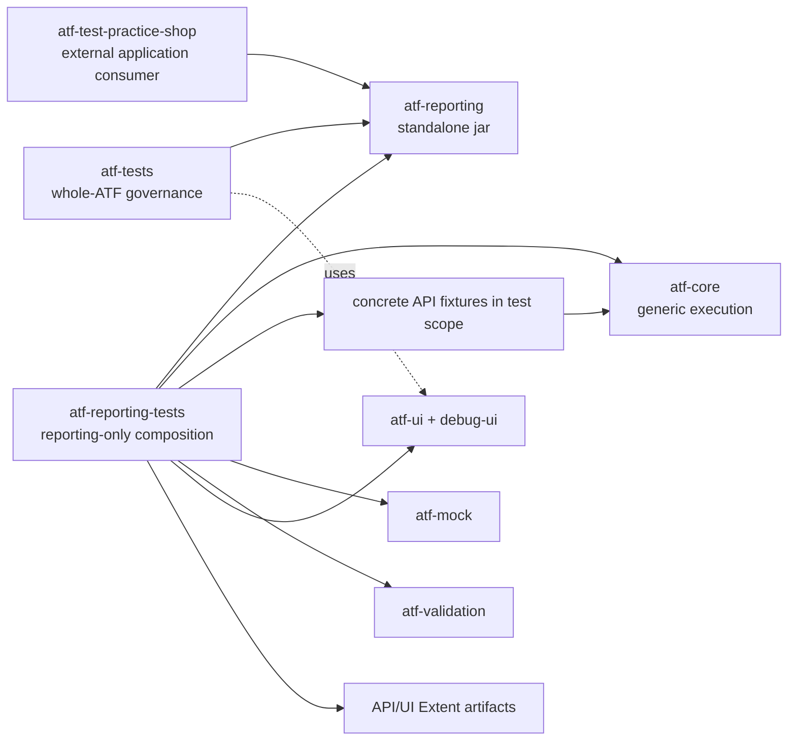
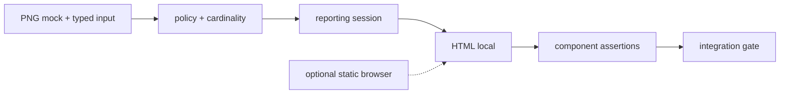

# ATF Reporting Tests — composition izolată pentru librăria reporting

## Overall

`atf-reporting-tests` este modulul specializat exclusiv în verificarea
`atf-reporting` ca librărie: îi probează contractele prin setup API/mock,
renderer, publisher, browser read-only și ATF Debug. Nu este modulul pentru
teste de business ale unei aplicații. Acestea aparțin unui modul consumer dedicat,
precum `atf-test-practice-shop`, sau unui alt modul de aplicație care consumă
jar-ul `atf-reporting`; `atf-tests` rămâne governance-only.



<details>
<summary><strong>Legendă — composition root pentru reporting</strong></summary>

- atf-reporting este biblioteca verificată, nu un test fixture;
- mock-ul, validarea, UI-ul și fixture-urile sunt dependențe de test scope;
- artifactele API/UI sunt rezultate ale compoziției, nu fișiere normative;
- atf-test-practice-shop și atf-tests sunt consumatori cu responsabilități separate, nu extensii ascunse ale librăriei.
</details>

| Surface | Owner | Dependențe |
|---|---|---|
| renderer, model, CSS/JS, publication | `atf-reporting` | zero module ATF |
| contracte API/mock care produc evidence pentru reporting | `atf-reporting-tests` | core/mock/validation/console |
| browser E2E și ATF Debug pentru raport | `atf-reporting-tests` | ui/debug-ui/Playwright |
| testele Practice Shop | `atf-test-practice-shop` | reporting jar, UI și setup-ul aplicației |
| guvernanță whole-ATF | `atf-tests` | nu deține teste de aplicație |

## Regula de boundary

`atf-reporting` trebuie să treacă singur:

```text
mvn -f atf-reporting/pom.xml test
```

Fără reactor, fără module ATF locale și fără fixture-uri de business. Testele
din acest modul verifică numai contractele publice ale reportingului. Testele
API/UI/E2E de aici sunt vehicule deterministe pentru a demonstra că reportingul
poate fi consumat; nu sunt suita unei aplicații reale.

Înlocuirea modulului cu un jar nu schimbă consumerii: aceștia depind de
interfețele și contractele publice `atf-reporting`, nu de clasele testului sau
de directoarele locale ale repository-ului.

În testele UI de aici, locatorii pentru raport sunt centralizați în
`src/test/.../support/locators`. Preferința CSS este
`element[attribute=value]` cu un atribut semantic stabil, de exemplu
`button[data-atf-action='expand']`. Selectorii structurali sau `nth(...)` sunt
permisi numai în ownerul locatorului atunci când markup-ul raportului nu oferă
o identitate mai bună; testele, flow-urile și auditorii nu compun
`page.locator(...)` direct.

## Ordinea testelor

1. `atf-reporting` — unit/component pentru model, renderer, artifact și CSS/JS;
2. `atf-reporting-tests` — integration și E2E pentru contractul librăriei
   `atf-reporting`;
3. `atf-test-practice-shop` — testele consumer pentru journey-ul Practice Shop.
4. `atf-tests` — boundary și guvernanță whole-reactor.

<details>
<summary><strong>Niveluri de testare și independență</strong></summary>

- **`atf-reporting/src/test`** — boundary standalone al librăriei; verifică
  compilarea independentă și contractele locale fără ATF, mock sau browser;
- **`atf-reporting-tests`** — composition root pentru component, integration/API
  și E2E; leagă reporting-ul de mock, execution, validation, Playwright și
  ATF Debug;
- **`atf-test-practice-shop`** — consumer de aplicație; nu este parte din
  verificarea bibliotecii reporting;
- **`atf-tests`** — governance pentru reactor; nu deține fixture-uri sau flows;
- **regula de independență** — testul E2E verifică numai comportamentul care
  depinde de browser; contractele statice, modelul și asset-urile se verifică
  la nivelurile mai mici;
- **regula de boundary** — mock-ul și browserul nu intră în production JAR-ul
  `atf-reporting`.

</details>

## Captură generică — suport verificat înaintea consumerului

Contractul transversal pentru flow mode, screenshot policy și capture source este
în [`docs/ATF_Evidence_Capture_Contract.md`](../docs/ATF_Evidence_Capture_Contract.md).
Acest modul îl probează prin fixture-uri deterministe; nu mută politica într-un
consumer și nu cere Practice Shop pentru testarea suportului.



<details>
<summary><strong>Legendă — testare pe niveluri</strong></summary>

- unit: valori de policy, target, duplicate și cardinalitate `0/1/N`;
- component: markup, status, disclosure, referință media și păstrarea acțiunilor;
- integration: session → model semantic → HTML, fără endpoint sau browser extern;
- browser opțional: captura reală pe artifact HTML static;
- E2E consumer: dovedește integrarea, nu reimplementează suportul generic;
- fixture-ul poate reprezenta `PASS`, `FAIL`, `WARNING` sau `SKIP`.

</details>

Starea curentă are `ReportScreenshotPolicy` și fixture-uri mock deja verificate.
Combinarea generică dintre `flow mode` și policy rămâne contract de evoluție și
se închide numai după ce există un model typed, teste lower-level și un consumer
subțire care îl folosește.

## Matricea integration și boundary-ul verificat

Integration tests rămân grupate după boundary-ul observat, nu după numele
modulului consumat:

| Familie | Clase reprezentative | Boundary verificat |
|---|---|---|
| API scenarios | `UsersApiTests`, `PostsApiTests`, `RequestVariantsApiTests`, `ApiHeadersAndEdgeCasesTests`, `ApiNegativeMatrixTests`, `ApiRequestFlowsTests` | mock → core → validation → reporting evidence |
| reporting API | `MockApiReportIntegrationTest`, `ApiReportArtifactAuditTest`, `ApiManualReplayTest` | fixture API → renderer/publisher → artifact și replay |
| UI composition | `SelectedApiTestsReportUiTest`, `StaticUiExtentReportContractTest` | artifact → ATF Debug/Playwright → DOM/CSS/disclosure |

Fiecare clasă declară layer-ul prin adnotare; package-ul exprimă domeniul și
boundary-ul, nu nivelul de testare. Setup-ul, mock-ul și validatorii comuni
rămân în `support`, ca o clasă nouă să compună scenariul fără copiere.

## Boundary-ul aplicațiilor consumatoare

`atf-reporting-tests` nu deține adaptere de aplicație. Practice Shop este izolat
în modulul dedicat:

```text
atf-test-practice-shop/src/test/resources/atf-practice-shop.yaml
atf-test-practice-shop/src/main/java/atf/ui/practiceshop/
├── api/         client, request factory și screen API flows
├── config/      configurare și credențiale typed
├── flow/        acțiuni semantice
├── locators/    singurul owner al selectorilor
├── pages/       page objects
└── support/     context și evidence adapters
atf-test-practice-shop/src/test/java/atf/ui/tests/practiceshop/
├── component/       teste rapide de module
├── api/component/   variații fake pozitive/negative
├── api/integration/ precondiție login live, opt-in
└── e2e/             journey complet
```

`atf-tests` nu mai conține YAML, page objects sau flow-uri Practice Shop.
Nu se copiază fixture-uri în `atf-reporting-tests`; acesta rămâne strict
composition root pentru contractul librăriei reporting.

Rapoartele sunt output de run, nu fixtures păstrate în documentație.
