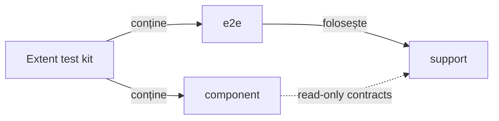

# Kit de testare UI pentru Extent

Acest modul testează rendererul Extent produs de ATF. Nu testează aplicația
UI și nu introduce teste de API de business. API-ul este folosit aici doar ca
setup declarativ, atunci când trebuie generat un raport pe care îl inspectăm
read-only în browser.

## Pe scurt

| Input | Flow | Evidence |
|---|---|---|
| API report + mock contract | setup read-only → UI navigation → validators | actions, audit, assertions, screenshot |
| UI YAML | selectors, viewport, zoom și output policy | configurabil, fără flag redundant |
| generated HTML | Chromium/Playwright MCP | DOM/CSS/console și artifact fresh |

## Diagramă de bază



<details>
<summary><strong>Legendă — separarea testelor Extent</strong></summary>

- `component` verifică inputul, modelul, markup-ul și politicile; componentele browser folosesc fixture-uri locale determinate;
- `e2e` verifică journey-ul de audit al artifactului și integrarea setup/browser;
- `support` reutilizează setup, locatori și validatori, dar nu este test root;
- browserul și locatorii sunt adaptați în `support`; layer-ul se alege după boundary-ul verificat.
</details>

Regula este intenționat strictă:

| Zonă | Responsabilitate | Poate conține Playwright? | Se rulează implicit? |
|---|---|---:|---:|
| `component` | contracte, modele, politici, validatori și fixture-uri browser locale | da, prin `support`, numai pentru fixture locală | da |
| `e2e` | scenarii browser și validarea randării reale | da, prin `support` | numai explicit |
| `support` | cod reutilizabil pentru testele de mai sus | da, când este adaptor browser | nu ca test root |

Un journey complet de audit aparține lui `e2e`; o componentă browser izolată
verifică numai fixture-ul local și boundary-ul declarat. Un flow, locator, fixture, inspector sau dynamic engine aparține lui
`support`. `component` nu are voie să devină un depozit pentru helper-e.

Nivelul, canalul și output-ul se declară prin
[adnotările TestKit](../../../../../../../../docs/ATF_Test_Infrastructure_Annotations.md).

## Pregătirea prin API față de validarea UI

Un raport API generat din `atf-mock.yaml` este o precondiție read-only pentru
testele UI, nu o validare de ecran. Înainte de browser se verifică în component
sau integration: request/response JSON, provenance-ul mock, structura HTML,
CSS/JavaScript, vocabulary, proiecțiile și contractele dintre secțiuni. În
E2E rămân numai comportamentele care cer randare reală:

```text
mock + API setup
      ↓
API report read-only
      ↓
component/integration: contract, JSON, markup, CSS/JS
      ↓
E2E: tab, click, collapse, computed-style, wrapping, screenshot, consolă
```

`SelectedApiTestsReportUiTest` este composition root-ul configurabil:

- selectează metodele prin `@ApiTestRef` și construiește fixture-ul;
- deleagă secțiunile către engine/publisher;
- nu clonează testul per tab și nu introduce `Page` în `atf.api.tests.api`;
- aserțiunile fără efect de browser rămân la component/integration pentru
  rulare rapidă și deterministă.

Acesta este singurul README al test-kit-ului Extent. Pachetele
`e2e/uireport` și `e2e/failure` nu au README-uri locale: contractele lor sunt
documentate mai jos, împreună cu regulile comune, pentru ca arhitectura să fie
citită într-un singur loc și să nu apară documentație divergentă.

## Prezentarea generală față de pașii de validare

Titlul fiecărei secțiuni este produs de `ExtentSectionGherkin` și este folosit
identic de dynamic test și de Extent. Titlul este un overview normal și concis:

```text
Request evidence includes request JSON, response JSON and execution evidence
```

`Overview` și pașii nested au responsabilități distincte:

- `Overview` numește suprafața verificată și rezultatul observabil;
- pașii nested publică dovada detaliată;
- validatorii păstrează assertions distincte pentru fiecare criteriu relevant;
- `Tests` publică projection și owners/scenarios;
- `Categories` publică counts și filters;
- `Fails` publică causes și deep links;
- `Evidence` publică request/response JSON și execution evidence;
- `THEN` poate apărea în pasul nested care publică validarea;
- GIVEN/WHEN/THEN nu se repetă drept titlu al testului.

## Structura curentă

<details>
<summary><strong>Harta pachetelor și regulile de coeziune</strong></summary>

```text
component/
├── architecture/       guard-uri pentru limitele de pachet și selector
├── audit/               teste pentru așteptări și rezultate de audit
├── inspection/         politici pure și teste de proiecție
├── locators/            testul limitei de locator
├── plan/                manifest/spec de scenariu
└── section/
    ├── architecture/
    └── contract/

e2e/
├── ExtentReportingE2eSuite.java
├── configurable/       scenarii configurabile de cardinalitate
├── failure/             raport de failure și evidența Playwright
├── navigation/          traversare și agregare între tab-uri
├── sanity/              verificări mici de disclosure și layout
├── section/             secțiuni generate din setup/API
└── uireport/            contractul static al unui raport existent

support/
├── api/                 setup, profiluri, flow-uri și declarații API
├── audit/               context, validatori și adaptoare browser
├── config/              resursele autonome ale modulului
├── failure/             fixture/factory/engine pentru failure
├── inspection/          inspectori DOM și responsive
├── lifecycle/           lifecycle browser și captură de evidence
├── locators/            singura zonă care compune selectori Playwright
├── navigation/          flow-uri semantice de navigare
├── section/             extractoare, module, publisher și runtime
└── uireport/            fixture, contract input și inspectori de tab-uri
```

În `support/section`, runtime-ul de compoziție este separat explicit în
`runtime/SectionAuditDynamicEngine` și `runtime/SectionAuditFixture`; astfel
package-ul `support.section` nu devine un container mixt. În mod similar,
`support/uireport/browser` poate folosi doar facade-ul din
`support/locators`, nu selectorii Playwright direct.

`ReportUiLocators` este fațada publică stabilă pentru consumatorii existenți,
nu owner-ul tuturor selectorilor. Implementarea este împărțită pe boundary-uri
coezive: `ReportLocatorSupport` pentru compoziție comună,
`ReportPageLocators` pentru pagină și tab-uri, `ReportTreeLocators` pentru
disclosure/card tree și `ReportScreenValidationLocators` pentru suprafețele
DOM/CSS de screen validation. `ReportEvidenceLocators`,
`ReportCategoryLocators` și `ReportFailureLocators` rămân verticale dedicate.
Astfel testele și flow-urile depind de fațadă/flow, iar schimbarea unei familii
de selectori nu mai obligă modificarea unei clase monolitice.

Locatorii noi preferă CSS semantic în forma `element[attribute=value]`, de
exemplu `button[data-atf-action='expand']`, `div[data-atf-node-role='scenario']`
sau `table[class~='helm-validation-table']`. Pentru clase se folosește
operatorul `~=` deoarece `class` este o listă de token-uri; pentru identități se
folosește `[id='...']`. Shorthand-ul `.class` rămâne permis în asset-ul CSS,
dar nu în locatorii Playwright ai testelor de reporting.

`nth(...)`, `:scope`, filtrele de text și XPath rămân detalii interne ale
ownerului din `support/locators`, doar când markup-ul generat nu expune un
atribut contractual mai bun. Valorile dinamice sunt validate de helper-ul
comun înainte de compunere, printr-un singur `Pattern` compilat la nivelul
`ReportLocatorSupport`; nu se recompilă regex-ul la fiecare locator dinamic.
Nici testul, nici flow-ul, nici auditorul nu repetă selectorul sau politica de
validare.

Subpachetele sunt deliberate: limita principală este `component/e2e/support`,
iar subpachetele separă verticalele fără să reintroducă un pachet rădăcină
cu responsabilități amestecate. Niciun pachet principal nu trebuie să treacă
de limita de opt clase; dacă o face, se extrage o responsabilitate coerentă,
nu se mută arbitrar fișiere.

</details>

## Contracte E2E specializate

### Raport UI static

`StaticUiExtentReportContractTest` verifică rendererul Extent pe un artifact HTML
deja produs:

- inputul este read-only;
- verdictul privește numai contractul raportului: tab-uri, navigare,
  disclosure-uri, CSS, text, evidence și comportamentul observabil;
- aplicația de business nu este testată aici;
- adaptoarele browser sunt în `support/uireport/browser`;
- inputul este în `support/uireport/contract`;
- validatorii puri rămân în producția `atf-reporting`.

```text
previous UI HTML report
        ↓
ATF Debug / loopback read-only
        ↓
Playwright: tab + disclosure + DOM/computed-style
        ↓
static contract validator
        ↓
Extent assertion / evidence
```

- Schimbă inputul prin `-Datf.ui.report=<report.html>`; nu este necesară o cale
  absolută sau un checkout hardcodat.
- Gate-ul verifică Overview, Tests, Categories și Fails, plus/minus inline,
  screenshot `📷` ca link inline, acțiunile inclusiv `getText`, lipsa `<hr>` și a
  overflow-ului, disclosure-uri închise implicit și consola fără erori.
- `TIME` apare numai în tabelul acțiunilor Playwright; observațiile statice nu
  primesc o durată artificială.
- Pentru arborele UI, `UI validation` este eticheta canonică; `Screen validation`
  este acceptată numai ca nume legacy. Se verifică eticheta prezentă, nu ambele.
- Contractul de densitate este comun: API exchange/aggregate și UI evidence au
  summary de `34px`, padding `9px 12px` și glyph inline de `18px` în Extent și
  fallback; `500px` se aplică numai viewport-urilor de tabele lungi.
- `AtfReportEvidenceCssTest`/`AtfReportThemeTokensTest` verifică tokenii și
  paritatea CSS; `ScreenValidationSectionExtractor` măsoară computed height,
  padding, glyph, badge și gap-ul dintre acțiuni/observații/assertions pe raportul
  randat. E2E/static contract + Browser MCP confirmă vizual aceeași geometrie
  la viewport normal și îngust.

### Raport de eșec

`UiFailureReportContractTest` folosește un fixture negativ controlat pentru a
verifica faptul că un failure este localizabil prin ierarhie, fără dublări și
fără a marca o fază drept failed atunci când doar un detaliu informativ este
prezent. Suprafețele obligatorii sunt distincte și auditabile:

```text
SETUP              input / raport / fixture disponibil
PLAYWRIGHT_ACTION  acțiunea reală și textul extras
AUDIT_OBSERVATION  ce a fost găsit în DOM și computed-style
ASSERTION          expected / actual / verdict reutilizabil
```

Contractul failure este schematic:

- acțiunea are `TARGET`;
- cauza este publicată în zona care a produs-o;
- `Tests` și `Fails` indică aceeași identitate;
- screenshot-ul este evidence inline cu `📷`:
  - PNG Base64 direct; sau
  - link inline deduplicat către ancora PNG canonică, cu referință locală bounded
    (`screenshot-n`), nu cu fingerprint-ul intern;
- un hash izolat fără link și marker vizibil nu este evidence;
- `Setup evidence` rămâne setup;
- `Screen validation` apare în `TEST BODY` după acțiunile browser și inspecția
  DOM/style;
- disclosure-urile sunt colapsate implicit;
- rama fiecărei zone își închide marginile indiferent de numărul de rânduri.

Aceste contracte sunt documentate aici deoarece sunt responsabilități distincte
ale test-kit-ului, nu pentru că ar necesita câte un README de pachet.

## Configurație gestionată de `atf-reporting`

`atf-reporting-tests/src/test/resources/atf-reporting-ui.yaml` este configurația UI
internă pentru contractele acestui modul. Secțiunea `ui:` a fost scoasă din
`atf.yaml`; proiectul păstrează acolo doar configurația comună API și
reporting. Astfel, schimbarea setup-ului UI al raportării nu modifică bootstrap-
ul proiectului și nu creează o cheie booleană artificială de tip
`ui.enabled`.

Pentru screenshot-uri mai încăpătoare, configurația folosește explicit
`ui.zoomPercent: 70`. Aceasta este preferința pentru auditul Extent: păstrăm
viewport-ul stabil și reducem doar zoom-ul documentului Playwright, astfel
încât într-o singură imagine să intre mai multe rânduri de evidence. Cheia
este configurabilă per YAML, acceptă `25..200`, iar lipsa ei înseamnă `100`.

Ownership-ul codului este la fel de strict ca ownership-ul YAML-ului:

```text
atf-ui
  UiBrowserConfiguration
  UiScreenValidationConfiguration
  PlaywrightUiSession / acțiuni / capture PNG
        ↓ politici runtime generice
atf-reporting-tests composition scope
  support/config/UiConfiguration
  support/config/UiAuditSuiteConfiguration
  support/config/AtfUiConfigurationLoader + Context
  support/config/UiConfigurationYamlReader
  ReportingTestResources → Extent output / audit input / API setup
```

Clasele din `support/config` nu sunt infrastructură generică de browser: ele
modelează exclusiv testarea raportului Extent, outputul UI, suitele de audit și
legătura setup API → raport. De aceea nu se mută în `atf-ui` și nu se publică
din `src/main` al unui modul generic. Un consumer Playwright fără Extent poate
folosi politicile runtime din `atf-ui` fără să depindă de aceste clase.

`atf-reporting-tests/src/test/resources/atf-mock.yaml` este catalogul mock folosit
de testele autonome ale raportării. Este o copie controlată a catalogului
proiectului, iar `atf-mock` rămâne proprietarul loader-ului și al schemei.
Testele raportării nu mai depind implicit de directorul din care a fost pornit
Maven sau IntelliJ. `ReportingTestResources` aplică următoarea prioritate:

1. `-Datf.ui.config=...` pentru o configurație UI explicită;
2. configurația internă `atf-reporting-ui.yaml`;
3. artifactele UI în `${ATF_REPORT_OUTPUT_DIR}` sau subdirectorul UI configurat;
4. `-Datf.ui.report=...` doar pentru inputul unui raport existent.

Mock-ul intern este încărcat explicit din classpath-ul modulului. Pentru un
test API/UI care folosește setup-ul de raportare, se utilizează
`ReportingTestResources.mockConfiguration()` sau `.mockTransport()`, nu
`AtfMockTransport.fromProjectConfiguration()`.

Lanțul este auditabil:

```text
atf-reporting-ui.yaml
        ↓
setup API declarativ / colecție selectată
        ↓
atf-reporting-tests/src/test/resources/atf-mock.yaml
        ↓
raport Extent API
        ↓
e2e Playwright read-only
        ↓
validări pe Tests, Overview, Categories, Fails, Evidence și Screen validation
```

## Rulare directă din IntelliJ

Pentru suita browser-backed se rulează clasa:

```text
atf.ui.tests.extent.e2e.ExtentReportingE2eSuite
```

În IntelliJ: Run/Debug pe clasă, cu working directory fie rădăcina
proiectului `atf`, fie modulul `atf-reporting`. Nu este necesară copierea
manuală a YAML-ului și nu se oprește niciun server sau proces existent.

La modificări ale resolverului de output, ale compoziției root-ului sau ale
configurației IDE, execută smoke-testul:

- rulează suita separat cu working directory la root-ul reactorului și la
  `atf-reporting`; ambele rulări trebuie să treacă;
- confirmă că fiecare run creează un raport nou în
  `<reactor>/artifacts/reports/ui/e2e` și că run-ul din `atf-reporting` nu
  creează o copie sub `atf-reporting/artifacts/reports/ui/e2e`;
- deschide raportul curent cu ATF Debug / Playwright MCP și verifică proveniența
  lui; testele automate simulează working directory-ul, dar nu lansează IntelliJ.

Acesta este un control operațional la schimbări relevante, nu un ToDo permanent.

Echivalent Maven, în staging sau local:

```text
mvn -pl atf-reporting-tests -am \
  -Dtest=ExtentReportingE2eSuite \
  -DforkCount=0 -DreuseForks=false test
```

Pentru un artifact UI existent:

```text
mvn -pl atf-reporting-tests -am \
  -Dtest=StaticUiExtentReportContractTest \
  -Datf.ui.report=<configured-ui-report> \
  -DforkCount=0 -DreuseForks=false test
```

În debug, raportul final se verifică prin ATF Debug și Playwright MCP. Nu se
folosește browserul Windows real. Verdictul nu este complet până când HTML-ul
nu este deschis, tab-urile sunt inspectate, screenshot-urile sunt vizibile,
nu există overflow orizontal, iar consola nu raportează erori.

## Contract de randare verificată

Testele E2E trebuie să publice propoziții scurte, dar explicite: `GIVEN` pentru
setup/input, `WHEN` pentru acțiunea Playwright și `THEN` pentru verdictul de
display. `Setup evidence` este setup, nu `UI validation`; validarea UI trebuie
să apară sub `TEST BODY` și să numească tab-ul/suprafața verificată.

În fiecare raport verificat se păstrează:

- plus/minus inline, mereu în fața propoziției;
- screenshot relevant ca link inline cu emoji-ul curent;
- tabelul Playwright cu acțiunile relevante, inclusiv `getText`/text extraction;
- numărul fiecărei acțiuni este un badge compact `#n`, cu lățime naturală; nu
  poate moșteni lățimea zonei colapsabile și nu poate întinde delimitarea pe viewport;
- request/response JSON pentru API setup când raportul îl expune;
- fără `<hr>` și fără delimitări artificiale între zonele unei secțiuni;
- inputul raportului ca evidence auditabil, fără hash-uri SHA-256 afișate ca
  substitut pentru linkul către artifact.

## Guard-uri pentru contribuții

- Testele E2E rămân puține și configurabile; nu se clonează un test pentru
  fiecare familie API. Se aleg scenarii concrete prin adnotări/profiluri.
- Locatori Playwright se compun numai în `support/locators`; testele și flow-
  urile folosesc facade-uri semantice.
- Fixture-urile nu devin clase `*Test`; testele rămân scurte și exprimă doar
  intenția, setup-ul și verdictul.
- Validarea DOM/Style se împarte în extractare, snapshot/policy și publicare;
  partea pură rămâne testabilă fără browser.
- API POST/PUT din mock trebuie să aibă body JSON și response JSON, iar
  perechea trebuie să fie vizibilă în raportul Extent.
- Orice refactor de CSS/JavaScript/HTML cere build extern în `${ATF_STAGING_ROOT}`,
  sincronizare controlată în codul live și verificare vizuală a unui raport
  proaspăt.

## Contract E2E pentru etichete

`ReportNavigationAggregationFlowTest` este flow-ul configurabil pentru filtrarea
dinamică a tab-ului `Tests`. El trebuie să dovedească în raport, nu doar în cod,
următoarea succesiune: owneri baseline → `Pass` → primul tag → al doilea tag →
`Clear` → `Categories` → `Overview`.

Pentru fiecare execuție se verifică:

- `aria-pressed` și numele opțiunilor;
- scenariile vizibile și starea restaurată;
- tranziția `tag1 → tag2`;
- `active=1` și `replaced=true`;
- `owners=3, tags=0` după `Clear`;
- numărul de checkpoint-uri în antetul colapsabil;
- detaliile complete în tabelul de audit;
- artifactul final deschis în ATF Debug/browser MCP înainte de promovare.

## Limitele de responsabilitate pentru dovezile UI și furnizorii de raportare

Regula transversală pentru captură configurabilă este în
[documentul dedicat](../../../../../../../../docs/ATF_Evidence_Capture_Contract.md).
Acest README deține doar auditul browserului și contractele observabile ale
artifactului; nu deține flow mode-ul sau mapping-ul YAML al unui consumer.

| Contract | Owner | Ce rămâne în test |
|---|---|---|
| vocabular HTML și atribute stabile | `AtfReportHtmlVocabulary` | verificarea contractului DOM public |
| culori și geometrie | `atf-reporting/.../theme/tokens` | verificarea computed style și a randării |
| stilul evidence UI | `theme/evidence/AtfUiEvidenceCss` | verificarea capturii, pașilor și tabelului |
| datele fiecărui run | records/POJO-uri immutable | input runtime; nu string-uri împrăștiate sau enum-uri dinamice |

E2E verifică browserul și raportul observabil; nu reimplementează CSS sau HTML
în clasele de test.

Ordinea de acoperire este:

- unit — token-uri, markup și provideri;
- component — secțiuni și contracte de evidence;
- integrare — asamblarea raportului și asset manifest;
- E2E — browser, randare, click-uri, expand/collapse, link-uri inline și tab-uri.

Reguli de execuție:

- orice schimbare se verifică în ATF Debug cu Playwright/Chromium headless;
- browserul Windows real nu face parte din validare;
- `＋/−` rămâne inline înaintea propoziției;
- disclosure-urile sunt închise implicit când nu fac parte din scenariu;
- nu există separatoare `<hr>` sau overflow orizontal;
- legăturile inline pentru capturi se păstrează;
- CSS-ul/JavaScript-ul se separă după responsabilitate semantică;
- providerii noi primesc identificatori tipizați și token-uri;
- testul verifică output-ul public rezultat.

## Contractul E2E al randării

Acesta este gate-ul normativ pentru orice extragere sau schimbare care poate
modifica raportul. Un gate nu validează un HTML istoric și nu validează doar
substring-uri în sursă: folosește raportul generat de run-ul curent sau un input
static ales explicit prin configurație. Numele, timestamp-ul și calea unui
artifact generat nu se păstrează în README-uri.

### Reguli care se aplică întotdeauna

- ✅ Raportul este deschis prin ATF Debug/Chromium headless și este verificat în
  browser MCP; browserul Windows real nu face parte din gate.
- ✅ E2E-ul verifică efectul observabil: DOM, stil calculat, navigare, click,
  expand/collapse, link-uri și randare. Nu reimplementează providerul sau
  regulile de contract deja testate la nivel inferior.
- ✅ Datele dinamice ale run-ului — nume de teste, locatori, body-uri JSON,
  durate, asset-uri și rezultate — rămân runtime data în modele/fixture-uri;
  nu sunt mutate în enum-uri sau constante doar pentru a scurta testul.
- ✅ Vocabularul stabil — tab-uri, operații, chei de contract și clase publice —
  poate fi tipizat în constante/enumerări, cu un singur owner.
- ✅ Promovarea folosește un artifact fresh și un manifest de asset-uri
  reconciliat; un raport vechi poate servi doar la investigație locală.
- ✅ Geometria se măsoară la `ui.viewport.width/height` din configurația run-ului;
  `ui.zoomPercent` schimbă zoom-ul documentului, nu viewport-ul CSS.

### Contractul auditului secundar din Overview

Cele două disclosures ATF — `#atf-execution-metadata` și `#atf-tag-audit` —
se verifică pe același scenariu E2E existent, fără o clasă nouă. Validatorul
nu se oprește la atributul `open` și nici la un număr generic de elemente:

```text
stare inițială închisă
        ↓
expandare prin acțiuni Playwright
        ↓
metrici + tabele + headere + rânduri populate
        ↓
assertions semantice
        ↓
închidere și verificare fără corp vizibil
```

Contractul semantic este:

- 6 metrici de execuție: clase, scenarii, pass, fail, skipped, warnings;
- exact 3 tabele de audit: `atf-audit-scenarios`, `atf-audit-packages`,
  `atf-audit-tags`;
- fiecare tabel are headere nenule, cel puțin un rând și celule populate;
- ambele corpuri devin vizibile la expandare și dispar efectiv la închidere;
- valorile dinamice rămân extrase din DOM; doar vocabularul structural este
  constantizat.

Proof-ul este împărțit pe niveluri:

- `OverviewSecondaryContractValidatorTest` verifică regulile pure;
- `SelectedApiTestsReportUiTest` le execută pe raportul real;
- scenariul trebuie să arate `Audit observations · 6` și `Assertions · 7`, cu
  rânduri verzi și fără overflow;
- deep-link-ul este `#test-id=48&scenario-index=6&expand=screen-validation`;
  restul raportului rămâne închis implicit.

Ordinea evidence-ului este strictă și semantică:

```text
Playwright actions: navigate → wait → open Overview → expand ATF zones
        ↓
Screenshot: capturat cât timp ambele zone sunt deschise
        ↓
Assertions: conținut metrici, tabele, vizibilitate și restore closed
```

Ordinea din artifact rămâne:

- `Playwright action sequence (7 entries)`;
- `Screenshot` ca ultim checkpoint vizual, imediat după acțiunile care au produs
  starea verificată;
- `Assertions · 7` după captură.

Click-urile de restore sunt cleanup tehnic: nu se publică drept acțiuni ale
flow-ului după captură.

### Asset-uri native și filtrarea Tests

Asset-urile `.js`/`.css` sunt output public, verificate la ambele limite:

- `atf-reporting` verifică resource loader-ul și composer-ul;
- testele UI verifică efectul în DOM și randare;
- `ExtentReportRuntimeTestFilters` este o fațadă Java peste
  `extent-tests-filters.js`; vocabularul stabil este typed, algoritmul rămâne
  JavaScript nativ;
- orice modificare cere component contract și gate E2E pe raport fresh.

### Checklist executabil pentru un gate E2E

Fiecare bifă de mai jos trebuie să fie `✅` în rezultatul run-ului sau marcată
explicit `N/A` cu motiv. Un gate nou nu este valid dacă lasă o verificare
obligatorie neexecutată.

#### 1. Input și navigare

- ☐ inputul este raportul run-ului curent sau inputul static indicat în
  configurație;
- ☐ gate-ul rulează la viewport-ul configurat și, pentru responsive, la o lățime
  cu cel mult 25% mai mică; o lățime sub această limită este exploratorie și
  trebuie raportată separat ca `known issue`, nu confundată cu verdictul gate-ului;
- ☐ pagina se încarcă fără erori de navigare, asset-uri lipsă sau resurse
  externe obligatorii;
- ☐ `Tests`, `Overview`, `Categories` și `Fails` sunt accesibile, iar deep-link
  -ul activează view-ul corect;
- ☐ `Tags` este verificat când este publicat de raportul respectiv;
- ☐ tab-ul activ, titlul și link-ul de revenire rămân coerente după navigare și
  refresh.

#### 2. Ierarhia și disclosure-urile din `Tests`

- ☐ `＋/−` este inline, înaintea titlului, și rămâne aliniat vertical cu titlul;
- ☐ `SETUP` este distinct de `TEST BODY` și `TEARDOWN` apare numai când există
  în lifecycle;
- ☐ scenariul și fazele relevante se pot deschide/închide prin click sau
  tastatură, fără să schimbe ordinea sau proprietarul conținutului;
- ☐ după expandare se văd `THEN` și `Screen validation` atunci când scenariul
  este UI-backed;
- ☐ în `Screen validation` se pot urmări acțiunile în ordinea executată,
  inclusiv target, expected, observed, rezultat și durată;
- ☐ `Audit observations` și `Assertions` sunt secțiuni distincte, lizibile și
  raportate după acțiunile pe care le explică;
- ☐ screenshot-ul sau link-ul inline este vizibil când este parte din contract;
  un link deduplicat trebuie să aibă markerul `📷 base64 img`,
  `data-atf-screenshot-ref` și să ducă la un PNG canonic valid care se poate
  deschide.

#### 3. Contractul API și al dovezilor (când se aplică)

- ☐ request-ul și response-ul JSON sunt afișate ca evidence separată, inclusiv
  body JSON, headers/status și provenance mock;
- ☐ execution evidence leagă request-ul de testul, ruta și rezultatul care l-au
  produs;
- ☐ un failure indică cauza și oferă `Open in Tests` fără să piardă testul
  original;
- ☐ raportul UI care folosește setup API poate fi reconciliat cu raportul API
  selectat de configurația run-ului: mock → API → UI → validare.

#### 4. DOM, CSS și consolă

- ☐ pentru document, root-ul raportului și container-ele declarate
  non-scrollable, `scrollWidth <= clientWidth` la viewport-ul suportat;
- ☐ wrapping-ul păstrează vizibile coloanele și acțiunile fără overflow
  orizontal ascuns;
- ☐ nu există `<hr>` decorative; delimitările sunt realizate prin componente
  semantice și CSS-ul lor;
- ☐ `＋/−`, badge-urile, tabelul, screenshot link-ul și secțiunile colapsabile
  au computed-style coerent cu tema și contrast lizibil;
- ☐ nu există console errors, page errors, request failures sau imagini
  broken;
- ☐ este capturată o imagine a stării finale pentru audit, dar imaginea este
  evidence a run-ului, nu nume de fișier hardcodat în documentație.

### Pașii de explorare manuală ATF Debug / browser MCP

Aceștia sunt pașii recomandabili când un gate schimbă structura, layout-ul sau
flow-ul, nu o listă de assertions care dublează toate testele unitare:

1. Deschide artifactul ales de configurația run-ului și pornește din `Tests`.
2. Selectează un test care are setup și test body; verifică mai întâi starea
   colapsată și apoi deschide scenariul, `SETUP`, `TEST BODY`, `THEN` și
   `Screen validation`.
3. Urmărește acțiunile de la primul `Navigate/Wait` până la ultima validare;
   pentru fiecare verifică target-ul, expected-ul și observed-ul, nu doar textul
   operației.
4. Deschide separat request evidence, response evidence, execution evidence,
   `Audit observations` și `Assertions`; verifică legătura dintre fiecare
   disclosure și rândul pe care îl explică.
5. Repetă navigarea pentru `Overview`, `Categories`, `Fails` și, dacă există,
   `Tags`. Pentru un raport API perechea UI/API se deschide în tab-uri MCP
   separate și se reconciliază prin manifestul run-ului, nu printr-un nume scris
   în README.
6. Rulează verificarea DOM/CSS/consolă și capturează starea finală numai după
   ce toate disclosure-urile relevante au fost verificate. Dacă suprafața
   browser MCP este mai îngustă decât limita suportată, notează observația ca
   explorare suplimentară; nu o folosi pentru a promova sau respinge run-ul
   configurat.

### Implementarea gate-ului și dovada de acoperire

Contractul este executat pe trei seams, fără duplicarea selectorilor sau a
regulilor:

| Seam | Owner | Dovadă executabilă |
|---|---|---|
| raport static ales explicit | `StaticUiExtentReportContractTest` + `UiReportContractDynamicEngine` | toate cele patru tab-uri, click/collapse în Tests, UI validation (legacy: Screen validation), screenshot, style/render boundary |
| raport generat din setup API | `SelectedApiTestsReportUiTest` + `SectionAuditRegistry` | mock → API, POST/PUT request/response JSON, owner/scenario/phase, Categories/Overview/Fails/Evidence și render-health pe toate tab-urile |
| browser render health | `UiReportStyleValidator` + `ReportAuditContext` | overflow document/body/non-scrollable, zero `<hr>`, imagini, glyph `＋/−`, console/page/request diagnostics |

`ScreenValidationSectionExtractor` verifică explicit:

- zone pentru Playwright actions, Audit observations și Assertions;
- un link PNG Base64 valid, direct sau deduplicat prin referință;
- markerul `📷 base64 img` și alinierea verticală a linkului;
- prezența reală a zonelor, nu doar numărul de carduri;
- `UI validation` pe artifactul UI care produce evidence (`Screen validation`
  rămâne acceptat pentru artifacte legacy);
- `N/A` pentru inputul API pur, cu render-health API obligatoriu;
- zoom-ul configurat de `PlaywrightUiSession` fără dereferențiere înaintea
  existenței `documentElement`;
- teste component și gate-uri E2E complementare pe artefacte reale.

Disclosure-urile secundare Overview au acest ciclu verificabil:

- **fresh:** `#atf-execution-metadata` și `#atf-tag-audit` sunt închise;
- **expand:** click pe `summary` afișează corpul direct;
- **collapse:** al doilea click ascunde corpul;
- **owner:** `OverviewSecondaryContractValidator.validateExpansion(...)`
  reutilizează scenariul existent, fără clasă E2E nouă.

Deep-link-ul pentru dovada completă:

```text
#test-id=48&scenario-index=6&expand=screen-validation
```

Acesta deschide `TEST BODY → THEN ATF metadata sections expansion → Screen
validation` și extinde `Playwright action sequence`, `Audit observations` și
`Assertions`. La închiderea scenariului, disclosure-urile revin colapsate;
component testele verifică și această tranziție.

### Reîncercări UI: politică publică, oprire implicită la incertitudine

Retry-ul Playwright este policy de acțiune, nu replay de test. `UiRetryPolicy`
are implicit un singur attempt și niciun operation eligibil. YAML poate activa
 doar operații enumerate, disponibile numai în citire (`navigate`, `wait-for-visible`,
`wait-for-text`, `wait-for-enabled`, `wait-for-state`, `wait-for-disclosure`):

```yaml
ui:
  retry:
    maxAttempts: 2
    backoff: PT0S
    eligibleOperations: [wait-for-visible]
    reason: DOM stabilization
```

`click`, `fill` și `select-option` nu sunt eligibile prin design. Fiecare retry
este rând `Info` în tabelul Playwright cu tentativa și motivul bounded; acțiunea
finală păstrează verdictul real. Loader-ul, recorder-ul și renderer-ul au
teste component/unitare, iar E2E verifică numai efectul browser observabil.

### Tabele de evidență cu resize content-aware

Tabelele de evidență din raport nu trebuie să folosească o împărțire uniformă
când `EXPECTED`, `OBSERVED`, `VALUE` sau `REASON` conțin diagnostice lungi.
Assetul `extent-evidence-table-layout.js` aplică aceeași politică plug-and-play
pe UI și API pentru acțiuni Playwright, audit observations, assertions, setup,
request/response details, execution, retry history și technical trace:

```text
maximum rendered text width per column → reserve RESULT/TIME/STATUS
                 → bounded min/max allocation → publish width diagnostics
                 → render without overflow
```

Regulile sunt dinamice, nu depend de un endpoint sau de un fixture anume:

- măsoară textul real din headere și rânduri;
- măsoară lățimea intrinsecă maximă a fiecărei coloane cu fontul efectiv al
  celulei (`CanvasRenderingContext2D.measureText`), cu fallback determinist;
- publică `data-atf-content-column-max-px` ca audit al maximului memorat pentru
  fiecare coloană, în aceeași ordine cu `data-atf-content-column-widths`;
- alocă spațiul proporțional cu maximele măsurate, apoi aplică limite min/max și
  reechilibrează iterativ, astfel încât un singur diagnostic să nu monopolizeze
  tabelul;
- impune minime semantice pentru `ACTION`, `TARGET`, `ASSERTION/CHECK` și
  `EXPECTED/ACTUAL/OBSERVED`, astfel încât coloanele de identificare să nu fie
  împinse artificial la 10–12% și să producă wrap-uri inutile;
- păstrează coloanele de status/timp compacte și lizibile;
- aplică procentele pe header și body, cu limite min/max pentru coloanele de
  conținut;
- face o normalizare inițială globală, apoi lucrează incremental: fiecare tabel
  păstrează un fingerprint al textului, fontului și lățimii disponibile, iar un
  fingerprint identic oprește măsurarea și rescrierea inline;
- urmărește mutațiile doar până la tabelul/containerul afectat; când browserul
  oferă `ResizeObserver`, acesta programează tabelul redimensionat, iar fallback-ul
  folosește `resize` cu un singur frame debounced (`requestAnimationFrame`);
- tratează `hidden → visible`, `open → close` și tabelele adăugate ulterior ca
  invalidări dirty ale zonei respective, nu ca rescannare funcțională a întregului
  raport;
- păstrează fallback-ul CSS și `table-layout: fixed`, deci nu introduce scroll
  orizontal accidental.

Tabelele `FIELD | VALUE` folosesc o regulă proprie pentru trace/API diagnostics:

| Coloană | Lățime |
|---|---|
| `FIELD` | lățimea intrinsecă a cheilor, limitată la `20%..38%` |
| `VALUE` | spațiul rămas; minimum `62%` fără coloane tehnice rezervate |

Component contract-ul verifică markerii `data-atf-key-value-layout` și
`data-atf-key-column-width`. Inspectorul acceptă `VALUE` ca dominantă chiar
dacă o cheie izolată este mai lungă ca text.

Tabelele agregate Overview (de exemplu `atf-tag-table`) sunt excluse: au
contract de dashboard, coloane numerice fixe și sticky header. Nu sunt evidence
tables și nu folosesc acest normalizator.

### Contractul de verificare

- `ValidationTableLayoutComponentTest` — contractul minim pentru politică;
- `ValidationTableLayoutInspector` — adapter OOP folosit de
  `ScreenValidationSectionExtractor` pentru toate familiile UI/API de evidence
  tables;
- metrică — compară `data-atf-content-column-max-px` cu cea mai lată coloană
  flexibilă și verifică suma lățimilor plus overflow-ul;
- E2E/MCP — verifică la `1440×900` și `1280×900`:
  - `data-atf-content-column-widths` este prezent;
  - `scrollWidth === clientWidth` pentru tabelele vizibile;
  - documentul și body-ul nu au overflow;
- captura de audit — arată `OBSERVED/EXPECTED` mai largi când valorile sunt mai
  lungi și păstrează `RESULT` compact.

### Responsabilitatea pe niveluri

| Nivel | ✅ Verifică | ❌ Nu înlocuiește |
|---|---|---|
| unit | modele, parser-e, vocabular, politici și token-uri | browser și randare reală |
| component | provider, markup public, CSS/JS contract și section module | flow complet și asset publication |
| integration | raport asamblat, mock → execution → validation, output și asset manifest | click-uri și computed-style |
| E2E | efectul real în Chromium: tab-uri, click/collapse, evidence, layout, link-uri și consolă | regulile statice ale providerului |

`N/A` este permis numai pentru o suprafață care nu este publicată de acel
artifact (de exemplu `Screen validation` într-un raport API pur). Nu este permis
pentru o verificare care există în DOM, dar nu a fost explorată.

### Criteriu de acceptare

Un gate este acceptat numai când:

- ✅ nivelul corect a verificat contractul său;
- ✅ checklist-ul E2E aplicabil este complet, inclusiv pașii manuali;
- ✅ la viewport-ul suportat nu există overflow în document/root/container-ele
  non-scrollable, `<hr>` decorativ, erori de consolă sau asset-uri rupte;
- ✅ artifactul, manifestul și sursele staging/live sunt reconciliate;
- ✅ rezultatul poate fi repetat de altă persoană din raport, fără cunoașterea
  implementării interne.
