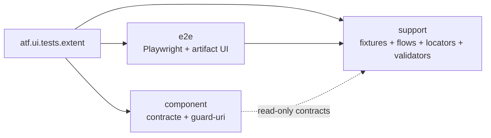

# Extent UI test kit

Acest modul testează rendererul Extent produs de ATF. Nu testează aplicația
UI și nu introduce teste de API de business. API-ul este folosit aici doar ca
setup declarativ, atunci când trebuie generat un raport pe care îl inspectăm
read-only în browser.

## Overall

| Input | Flow | Evidence |
|---|---|---|
| API report + mock contract | setup read-only → UI navigation → validators | actions, audit, assertions, screenshot |
| UI YAML | selectors, viewport, zoom și output policy | configurabil, fără flag redundant |
| generated HTML | Chromium/Playwright MCP | DOM/CSS/console și artifact fresh |

## Diagramă de bază



<details>
<summary><strong>Legendă — separarea testelor Extent</strong></summary>

- `component` verifică inputul, modelul, markup-ul și politicile fără browser;
- `e2e` verifică efectul observabil al artifactului în Playwright/Chromium;
- `support` reutilizează setup, locatori și validatori, dar nu este test root;
- un test care deschide HTML-ul sau folosește `Page` aparține `e2e`.
</details>

Regula este intenționat strictă:

| Zonă | Responsabilitate | Poate conține Playwright? | Se rulează implicit? |
|---|---|---:|---:|
| `component` | contracte, modele, politici, validatori și teste de arhitectură | nu | da |
| `e2e` | scenarii browser și validarea randării reale | da, prin `support` | numai explicit |
| `support` | cod reutilizabil pentru testele de mai sus | da, când este adaptor browser | nu ca test root |

Un `*Test` care deschide raportul sau folosește `Page` aparține lui `e2e`.
Un flow, locator, fixture, inspector sau dynamic engine aparține lui
`support`. `component` nu are voie să devină un depozit pentru helper-e.

## Setup API versus validare UI

Un raport API generat din `atf-mock.yaml` este o precondiție read-only pentru
testele UI, nu o validare de ecran. Înainte de browser se verifică în component
sau integration: request/response JSON, provenance-ul mock, structura HTML,
CSS/JavaScript, vocabulary, proiecțiile și contractele dintre secțiuni. În
E2E rămân numai comportamentele care cer randare reală:

```text
mock + API setup
      ↓
API report read-only
      ↓
component/integration: contract, JSON, markup, CSS/JS
      ↓
E2E: tab, click, collapse, computed-style, wrapping, screenshot, consolă
```

`SelectedApiTestsReportUiTest` este composition root-ul configurabil: alege
metode API concrete prin `@ApiTestRef`, construiește fixture-ul și delegă
secțiunile către engine/publisher. Nu se clonează testul pentru fiecare tab și
nu se mută `Page` în `atf.api.tests.api`. Dacă o aserțiune nu observă un efect
de browser, ea trebuie coborâtă în component/integration pentru rulare rapidă,
deterministă și reutilizabilă.

Acesta este singurul README al test-kit-ului Extent. Pachetele
`e2e/uireport` și `e2e/failure` nu au README-uri locale: contractele lor sunt
documentate mai jos, împreună cu regulile comune, pentru ca arhitectura să fie
citită într-un singur loc și să nu apară documentație divergentă.

## Overview versus pași de validare

Titlul fiecărei secțiuni este produs de `ExtentSectionGherkin` și este folosit
identic de dynamic test și de Extent. Titlul este un overview normal și concis:

```text
Request evidence includes request JSON, response JSON and execution evidence
```

Overview-ul numește suprafața verificată și rezultatul observabil; pașii de sub
el publică dovada detaliată. Validatorii trebuie să păstreze assertions
distincte pentru fiecare criteriu relevant, iar modulele trebuie să publice
evidence-ul potrivit secțiunii: projection și owners/scenarios pentru `Tests`,
counts și filters pentru `Categories`, causes și deep links pentru `Fails`,
respectiv request/response JSON și execution evidence pentru `Evidence`.
Nu se înghesuie aceste detalii în titlu. `THEN` poate apărea în pasul nested
care publică validarea, dar GIVEN/WHEN/THEN nu se repetă ca titlu al testului.

## Structura curentă

<details>
<summary><strong>Harta pachetelor și regulile de coeziune</strong></summary>

```text
component/
├── architecture/       guard-uri pentru limitele de pachet și selector
├── audit/               teste pentru așteptări și rezultate de audit
├── inspection/         politici pure și teste de proiecție
├── locators/            testul limitei de locator
├── plan/                manifest/spec de scenariu
└── section/
    ├── architecture/
    └── contract/

e2e/
├── ExtentReportingE2eSuite.java
├── configurable/       scenarii configurabile de cardinalitate
├── failure/             raport de failure și evidența Playwright
├── navigation/          traversare și agregare între tab-uri
├── sanity/              verificări mici de disclosure și layout
├── section/             secțiuni generate din setup/API
└── uireport/            contractul static al unui raport existent

support/
├── api/                 setup, profiluri, flow-uri și declarații API
├── audit/               context, validatori și adaptoare browser
├── config/              resursele autonome ale modulului
├── failure/             fixture/factory/engine pentru failure
├── inspection/          inspectori DOM și responsive
├── lifecycle/           lifecycle browser și captură de evidence
├── locators/            singura zonă care compune selectori Playwright
├── navigation/          flow-uri semantice de navigare
├── section/             extractoare, module, publisher și runtime
└── uireport/            fixture, contract input și inspectori de tab-uri
```

În `support/section`, runtime-ul de compoziție este separat explicit în
`runtime/SectionAuditDynamicEngine` și `runtime/SectionAuditFixture`; astfel
package-ul `support.section` nu devine un container mixt. În mod similar,
`support/uireport/browser` poate folosi doar facade-ul din
`support/locators`, nu selectorii Playwright direct.

`ReportUiLocators` este fațada publică stabilă pentru consumatorii existenți,
nu owner-ul tuturor selectorilor. Implementarea este împărțită pe boundary-uri
coezive: `ReportLocatorSupport` pentru compoziție comună,
`ReportPageLocators` pentru pagină și tab-uri, `ReportTreeLocators` pentru
disclosure/card tree și `ReportScreenValidationLocators` pentru suprafețele
DOM/CSS de screen validation. `ReportEvidenceLocators`,
`ReportCategoryLocators` și `ReportFailureLocators` rămân verticale dedicate.
Astfel testele și flow-urile depind de fațadă/flow, iar schimbarea unei familii
de selectori nu mai obligă modificarea unei clase monolitice.

Locatorii noi preferă CSS semantic în forma `element[attribute=value]`, de
exemplu `button[data-atf-action='expand']`, `div[data-atf-node-role='scenario']`
sau `table[class~='helm-validation-table']`. Pentru clase se folosește
operatorul `~=` deoarece `class` este o listă de token-uri; pentru identități se
folosește `[id='...']`. Shorthand-ul `.class` rămâne permis în asset-ul CSS,
dar nu în locatorii Playwright ai testelor de reporting.

`nth(...)`, `:scope`, filtrele de text și XPath rămân detalii interne ale
ownerului din `support/locators`, doar când markup-ul generat nu expune un
atribut contractual mai bun. Valorile dinamice sunt validate de helper-ul
comun înainte de compunere, printr-un singur `Pattern` compilat la nivelul
`ReportLocatorSupport`; nu se recompilă regex-ul la fiecare locator dinamic.
Nici testul, nici flow-ul, nici auditorul nu repetă selectorul sau politica de
validare.

Subpachetele sunt deliberate: limita principală este `component/e2e/support`,
iar subpachetele separă verticalele fără să reintroducă un pachet rădăcină
cu responsabilități amestecate. Niciun pachet principal nu trebuie să treacă
de limita de opt clase; dacă o face, se extrage o responsabilitate coerentă,
nu se mută arbitrar fișiere.

</details>

## Contracte E2E specializate

### Raport UI static

`StaticUiExtentReportContractTest` verifică rendererul Extent pe un artifact
HTML deja produs. Inputul este read-only, iar verdictul privește numai
contractul raportului: tab-uri, navigare, disclosure-uri, CSS, text, evidence
și comportamentul observabil. Nu testează aplicația de business. Adaptorii
browser sunt în `support/uireport/browser`, inputul în
`support/uireport/contract`, iar validatorii puri rămân în producția
`atf-reporting`.

```text
previous UI HTML report
        ↓
ATF Debug / loopback read-only
        ↓
Playwright: tab + disclosure + DOM/computed-style
        ↓
static contract validator
        ↓
Extent assertion / evidence
```

Inputul poate fi schimbat prin `-Datf.ui.report=<report.html>`, fără cale
absolută sau checkout hardcodat. Gate-ul verifică Overview, Tests, Categories
și Fails, plus/minus inline, screenshot `📷` ca link inline, acțiunile inclusiv
`getText`, lipsa `<hr>`/overflow-ului, disclosure-uri închise implicit și
consola fără erori. `TIME` apare numai în tabelul acțiunilor Playwright, unde
măsoară o acțiune; observațiile statice nu primesc o durată artificială.

### Failure report

`UiFailureReportContractTest` folosește un fixture negativ controlat pentru a
verifica faptul că un failure este localizabil prin ierarhie, fără dublări și
fără a marca o fază drept failed atunci când doar un detaliu informativ este
prezent. Suprafețele obligatorii sunt distincte și auditabile:

```text
SETUP              input / raport / fixture disponibil
PLAYWRIGHT_ACTION  acțiunea reală și textul extras
AUDIT_OBSERVATION  ce a fost găsit în DOM și computed-style
ASSERTION          expected / actual / verdict reutilizabil
```

Acțiunea care eșuează trebuie să aibă `TARGET`, cauza trebuie publicată în
zona care a produs-o, iar `Tests` și `Fails` trebuie să indice aceeași
identitate. Screenshot-ul este evidence inline cu `📷`: fie un PNG Base64
direct, fie un link inline deduplicat către ancora PNG canonică. Un hash izolat
fără link și fără marker vizibil nu este evidence. `Setup evidence` rămâne setup;
`Screen validation` apare în `TEST BODY`
după acțiunile browser și inspecția DOM/style. Toate disclosure-urile sunt
colapsate implicit, iar rama fiecărei zone își închide marginile indiferent de
numărul de rânduri.

Aceste contracte sunt documentate aici deoarece sunt responsabilități distincte
ale test-kit-ului, nu pentru că ar necesita câte un README de pachet.

## Configurație deținută de `atf-reporting`

`atf-reporting-tests/src/test/resources/atf-reporting-ui.yaml` este configurația UI
internă pentru contractele acestui modul. Secțiunea `ui:` a fost scoasă din
`atf.yaml`; proiectul păstrează acolo doar configurația comună API și
reporting. Astfel, schimbarea setup-ului UI al raportării nu modifică bootstrap-
ul proiectului și nu creează o cheie booleană artificială de tip
`ui.enabled`.

Pentru screenshot-uri mai încăpătoare, configurația folosește explicit
`ui.zoomPercent: 70`. Aceasta este preferința pentru auditul Extent: păstrăm
viewport-ul stabil și reducem doar zoom-ul documentului Playwright, astfel
încât într-o singură imagine să intre mai multe rânduri de evidence. Cheia
este configurabilă per YAML, acceptă `25..200`, iar lipsa ei înseamnă `100`.

Ownership-ul codului este la fel de strict ca ownership-ul YAML-ului:

```text
atf-ui
  UiBrowserConfiguration
  UiScreenValidationConfiguration
  PlaywrightUiSession / acțiuni / capture PNG
        ↓ politici runtime generice
atf-reporting-tests composition scope
  support/config/UiConfiguration
  support/config/UiAuditSuiteConfiguration
  support/config/AtfUiConfigurationLoader + Context
  support/config/UiConfigurationYamlReader
  ReportingTestResources → Extent output / audit input / API setup
```

Clasele din `support/config` nu sunt infrastructură generică de browser: ele
modelează exclusiv testarea raportului Extent, outputul UI, suitele de audit și
legătura setup API → raport. De aceea nu se mută în `atf-ui` și nu se publică
din `src/main` al unui modul generic. Un consumer Playwright fără Extent poate
folosi politicile runtime din `atf-ui` fără să depindă de aceste clase.

`atf-reporting-tests/src/test/resources/atf-mock.yaml` este catalogul mock folosit
de testele autonome ale raportării. Este o copie controlată a catalogului
proiectului, iar `atf-mock` rămâne proprietarul loader-ului și al schemei.
Testele raportării nu mai depind implicit de directorul din care a fost pornit
Maven sau IntelliJ. `ReportingTestResources` aplică următoarea prioritate:

1. `-Datf.ui.config=...` pentru o configurație UI explicită;
2. configurația internă `atf-reporting-ui.yaml`;
3. artifactele UI în `${ATF_REPORT_OUTPUT_DIR}` sau subdirectorul UI configurat;
4. `-Datf.ui.report=...` doar pentru inputul unui raport existent.

Mock-ul intern este încărcat explicit din classpath-ul modulului. Pentru un
test API/UI care folosește setup-ul de raportare, se utilizează
`ReportingTestResources.mockConfiguration()` sau `.mockTransport()`, nu
`AtfMockTransport.fromProjectConfiguration()`.

Lanțul este auditabil:

```text
atf-reporting-ui.yaml
        ↓
setup API declarativ / colecție selectată
        ↓
atf-reporting-tests/src/test/resources/atf-mock.yaml
        ↓
raport Extent API
        ↓
e2e Playwright read-only
        ↓
validări pe Tests, Overview, Categories, Fails, Evidence și Screen validation
```

## Rulare directă din IntelliJ

Pentru suita browser-backed se rulează clasa:

```text
atf.ui.tests.extent.e2e.ExtentReportingE2eSuite
```

În IntelliJ: Run/Debug pe clasă, cu working directory fie rădăcina
proiectului `atf`, fie modulul `atf-reporting`. Nu este necesară copierea
manuală a YAML-ului și nu se oprește niciun server sau proces existent.

Echivalent Maven, în staging sau local:

```text
mvn -pl atf-reporting-tests -am \
  -Dtest=ExtentReportingE2eSuite \
  -DforkCount=0 -DreuseForks=false test
```

Pentru un artifact UI existent:

```text
mvn -pl atf-reporting-tests -am \
  -Dtest=StaticUiExtentReportContractTest \
  -Datf.ui.report=<configured-ui-report> \
  -DforkCount=0 -DreuseForks=false test
```

În debug, raportul final se verifică prin ATF Debug și Playwright MCP. Nu se
folosește browserul Windows real. Verdictul nu este complet până când HTML-ul
nu este deschis, tab-urile sunt inspectate, screenshot-urile sunt vizibile,
nu există overflow orizontal, iar consola nu raportează erori.

## Contract de randare verificat

Testele E2E trebuie să publice propoziții scurte, dar explicite: `GIVEN` pentru
setup/input, `WHEN` pentru acțiunea Playwright și `THEN` pentru verdictul de
display. `Setup evidence` este setup, nu `UI validation`; validarea UI trebuie
să apară sub `TEST BODY` și să numească tab-ul/suprafața verificată.

În fiecare raport verificat se păstrează:

- plus/minus inline, mereu în fața propoziției;
- screenshot relevant ca link inline cu emoji-ul curent;
- tabelul Playwright cu acțiunile relevante, inclusiv `getText`/text extraction;
- numărul fiecărei acțiuni este un badge compact `#n`, cu lățime naturală; nu
  poate moșteni lățimea zonei colapsabile și nu poate întinde delimitarea pe viewport;
- request/response JSON pentru API setup când raportul îl expune;
- fără `<hr>` și fără delimitări artificiale între zonele unei secțiuni;
- inputul raportului ca evidence auditabil, fără hash-uri SHA-256 afișate ca
  substitut pentru linkul către artifact.

## Guard-uri pentru contribuții

- Testele E2E rămân puține și configurabile; nu se clonează un test pentru
  fiecare familie API. Se aleg scenarii concrete prin adnotări/profiluri.
- Locatori Playwright se compun numai în `support/locators`; testele și flow-
  urile folosesc facade-uri semantice.
- Fixture-urile nu devin clase `*Test`; testele rămân scurte și exprimă doar
  intenția, setup-ul și verdictul.
- Validarea DOM/Style se împarte în extractare, snapshot/policy și publicare;
  partea pură rămâne testabilă fără browser.
- API POST/PUT din mock trebuie să aibă body JSON și response JSON, iar
  perechea trebuie să fie vizibilă în raportul Extent.
- Orice refactor de CSS/JavaScript/HTML cere build extern în `${ATF_STAGING_ROOT}`,
  sincronizare controlată în codul live și verificare vizuală a unui raport
  proaspăt.

## Contract E2E pentru Tags

`ReportNavigationAggregationFlowTest` este flow-ul configurabil pentru filtrarea
dinamică a tab-ului `Tests`. El trebuie să dovedească în raport, nu doar în cod,
următoarea succesiune: owneri baseline → `Pass` → primul tag → al doilea tag →
`Clear` → `Categories` → `Overview`.

Pentru fiecare execuție se verifică `aria-pressed`, numele opțiunilor, scenariile
vizibile și starea restaurată. Raportul trebuie să arate explicit tranziția
`tag1 → tag2`, `active=1`, `replaced=true` și `owners=3, tags=0` după `Clear`.
Numărul de checkpoint-uri rămâne în antetul colapsabil; detaliile complete rămân
în tabelul de audit. Artifactul final se deschide în ATF Debug/browser MCP înainte
de promovare.

## Boundary pentru UI evidence și providerii reporting

Regula transversală pentru captură configurabilă este în
[documentul dedicat](../../../../../../../../docs/ATF_Evidence_Capture_Contract.md).
Acest README deține doar auditul browserului și contractele observabile ale
artifactului; nu deține flow mode-ul sau mapping-ul YAML al unui consumer.

Validarea E2E verifică comportamentul observabil al browserului și contractul
raportului; nu reimplementează CSS-ul sau HTML-ul în clasele de test. Contractul
finit al markup-ului (tag-uri, clase, atribute și identificatori de tab) este
centralizat în `AtfReportHtmlVocabulary`, token-urile vizuale în
`atf-reporting/.../theme/tokens`, iar stylesheet-ul evidence în
`theme/evidence/AtfUiEvidenceCss`. Capturile, pașii, body-urile JSON și titlurile
de execuție rămân date runtime reprezentate prin records/POJO-uri imutabile, nu
string-uri împrăștiate și nu enum-uri pentru valori dinamice.

Ordinea de acoperire este: unit pentru token-uri/markup/provideri → component
pentru secțiuni și contracte de evidence → integrare pentru asamblarea raportului
și asset manifest → E2E doar pentru browser, randare, click-uri, expand/collapse,
link-uri inline și comportamentul tab-urilor. Orice schimbare trebuie verificată
în ATF Debug cu Playwright/Chromium headless; browserul Windows real nu face parte
din validare.

Contractul vizual obligatoriu rămâne: `＋/−` inline înaintea propoziției,
disclosures închise implicit unde nu sunt parte din scenariu, zero separatoare
`<hr>`, zero overflow orizontal și păstrarea legăturilor inline pentru capturi.
CSS-ul/JavaScript-ul se separă după responsabilitate semantică, nu artificial
după numărul de linii; orice provider nou trebuie să primească identificatori
tipizați și token-uri, iar testul să verifice output-ul public rezultat.

## Contractul E2E al randării

Acesta este gate-ul normativ pentru orice extragere sau schimbare care poate
modifica raportul. Un gate nu validează un HTML istoric și nu validează doar
substring-uri în sursă: folosește raportul generat de run-ul curent sau un input
static ales explicit prin configurație. Numele, timestamp-ul și calea unui
artifact generat nu se păstrează în README-uri.

### Reguli care se aplică întotdeauna

- ✅ Raportul este deschis prin ATF Debug/Chromium headless și este verificat în
  browser MCP; browserul Windows real nu face parte din gate.
- ✅ E2E-ul verifică efectul observabil: DOM, stil calculat, navigare, click,
  expand/collapse, link-uri și randare. Nu reimplementează providerul sau
  regulile de contract deja testate la nivel inferior.
- ✅ Datele dinamice ale run-ului — nume de teste, locatori, body-uri JSON,
  durate, asset-uri și rezultate — rămân runtime data în modele/fixture-uri;
  nu sunt mutate în enum-uri sau constante doar pentru a scurta testul.
- ✅ Vocabularul stabil — tab-uri, operații, chei de contract și clase publice —
  poate fi tipizat în constante/enumerări, cu un singur owner.
- ✅ Promovarea folosește un artifact fresh și un manifest de asset-uri
  reconciliat; un raport vechi poate servi doar la investigație locală.
- ✅ Geometria se măsoară la `ui.viewport.width/height` din configurația run-ului;
  `ui.zoomPercent` schimbă zoom-ul documentului, nu viewport-ul CSS.

### Asset-uri native și filtrarea Tests

Asset-urile `.js`/`.css` ale raportului sunt testate ca output public, nu doar ca
surse Java: resource loader-ul și composer-ul se verifică în `atf-reporting`,
iar testele UI verifică efectul lor în DOM și în randare. În particular,
`ExtentReportRuntimeTestFilters` este o facade Java subțire peste
`extent-tests-filters.js`; selectorii, atributele, valorile și funcțiile stabile
sunt furnizate de vocabular Java tipizat, în timp ce algoritmul rămâne JavaScript
valid și lizibil în fișierul nativ. Orice modificare aici cere contract component
și gate E2E pe raport fresh.

### Checklist executabil pentru un gate E2E

Fiecare bifă de mai jos trebuie să fie `✅` în rezultatul run-ului sau marcată
explicit `N/A` cu motiv. Un gate nou nu este valid dacă lasă o verificare
obligatorie neexecutată.

#### 1. Input și navigare

- ☐ inputul este raportul run-ului curent sau inputul static indicat în
  configurație;
- ☐ gate-ul rulează la viewport-ul configurat și, pentru responsive, la o lățime
  cu cel mult 25% mai mică; o lățime sub această limită este exploratorie și
  trebuie raportată separat ca `known issue`, nu confundată cu verdictul gate-ului;
- ☐ pagina se încarcă fără erori de navigare, asset-uri lipsă sau resurse
  externe obligatorii;
- ☐ `Tests`, `Overview`, `Categories` și `Fails` sunt accesibile, iar deep-link
  -ul activează view-ul corect;
- ☐ `Tags` este verificat când este publicat de raportul respectiv;
- ☐ tab-ul activ, titlul și link-ul de revenire rămân coerente după navigare și
  refresh.

#### 2. Ierarhia și disclosure-urile din `Tests`

- ☐ `＋/−` este inline, înaintea titlului, și rămâne aliniat vertical cu titlul;
- ☐ `SETUP` este distinct de `TEST BODY` și `TEARDOWN` apare numai când există
  în lifecycle;
- ☐ scenariul și fazele relevante se pot deschide/închide prin click sau
  tastatură, fără să schimbe ordinea sau proprietarul conținutului;
- ☐ după expandare se văd `THEN` și `Screen validation` atunci când scenariul
  este UI-backed;
- ☐ în `Screen validation` se pot urmări acțiunile în ordinea executată,
  inclusiv target, expected, observed, rezultat și durată;
- ☐ `Audit observations` și `Assertions` sunt secțiuni distincte, lizibile și
  raportate după acțiunile pe care le explică;
- ☐ screenshot-ul sau link-ul inline este vizibil când este parte din contract;
  un link deduplicat trebuie să aibă markerul `📷 base64 img`,
  `data-atf-screenshot-ref` și să ducă la un PNG canonic valid care se poate
  deschide.

#### 3. Contractul API și al evidence-ului (când este aplicabil)

- ☐ request-ul și response-ul JSON sunt afișate ca evidence separată, inclusiv
  body JSON, headers/status și provenance mock;
- ☐ execution evidence leagă request-ul de testul, ruta și rezultatul care l-au
  produs;
- ☐ un failure indică cauza și oferă `Open in Tests` fără să piardă testul
  original;
- ☐ raportul UI care folosește setup API poate fi reconciliat cu raportul API
  selectat de configurația run-ului: mock → API → UI → validare.

#### 4. DOM, CSS și consolă

- ☐ pentru document, root-ul raportului și container-ele declarate
  non-scrollable, `scrollWidth <= clientWidth` la viewport-ul suportat;
- ☐ wrapping-ul păstrează vizibile coloanele și acțiunile fără overflow
  orizontal ascuns;
- ☐ nu există `<hr>` decorative; delimitările sunt realizate prin componente
  semantice și CSS-ul lor;
- ☐ `＋/−`, badge-urile, tabelul, screenshot link-ul și secțiunile colapsabile
  au computed-style coerent cu tema și contrast lizibil;
- ☐ nu există console errors, page errors, request failures sau imagini
  broken;
- ☐ este capturată o imagine a stării finale pentru audit, dar imaginea este
  evidence a run-ului, nu nume de fișier hardcodat în documentație.

### Pașii de explorare manuală ATF Debug / browser MCP

Aceștia sunt pașii recomandabili când un gate schimbă structura, layout-ul sau
flow-ul, nu o listă de assertions care dublează toate testele unitare:

1. Deschide artifactul ales de configurația run-ului și pornește din `Tests`.
2. Selectează un test care are setup și test body; verifică mai întâi starea
   colapsată și apoi deschide scenariul, `SETUP`, `TEST BODY`, `THEN` și
   `Screen validation`.
3. Urmărește acțiunile de la primul `Navigate/Wait` până la ultima validare;
   pentru fiecare verifică target-ul, expected-ul și observed-ul, nu doar textul
   operației.
4. Deschide separat request evidence, response evidence, execution evidence,
   `Audit observations` și `Assertions`; verifică legătura dintre fiecare
   disclosure și rândul pe care îl explică.
5. Repetă navigarea pentru `Overview`, `Categories`, `Fails` și, dacă există,
   `Tags`. Pentru un raport API perechea UI/API se deschide în tab-uri MCP
   separate și se reconciliază prin manifestul run-ului, nu printr-un nume scris
   în README.
6. Rulează verificarea DOM/CSS/consolă și capturează starea finală numai după
   ce toate disclosure-urile relevante au fost verificate. Dacă suprafața
   browser MCP este mai îngustă decât limita suportată, notează observația ca
   explorare suplimentară; nu o folosi pentru a promova sau respinge run-ul
   configurat.

### Implementarea gate-ului și dovada de acoperire

Contractul este executat pe trei seams, fără duplicarea selectorilor sau a
regulilor:

| Seam | Owner | Dovadă executabilă |
|---|---|---|
| raport static ales explicit | `StaticUiExtentReportContractTest` + `UiReportContractDynamicEngine` | toate cele patru tab-uri, click/collapse în Tests, Screen validation, screenshot, style/render boundary |
| raport generat din setup API | `SelectedApiTestsReportUiTest` + `SectionAuditRegistry` | mock → API, POST/PUT request/response JSON, owner/scenario/phase, Categories/Overview/Fails/Evidence și render-health pe toate tab-urile |
| browser render health | `UiReportStyleValidator` + `ReportAuditContext` | overflow document/body/non-scrollable, zero `<hr>`, imagini, glyph `＋/−`, console/page/request diagnostics |

`ScreenValidationSectionExtractor` cere efectiv zone pentru Playwright actions,
Audit observations și Assertions, plus un link PNG Base64 valid (direct sau
deduplicat prin referință), markerul `📷 base64 img` și alinierea verticală a
linkului; prezența lor nu este doar dedusă dintr-un număr de carduri. `Screen validation` este verificat pe
artefactul UI care produce evidence; pentru inputul API pur este `N/A` în mod
intenționat, dar render-health-ul API rămâne obligatoriu. `PlaywrightUiSession`
aplică zoom-ul configurat fără dereferențiere înaintea existenței
`documentElement`, astfel încărcarea raportului nu produce page error artificial.
Testele de componentă și gate-urile E2E pe artefactele reale rămân complementare.

### Responsabilitatea pe niveluri

| Nivel | ✅ Verifică | ❌ Nu înlocuiește |
|---|---|---|
| unit | modele, parser-e, vocabular, politici și token-uri | browser și randare reală |
| component | provider, markup public, CSS/JS contract și section module | flow complet și asset publication |
| integration | raport asamblat, mock → execution → validation, output și asset manifest | click-uri și computed-style |
| E2E | efectul real în Chromium: tab-uri, click/collapse, evidence, layout, link-uri și consolă | regulile statice ale providerului |

`N/A` este permis numai pentru o suprafață care nu este publicată de acel
artifact (de exemplu `Screen validation` într-un raport API pur). Nu este permis
pentru o verificare care există în DOM, dar nu a fost explorată.

### Criteriu de acceptare

Un gate este acceptat numai când:

- ✅ nivelul corect a verificat contractul său;
- ✅ checklist-ul E2E aplicabil este complet, inclusiv pașii manuali;
- ✅ la viewport-ul suportat nu există overflow în document/root/container-ele
  non-scrollable, `<hr>` decorativ, erori de consolă sau asset-uri rupte;
- ✅ artifactul, manifestul și sursele staging/live sunt reconciliate;
- ✅ rezultatul poate fi repetat de altă persoană din raport, fără cunoașterea
  implementării interne.
