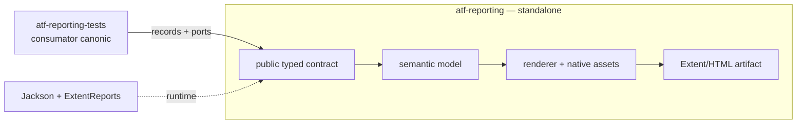
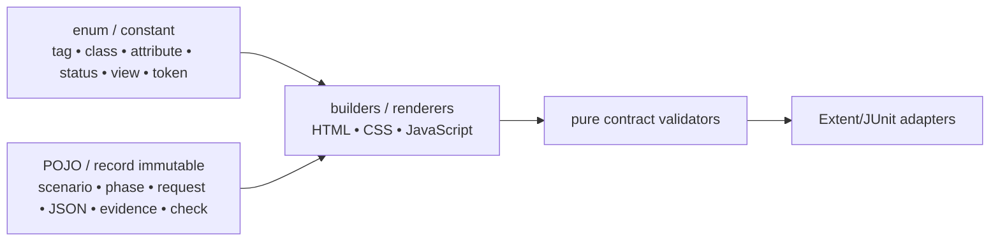
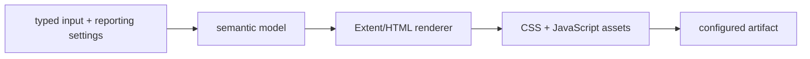

# ATF Reporting — bibliotecă standalone pentru artifacte Extent

`atf-reporting` transformă modele typed în raportare semantică și artifacte
Extent/HTML verificabile. Librăria nu execută API-uri, nu pornește browserul și
nu citește mock-uri sau fixture-uri de aplicație.

## Overall

- **producție** — contracte typed, modele semantice, renderer, asset-uri și
  publication; zero dependențe către module ATF;
- **teste proprii** — verifică standalone boundary-ul și contracte locale fără
  mock, Playwright sau fixture-uri de aplicație;
- **compoziție** — `atf-reporting-tests` este consumatorul canonic pentru
  API/integration și UI/E2E reporting;
- **output** — artifact Extent/HTML cu CSS și JavaScript native, fără verdicturi
  inventate de renderer;
- **adopție** — consumatorul furnizează inputul typed, statusul, evidence-ul și
  politica de output prin API-ul public.

Ordinea de citire este: boundary → pipeline semantic → contractul artifactului
→ structură internă → niveluri de testare → gate și feedback. Structura
package-urilor din `atf-reporting-tests` nu este duplicată aici; aparține
README-ului acelui consumer.

## Boundary standalone și consumatorul canonic



<details>
<summary><strong>Legendă — boundary-ul standalone</strong></summary>
- `atf-reporting` primește input typed și publică artifactul; nu orchestrează teste;
- `atf-reporting-tests` este singurul consumator canonic pentru compoziția ATF;
- Jackson și ExtentReports sunt dependențe externe declarate în POM-ul standalone;
- mock-ul, browserul, JUnit orchestration și fixture-urile nu intră în producția librăriei.
</details>

| Suprafață | Responsabilitate | Boundary permis |
|---|---|---|
| `src/main` | librăria producție și artifactul publicat | orice modul ATF, browser, fixture de business |
| `src/test` | guard-uri și contracte standalone | mock, Playwright, endpoint live |
| `atf-reporting-tests` | consumatorul canonic pentru API/UI/E2E | nu intră în JAR-ul reporting |
| alte module | nu trebuie să fie consumatori direcți în ținta de decuplare | dependențe test-scope rămase se urmăresc separat în feedback |

<details>
<summary><strong>Reconciliere live — ce este deja adevărat și ce mai trebuie decuplat</strong></summary>

Este adevărat în codul live că `atf-reporting/pom.xml` este parentless și nu
declară dependențe către module ATF, iar `src/test` nu importă module ATF.
Este însă încă prezentă o dependență **test-scope** directă în POM-urile
`atf-tests` și `atf-test-practice-shop`, iar unele teste de acolo importă
contracte reporting. Aceasta nu contaminează JAR-ul production, dar nu respectă
încă ținta strictă „singur consumer ATF = `atf-reporting-tests`”.

Mutarea acelor adaptoare și a dependențelor este un ToDo separat; README-ul nu îl
marchează rezolvat înainte de eliminarea verificabilă din cod și POM.
</details>

### Boundary standalone și adopție

`atf-reporting` este livrat ca modul renderer-neutral și HTML. API-ul public
este în `atf.api.reporting.*`: contracte, records immutable, porturi de
publicare, evidence, snapshot și renderer. Consumatorii furnizează execution,
UI evidence și statusuri prin aceste porturi fără să instaleze `atf-core`.

Compatibilitatea cu modele istorice este împărțită pe boundary: `ReportModelAdapters`
este seam-ul reflection-only din production, fără importuri către module ATF, iar
`CoreReportPortsAdapter` rămâne exclusiv în test/composition scope. Sunt seam-uri
de migrare, nu cod de business. Execution decide schimbul HTTP, validation decide
verdictul, UI produce acțiunea, iar reporting conservă și publică evidence-ul.

„Standalone” înseamnă că `mvn -f atf-reporting/pom.xml test` trece fără parent-ul
reactorului, fără niciun artifact ATF în POM și fără reactor local. POM-ul
modulului își declară singur release-ul Java, plugin-urile de build și versiunile
vendorilor; dependențele externe ale rendererului rămân explicite. Compoziția
completă are owner separat în `atf-reporting-tests`.

## Modelul typed

Regula permanentă este:



<details>
<summary><strong>Legendă — vocabular, modele și renderer</strong></summary>
- enum-urile și constantele dețin vocabularul finit: tag, class, attribute, view, status și token;
- POJO-urile/record-urile immutable dețin datele runtime: request, JSON, evidence și checks;
- builder-ele și renderer-ele transformă modelul în HTML/CSS/JavaScript;
- validatorii verifică output-ul, iar adapterele îl publică; valorile dinamice nu devin enum-uri artificiale.
</details>

| Tip de informație | Owner | Regulă |
|---|---|---|
| tag, class, attribute, element, view, status | `AtfReportHtmlVocabulary`, `AtfReportAsset`, `ExtentReportRuntimeVocabulary`, `AtfReportStatus` | enum/constant unic; `displayValue()` produce valoarea lowercase pentru CSS/filter; fără literali distribuiți |
| culori și geometrie | `AtfReportColors`, `AtfReportCssSelectors`, theme tokens | token stabil; output CSS determinist |
| CSS evidence | `AtfUiEvidenceCss` și providerii theme/evidence | selectorii și token-urile sunt typed; stylesheet-ul este asset CSS nativ, iar valorile dinamice sunt doar placeholder-e de compoziție |
| module JavaScript | `HtmlReportScriptModule`, builders și runtime section modules | ordine și ownership explicite |
| fields, body JSON, screenshot, checks | `ReportField`, `ReportJsonBody`, `ReportScreenshot`, `ReportCheck` | records/POJO immutable; serializerul legacy este boundary |
| scenarii și faze | `ReportExecutionModel`, `AtfReportSemanticSnapshot` | arbore semantic, nu markup |
| propoziții, URL-uri, payload-uri, valori de test | input runtime | nu se transformă artificial în enum-uri |

### Politica tag-urilor și adnotărilor

Tag-urile sunt normalizate la boundary-ul de publicare prin
`ReportTagNormalizer`: trim, eliminare valori goale/null, lowercase cu
`Locale.ROOT`, apoi deduplicare păstrând ordinea primei apariții. Aceeași listă
canonicală ajunge în categoriile Extent și în snapshot-ul semantic, iar runtime-ul
JavaScript normalizează valorile citite din markup pentru filtre și artifacte
legacy. Astfel un tag precum `CATEGORIES` este afișat și filtrat ca `categories`.

Regula este apărată de `ReportTagNormalizerTest`, testele semantic/fallback și
contractele runtime pentru `readTagValues`/`testTags`. Orice publisher nou trebuie
să treacă prin normalizer, nu să cheme direct `assignCategory` cu input brut.

Această separare permite teste unitare pentru fiecare provider, teste component
pentru contracte și teste integration pentru compoziția completă, fără să
folosească browserul pentru ce poate fi verificat prin DOM static sau text.
Statusurile `PASS`, `FAIL`, `WARNING`, `SKIP` și `INFO` sunt verdicturi typed în
`AtfReportStatus`; `CLEAR` rămâne un filtru UI separat. Nicio proiecție locală nu
reintroduce lista statusurilor ca string-uri.

## Modelele semantice și proiecția comună

Codul păstrează două modele immutable cu responsabilități locale distincte,
legate printr-o proiecție comună. Astfel nu este nevoie să forțăm rendererul
Extent și fallback-ul să împartă aceeași structură internă:

| Model | Rol |
|---|---|
| `AtfReportSemanticSnapshot` | populația lifecycle-ului Extent: class → scenario → phase → node |
| `ReportExecutionModel` | arborele fallback: scenario → phase → request/validation și proiecțiile `Overview`, `Categories`, `Failures` |

`AtfReportSemanticSnapshot.from(ReportExecutionModel)` este adaptorul comun.
Fallback-ul îl folosește pentru `semanticSnapshot()`, iar sesiunea eșuează
înainte de render dacă snapshot-ul derivat din arbore nu este egal cu recorderul
lifecycle. Proiecția păstrează package-ul, request/response JSON metadata,
validations și numărul de acțiuni/screenshot-uri; testul semantic compară
Extent și fallback pe arborele `class → scenario → phase → request → validation`.
Modelele rămân separate pentru că proiecțiile Overview/Categories/Fails sunt
specifice fallback-ului, iar snapshot-ul este contractul comun renderer-neutral.

## Contractul raportului

```text
TestCase
├── SETUP (opțional; numai precondiții / fixture-uri)
├── TEST BODY (acțiunea și validarea)
│   ├── Request
│   │   ├── Request details + REQUEST JSON / null
│   │   ├── Response details + RESPONSE JSON / null
│   │   └── Execution evidence
│   └── Validation — sibling direct al request-ului
│       └── aggregate assertion table
└── TEARDOWN (opțional; cleanup / read-back)
```

| Regula | Contract |
|---|---|
| ownership | request și validation sunt surori în aceeași fază |
| write body | `POST` și `PUT` au request JSON și response JSON valide, ne-goale |
| read/no body | `GET`, `204`, `304` păstrează disclosure-urile și afișează explicit `null` când body-ul lipsește |
| UI evidence | `SETUP` este setup; `Screen validation` este în `TEST BODY` după acțiuni și observații |
| layout | `＋/−` este inline înaintea propoziției; cele trei zone de validation sunt surori, fără `<hr>` decorativ |
| responsive evidence | până la breakpoint-ul de lucru (`1300px`), action tables se redimensionează și împachetează conținutul fără scrollbar orizontal; padding-ul lateral al wrapperului este eliminat semantic, nu prin crop | 
| action number | fiecare acțiune afișează `#n` într-un token dedicat, `atf-ui-action-number`, compact (`inline-block`/`max-content`); nu se reutilizează clasa extensibilă `atf-ui-action-sequence` |
| screenshot | link inline cu emoji-ul curent și payload Base64; nu hash afișat în locul linkului |
| action table | acțiunile relevante includ `getText`/text extraction; timpul apare numai pentru acțiuni |
| failures | `Setup`, `Playwright action`, `Audit observation` și `Assertion` au cauze distincte și `Open in Tests` |
| navigation | `Tests`, `Overview`, `Categories`, `Fails` folosesc aceeași identitate semantică și deep-link |

### API evidence atașată unui pas UI

Un consumer poate atașa unul sau mai multe `ReportExecutionEvidence` la același
checkpoint UI prin overload-ul `UiExtentReportSession.step(...)`. Reporting nu
creează un test artificial și nu recalculează verdictul; proiectează schimbul
în contractul existent al request-ului:

```text
UI checkpoint
├── Request details  → method/path/url/query/auth/headers/transport + REQUEST JSON
├── Response details → status/content-type/headers + RESPONSE JSON
└── Execution evidence → attempts/retries/duration/outcome
```

Disclosures sunt închise by default și rămân pe același nod UI. Body-urile sunt
afișate cu limita configurată de consumer prin
`reporting.bodyMaxDisplayCharacters`, cu redaction înainte de render; nu se
introduce o limită hardcodată în `atf-reporting`. `atf-reporting` rămâne
independent de mock, browser și aplicație: consumerul furnizează datele typed,
iar librăria publică numai contractul semantic și layout-ul verificabil.

Verdictul este calculat de execution/validation și doar publicat de reporting.
Rendererul nu inventează statusuri.

## Structura producției

| Boundary | Owner principal | Output verificabil |
|---|---|---|
| semantic/model | `semantic`, `model`, `contract` | snapshot, execution tree, status și assertions |
| markup/render | `markup`, `html`, `extent` | Extent nodes și fallback HTML |
| asset/theme | `asset`, `theme`, `runtime` | CSS/JavaScript native, vocabulary și manifest |
| audit/publication | `ui/audit`, `artifact`, `publication` | contracte, inspector, workspace și artifact final |
| input/config | `api`, `configuration`, `evidence` | request/response/evidence typed și policy de output |

<details>
<summary><strong>Detaliu — harta internă și split-ul CSS/JavaScript</strong></summary>

```text
atf.api.reporting
├── semantic/       snapshot și recorder lifecycle
├── model/          execution tree și evidence POJO
├── markup/         Extent nodes, assets și vocabulary bridge
├── html/            fallback document și script builder
├── theme/           tokens, CSS selectors, theme/evidence providers
├── runtime/         JavaScript Extent split pe responsabilități
├── ui/              contracte, audit model și UI lifecycle
├── api/             acceptance/report contract și JSON evidence audit
├── artifact/        inspector și contracte ale artifactului
├── publication/     workspace, coordinator, finalizer
├── configuration/   reporting settings și environment
└── evidence/        transport/UI evidence și style contract
```

Split-ul CSS/JavaScript este semantic, nu cosmetic. `ExtentReportRuntimeBehaviour`
compune core/tests/overview/evidence/navigation/duration/failure; providerii
theme/evidence dețin CSS-ul aferent. Nu se mai creează clase doar pentru a reduce
numărul de linii.

Pentru navigare, limita este explicită și verificabilă: `ExtentReportRuntimeNavigation`
compune trei asset-uri JavaScript native — DOM contract, disclosure și controller —
prin `ReportAssetComposer`. Fațadele Java rămân doar owneri semantici și nu mai
rețin corpuri inline; testele de componentă verifică atât funcțiile publicate, cât
și manifestul asset-urilor. `Scenarios`, `Categories`, fragmentele de evidence
și Overview CSS respectă aceeași limită; `AtfReportOverviewCss` compune acum
asset-uri native separate pentru layout, tag audit, category tables și category
status. Aceeași limită este aplicată și theme-ului Extent: responsive, base,
category/category-status, Fails layout/status, navigation și detail sunt asset-uri
CSS native, iar fațadele Java rezolvă doar token-uri și seam-urile de compoziție.
Evidence interaction/table/disclosure/stack și fallback theme folosesc aceeași
graniță.

Fallback navigation și boot-ul documentului Extent urmează aceeași regulă:
`fallback-navigation.js` și `runtime-boot.js` sunt asset-uri native, iar
`HtmlReportNavigationScript` și `ExtentReportRuntimeBehaviour` sunt doar
fațade/publication seams typed. Modulele JavaScript Extent sunt injectate în
placeholder-ul de boot fără ca Java să reconstruiască funcții sau expresii
executabile.

Aceeași limită este aplicată acum și familiei `ExtentReportRuntimeOverview`:
`Audit`, `Labels`, `Charts` și `Cleanup` sunt asset-uri native distincte, iar
enum-ul `Fragment` rămâne composition root-ul ordinii. Java nu mai conține
corpurile funcțiilor; le expune prin fațade testabile și `ReportAssetComposer`.

`ExtentReportRuntimeScenarios` și `ExtentReportRuntimeCategories` folosesc aceeași
graniță: `extent-scenarios.js` și `extent-categories.js` dețin funcțiile browser,
iar Java păstrează doar facade-ul public și vocabularul typed. Astfel filtrarea,
adnotările de scenariu și deep-link-urile către Categories pot fi verificate
componentar fără să reintroducem literali JavaScript în clasele runtime.

Evidence are aceeași separare: `ExtentReportRuntimeEvidenceDisclosure`,
`ExtentReportRuntimeEvidenceFailures` și `ExtentReportRuntimeEvidenceTableLayout`
sunt fațade Java mici peste `extent-evidence-disclosure.js`,
`extent-evidence-failures.js` și `extent-evidence-table-layout.js`. Primul normalizează
disclosure-urile pentru request/response/JSON/assertions, al doilea proiectează
failure evidence UI, iar al treilea măsoară valorile reale și publică lățimi de
coloane deterministe. Nu se amestecă layout-ul cu semantica evidence și nu se
introduce un al doilea owner al aceleiași funcții.

Și proiecția `Fails` este acum separată pe responsabilități native: detection,
context, cause-chain și projection au câte un asset JS și o fațadă Java proprie.
`ExtentReportFailureRuntime` compune ordinea stabilă, fără să dețină corpuri de
funcții; astfel testele pot verifica independent cauza, contextul și randarea
failure fără browser, iar testul E2E verifică deep-link-ul către testul exact.

Rămâne intenționat în următorul val auditul final al vocabularului/builder-ului CSS
și al seam-urilor mici de publicare. `AtfUiEvidenceCss` este facade typed peste
`ui-evidence.css`, iar `Duration` și `RuntimeCore` sunt compuse din asset-uri
JavaScript native; niciuna dintre aceste familii nu mai asamblează corpuri mari în
Java. `ScenarioCss`
este deja un builder typed mic și rămâne Java pentru că validează selectorii și
proprietățile înainte de serializare; nu este un depozit de CSS inline monolitic.
`HtmlReportScriptBuilder` rămâne numai infrastructură generică pentru porturi
typed/custom și teste; nu mai este folosit pentru a construi navigation sau boot
în producție.
Migrarea următoare se face incremental, cu contract component echivalent,
reconciliere live și raport fresh; nu se transformă mecanic toate constantele Java
în token-uri dacă asta ar ascunde contractul sau ar îngreuna debugging-ul.

Funcțiile JavaScript generate au aceeași regulă de ownership: fiecare funcție
publicată are un singur owner runtime și o singură definiție autoritativă. Funcția
de orchestrare nu este rebinding-uită ulterior de un alt string; citirea DOM-ului,
derivarea datelor și proiecția în DOM sunt helperi separați și numiți după
responsabilitate. `ExtentReportFailureRuntime` păstrează un singur `failureContext`
și un singur `renderFails`.

Durata este emisă de seams cu owner unic, compuse de facade-ul public
`ExtentReportDurationRuntime`:

| Seam | Responsabilitate | Dovadă componentă |
|---|---|---|
| `ExtentReportDurationParsing` | citire, normalizare și formatare a duratelor | funcții de parsing declarate o singură dată |
| `ExtentReportDurationDom` | traversare DOM, selectori și identitate de nod | selectorii/atributele nu sunt literali împrăștiați |
| `ExtentReportDurationMemory` | memorarea măsurătorilor și lookup-ul de durată | precedence între marker, path și node id |
| `ExtentReportDurationAggregation` | copii, evidence transport și agregare de noduri | durată directă vs. agregată |
| `ExtentReportDurationProjectionLookup` | rezolvarea cardului de scenariu | lookup separat de randare |
| `ExtentReportDurationProjectionViews` | Categories, Overview, Fails și proiecții | fiecare view își păstrează ownerul |
| `ExtentReportDurationProjectionPublication` | badge-uri, summary și publicarea class duration | output consistent în toate tab-urile |
| `ExtentReportDurationScheduling` / `Lifecycle` | scheduling, click hooks, observer și boot | activare idempotentă și ready marker |
| `ExtentReportDurationVocabulary` | contract typed pentru atribute, selectori și funcții | cardinalitate și unicitate verificate static |

`ReportArtifactInspectorTest` și contractele runtime verifică unicitatea și
prezența acestor seams în HTML-ul publicat. Stringurile dinamice se compun local,
prin fragmente mici și `String.join`; enum-urile tipizează protocolul browser,
nu datele runtime. Orice funcție rămasă mixtă se justifică în feedback printr-un
contract semantic concret, nu printr-un split cosmetic de linii.

Registrul `ExtentReportRuntimeModule` este singurul composition root pentru
runtime-ul injectat. El mapează fiecare controller la un singur
`HtmlReportScriptModule` și îl publică în ordinea semantică `CORE → TESTS →
OVERVIEW → EVIDENCE → NAVIGATION → DURATION → FAILURES → FAILURE_CAUSE`.
`ExtentReportRuntimeBehaviour` doar orchestrează boot/ready și iterează registrul;
nu mai repetă manual lista claselor. Astfel `Duration`, `Evidence`, `Overview`,
`Navigation`, `Tests` și failure projection pot fi testate independent ca
module component, iar integrarea verifică doar compoziția și ordinea.

| Controller | Boundary deținut | Contract component principal |
|---|---|---|
| `ExtentReportRuntimeCore` | vocabular DOM, query, identitate și status | primitive tipizate, declarații unice |
| `ExtentReportRuntimeTests` | filtre Tests/Categories și proiecția scenariilor | status/tag filters, category links |
| `ExtentReportRuntimeOverview` | audit, summary, chart și procentaje | proiecție Overview fără evidence fals |
| `ExtentReportRuntimeEvidence` | roluri, disclosure și evidence failure | request/response/assertion/UI evidence |
| `ExtentReportRuntimeNavigation` | hash, tab, collapse și deep-link | navigare și `＋/−` inline |
| `ExtentReportDurationRuntime` | parsing, măsurare, agregare și publicare | duration precedence și clone parity |
| `ExtentReportFailureRuntime` | failure state, rows și cause chain | un owner pentru Fails și diagnostic |

`ExtentReportRuntimeModuleTest` verifică non-empty source, owner-ul de publicare,
ordinea modulelor și faptul că o funcție JavaScript nu este declarată de două
module. Este un contract de coeziune, nu o verificare cosmetică a numărului de
linii; comportamentul browserului rămâne verificat separat prin ATF Debug și
Playwright MCP.

</details>

### Vocabularul runtime și testarea pe niveluri

`ExtentReportRuntimeVocabulary` este ownerul unic pentru numele funcțiilor
injectate, selectorii DOM, atributele `data-atf-*`, clasele CSS semantice și
valorile finite de status. `ExtentReportRuntimeCore` emite aceste primitive în
ordine stabilă, prin emitătoare mici pentru fiecare responsabilitate; nu
reintroduce literali de protocol în concatenări de stringuri. Regula este
verificată de `ExtentReportRuntimeScriptTest`: fiecare funcție din enum are o
singură declarație în script, iar contractele vizibile rămân observabile în
artifactul HTML.

| Boundary | Dovadă principală | Browser |
|---|---|---:|
| vocabular și builder JavaScript | enum-uri, funcții de emitere, unicitatea funcțiilor | nu |
| HTML/CSS/JS publicat | contracte statice, model/proiecție, asset manifest | nu |
| mock → execution → validation → report | integrare și reconciliere JSON/evidence | nu implicit |
| tab-uri, click, disclosure, computed-style și screenshot | E2E prin ATF Debug + Playwright MCP | da |

Un raport API generat pentru precondiția unui test UI este input read-only, nu
devine automat validare UI. Structura, JSON-ul, provenance-ul mock și
reconcilierea secțiunilor se verifică component/integration; E2E păstrează doar
ce depinde de browserul real: interacțiune, layout, vizibilitate, wrapping,
disclosure și navigare. Astfel `ExtentReportRuntimeCore`, `...Tests`,
`...Evidence`, `...Navigation`, `...DurationRuntime` și `...FailureRuntime`
rămân separate pe boundary semantic, iar testele UI rămân composition roots
subțiri și configurabile.

Contractele Extent de testare sunt separate pe boundary semantic:
`ExtentReportInteractionContractTest` verifică arborele request/phase/evidence,
`ExtentReportFailureProjectionContractTest` verifică ownership-ul și cauza din
Fails, iar `ExtentReportNavigationContractTest` verifică tab-urile, filtrele și
deep-link-urile Categories. `ExtentReportContractCohesionArchitectureTest`
ține separarea executabilă; fixture-urile rămân în test scope și nu sunt
duplicate în production.

Limita de coeziune este de maximum opt clase pe pachet. Architecture/cohesion
tests verifică limita și resping atât pachetele noi supradimensionate, cât și
split-urile artificiale.

## Consumerul de compoziție

`atf-reporting-tests` este locul în care se leagă reporting-ul de mock, execution,
validation, API fixtures, Playwright și ATF Debug. Aceste detalii nu aparțin
package-ului `atf-reporting` și sunt documentate separat în
[`atf-reporting-tests/README.md`](../atf-reporting-tests/README.md) și în README-ul
dedicat testelor Extent
([`ui/tests/extent/README.md`](../atf-reporting-tests/src/test/java/atf/ui/tests/extent/README.md)).

Reporting-ul expune numai contracte; nu deține structura test-kit-ului, locatori,
fixture-uri, setup API sau composition roots. Un test consumer poate folosi
contractele reporting fără ca librăria să importe invers codul testului.

Structura package-urilor, adnotările, mock YAML, locatorii Playwright și
împărțirea unit/component/integration/E2E sunt detalii ale consumerului și se
urmăresc numai în README-ul dedicat, nu se duplică în această librărie.

## Input și configurare în librărie

Producția `atf-reporting` deține numai configurația necesară publicării:
`ReportingSettings`, `ExtentReportConfiguration`, contextul de pornire și loaderul
YAML. Consumatorul furnizează configurația; reporting-ul validează limitele,
output directory, numele fișierului și timestamp policy înainte de publication.



<details>
<summary><strong>Legendă — ce configurează reporting-ul și ce nu</strong></summary>
- reporting-ul poate citi configurația de output și limitele de display;
- mock-ul, endpoint-ul, browserul și politica de audit aparțin consumerului;
- output-ul este configurabil, iar documentația nu păstrează nume sau căi de run;
- un status este primit semantic de la execution/validation și doar publicat.
</details>

Pentru body-uri și assertions, `null` rămâne diferit de string gol; redaction-ul
se aplică înainte de render, iar limitele sunt typed și configurabile. `POST` și
`PUT` pot avea request/response JSON; `GET`, `204` și `304` păstrează explicit
absența body-ului.

## Publicare și output

Output-ul este configurabil prin `reporting.extent.outputDirectory` și
`fileName`; runtime-ul UI folosește separat directorul UI configurat de test.
Documentația descrie numai politica și pattern-ul de output, nu nume concrete de
rapoarte generate.

`ReportPublicationCoordinator` protejează publication path, lock-ul și
concurența. Identitatea/hash-ul intern poate fi folosit pentru ownership și
deduplicare, dar nu este afișat în HTML ca înlocuitor pentru evidence-ul uman.
La publicarea pe filesystem-uri care pot păstra temporar fișierul deschis,
coordonatorul aplică un retry bounded după tentativa atomică; fallback-ul
non-atomic este permis numai pentru `AtomicMoveNotSupportedException`, iar o
eroare persistentă este propagată după ultima încercare. Retry-ul rămâne în
production publication boundary, nu în test-kit și nu în browser.

## Niveluri de testare și independență

| Nivel | Exemple de responsabilitate | Browser? |
|---|---|---:|
| unit/standalone | status, duration, redaction și contracte locale din `atf-reporting/src/test` | nu |
| component | asset manifest, HTML contract, section modules și architecture/cohesion guards în consumer | nu |
| integration/API consumer | mock → execution → validation → reporting publication | nu, implicit |
| e2e consumer | raport generat, tab-uri, click/collapse, computed-style, screenshot link | da |

Independența nu înseamnă să mutăm mock-ul sau browserul în `atf-reporting`.
Înseamnă o scară de teste fără contaminarea librăriei:

| Artifact | Niveluri proprii | De ce |
|---|---|---|
| `atf-reporting` | unit + standalone boundary | dovedește că librăria se compilează și își verifică contractele fără ATF |
| `atf-reporting-tests` | component + integration/API + E2E | dovedește rendererul în consumer, mock/execution/validation și Playwright |

`atf-tests` nu este consumer reporting; guvernanța întregului reactor este
documentată separat în [`../atf-tests/README.md`](../atf-tests/README.md).

Astfel librăria poate fi compilată și folosită fără celelalte module, iar
acoperirea API/E2E rămâne executabilă într-un consumator real. A cere browser și
transport în modulul standalone ar reintroduce exact coupling-ul pe care
boundary-ul îl interzice.

Un test E2E nu reimplementează contractul deja apărat component. Un test
component nu pornește browser pentru un selector sau text care poate fi analizat
static. Orice schimbare vizuală importantă trece toate nivelurile afectate și
verificarea finală prin ATF Debug + Chromium/Playwright MCP.

## Gate de contribuție

```text
cod live curent
  → staging extern nou (target/artifacts excluse)
  → test focalizat
  → gate unit/component/integration
  → gate E2E dacă se schimbă DOM/layout/interacțiunea
  → ATF Debug + Playwright/Chromium headless
  → reconciliere live ↔ staging
  → sync selectiv și README owner actualizat
```

Checklist-ul de aici este doar harta rapidă. Checklist-ul normativ, cu reguli
obligatorii/condiționale și pași de explorare manuală, este în
[`../atf-reporting-tests/src/test/java/atf/ui/tests/extent/README.md`](../atf-reporting-tests/src/test/java/atf/ui/tests/extent/README.md).

<details>
<summary><strong>Checklist browser — responsabilitatea consumerului</strong></summary>

- ✅ `Tests`, `Overview`, `Categories`, `Fails` și deep-link navigation;
- ✅ disclosure-uri colapsate implicit unde contractul nu cere altceva;
- ✅ `＋/−` inline, screenshot inline, acțiuni, audit observations și assertions;
- ✅ `scrollWidth <= clientWidth`, wrapping și computed-style;
- ✅ zero `<hr>` decorative, console/page errors sau asset-uri rupte;
- ✅ request/response JSON, status și mock provenance reconciliate când sunt
  publicate;
- ✅ verificare prin ATF Debug + Chromium/Playwright MCP, fără browser Windows
  real și fără oprirea run-urilor active.

</details>

## Contracte și feedback

- contract vizual: [`docs/ATF_Reporting_Contract.md`](../docs/ATF_Reporting_Contract.md);
- arhitectură: [`docs/ATF_Architecture.md`](../docs/ATF_Architecture.md);
- bune practici: [`docs/README_Atf_BestPractices.md`](../docs/README_Atf_BestPractices.md);
- feedback activ: [`docs/feedback/README.md`](../docs/feedback/README.md).

Feedback-ul nu mai are gap-uri active pentru contractele deja verificate:
manifestul software reutilizabil, catalogul live explicit și split-ul semantic
al contractelor Extent sunt implementate și apărate de teste. Registrul păstrează
în continuare limitele de decuplare și refactorizare care nu sunt încă închise.

<details>
<summary><strong>Detaliu — asset-uri browser native și guvernare Java</strong></summary>

CSS-ul și JavaScript-ul livrat în HTML se păstrează în `src/main/resources`,
în fișiere mici, grupate după responsabilitate (`theme`, `overview`, `evidence`,
`navigation`, `filters`, `runtime-core`, `duration`). Overview-ul folosește separat
`overview-layout.css`, `overview-tag-audit.css`,
`overview-category-tables.css` și `overview-category-status.css`; nu există o
regulă CSS duplicată în facade-ul Java. `ReportAsset` este vocabularul unic al
asset-urilor; `ReportAssetLoader` citește resursa din classpath, iar
`ReportAssetComposer` rezolvă token-urile Java (inclusiv culorile finite) și
produce corpul final. Aceeași graniță este folosită de cele nouă asset-uri
`duration-*.js` și de cele trei asset-uri `runtime-core-*.js`; fragmentele
JavaScript păstrează ownership-ul semantic, iar facade-urile Java păstrează doar
ordinea de compoziție.

Facade-urile Java (`AtfFallbackTheme`, `AtfReportOverviewCss`, facades-urile CSS
theme/evidence,
`HtmlReportNavigationScript`, `ExtentReportRuntimeEvidenceRoles` și
`ExtentReportRuntimeTestFilters`) rămân API-ul de integrare. Ele nu reconstruiesc
corpul scriptului prin concatenări mari; Java guvernează doar asset-ul, token-urile
și ordinea de compoziție. `ExtentReportRuntimeTestsVocabulary.Template` guvernează
placeholder-ele asset-ului, iar funcțiile comune (`aggregateClassDurations`,
`captureDomContract`) provin din vocabularul runtime central, nu din string-uri
izolate în facade. Contractul se verifică separat prin teste de asset, component
și browser E2E.

</details>
