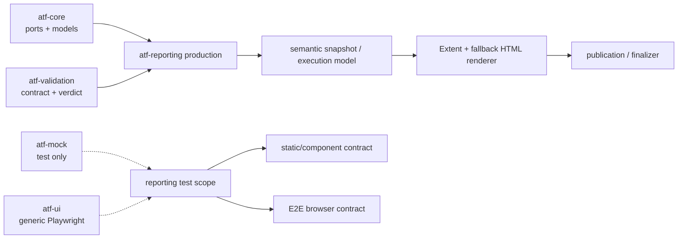
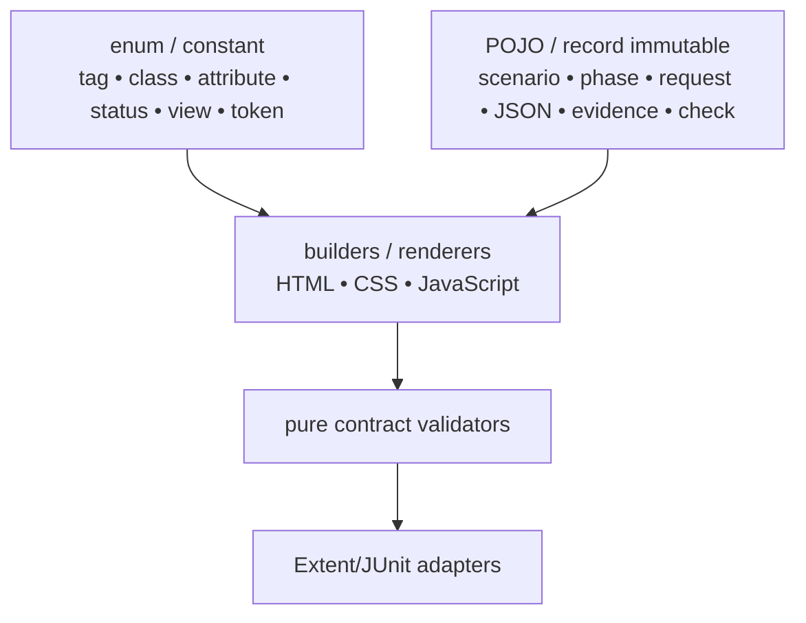
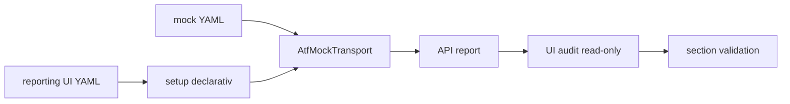

# ATF Reporting — semantic renderer și test-kit Extent

`atf-reporting` are două suprafețe distincte:

1. `src/main/java` produce raportarea renderer-neutrală și output-ul Extent/HTML;
2. `src/test/java` testează independent acest modul prin unit, component,
   integration și un număr minim de flow-uri E2E UI.

Producția nu depinde de mock, Playwright, fixture-uri sau browser. Acestea sunt
adaptoare ale test scope-ului și nu pot ajunge în runtime.

## Harta responsabilității



| Zonă | Deține | Nu deține |
|---|---|---|
| production | model semantic, evidence, vocabulary, theme, runtime, renderer, publication și artifact contract | mock, browser, JUnit orchestration, verdict inventat |
| unit | modele, enum-uri, token-uri, builder-e, parser-e și politici pure | DOM și endpoint |
| component | contractele HTML/CSS/JavaScript, projection, audit și ownership | browser pentru comportamente demonstrabile static |
| integration | producție → input → artifact, mock și boundary-uri reale | endpoint live implicit |
| E2E test scope | click, tab navigation, collapse, computed-style, responsive layout și screenshot link | reimplementarea rendererului în teste |

## Modelul typed

Regula permanentă este:



| Tip de informație | Owner | Regulă |
|---|---|---|
| tag, class, attribute, element, view, status | `AtfReportHtmlVocabulary`, `AtfReportAsset`, `ExtentReportRuntimeVocabulary`, `AtfReportStatus` | enum/constant unic; `displayValue()` produce valoarea lowercase pentru CSS/filter; fără literali distribuiți |
| culori și geometrie | `AtfReportColors`, `AtfReportCssSelectors`, theme tokens | token stabil; output CSS determinist |
| CSS evidence | `AtfUiEvidenceCss` și providerii theme/evidence | selectorii și token-urile sunt typed; valorile dinamice nu sunt enum-uri |
| module JavaScript | `HtmlReportScriptModule`, builders și runtime section modules | ordine și ownership explicite |
| fields, body JSON, screenshot, checks | `ReportField`, `ReportJsonBody`, `ReportScreenshot`, `ReportCheck` | records/POJO immutable; serializerul legacy este boundary |
| scenarii și faze | `ReportExecutionModel`, `AtfReportSemanticSnapshot` | arbore semantic, nu markup |
| propoziții, URL-uri, payload-uri, valori de test | input runtime | nu se transformă artificial în enum-uri |

### Politica tag-urilor și adnotărilor

Tag-urile sunt normalizate la boundary-ul de publicare prin
`ReportTagNormalizer`: trim, eliminare valori goale/null, lowercase cu
`Locale.ROOT`, apoi deduplicare păstrând ordinea primei apariții. Aceeași listă
canonicală ajunge în categoriile Extent și în snapshot-ul semantic, iar runtime-ul
JavaScript normalizează valorile citite din markup pentru filtre și artifacte
legacy. Astfel un tag precum `CATEGORIES` este afișat și filtrat ca `categories`.

Regula este apărată de `ReportTagNormalizerTest`, testele semantic/fallback și
contractele runtime pentru `readTagValues`/`testTags`. Orice publisher nou trebuie
să treacă prin normalizer, nu să cheme direct `assignCategory` cu input brut.

Această separare permite teste unitare pentru fiecare provider, teste component
pentru contracte și teste integration pentru compoziția completă, fără să
folosească browserul pentru ce poate fi verificat prin DOM static sau text.
Statusurile `PASS`, `FAIL`, `WARNING`, `SKIP` și `INFO` sunt verdicturi typed în
`AtfReportStatus`; `CLEAR` rămâne un filtru UI separat. Nicio proiecție locală nu
reintroduce lista statusurilor ca string-uri.

## Modelele semantice și proiecția comună

Codul păstrează două modele immutable cu responsabilități locale distincte,
legate printr-o proiecție comună. Astfel nu este nevoie să forțăm rendererul
Extent și fallback-ul să împartă aceeași structură internă:

| Model | Rol |
|---|---|
| `AtfReportSemanticSnapshot` | populația lifecycle-ului Extent: class → scenario → phase → node |
| `ReportExecutionModel` | arborele fallback: scenario → phase → request/validation și proiecțiile `Overview`, `Categories`, `Failures` |

`AtfReportSemanticSnapshot.from(ReportExecutionModel)` este adaptorul comun.
Fallback-ul îl folosește pentru `semanticSnapshot()`, iar sesiunea eșuează
înainte de render dacă snapshot-ul derivat din arbore nu este egal cu recorderul
lifecycle. Proiecția păstrează package-ul, request/response JSON metadata,
validations și numărul de acțiuni/screenshot-uri; testul semantic compară
Extent și fallback pe arborele `class → scenario → phase → request → validation`.
Modelele rămân separate pentru că proiecțiile Overview/Categories/Fails sunt
specifice fallback-ului, iar snapshot-ul este contractul comun renderer-neutral.

## Contractul raportului

```text
TestCase
├── SETUP (opțional; numai precondiții / fixture-uri)
├── TEST BODY (acțiunea și validarea)
│   ├── Request
│   │   ├── Request details + REQUEST JSON / null
│   │   ├── Response details + RESPONSE JSON / null
│   │   └── Execution evidence
│   └── Validation — sibling direct al request-ului
│       └── aggregate assertion table
└── TEARDOWN (opțional; cleanup / read-back)
```

| Regula | Contract |
|---|---|
| ownership | request și validation sunt surori în aceeași fază |
| write body | `POST` și `PUT` au request JSON și response JSON valide, ne-goale |
| read/no body | `GET`, `204`, `304` păstrează disclosure-urile și afișează explicit `null` când body-ul lipsește |
| UI evidence | `SETUP` este setup; `Screen validation` este în `TEST BODY` după acțiuni și observații |
| layout | `＋/−` este inline înaintea propoziției; cele trei zone de validation sunt surori, fără `<hr>` decorativ |
| screenshot | link inline cu emoji-ul curent și payload Base64; nu hash afișat în locul linkului |
| action table | acțiunile relevante includ `getText`/text extraction; timpul apare numai pentru acțiuni |
| failures | `Setup`, `Playwright action`, `Audit observation` și `Assertion` au cauze distincte și `Open in Tests` |
| navigation | `Tests`, `Overview`, `Categories`, `Fails` folosesc aceeași identitate semantică și deep-link |

Verdictul este calculat de execution/validation și doar publicat de reporting.
Rendererul nu inventează statusuri.

## Structura producției

```text
atf.api.reporting
├── semantic/       snapshot și recorder lifecycle
├── model/          execution tree și evidence POJO
├── markup/         Extent nodes, assets și vocabulary bridge
├── html/            fallback document și script builder
├── theme/           tokens, CSS selectors, theme/evidence providers
├── runtime/         JavaScript Extent split pe responsabilități
├── ui/              contracte, audit model și UI lifecycle
├── api/             acceptance/report contract și JSON evidence audit
├── artifact/        inspector și contracte ale artifactului
├── publication/     workspace, coordinator, finalizer
├── configuration/   reporting settings și environment
└── evidence/        transport/UI evidence și style contract
```

Split-ul CSS/JavaScript este semantic, nu cosmetic. `ExtentReportRuntimeBehaviour`
compune core/tests/overview/evidence/navigation/duration/failure; providerii
theme/evidence dețin CSS-ul aferent. Nu se mai creează clase doar pentru a reduce
numărul de linii.

Funcțiile JavaScript generate au aceeași regulă de ownership: fiecare funcție
publicată are un singur owner runtime și o singură definiție autoritativă. Funcția
de orchestrare nu este rebinding-uită ulterior de un alt string; citirea DOM-ului,
derivarea datelor și proiecția în DOM sunt helperi separați și numiți după
responsabilitate. `ExtentReportFailureRuntime` păstrează un singur `failureContext`
și un singur `renderFails`, iar `ExtentReportDurationRuntime` separă traversarea,
decizia de agregare și publicarea duratelor. Pentru lizibilitate și testare
component, durata este emisă de patru fragmente cu owner unic — parsing,
aggregation, projection și lifecycle — compuse de facade-ul
`ExtentReportDurationRuntime`; `ExtentReportDurationRuntimeComponentTest`
verifică ordinea și unicitatea funcțiilor. `ReportArtifactInspectorTest` și
contractele runtime verifică unicitatea și prezența acestor seams în HTML-ul
publicat. Orice funcție rămasă mixtă se justifică în feedback printr-un contract
semantic concret, nu printr-un split cosmetic de linii.

Registrul `ExtentReportRuntimeModule` este singurul composition root pentru
runtime-ul injectat. El mapează fiecare controller la un singur
`HtmlReportScriptModule` și îl publică în ordinea semantică `CORE → TESTS →
OVERVIEW → EVIDENCE → NAVIGATION → DURATION → FAILURES → FAILURE_CAUSE`.
`ExtentReportRuntimeBehaviour` doar orchestrează boot/ready și iterează registrul;
nu mai repetă manual lista claselor. Astfel `Duration`, `Evidence`, `Overview`,
`Navigation`, `Tests` și failure projection pot fi testate independent ca
module component, iar integrarea verifică doar compoziția și ordinea.

| Controller | Boundary deținut | Contract component principal |
|---|---|---|
| `ExtentReportRuntimeCore` | vocabular DOM, query, identitate și status | primitive tipizate, declarații unice |
| `ExtentReportRuntimeTests` | filtre Tests/Categories și proiecția scenariilor | status/tag filters, category links |
| `ExtentReportRuntimeOverview` | audit, summary, chart și procentaje | proiecție Overview fără evidence fals |
| `ExtentReportRuntimeEvidence` | roluri, disclosure și evidence failure | request/response/assertion/UI evidence |
| `ExtentReportRuntimeNavigation` | hash, tab, collapse și deep-link | navigare și `＋/−` inline |
| `ExtentReportDurationRuntime` | parsing, măsurare, agregare și publicare | duration precedence și clone parity |
| `ExtentReportFailureRuntime` | failure state, rows și cause chain | un owner pentru Fails și diagnostic |

`ExtentReportRuntimeModuleTest` verifică non-empty source, owner-ul de publicare,
ordinea modulelor și faptul că o funcție JavaScript nu este declarată de două
module. Este un contract de coeziune, nu o verificare cosmetică a numărului de
linii; comportamentul browserului rămâne verificat separat prin ATF Debug și
Playwright MCP.

### Vocabularul runtime și testarea pe niveluri

`ExtentReportRuntimeVocabulary` este ownerul unic pentru numele funcțiilor
injectate, selectorii DOM, atributele `data-atf-*`, clasele CSS semantice și
valorile finite de status. `ExtentReportRuntimeCore` emite aceste primitive în
ordine stabilă, prin emitătoare mici pentru fiecare responsabilitate; nu
reintroduce literali de protocol în concatenări de stringuri. Regula este
verificată de `ExtentReportRuntimeScriptTest`: fiecare funcție din enum are o
singură declarație în script, iar contractele vizibile rămân observabile în
artifactul HTML.

| Boundary | Dovadă principală | Browser |
|---|---|---:|
| vocabular și builder JavaScript | enum-uri, funcții de emitere, unicitatea funcțiilor | nu |
| HTML/CSS/JS publicat | contracte statice, model/proiecție, asset manifest | nu |
| mock → execution → validation → report | integrare și reconciliere JSON/evidence | nu implicit |
| tab-uri, click, disclosure, computed-style și screenshot | E2E prin ATF Debug + Playwright MCP | da |

Un raport API generat pentru precondiția unui test UI este input read-only, nu
devine automat validare UI. Structura, JSON-ul, provenance-ul mock și
reconcilierea secțiunilor se verifică component/integration; E2E păstrează doar
ce depinde de browserul real: interacțiune, layout, vizibilitate, wrapping,
disclosure și navigare. Astfel `ExtentReportRuntimeCore`, `...Tests`,
`...Evidence`, `...Navigation`, `...DurationRuntime` și `...FailureRuntime`
rămân separate pe boundary semantic, iar testele UI rămân composition roots
subțiri și configurabile.

Contractele Extent de testare sunt separate pe boundary semantic:
`ExtentReportInteractionContractTest` verifică arborele request/phase/evidence,
`ExtentReportFailureProjectionContractTest` verifică ownership-ul și cauza din
Fails, iar `ExtentReportNavigationContractTest` verifică tab-urile, filtrele și
deep-link-urile Categories. `ExtentReportContractCohesionArchitectureTest`
ține separarea executabilă; fixture-urile rămân în test scope și nu sunt
duplicate în production.

Limita de coeziune este de maximum opt clase pe pachet. Architecture/cohesion
tests verifică limita și resping atât pachetele noi supradimensionate, cât și
split-urile artificiale.

## Structura test-kit-ului

```text
src/test/java/atf
├── api/tests/api/          API-only tests, route coverage, headers, lifecycle
├── api/tests/support/      API resources și setup fără UI
├── api/tests/architecture/ boundary și ownership guards
├── api/reporting/          unit/integration pentru production reporting
└── ui/tests/extent/
    ├── component/          contracte statice, projection, architecture
    ├── e2e/                 browser-backed composition roots
    └── support/             api, config, locators, extract, audit, flow, publish
```

`ReportingTestReadabilityArchitectureTest` este un guard de arhitectură pentru
test scope: respinge invocațiile ATF complet calificate în expresii și păstrează
importurile normale/static ca sursă lizibilă a ownerului și a vocabularului.
Același guard verifică toate source-set-urile Java ale proiectului și respinge
importurile duplicate, astfel încât merge-urile și refactorizările paralele să
nu lase dependențe repetate în producție sau în teste.
Verificarea se aplică numai surselor de test și nu introduce o regulă în
producția reporting.

`atf.api.tests.api` nu importă UI, Playwright, DOM sau Debug UI. Catalogul mock
este accesat de `atf.api.tests.support.ApiTestResources`, iar configurația UI și
setup-ul de audit rămân în `atf.ui.tests.extent.support.config`.

### E2E configurabil

Composition root-ul selectează metode concrete prin `@ApiTestRef`, nu familii
întregi și nu creează câte un test pentru fiecare variantă. E2E acoperă doar
comportamente imposibil de dovedit static:

```text
@ApiScenarioSetup(tests = { ApiTestRef(owner = ..., method = ...) })
        ↓
setup/mock → API report read-only
        ↓
SectionAuditRegistry → module + checks + publisher
        ↓
Playwright → tab / click / collapse / style / screenshot / console
```

Fixture-urile, flow-urile, inspectorii, locatorii și dynamic engines nu sunt
teste și rămân în `support`. Locatori Playwright se compun numai în
`support/locators`; testele și flow-urile consumă facade-uri semantice.

## Configurație și mock

`atf.yaml` al proiectului consumator păstrează configurația comună API,
validation și reporting. Test scope-ul reporting își deține separat:

```text
src/test/resources/atf-reporting-ui.yaml  → UI audit policy
src/test/resources/atf-mock.yaml          → deterministic mock catalog
```

`ui.enabled` nu este necesar. UI auditul este selectat prin compoziție/test
explicită, iar `reporting.extent.enabled` controlează numai publicarea HTML.
Mock-ul rămâne offline și fail-closed; un catalog live nu se activează prin URL,
default sau simpla prezență a unei valori `baseUri`.



Pentru `POST` și `PUT`, mock-ul și auditorul verifică request/response JSON.
Pentru `GET` fără body, request evidence este `null` explicit, nu un string gol.
Regulile sunt apărate de contractele API și de testul de resurse mock.

## Publicare și output

Output-ul este configurabil prin `reporting.extent.outputDirectory` și
`fileName`; runtime-ul UI folosește separat directorul UI configurat de test.
Documentația descrie numai politica și pattern-ul de output, nu nume concrete de
rapoarte generate.

`ReportPublicationCoordinator` protejează publication path, lock-ul și
concurența. Identitatea/hash-ul intern poate fi folosit pentru ownership și
deduplicare, dar nu este afișat în HTML ca înlocuitor pentru evidence-ul uman.
La publicarea pe filesystem-uri care pot păstra temporar fișierul deschis,
coordonatorul aplică un retry bounded după tentativa atomică; fallback-ul
non-atomic este permis numai pentru `AtomicMoveNotSupportedException`, iar o
eroare persistentă este propagată după ultima încercare. Retry-ul rămâne în
production publication boundary, nu în test-kit și nu în browser.

## Niveluri de testare

| Nivel | Exemple de responsabilitate | Browser? |
|---|---|---:|
| unit | `ReportField`, `ReportJsonBody`, vocabulary, CSS/JS builders, projections | nu |
| component | asset manifest, HTML contract, section modules, architecture/cohesion guards | nu |
| integration | mock → execution → validation → reporting publication | nu, implicit |
| e2e | raport generat, tab-uri, click/collapse, computed-style, screenshot link | da |

Un test E2E nu reimplementează contractul deja apărat component. Un test
component nu pornește browser pentru un selector sau text care poate fi analizat
static. Orice schimbare vizuală importantă trece toate nivelurile afectate și
verificarea finală prin ATF Debug + Chromium/Playwright MCP.

## Gate de contribuție

```text
cod live curent
  → staging extern nou (target/artifacts excluse)
  → test focalizat
  → gate unit/component/integration
  → gate E2E dacă se schimbă DOM/layout/interacțiunea
  → ATF Debug + Playwright/Chromium headless
  → reconciliere live ↔ staging
  → sync selectiv și README owner actualizat
```

Checklist-ul de aici este doar harta rapidă. Checklist-ul normativ, cu reguli
obligatorii/condiționale și pași de explorare manuală, este în
[`src/test/java/atf/ui/tests/extent/README.md`](src/test/java/atf/ui/tests/extent/README.md):

- ✅ `Tests`, `Overview`, `Categories`, `Fails` și deep-link navigation;
- ✅ disclosure-uri colapsate implicit unde contractul nu cere altceva;
- ✅ `＋/−` inline, screenshot inline, acțiuni, audit observations și assertions;
- ✅ `scrollWidth <= clientWidth`, wrapping și computed-style;
- ✅ zero `<hr>` decorative, console/page errors sau asset-uri rupte;
- ✅ request/response JSON, status și mock provenance reconciliate când sunt
  publicate;
- ✅ verificare prin ATF Debug + Chromium/Playwright MCP, fără browser Windows
  real și fără oprirea run-urilor active.

## Contracte și feedback

- contract vizual: [`docs/ATF_Reporting_Contract.md`](../docs/ATF_Reporting_Contract.md);
- arhitectură: [`docs/ATF_Architecture.md`](../docs/ATF_Architecture.md);
- bune practici: [`docs/README_Atf_BestPractices.md`](../docs/README_Atf_BestPractices.md);
- test-kit Extent: [`src/test/java/atf/ui/tests/extent/README.md`](src/test/java/atf/ui/tests/extent/README.md);
- feedback activ: [`docs/feedback/README.md`](../docs/feedback/README.md).

Feedback-ul nu mai are gap-uri active pentru contractele verificate: manifestul
software reutilizabil, catalogul live explicit și split-ul semantic al
contractelor Extent sunt implementate și apărate de teste. Registrul păstrează
numai regresii noi și reproductibile.
