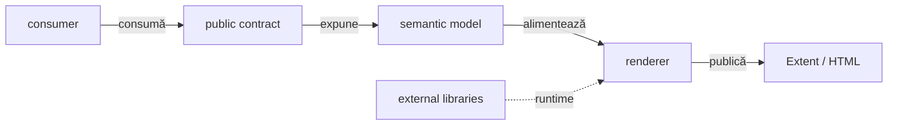
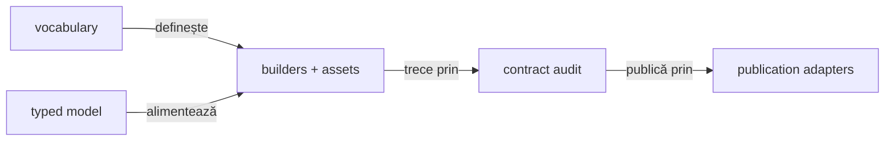
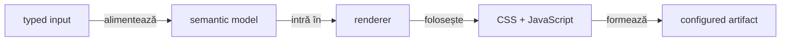
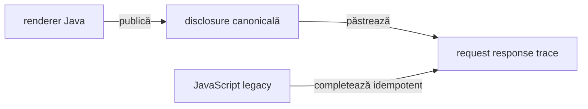

# ATF Reporting — bibliotecă standalone pentru artifacte Extent

`atf-reporting` transformă modele typed în raportare semantică și artifacte
Extent/HTML verificabile. Librăria nu execută API-uri, nu pornește browserul și
nu citește mock-uri sau fixture-uri de aplicație.

## Overall

- **producție** — contracte typed, modele semantice, renderer, asset-uri și
  publication; zero dependențe către module ATF;
- **teste proprii** — verifică standalone boundary-ul și contracte locale fără
  mock, Playwright sau fixture-uri de aplicație;
- **compoziție** — `atf-reporting-tests` este consumatorul canonic pentru
  API/integration și UI/E2E reporting;
- **output** — artifact Extent/HTML cu CSS și JavaScript native, fără verdicturi
  inventate de renderer;
- **adopție** — consumatorul furnizează inputul typed, statusul, evidence-ul și
  politica de output prin API-ul public.

**Harta documentului:** `boundary → model semantic → contract → structură →
testare → gate`. Structura package-urilor din `atf-reporting-tests` nu este
duplicată aici; aparține README-ului acelui consumer.

## Boundary standalone și consumatorul canonic



<details>
<summary><strong>Legendă — boundary-ul standalone</strong></summary>

- `atf-reporting` primește input typed și publică artifactul; nu orchestrează teste;
- traseul `Contract → Model → Renderer → Artifact` este interiorul bibliotecii;
- `consumer` este în mod canonic `atf-reporting-tests`, dar poate fi înlocuit de
  orice aplicație care folosește API-ul public;
- `atf-reporting-tests` este singurul consumator canonic pentru compoziția ATF;
- Jackson și ExtentReports sunt dependențe externe declarate în POM-ul standalone;
- mock-ul, browserul, JUnit orchestration și fixture-urile nu intră în producția librăriei.
</details>

| Suprafață | Responsabilitate | Boundary permis |
|---|---|---|
| `src/main` | librăria producție și artifactul publicat | orice modul ATF, browser, fixture de business |
| `src/test` | guard-uri și contracte standalone | mock, Playwright, endpoint live |
| `atf-reporting-tests` | consumatorul canonic pentru API/UI/E2E | nu intră în JAR-ul reporting |
| alte module | nu trebuie să fie consumatori direcți în ținta de decuplare | dependențe test-scope rămase se urmăresc separat în feedback |

<details>
<summary><strong>Dovadă standalone, adopție și limită de decuplare</strong></summary>

- `atf-reporting/pom.xml` este parentless și nu declară dependențe către module
  ATF în production;
- `src/test` poate verifica boundary-ul standalone fără să contamineze JAR-ul;
- `atf-reporting` este renderer-neutral și publică HTML prin API-ul
  `atf.api.reporting.*`: contracte, records immutable, porturi, evidence,
  snapshot și renderer;
- `ReportModelAdapters` rămâne seam-ul reflection-only din production, iar
  `CoreReportPortsAdapter` rămâne exclusiv în test/composition scope;
- aceste seam-uri sunt pentru migrare, nu cod de business: execution decide
  schimbul HTTP, validation decide verdictul, UI produce acțiunea, iar reporting
  conservă și publică evidence-ul;
- orice dependență test-scope din afara consumerului canonic este urmărită în
  [feedback-ul activ](../docs/feedback/README.md), nu duplicată ca TODO aici;
- standalone înseamnă build independent de parent-ul reactorului și de artifacte
  ATF; compoziția completă are owner separat în `atf-reporting-tests`;
- ținta și dovada de decuplare se închid numai după verificarea codului și POM-ului
  live.

</details>

## Modelul typed

Regula permanentă este:



<details>
<summary><strong>Legendă — vocabular, modele și renderer</strong></summary>

- enum-urile și constantele dețin vocabularul finit: tag, class, attribute, view, status și token;
- `AtfReportHtmlVocabulary.element(...)` și `voidElement(...)` compun elementele fără
  a reintroduce tag-uri raw în view-uri; `HtmlReportShell` deține exclusiv shell-ul
  fallback (`html/head/body/meta/title/style/script`);
- POJO-urile/record-urile immutable dețin datele runtime: request, JSON, evidence și checks;
- builder-ele și renderer-ele transformă modelul în HTML/CSS/JavaScript;
- validatorii verifică output-ul, iar adapterele îl publică; valorile dinamice nu devin enum-uri artificiale.
</details>

| Tip de informație | Owner | Regulă |
|---|---|---|
| tag, class, attribute, element, view, status | `AtfReportHtmlVocabulary`, `HtmlReportShell`, `AtfReportAsset`, `ExtentReportRuntimeVocabulary`, `AtfReportStatus` | enum/constant unic; `element(...)`/`voidElement(...)` păstrează forma HTML; `displayValue()` produce valoarea lowercase pentru CSS/filter; fără literali distribuiți |
| culori și geometrie | `AtfReportColors`, `AtfReportCssSelectors`, theme tokens | token stabil; output CSS determinist |
| CSS evidence | `AtfUiEvidenceCss` și providerii theme/evidence | selectorii și token-urile sunt typed; stylesheet-ul este asset CSS nativ, iar valorile dinamice sunt doar placeholder-e de compoziție |
| module JavaScript | `HtmlReportScriptModule`, builders și runtime section modules | ordine și ownership explicite |
| fields, body JSON, screenshot, checks | `ReportField`, `ReportJsonBody`, `ReportScreenshot`, `ReportCheck` | records/POJO immutable; serializerul legacy este boundary |
| scenarii și faze | `ReportExecutionModel`, `AtfReportSemanticSnapshot` | arbore semantic, nu markup |
| propoziții, URL-uri, payload-uri, valori de test | input runtime | nu se transformă artificial în enum-uri |

<details>
<summary><strong>Politica tag-urilor și adnotărilor</strong></summary>

- **normalizare** — `trim` → eliminare valori goale/null → lowercase cu
  `Locale.ROOT` → deduplicare în ordinea primei apariții;
- **proiecție** — lista canonicală ajunge în categoriile Extent, snapshot-ul
  semantic și filtrele JavaScript legacy;
- **publisher** — trece prin `ReportTagNormalizer`; nu apelează direct
  `assignCategory` cu input brut;
- **statusuri** — `PASS`, `FAIL`, `WARNING`, `SKIP` și `INFO` sunt verdicturi
  typed în `AtfReportStatus`; `CLEAR` rămâne filtru UI separat;
- **proof** — testele component/integration ale acestei politici aparțin
  [consumerului specializat](../atf-reporting-tests/README.md), nu sunt duplicate
  în README-ul bibliotecii.

</details>

## Modelele semantice și proiecția comună

Codul păstrează două modele immutable cu responsabilități locale distincte,
legate printr-o proiecție comună. Astfel nu este nevoie să forțăm rendererul
Extent și fallback-ul să împartă aceeași structură internă:

| Model | Rol |
|---|---|
| `AtfReportSemanticSnapshot` | populația lifecycle-ului Extent: class → scenario → phase → node |
| `ReportExecutionModel` | arborele fallback: scenario → phase → request/validation și proiecțiile `Overview`, `Categories`, `Failures` |

`AtfReportSemanticSnapshot.from(ReportExecutionModel)` este adaptorul comun:

- fallback-ul îl folosește pentru `semanticSnapshot()`;
- sesiunea eșuează înainte de render dacă snapshot-ul derivat din arbore diferă
  de recorderul lifecycle;
- proiecția păstrează package-ul, metadata request/response JSON, validations și
  numărul de acțiuni/screenshot-uri;
- testul semantic compară Extent și fallback pe arborele
  `class → scenario → phase → request → validation`;
- modelele rămân separate: `Overview/Categories/Fails` sunt specifice fallback-ului,
  iar snapshot-ul este contractul comun renderer-neutral.

## Contractul raportului

```text
TestCase
├── SETUP (opțional; numai precondiții / fixture-uri)
├── TEST BODY (acțiunea și validarea)
│   ├── Request
│   │   ├── Request details + REQUEST JSON / null
│   │   ├── Response details + RESPONSE JSON / null
│   │   └── Execution evidence
│   └── Validation — sibling direct al request-ului
│       └── aggregate assertion table
└── TEARDOWN (opțional; cleanup / read-back)
```

| Regula | Contract |
|---|---|
| ownership | request și validation sunt surori în aceeași fază |
| write body | `POST` și `PUT` au request JSON și response JSON valide, ne-goale |
| read/no body | `GET`, `204`, `304` păstrează disclosure-urile și afișează explicit `null` când body-ul lipsește |
| UI evidence | `SETUP` este setup; `Screen validation` este în `TEST BODY` după acțiuni și observații |
| layout | `＋/−` este inline înaintea propoziției; cele trei zone de validation sunt surori, fără `<hr>` decorativ |
| responsive evidence | până la breakpoint-ul de lucru (`1300px`), action tables se redimensionează și împachetează conținutul fără scrollbar orizontal; padding-ul lateral al wrapperului este eliminat semantic, nu prin crop | 
| action number | fiecare acțiune afișează `#n` într-un token dedicat, `atf-ui-action-number`, compact (`inline-block`/`max-content`); nu se reutilizează clasa extensibilă `atf-ui-action-sequence` |
| screenshot | link inline cu emoji-ul curent; payload Base64 pentru prima apariție sau referință inline pentru o stare deduplicată; nu hash afișat în locul linkului |
| action table | acțiunile relevante includ `getText`/text extraction; timpul apare numai pentru acțiuni |
| failures | `Setup`, `Playwright action`, `Audit observation` și `Assertion` au cauze distincte și `Open in Tests` |
| navigation | `Tests`, `Overview`, `Categories`, `Fails` folosesc aceeași identitate semantică și deep-link |

### API evidence atașată unui pas UI

Un consumer poate atașa unul sau mai multe `ReportExecutionEvidence` la același
checkpoint UI prin overload-ul `UiExtentReportSession.step(...)`. Reporting nu
creează un test artificial și nu recalculează verdictul; proiectează schimbul
în contractul existent al request-ului:

```text
UI checkpoint
├── Request details  → method/path/url/query/auth/headers/transport + REQUEST JSON
├── Response details → status/content-type/headers + RESPONSE JSON
└── Execution evidence → attempts/retries/duration/outcome
```

Disclosures sunt închise by default și rămân pe același nod UI. Body-urile sunt
afișate cu limita configurată de consumer prin
`reporting.bodyMaxDisplayCharacters`, cu redaction înainte de render; nu se
introduce o limită hardcodată în `atf-reporting`. `atf-reporting` rămâne
independent de mock, browser și aplicație: consumerul furnizează datele typed,
iar librăria publică numai contractul semantic și layout-ul verificabil.

Verdictul este calculat de execution/validation și doar publicat de reporting.
Rendererul nu inventează statusuri.

## Structura producției

| Boundary | Owner principal | Output verificabil |
|---|---|---|
| semantic/model | `semantic`, `model`, `contract` | snapshot, execution tree, status și assertions |
| markup/render | `markup`, `html`, `extent` | Extent nodes și fallback HTML |
| asset/theme | `asset`, `theme`, `runtime` | CSS/JavaScript native, vocabulary și manifest |
| audit/publication | `ui/audit`, `artifact`, `publication` | contracte, inspector, workspace și artifact final |
| input/config | `api`, `configuration`, `evidence` | request/response/evidence typed și policy de output |

<details>
<summary><strong>Detaliu — harta internă și split-ul CSS/JavaScript</strong></summary>

```text
atf.api.reporting
├── semantic/       snapshot și recorder lifecycle
├── model/          execution tree și evidence POJO
├── markup/         Extent nodes, assets și vocabulary bridge
├── html/            fallback document și script builder
├── theme/           tokens, CSS selectors, theme/evidence providers
├── runtime/         JavaScript Extent split pe responsabilități
├── ui/              contracte, audit model și UI lifecycle
├── api/             acceptance/report contract și JSON evidence audit
├── artifact/        inspector și contracte ale artifactului
├── publication/     workspace, coordinator, finalizer
├── configuration/   reporting settings și environment
└── evidence/        transport/UI evidence și style contract
```

Split-ul CSS/JavaScript este semantic, nu cosmetic. `ExtentReportRuntimeBehaviour`
compune core/tests/overview/evidence/navigation/duration/failure; providerii
theme/evidence dețin CSS-ul aferent. Nu se mai creează clase doar pentru a reduce
numărul de linii.

Pentru navigare, limita este explicită și verificabilă: `ExtentReportRuntimeNavigation`
compune trei asset-uri JavaScript native — DOM contract, disclosure și controller —
prin `ReportAssetComposer`. Fațadele Java rămân doar owneri semantici și nu mai
rețin corpuri inline; testele de componentă verifică atât funcțiile publicate, cât
și manifestul asset-urilor. `Scenarios`, `Categories`, fragmentele de evidence
și Overview CSS respectă aceeași limită; `AtfReportOverviewCss` compune acum
asset-uri native separate pentru layout, tag audit, category tables și category
status. Aceeași limită este aplicată și theme-ului Extent: responsive, base,
category/category-status, Fails layout/status, navigation, scenario și detail sunt asset-uri
CSS native, iar fațadele Java rezolvă doar token-uri și seam-urile de compoziție.
Evidence interaction/table/disclosure/stack și fallback theme folosesc aceeași
graniță. Navigarea HTML publicată nu mai include `onclick` inline; linkurile cu
hash sunt contractul static, iar controllerul nativ le activează prin hash.

</details>

<details>
<summary><strong>Detaliu — runtime Overview, Scenarios, Categories și Fails</strong></summary>

Fallback navigation și boot-ul documentului Extent urmează aceeași regulă:
`fallback-navigation.js` și `runtime-boot.js` sunt asset-uri native, iar
`HtmlReportNavigationScript` și `ExtentReportRuntimeBehaviour` sunt doar
fațade/publication seams typed. Modulele JavaScript Extent sunt injectate în
placeholder-ul de boot fără ca Java să reconstruiască funcții sau expresii
executabile.

Aceeași limită este aplicată acum și familiei `ExtentReportRuntimeOverview`:
`Audit`, `Labels`, `Charts` și `Cleanup` sunt asset-uri native distincte, iar
enum-ul `Fragment` rămâne composition root-ul ordinii. Java nu mai conține
corpurile funcțiilor; le expune prin fațade testabile și `ReportAssetComposer`.

`ExtentReportRuntimeScenarios` și `ExtentReportRuntimeCategories` folosesc aceeași
graniță: `extent-scenarios.js` și `extent-categories.js` dețin funcțiile browser,
iar Java păstrează doar facade-ul public și vocabularul typed. Astfel filtrarea,
adnotările de scenariu și deep-link-urile către Categories pot fi verificate
componentar fără să reintroducem literali JavaScript în clasele runtime.

Evidence are aceeași separare: `ExtentReportRuntimeEvidenceDisclosure`,
`ExtentReportRuntimeEvidenceFailures` și `ExtentReportRuntimeEvidenceTableLayout`
sunt fațade Java mici peste `extent-evidence-disclosure.js`,
`extent-evidence-failures.js` și `extent-evidence-table-layout.js`. Primul normalizează
disclosure-urile pentru request/response/JSON/assertions, al doilea proiectează
failure evidence UI, iar al treilea măsoară valorile reale și publică lățimi de
coloane deterministe. Nu se amestecă layout-ul cu semantica evidence și nu se
introduce un al doilea owner al aceleiași funcții.

La nivelul markup-ului Java, `ReportEvidenceDisclosure` este modelul typed al
unei zone colapsabile, iar `ReportEvidenceMarkup` este shell-ul comun pentru
disclosure-uri și badge-ul de status. `AtfReportMarkup.tableHtml` este builder-ul canonical pentru
tabelele key/value, iar `ReportEvidenceJsonFormatter` deține politica comună
label → redaction → pretty print → display-limit. Renderer-ul Extent și
fallback-ul HTML primesc aceeași listă typed de `ReportField` și același JSON
display policy; diferența rămasă este numai adaptorul de publicare (Markup
Extent versus document HTML). Paritatea este protejată prin teste component/unit,
nu printr-un E2E suplimentar.

`AtfReportStatus` este și owner-ul unic pentru markerul inline, label-ul uman și
rezultatul compact; rendererele nu își definesc switch-uri locale pentru emoji sau
text de status, iar fallback-ul HTML folosește aceeași prezentare typed ca evidence-ul UI.

Și proiecția `Fails` este acum separată pe responsabilități native: detection,
context, cause-chain și projection au câte un asset JS și o fațadă Java proprie.
`ExtentReportFailureRuntime` compune ordinea stabilă, fără să dețină corpuri de
funcții; astfel testele pot verifica independent cauza, contextul și randarea
failure fără browser, iar testul E2E verifică deep-link-ul către testul exact.

Rămâne intenționat în următorul val auditul final al vocabularului/builder-ului CSS
și al seam-urilor mici de publicare. `AtfUiEvidenceCss` este facade typed peste
`ui-evidence.css`, iar `Duration` și `RuntimeCore` sunt compuse din asset-uri
JavaScript native; niciuna dintre aceste familii nu mai asamblează corpuri mari în
Java. `ScenarioCss` este facade typed peste `theme-scenario.css`, iar
`ExtentReportNavigationView` publică numai markup și hash links; nu mai generează
JavaScript executabil inline.
`ExtentReportCategoryMarkup` folosește aceeași construcție semantică pentru
shell-ul Category: vocabularul typed guvernează tag-uri, clase, atribute și
empty-state, iar markerul vendor `atf-fails-view` este păstrat doar ca boundary
de inserare documentat. `ExtentReportCategoryMarkupTest` verifică separat
idempotency, ordinea în DOM și contractul CSS/accessibility.
`HtmlReportFailsView` folosește aceleași primitive pentru fallback-ul Fails,
inclusiv statusul semantic, deep-link-ul scenariului și empty-state-ul; astfel
paritatea dintre Extent și fallback este verificabilă prin teste lower-level.
`HtmlReportTestsView` și `ExtentReportPublicationPipeline` folosesc aceeași
graniță pentru scenarii, phase/request nodes, theme și view identifiers.
`ExtentReportScreenshotDeduplicator` păstrează fingerprint-ul doar intern,
pentru deduplicare; în raport rămâne linkul inline cu emoji-ul curent, nu un
hash afișat.
`HtmlReportScriptBuilder` rămâne numai infrastructură generică pentru porturi
typed/custom și teste; nu mai este folosit pentru a construi navigation sau boot
în producție.

</details>

<details>
<summary><strong>Detaliu — ownership-ul funcțiilor și durata</strong></summary>

Migrarea următoare se face incremental, cu contract component echivalent,
reconciliere live și raport fresh; nu se transformă mecanic toate constantele Java
în token-uri dacă asta ar ascunde contractul sau ar îngreuna debugging-ul.

Funcțiile JavaScript generate au aceeași regulă de ownership: fiecare funcție
publicată are un singur owner runtime și o singură definiție autoritativă. Funcția
de orchestrare nu este rebinding-uită ulterior de un alt string; citirea DOM-ului,
derivarea datelor și proiecția în DOM sunt helperi separați și numiți după
responsabilitate. `ExtentReportFailureRuntime` păstrează un singur `failureContext`
și un singur `renderFails`.

Durata este emisă de seams cu owner unic, compuse de facade-ul public
`ExtentReportDurationRuntime`:

| Seam | Responsabilitate | Dovadă componentă |
|---|---|---|
| `ExtentReportDurationParsing` | citire, normalizare și formatare a duratelor | funcții de parsing declarate o singură dată |
| `ExtentReportDurationDom` | traversare DOM, selectori și identitate de nod | selectorii/atributele nu sunt literali împrăștiați |
| `ExtentReportDurationMemory` | memorarea măsurătorilor și lookup-ul de durată | precedence între marker, path și node id |
| `ExtentReportDurationAggregation` | copii, evidence transport și agregare de noduri | durată directă vs. agregată |
| `ExtentReportDurationProjectionLookup` | rezolvarea cardului de scenariu | lookup separat de randare |
| `ExtentReportDurationProjectionViews` | Categories, Overview, Fails și proiecții | fiecare view își păstrează ownerul |
| `ExtentReportDurationProjectionPublication` | badge-uri, summary și publicarea class duration | output consistent în toate tab-urile |
| `ExtentReportDurationScheduling` / `Lifecycle` | scheduling, click hooks, observer și boot | activare idempotentă și ready marker |
| `ExtentReportDurationVocabulary` | contract typed pentru atribute, selectori și funcții | cardinalitate și unicitate verificate static |

`ReportArtifactInspectorTest` și contractele runtime verifică unicitatea și
prezența acestor seams în HTML-ul publicat. Stringurile dinamice se compun local,
prin fragmente mici și `String.join`; enum-urile tipizează protocolul browser,
nu datele runtime. Orice funcție rămasă mixtă se justifică în feedback printr-un
contract semantic concret, nu printr-un split cosmetic de linii.

</details>

<details>
<summary><strong>Detaliu — composition root și contractele component</strong></summary>

Registrul `ExtentReportRuntimeModule` este singurul composition root pentru
runtime-ul injectat. El mapează fiecare controller la un singur
`HtmlReportScriptModule` și îl publică în ordinea semantică `CORE → TESTS →
OVERVIEW → EVIDENCE → NAVIGATION → DURATION → FAILURES → FAILURE_CAUSE`.
`ExtentReportRuntimeBehaviour` doar orchestrează boot/ready și iterează registrul;
nu mai repetă manual lista claselor. Astfel `Duration`, `Evidence`, `Overview`,
`Navigation`, `Tests` și failure projection pot fi testate independent ca
module component, iar integrarea verifică doar compoziția și ordinea.

| Controller | Boundary deținut | Contract component principal |
|---|---|---|
| `ExtentReportRuntimeCore` | vocabular DOM, query, identitate și status | primitive tipizate, declarații unice |
| `ExtentReportRuntimeTests` | filtre Tests/Categories și proiecția scenariilor | status/tag filters, category links |
| `ExtentReportRuntimeOverview` | audit, summary, chart și procentaje | proiecție Overview fără evidence fals |
| `ExtentReportRuntimeEvidence` | roluri, disclosure și evidence failure | request/response/assertion/UI evidence |
| `ExtentReportRuntimeNavigation` | hash, tab, collapse și deep-link | navigare și `＋/−` inline |
| `ExtentReportDurationRuntime` | parsing, măsurare, agregare și publicare | duration precedence și clone parity |
| `ExtentReportFailureRuntime` | failure state, rows și cause chain | un owner pentru Fails și diagnostic |

`ExtentReportRuntimeModuleTest` verifică non-empty source, owner-ul de publicare,
ordinea modulelor și faptul că o funcție JavaScript nu este declarată de două
module. Este un contract de coeziune, nu o verificare cosmetică a numărului de
linii; comportamentul browserului rămâne verificat separat prin ATF Debug și
Playwright MCP.

</details>

<details>
<summary><strong>Vocabularul runtime</strong></summary>

- **owner unic** — `ExtentReportRuntimeVocabulary` deține numele funcțiilor
  injectate, selectorii DOM, atributele `data-atf-*`, clasele CSS semantice și
  valorile finite de status;
- **emisie** — `ExtentReportRuntimeCore` publică primitivele în ordine stabilă,
  prin emitătoare mici; protocolul nu este reconstruit în concatenări de stringuri;
- **compoziție** — `ExtentReportRuntimeModule` păstrează ordinea semantică și
  mapează fiecare controller la un singur asset/module;
- **boundary** — vocabularul, modelul și asset-urile rămân responsabilități ale
  librăriei; fixture-urile și browserul aparțin consumerului;
- **proof extern** — matricea component/integration/E2E, contractele de test și
  limita de coeziune sunt documentate în
  [README-ul `atf-reporting-tests`](../atf-reporting-tests/README.md).

</details>

<details>
<summary><strong>Consumerul de compoziție</strong></summary>

`atf-reporting-tests` este locul în care se leagă reporting-ul de mock, execution,
validation, API fixtures, Playwright și ATF Debug. Aceste detalii nu aparțin
package-ului `atf-reporting` și sunt documentate separat în
[`atf-reporting-tests/README.md`](../atf-reporting-tests/README.md) și în README-ul
dedicat testelor Extent
([`ui/tests/extent/README.md`](../atf-reporting-tests/src/test/java/atf/ui/tests/extent/README.md)).

Reporting-ul expune numai contracte; nu deține structura test-kit-ului, locatori,
fixture-uri, setup API sau composition roots. Un test consumer poate folosi
contractele reporting fără ca librăria să importe invers codul testului.

Structura package-urilor, adnotările, mock YAML, locatorii Playwright și
împărțirea unit/component/integration/E2E sunt detalii ale consumerului și se
urmăresc numai în README-ul dedicat, nu se duplică în această librărie.

</details>

## Input și configurare în librărie

Producția `atf-reporting` deține numai configurația necesară publicării:
`ReportingSettings`, `ExtentReportConfiguration`, contextul de pornire și loaderul
YAML. Consumatorul furnizează configurația; reporting-ul validează limitele,
output directory, numele fișierului, timestamp policy și politica typed de captură
înainte de publication.



<details>
<summary><strong>Legendă — ce configurează reporting-ul și ce nu</strong></summary>

- reporting-ul poate citi configurația de output și limitele de display;
- politica de screenshot este browser-neutral și poate fi setată prin
  `reporting.extent.screenshotPolicy`; mock-ul, endpoint-ul și browserul aparțin
  consumerului;
- output-ul este configurabil, iar documentația nu păstrează nume sau căi de run;
- un status este primit semantic de la execution/validation și doar publicat.
</details>

Pentru body-uri și assertions, `null` rămâne diferit de string gol; redaction-ul
se aplică înainte de render, iar limitele sunt typed și configurabile. `POST` și
`PUT` pot avea request/response JSON; `GET`, `204` și `304` păstrează explicit
absența body-ului.

### Politica typed pentru screenshot evidence

`ReportScreenshotPolicy` este contractul public pentru politica de publicare a
capturilor UI. Nu se pasează
booleene sau string-uri arbitrare prin publisher; se alege o valoare enum, iar
punctul de captură este explicit atunci când un flow marchează o stare finală:

Contractul transversal — inclusiv diferența dintre flow mode, screenshot policy,
capture source și publisher — este în
[`docs/ATF_Evidence_Capture_Contract.md`](../docs/ATF_Evidence_Capture_Contract.md).
Acest README păstrează numai partea deținută de `atf-reporting`: enum-ul de
publication policy, validarea target-ului și proiecția în artifact.

| Valoare YAML/API | `CapturePoint` publicat | Utilizare |
|---|---|---|
| `each-checkpoint` | checkpoint, final, failure | compatibil cu comportamentul implicit; păstrează evidence pentru fiecare stare |
| `final-only` | final | un flow lung publică numai starea finală declarată explicit |
| `failure-only` | failure | raport compact, orientat pe diagnostic |
| `final-and-failure` | final, failure | starea de succes și dovada de regresie sunt păstrate |
| `none` | niciunul | flow fără screenshot, păstrând acțiunile și assertions |

- `UiExtentReportSession` expune overload-ul cu `ReportScreenshotPolicy`;
- `UiPhase` expune overload-ul cu `ReportScreenshotPolicy.CapturePoint.FINAL`;
- `UiEvidencePublisher` verifică target-ul numai când payload-ul va fi publicat;
- un target lipsă nu poate produce un screenshot orfan;
- contractul este verificat în `atf-reporting-tests` prin teste unitare și
  integration pe HTML local, fără browser și fără Practice Shop;
- seam-ul typed pentru configurare extinsă este `ReportEvidenceProfile`;
- profilul compune `ReportEvidenceFlowMode`, `ReportScreenshotPolicy` și
  `ReportEvidenceCaptureSource`;
- profilul se construiește prin builder sau `fromConfig(...)` și se pasează în
  `UiExtentReportSession.openConfigured(..., profile)`;
- profilul descrie policy și proveniență, nu execută browserul; mock-ul și
  Playwright rămân în consumer/test scope;
- entry point-ul preferat pentru sesiunea UI este
  `UiExtentReportOptions.builder(outputDirectory)`;
- builder-ul grupează `fileName`, `AtfConsoleSink`, `ReportEvidenceProfile` și
  `timestampEnabled`, iar overload-urile istorice rămân delegări de compatibilitate;
- configurația se încarcă o singură dată, iar `openConfiguredResolved` poate
  dezactiva timestamp-ul fără a reconstrui o a doua configurație.

### Evidence JSON și renderer-ele UI

`ReportJsonBody` păstrează body-ul semantic așa cum a fost primit. Pentru
afișare, atât Extent cât și fallback HTML folosesc
`ReportJsonBodyFormatter`: redaction-ul se aplică primul, pretty-print-ul este
determinist, iar limita `bodyMaxDisplayCharacters` se aplică numai după
formatare. Obiectele, array-urile, scalarul și `null` sunt păstrate; payload-ul
invalid rămâne neschimbat pentru diagnostic și nu este transformat artificial.

`ExtentUiEvidenceRenderer` este orchestration-only:

- markup-ul este împărțit în `ExtentUiActionRenderer`,
  `ExtentUiObservationRenderer` și `ExtentUiAssertionRenderer`;
- escaping/status/publication sunt primitive comune în `ExtentUiEvidenceMarkup`;
- fiecare fragment poate fi testat componentar, iar testele de session verifică
  compoziția reală și screenshot-ul inline;
- shell-ul semantic pentru disclosure-uri este reutilizat de Extent și fallback
  HTML prin `ReportEvidenceMarkup`;
- începutul, titlul accesibil, glyph-ul și închiderea nu se copiază în fiecare
  renderer;
- body-ul rămâne responsabilitatea renderer-ului concret: Extent poate publica
  markup vendor-specific, iar fallback-ul păstrează `<pre>`.

### Normalizarea evidence în artifact

Normalizarea este un boundary de publicare, nu o a doua sursă de evidence:



<details>
<summary><strong>Legendă — cine scrie și cine doar completează</strong></summary>

- renderer-ul Java publică disclosure-ul canonical și metadata typed;
- JavaScript-ul completează numai rândurile vendor legacy care lipsesc;
- un disclosure existent nu este înlocuit și nu se reserializează inutil;
- request JSON, response JSON și execution trace rămân împreună în DOM;
- idempotența este verificată în `atf-reporting-tests`, inclusiv pe artifact HTML.

</details>

## Publicare și output

Output-ul este configurabil prin `reporting.extent.outputDirectory` și
`fileName`; runtime-ul UI folosește separat directorul UI configurat de test.
Documentația descrie numai politica și pattern-ul de output, nu nume concrete de
rapoarte generate.

`ReportPublicationCoordinator` are următoarele responsabilități:

- protejează publication path, lock-ul și concurența;
- poate folosi identitatea/hash-ul intern pentru ownership și deduplicare, fără
  să-l afișeze în HTML ca înlocuitor pentru evidence-ul uman;
- aplică retry bounded după tentativa atomică pe filesystem-uri care pot păstra
  temporar fișierul deschis;
- permite fallback non-atomic numai pentru
  `AtomicMoveNotSupportedException`;
- propagă eroarea persistentă după ultima încercare;
- păstrează retry-ul în production publication boundary, nu în test-kit și nu în
  browser.

## Gate de contribuție

```text
cod live curent
  → staging extern nou (target/artifacts excluse)
  → test focalizat
  → gate unit/component/integration
  → gate E2E dacă se schimbă DOM/layout/interacțiunea
  → ATF Debug + Playwright/Chromium headless
  → reconciliere live ↔ staging
  → sync selectiv și README owner actualizat
```

Checklist-ul de aici este doar harta rapidă. Checklist-ul normativ, cu reguli
obligatorii/condiționale și pași de explorare manuală, este în
[`../atf-reporting-tests/src/test/java/atf/ui/tests/extent/README.md`](../atf-reporting-tests/src/test/java/atf/ui/tests/extent/README.md).

<details>
<summary><strong>Checklist browser — responsabilitatea consumerului</strong></summary>

- ✅ `Tests`, `Overview`, `Categories`, `Fails` și deep-link navigation;
- ✅ disclosure-uri colapsate implicit unde contractul nu cere altceva;
- ✅ `＋/−` inline, screenshot inline, acțiuni, audit observations și assertions;
- ✅ `scrollWidth <= clientWidth`, wrapping și computed-style;
- ✅ zero `<hr>` decorative, console/page errors sau asset-uri rupte;
- ✅ request/response JSON, status și mock provenance reconciliate când sunt
  publicate;
- ✅ verificare prin ATF Debug + Chromium/Playwright MCP, fără browser Windows
  real și fără oprirea run-urilor active.

</details>

## Contracte și feedback

- contract vizual: [`docs/ATF_Reporting_Contract.md`](../docs/ATF_Reporting_Contract.md);
- arhitectură: [`docs/ATF_Architecture.md`](../docs/ATF_Architecture.md);
- bune practici: [`docs/README_Atf_BestPractices.md`](../docs/README_Atf_BestPractices.md);
- feedback activ: [`docs/feedback/README.md`](../docs/feedback/README.md).

README-ul păstrează contractele validate, limitele și criteriile de testare;
starea gap-urilor rămâne în [registrul de feedback](../docs/feedback/README.md).
O regulă intră aici numai după ce este confirmată de codul și testele live; până
atunci rămâne feedback auditabil, nu documentație stabilă.

<details>
<summary><strong>Detaliu — asset-uri browser native și guvernare Java</strong></summary>

CSS-ul și JavaScript-ul livrat în HTML se păstrează în `src/main/resources`,
în fișiere mici, grupate după responsabilitate (`theme`, `overview`, `evidence`,
`navigation`, `filters`, `runtime-core`, `duration`). Overview-ul folosește separat
`overview-layout.css`, `overview-tag-audit.css`,
`overview-category-tables.css` și `overview-category-status.css`, iar scenariile
folosesc `theme-scenario.css`; nu există o regulă CSS duplicată în facade-ul Java.
`ReportAsset` este vocabularul unic al asset-urilor, iar
`ReportAssetManifest.production()` este inventarul validat și ordonat folosit
de publication boundary. Manifestul respinge duplicate de asset/path/owner,
resurse din afara namespace-ului reporting, extensii incompatibile cu formatul
și asset-uri lipsă. `ReportAssetLoader` citește resursa din classpath, iar
`ReportAssetComposer` rezolvă token-urile Java (inclusiv culorile finite) și
produce corpul final păstrând identitatea typed a asset-ului; ordinea efectivă de
compoziție rămâne explicită în facade-urile runtime. Aceeași graniță este folosită de cele nouă asset-uri
`duration-*.js` și de cele trei asset-uri `runtime-core-*.js`; fragmentele
JavaScript păstrează ownership-ul semantic, iar facade-urile Java păstrează doar
ordinea de compoziție.

Sursele native `.css` și `.js` rămân formatate pe mai multe linii în classpath,
pentru review, depanare și teste component. `ReportAssetLoader.load(...)` și
`render(...)` expun această sursă lizibilă; `loadForPublication(...)` și
`renderForPublication(...)` trec numai copia destinată HTML-ului prin
`ReportAssetCompactor`. Compactorul elimină whitespace-ul și comentariile sigure
în afara valorilor quoted, păstrează spațiile semnificative din text, selectorii
și expresiile JS/CSS și nu modifică fișierele native. Astfel HTML-ul Extent nu
primește enter-uri de indentare inutile, iar sursa rămâne ușor de întreținut și
de testat separat.

`ReportAssetSizeInventory` măsoară separat bytes pentru fiecare sursă nativă și
copia publicată, agregat pe format și owner. El este un instrument de diagnostic
și contract test. `ReportAssetSizeBudget` primește limitele din configurația
consumerului pentru total, format și owner și produce doar încălcările
observate; nu are baseline hardcodat. Bundle-ul HTML/evidence se bugetează în
consumer, unde există artifactul complet, nu în biblioteca standalone. Astfel o optimizare
poate fi verificată fără să transforme numele sau hash-ul artifactului în API.

Facade-urile Java (`AtfFallbackTheme`, `AtfReportOverviewCss`, facades-urile CSS
theme/evidence,
`HtmlReportNavigationScript`, `ExtentReportRuntimeEvidenceRoles` și
`ExtentReportRuntimeTestFilters`) rămân API-ul de integrare. Ele nu reconstruiesc
corpul scriptului prin concatenări mari; Java guvernează doar asset-ul, token-urile
și ordinea de compoziție. `ExtentReportRuntimeTestsVocabulary.Template` guvernează
placeholder-ele asset-ului, iar funcțiile comune (`aggregateClassDurations`,
`captureDomContract`) provin din vocabularul runtime central, nu din string-uri
izolate în facade. Contractul se verifică separat prin teste de asset, component
și browser E2E.

</details>
