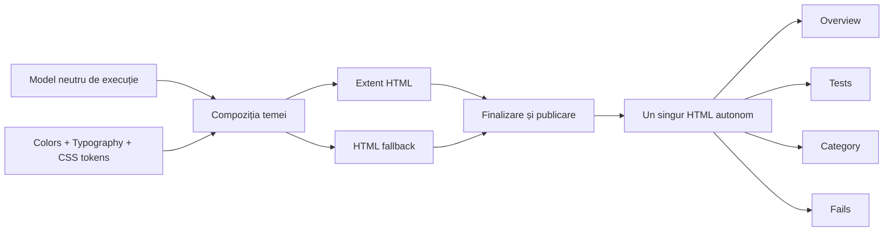
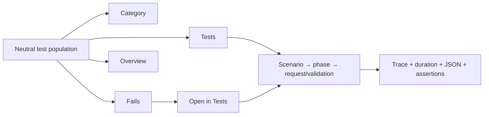
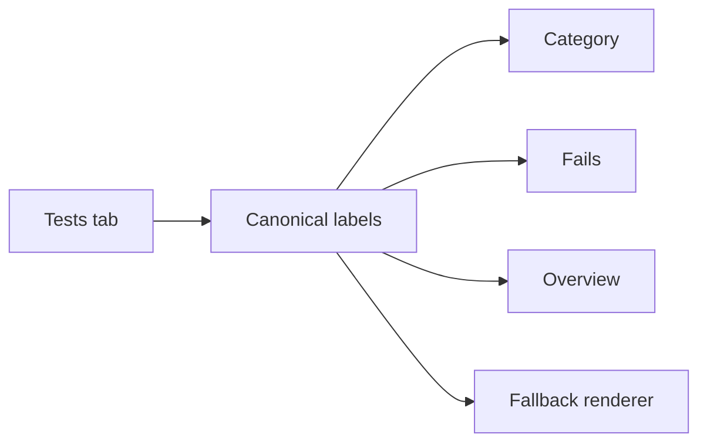

# ATF Reporting — contractul vizual al raportului Extent

Acest document este contractul normativ pentru raportul HTML autonom produs de
`atf-reporting`. Descrie cum trebuie să arate, să se comporte și să poată fi
verificat raportul complet, indiferent dacă artifactul este produs prin Extent
sau prin rendererul HTML fallback.

Nu este o colecție de preferințe CSS. Orice schimbare de culoare, suprafață,
tipografie, ierarhie, disclosure, navigare sau tabel este o schimbare de
contract și trebuie să păstreze cerințele de mai jos.

## Modelul de randare



Responsabilitățile sunt separate astfel:

| Rol | Responsabilitate | Nu decide |
|---|---|---|
| Sistemul de culoare | valori de culoare și suprafețe | structura HTML |
| Sistemul tipografic | fonturi, dimensiuni și line-height | verdicturi |
| Token-urile de temă | exportul token-urilor CSS | conținutul testului |
| Compoziția temei | regulile vizuale comune | transport/API |
| Proiecția markup-ului | markup semantic și roluri stabile | culori locale arbitrare |
| Formatterul de evidence | tabelele de evidence și assertions | verdictul de business |
| Documentul semantic | identity, ordering și arborele request → validation | HTML/CSS/JS |
| Proiecțiile fallback | Tests, Category, Fails și Overview | lifecycle, verdicturi |
| Sesiunea de raportare | lifecycle facade și fallback renderer | CSS duplicat |
| Finalizarea și publicarea | flush, asset-uri, atomizare și publicare | noi reguli vizuale |
| Inspectorul de artifact | verificarea raportului rezultat | repararea artifactului |

Rendererul primește modelul neutru și îl proiectează. Nu reconstruiește reguli
de business, statusuri sau relații între request și validation.

## Contractul vizual comun

Extent și fallback folosesc aceeași compoziție de prezentare: aceleași token-uri
de culoare, suprafețe, tipografie, geometrie de tabel și status badge-uri.
Diferența dintre renderer-e este mecanismul de publicare, nu forma observabilă a
raportului.

```text
body       sans-serif comun · 14px · line-height 1.55
tables     12.6px · line-height 16.884px · padding 7px 9px
JSON       monospace · 12.5px · line-height 18.75px · scroll bounded
surface    #101723 · border #29364d · code #070a0e
tabs       Tests → Category → Fails → Overview · Overview implicit
```

Detaliile normative pentru paletă, faze, badge-uri, tabele, background și
tipografie sunt în secțiunile de mai jos și în
[`docs/ATF_Reporting_Contract.md`](../docs/ATF_Reporting_Contract.md). Nu se
introduce CSS local într-un singur tab dacă există token sau provider comun.

## Contractul navigabil al artifactului

Artifactul este o singură populație semantică văzută prin proiecții diferite;
Overview, Category și Fails nu creează verdicturi sau arbori concurenți.



Overview este sumarul agregat și se deschide implicit; metadata și auditul sunt
secundare și colapsate. Tests este sursa de navigare pentru scenarii, Fails este
indexul failure-urilor, iar `Open in Tests` revine la nodul original prin
deep-link. Category grupează aceeași populație, fără să cloneze pașii.

Regulile de conținut sunt la fel de importante ca layout-ul: request-ul și
validation-ul sunt frați direcți, evidence-ul tehnic rămâne sub request,
assertions sunt într-un singur tabel agregat, iar duratele folosesc întotdeauna
unitatea `ms`. Verificarea vizuală se face pe artifactul autonom, în TAB MCP,
nu prin compararea unor string-uri izolată de DOM.

### Contractul evidence-ului UI

Pentru un pas Gherkin de tip `Screen validation`, rendererul trebuie să păstreze
local și lizibil relația:

```text
Screen validation
  └── Playwright action sequence
       ├── tabel cu acțiuni consecutive
       └── screenshot Base64 al aceleiași stări, imediat sub tabel
```

Un screenshot desprins într-un nod separat sau atașat altei stări rupe
auditabilitatea, chiar dacă HTML-ul este valid. În artifactul UI auditabil, un
tabel de acțiuni fără captură nu este acceptat. Pașii tehnici non-vizuali pot
rămâne fără imagine numai dacă nu emit tabel Playwright; politica de captură
dezactivată produce doar audit funcțional, nu dovadă vizuală completă.
Rendererul verifică acum cardinalitatea la publicare și respinge o secvență de
acțiuni cu zero sau mai mult de o captură Base64 validă; nu inventează și nu
poate repara semantic o dovadă lipsă. Contractul trebuie validat în
`atf-ui`/`atf-tests`, unde se decide ce stare vizuală trebuie capturată.

Atunci când evidence-ul este furnizat prin `UiExtentReportSession`, secvența de
acțiuni și captura sunt randate în nodul de validare care le-a produs
(`Screen validation`), în această ordine. Verificările UI sunt rânduri de
acțiuni Playwright; tabelul `AtfAssertion` este doar sumarul semantic și nu
duplică operația de citire/verificare.

Tabelul Playwright are layout fix și un minim contractual de `760px`, cu lățimi
explicite pentru cele șapte coloane. Astfel operația, locatorul, expected și
observed rămân lizibile; textele lungi se împart în celula lor, iar wrapperul
permite scroll orizontal la viewport îngust. Nu se acceptă antete fragmentate
literă-cu-literă și nu se introduce o a doua structură de tabel. Coloana
`RESULT` afișează exclusiv markerul emoji (`✅`, `⚠️`, `❌`, `⏭️`, `ℹ️`); textul
semantic nu este duplicat vizibil, dar rămâne în `aria-label`/`title` pentru
accesibilitate.
Markerul de succes este același `✅` nativ folosit în tabelul Assertions; nu se
folosește un badge circular sau un text `Pass` separat în celula `RESULT`.

### Contractul coloanei `TARGET`

Rendererul tratează `TARGET` ca evidence operațional, nu ca text decorativ.
Pentru rândurile cu `source=ACTION`, coloana este obligatorie și trebuie să
conțină locatorul exact al elementului Playwright executat. Contractul acoperă
fără excepție `Click`, `Get text`, `Find element`, `Expect text`, `Focus`,
`Wait for visible` și `Expect visible`. Un target prose (`"selected owner
detail"`, `"collapse node"`, `"tree node"`) nu este echivalent cu un locator și
nu trebuie acceptat ca evidence.

Forma recomandată este un selector CSS stabil și scoped, de exemplu
`button[data-filter-value='clear']`, `a[href='#test-view']` sau
`element[data-testid='stable-contract']`. `Navigate` păstrează URI-ul drept
target. Un timeout de stabilizare trebuie să publice locatorul-anchor al stării;
`TARGET=page` nu este acceptat în secvența auditabilă. Pentru stări UI se
preferă un `Wait for visible` sau alt state wait pe locator.

Rendererul nu poate reconstitui un selector din textul unei descrieri și nu
trebuie să „repare” la publicare un target generic. Validarea contractului
aparține producerului din `atf-ui`/`atf-tests`, iar testul de reporting trebuie
să verifice cel puțin că fiecare rând `ACTION` are target nevid, că acesta este
locatorul transmis operației și că rândurile rămân în forma:

```text
# | OPERATION | TARGET (locator/URI) | EXPECTED | OBSERVED | TIME | RESULT
```

Această separare păstrează `atf-reporting` responsabil de layout și accesibilitate,
fără să-i transfere responsabilitatea semantică de a ghici ce element a fost
testat.

La failure, rândurile de acțiuni deja înregistrate trebuie păstrate în
artifactul de audit chiar dacă pasul vizual nu se finalizează. Aceasta este
separat de lifecycle-ul Extent: reporting-ul publică evidence-ul primit, iar
testul UI este responsabil să nu piardă bufferul înainte de `finally`.

`atf-reporting` este consumatorul portului de raportare, nu proprietarul
validării. `atf-validation` evaluează response-ul și publică assertions prin
`atf.api.core.reporting.ValidationSink`; implementarea Extent oferă acest port
prin `AtfReportPorts.Request`. Astfel, acest modul rămâne singurul proprietar
al interacțiunii Extent, al HTML-ului, al CSS-ului și al finalizării artifactului,
iar validarea poate fi distribuită ca JAR fără să transporte rendererul.

Sesiunea publică `ExtentReportSession` este o fațadă intenționat mică. Ea deține
doar deschiderea/închiderea sesiunii, staging-ul, flush-ul și publicarea atomică;
arborele Extent este coordonat de `ExtentReportTree`, iar scope-urile de
scenario, phase, request și validation sunt separate în `reporting.extent`.
`ExtentNodeLifecycle` este singurul owner pentru maparea statusurilor și pentru
duratele pozitive ale nodurilor. Astfel, o modificare a lifecycle-ului nu mai
trebuie făcută în aceeași clasă cu staging-ul sau cu evidence-ul.
`ReportStagingWorkspace` este la rândul lui doar fațada workspace-ului: lease-ul
exclusiv și markerul sunt deținute de `ReportWorkspaceLease`, iar scanarea și
ștergerea workspace-urilor stale sunt deținute de `ReportWorkspaceSweeper`.
Acest boundary păstrează cleanup-ul sigur pentru rulări paralele și face
politica de sweeper testabilă fără să amestece lifecycle-ul sesiunii.

`ExtentReportFinalizer` este o fațadă publică mică. Implementarea internă
`ExtentReportPublicationPipeline` păstrează ordinea de publicare:
`assets → theme → navigation → views → overview metadata → runtime → atomic write → cleanup`.
Testul `ExtentReportFinalizerBoundaryTest` verifică artifactul lipsă,
injectarea theme/runtime și cleanup-ul fără director `spark`. Ordinea este
parte din contract; o extragere viitoare trebuie să păstreze HTML-ul observabil
și să adauge un test de caracterizare înainte de schimbarea layout-ului.

`AtfReportTheme` rămâne fațada de compoziție pentru CSS-ul Extent. Selectoarele
cu risc vizual mare pentru Overview, Category și tabelele scrollabile sunt
deținute de `AtfReportOverviewCss`, iar `AtfReportTheme` păstrează doar ordinea
finală a fragmentelor. `AtfReportOverviewCssTest` verifică disclosure-ul,
header-ele sticky, înălțimea scrollabilă și token-urile comune de font; testul
verifică și faptul că fragmentul este compus după regulile execution-page,
deoarece precedența selectorilor este parte din contract.

Bootstrap-ul JavaScript nu mai este deținut direct de pipeline.
`ExtentReportRuntimeBehaviour` este fațada internă pentru runtime-ul injectat
și compune explicit controlerele specializate pentru durate, failure/cause-chain
și interacțiuni DOM. Astfel, pipeline-ul rămâne orchestration-only, iar ordinea
controllerelor este protejată de `ExtentReportRuntimeScriptTest`. Această
extracție este primul pas al splitului F-01; navigation/hash, filters, collapse
și DOM contract vor fi izolate incremental, fără schimbarea artifactului.

## Consola: contract consumat, implementare separată

Raportarea HTML și consola sunt proiecții diferite ale aceleiași execuții.
`AtfConsoleEvent` și `AtfConsoleSink` sunt contractul neutru din `atf-core`, iar
implementarea formatterului este în modulul separat
[`atf-console`](../atf-console/README.md). `atf-reporting` doar publică
evenimente către un sink injectat; nu importă `atf.api.console` și nu creează
implicit `System.out`.

```text
scenario
  → phase
    → request
      • method=POST
      • url=https://atf.local/public/v2/users
      • request.body={...}
      • response.status=201
      • response.body={...}
      ✅ PASS: Call completed (N ms)
    → validation
      • actual=201
      ✅ PASS: Validated (N ms)
  ✅ PASS: phase (N ms)
✅ PASS: scenario (N ms)
```

Formatterul separat `AtfConsoleReporter` normalizează caracterele tipografice
folosite în titlurile raportului (`—` și `→`) la reprezentarea ASCII (`-` și
`->`). Astfel consola rămâne lizibilă și stabilă în terminale cu code page
diferit, fără să schimbe artifactul HTML sau modelul semantic. Regula este
protejată de testele din `atf-console`.

Output-ul cu detalii active reproduce fluxul de diagnostic al referinței:

```text
[ATF] ▶ PostsApiTests
[ATF]   ▶ TEST BODY
[ATF]     ▶ GET /public/v2/posts
[ATF]       • method=GET
[ATF]       • url=https://atf.local/public/v2/posts
[ATF]       • response.status=200
[ATF]       • response.body
[ATF]         [ ... ]
[ATF]     ✅ PASS: Call completed (16 ms)
[ATF]     ▶ Validate response contract
[ATF]       • actual=200
[ATF]       ✅ PASS: Validated (1 ms)
[ATF]   ✅ PASS: TEST BODY (18 ms)
[ATF] ✅ PASS: PostsApiTests (20 ms)
```

Mesajele de detaliu sunt activate în configurația live a proiectului, pentru a
face vizibile request/response body în rularea `UsersApiTests`. Dacă sunt
dezactivate, lifecycle-ul și verdictul rămân disponibile, dar detaliile și
body-urile sunt omise. Toate valorile trec prin aceeași redaction policy înainte
de publicare. Configurația este în `atf.yaml`:

```yaml
reporting:
  assertionMaxDisplayCharacters: 240
  bodyMaxDisplayCharacters: 12000
  console:
    enabled: true
    detailsEnabled: true
```

`atf-console` folosește glyph-uri doar pentru stream-uri UTF-8; pentru
`System.out` cu code page incompatibil aplică automat fallback ASCII, prevenind
randarea `?` sau `�` în IntelliJ/CI. Contractul este verificat de testele din
`atf-console`, inclusiv de testele de lifecycle JUnit incluse în același modul.

Un sink de consolă nu poate schimba statusul testului. Dacă terminalul nu este
disponibil sau scrierea eșuează, execuția și artifactul rămân valide.

Constructorii impliciți ai `HtmlReportSession` și `ExtentReportSession` folosesc
`AtfConsoleSink.noOp()`. Pentru o rulare care dorește și consolă, composition
root-ul injectează explicit un `AtfConsoleReporter` din `atf-console`. Astfel,
artifactul HTML nu aduce tranzitiv formatter, policy de encoding sau scrieri în
`System.out`.

Loaderul acestui modul citește numai setările artifactului Extent și limitele de
afișare pentru assertions și body-urile JSON. `reporting.console` este citit exclusiv de
`AtfConsoleConfigurationLoader` din `atf-console`; nu există două surse de adevăr
pentru politica de consolă.

Când `detailsEnabled` este activat, detaliile de transport și body-urile JSON
apar ca blocuri indentate sub pasul activ. Body-ul este redacționat înainte de
afișare și folosește markerul `•` pe stream-uri UTF-8, respectiv `-` pe
terminalele Windows/CI incompatibile. Dezactivarea setării păstrează
lifecycle-ul și verdicturile, dar elimină detaliile și body-urile.

`bodyMaxDisplayCharacters` este limita de siguranță pentru conținutul afișat în
`REQUEST JSON` și `RESPONSE JSON`. Se aplică după redaction, separat de limita
assertion-urilor; valoarea implicită este `12000`. Dacă limita este depășită,
se păstrează prefixul și se adaugă `… [truncated]`. Blocul rămâne un code block
scrollabil intern (`max-height: 360px`), fără să forțeze o înălțime artificială
pentru payload-urile mici și fără să extindă pagina pentru payload-uri mari.

## Rulare individuală din IntelliJ

`ExtentReportSession.openConfigured()` încarcă `atf.yaml` o singură dată,
caută configurația din directorul curent în sus și rezolvă căile relative față
de fișierul YAML. Astfel, un test de reportare poate fi rulat cu butonul Run
din IntelliJ fără să reconstruiască output path-ul și fără să copieze
configurație în test.

`atf-tests` păstrează host-uri subțiri pentru acest caz:

- `PostsApiReportTest` compune transportul offline, `PostsApiScenarios` și
  `ApiScenarioLifecycleRunner`, apoi deschide sesiunea configurată;
- `ApiAcceptanceReportTest` publică Users, Posts și lifecycle în același
  artifact configurat;
- scenariile rămân proprietarul pașilor API, iar host-ul rămâne proprietarul
  compoziției și al sesiunii.

Important: aceste host-uri acceptance folosesc `AtfMockTransport` din modulul
`atf-mock`. URL-ul
`https://atf.local/...` care poate apărea în evidence este ruta semantică a
cererii, nu dovada unui request HTTP real. Transportul fake nu face DNS, TLS
sau conectare la server; această proprietate păstrează raportul determinist și
reproductibil.

Pentru trafic real există separat `ApiLiveReportTest`, care trebuie activat
explicit cu `-Datf.liveApi.enabled=true` și configurat cu
`-Datf.liveApi.baseUri=https://host-ul-real`. Nu folosi raportul acceptance ca
health-check al unui serviciu și nu activa live HTTP printr-un flag implicit.

Pentru o configurație aleasă explicit în IntelliJ se poate folosi VM option-ul
`-Datf.report.config=atf.yaml` sau o cale relativă precum
`-Datf.report.config=..\atf.yaml` când working directory este `atf-tests`.
Păstrează `timestampEnabled: true` pentru rulări paralele, ca sesiunile să nu
se suprascrie.

## Configurația de raportare

`atf.yaml` este deținut de proiectul consumator. `AtfReportConfigurationLoader`
citește efectiv doar `reporting.extent`, inclusiv comutatorul `enabled`, și rezolvă `outputDirectory` relativ la
fișierul YAML și produce `ExtentReportConfiguration` immutable. Proprietățile
explicite și variabila `ATF_REPORT_CONFIG` pot selecta fișierul; raportarea nu
trebuie să citească API timeout, retry sau auth și nu trebuie să recitească YAML-
ul în timpul unui request.

Pentru rulări paralele sau embedding, `AtfReportConfigurationContext` capturează
immutable rădăcina de căutare și valorile explicite înaintea încărcării.
`AtfReportConfigurationLoader.load(context)` nu mai citește stare globală după
ce primește contextul; property-ul explicit are precedence peste environment.
`AtfReportConfigurationContext.fromProcess()` este boundary-ul unic pentru
fațada legacy `load()`.

Până la completarea snapshot-ului unificat, această limită este intenționată:
reporting deține doar output, nume, timestamp și zonă; modelele runtime neutre
aparțin lui `atf-core`. Secțiunile `api` și `validation` din fișier sunt schema
proiectului, dar nu sunt încă consumate de acest loader specializat. Integrarea
lor aparține composition root-ului, cu chei stricte, paths relative față de
fișier, secrete injectate prin provider și izolare per sesiune paralelă.

## Paleta obligatorie

Toate suprafețele neutre trebuie să folosească același token de bază. Nu se
introduc valori locale pentru un singur card, wrapper sau viewport.

| Token | Valoare | Utilizare |
|---|---|---|
| `--atf-bg` / `--atf-dark` | `#101723` | canvas, body, layout și suprafețe neutre |
| `--atf-panel` / `--atf-panel-2` | `#101723` | panouri și carduri standard |
| `--atf-border` | `#29364d` | linii, contururi și separatoare |
| `--atf-text` | `#e5ecf7` | text principal |
| `--atf-muted` | `#91a3bf` | text secundar, durate și metadata |
| `--atf-accent` | `#7aa2ff` | linkuri, selecție și accent TEST BODY |
| SETUP accent | `#56b6c2` | accentul lateral al fazei SETUP |
| PASS overview accent | `#35c759` | accent de succes pentru Overview și TEARDOWN |
| WARNING overview accent | `#f2b94b` | accent secundar pentru Overview și soft assertion |
| FAIL overview accent | `#ff6b81` | accent secundar pentru Overview și failure |
| INFO semantic | `#04a1f4` | evidence informativ |
| JSON surface | `#070a0e` | blocuri de cod JSON |
| JSON text | `#e6edf3` | conținut JSON |
| code text | `#d7e2f4` | text code/evidence |

Badge-urile de execuție folosesc suprafețele aprobate pentru contractul vizual
ATF Java:

| Badge | Background |
|---|---|
| Pass | `#9ccc65` |
| Warning | `#ffc107` |
| Fail | `#e57373` |
| Info | `#04a1f4` |

`#28a745`, `#dc3545` și alte valori Bootstrap pot exista în asset-ul vendor, dar
nu sunt contractul ATF și nu trebuie să ajungă în stilurile finale ale
raportului.

Badge-urile `Pass`, `Warning` și `Fail` folosesc aceeași geometrie compactă în toate
tab-urile (`Tests`, `Category`, `Fails`, `Overview` și proiecțiile de detail):

```text
height 18.2px · padding 0 5px · radius 4px · font 9.52px
line-height 18.2px · font-weight 400 · border 0
```

Containerul nu are voie să modifice dimensiunea sau culoarea semantică a
badge-ului. Badge-urile neutre de durată/metadata folosesc separat `22.4px`,
padding `5px 7px` și line-height `10.6624px`.

### Uniformitatea suprafețelor

`html`, `body`, layout-ul, navigarea, lista `Tests`, conținutul, marginile și
zona goală de sub clase trebuie să rezolve `var(--atf-bg)`. O bandă mai gri sau
mai deschisă în canvas-ul gol este regresie vizuală.

Este permis un tint local pentru rândul selectat sau pentru statusul unui test,
dar tint-ul nu se propagă în canvas, wrapper-e sau spațiul gol. Această regulă
este importantă deoarece un raport poate părea corect când are conținut, dar
poate expune suprafețe diferite când lista are puține teste.

## Tipografie și densitate

```text
font principal    Segoe UI, Inter, Helvetica Neue, Arial, sans-serif
font code         ui-monospace, Consolas, monospace
document root     14px
Overview          12.6px
table header      11.2px
table cell        12.6px
JSON              12.5px / 18.75px
status badge      9.52px / 18.2px, weight 400
```

Textul raportului folosește fontul sans-serif comun. Monospace este rezervat
JSON-ului și blocurilor code. Durata este neutră, compactă și afișată explicit
cu politica comună din `atf.api.core.reporting.AtfDurationFormatter`: `0–300 ms`
rămâne în `ms`, iar orice valoare strict mai mare de `300 ms` este afișată în
secunde (`0.301 s`, `1 s`, `1.5 s`). Aceeași regulă se aplică în consola ATF,
HTML, Extent, `Tests`, `Category` și `Fails`; un număr fără unitate nu este
acceptat în UI.

Pentru agregarea duratelor, frunza păstrează durata măsurată. Un părinte afișează
durata proprie exclusivă, dacă există, plus suma totalurilor copiilor
structurali direcți. O durată Extent deja inclusivă nu se adună din nou cu
descendenții. Modelul trebuie să distingă durata `measured`, `exclusive` și
`inclusive`.

În navigatorul `Tests`, durata afișată lângă fiecare clasă este suma duratelor
scenariilor directe afișate în panoul din dreapta al acelei clase. Aceeași
valoare trebuie să apară și în header-ul clasei; durata brută Extent a clasei
nu poate înlocui suma dacă include deja aceleași scenarii.

## Ierarhia fazelor și a pașilor

```text
TestCase
├── SETUP
│   └── Request(s)
├── TEST BODY
│   ├── Request
│   │   ├── Request details
│   │   │   ├── URL / method / path
│   │   │   ├── headers / params / auth
│   │   │   └── request JSON body, dacă există
│   │   ├── Response details
│   │   │   ├── TECHNICAL TRACE
│   │   │   └── response JSON body, dacă există
│   │   └── Execution evidence
│   └── Validation — sibling direct al request-ului owner
│       └── aggregate assertion table
└── TEARDOWN (opțional, doar dacă este cerut explicit)
    └── Request(s) / outcome
```

### Shell-ul unei faze

Fiecare fază este un container vizual, nu un pas HTTP obișnuit:

- border de `1px` cu `#29364d`;
- accent lateral de `3px`;
- radius de `8px`;
- background `#101723`;
- shadow `rgba(0,0,0,.18)`;
- header cu tint `rgba(122,162,255,.045)`;
- `SETUP` folosește accentul `#56b6c2`;
- `TEST BODY` folosește accentul `#7aa2ff`;
- `TEARDOWN` folosește accentul `#35c759`.

Request-ul și validation-ul sunt carduri sibling în shell-ul `TEST BODY`, cu
propriul header, durata și statusul. Nu există un al doilea rail vertical în
interiorul phase-ului; delimitarea vine numai de la shell-ul fazei.

### Contractul canonical al label-urilor

Label-urile vizibile în tab-ul `Tests` sunt sursa unică pentru toate celelalte
suprafețe (`Category`, `Fails`, `Overview` și fallback). Rendererul nu traduce
și nu scurtează aceste texte în funcție de tab:

| Rol | Label canonical |
|---|---|
| contextul cererii | `Request details · N fields` |
| containerul trace-ului | `Response details · N fields` |
| clasificarea din container | `TECHNICAL TRACE` |
| payload de request | `REQUEST JSON` |
| payload de response | `RESPONSE JSON` |
| execuție transport | `Execution evidence · N attempts` |
| tabel agregat | `Assertions · N` |
| coloane assertions | `ASSERTION`, `EXPECTED`, `ACTUAL`, `RESULT` |

`N` este calculat din rândurile efectiv randate, nu dintr-o valoare hardcodata.
`Request details` descrie cererea înainte de transport; `TECHNICAL TRACE` este
clasificarea internă a `Response details`, nu titlul blocului. Response JSON
este inclus în aceeași zonă colapsabilă cu response details când există. Această
distincție trebuie păstrată și în Fails, unde evidence-ul este o proiecție a
aceluiași nod.



## Disclosure și evidence

### Raport UI separat și evidence Playwright ca Base64 inline

`UiExtentReportSession` creează un artifact Extent separat, configurat prin
aceleași setări de output ca raportul API, dar cu numele
`ui-atf-extent-report.html`. Raportul API pe care Playwright îl investighează
este input read-only; nu este modificat și nu primește capturile testului UI.

Fiecare pas Playwright este publicat în raportul UI ca nod auditabil sub
`SETUP`, `TEST BODY` sau, numai când este cerut explicit, `TEARDOWN`, cu keyword
`GIVEN`/`WHEN`/`THEN`, targetul inspectat, assertions și status. Când există captură, `UiExtentReportSession`
folosește portul comun de reporting pentru a o scrie direct în nod ca
`data:image/png;base64,...`, într-un link nativ din disclosure-ul `details`
colapsabil și închis implicit. Linkul afișează eticheta `Open screenshot · Base64 image`,
are `target="_blank"` și `rel="noopener"`; nu se scriu fișiere PNG temporare,
nu se creează linkuri externe și nu se folosește `data-featherlight`.

Regula de cardinalitate este strictă: orice secvență care conține cel puțin o
acțiune Playwright trebuie să conțină exact un screenshot Base64 local, plasat
după tabelul acțiunilor, în aceeași zonă colapsabilă. Screenshot-ul nu se
deschide automat (`<details>` nu are atribut `open`). Dacă o captură nu poate fi
obținută după un failure, se publică explicit evidence de failure fără a inventa
o imagine; acesta este singurul caz permis fără screenshot.

Rezultatul de lifecycle/publicare este separat de validarea UI: `UiPhase.step`
este pentru un pas cu assertions și creează explicit copilul `UI validation`,
în timp ce `UiPhase.outcome` publică un `GIVEN`/`WHEN`/`THEN` standalone (de
exemplu publicarea artefactului final), fără să inventeze un copil de validare.
Astfel, `THEN the ... artifact was published` rămâne pasul final cu propriul
status și duration, nu este prezentat fals ca o verificare vizuală.

`TEARDOWN` este o fază opțională, nu un pas implicit al sesiunii. Un audit UI
care doar inspectează și validează raportul poate încheia scenariul după
`TEST BODY`; `UiExtentReportSession.close()` publică în continuare artefactul
separat. Testul pornește `TEARDOWN` numai dacă are cleanup UI real sau un
outcome de lifecycle/publicare care trebuie urmărit explicit. Astfel raportul
nu inventează un pas final doar pentru a confirma închiderea sesiunii, dar
păstrează capabilitatea pentru cazurile care au nevoie de ea.

Aceeași regulă se aplică și pentru `SETUP`: un test autonom poate publica doar
`TEST BODY`. Dacă are precondiții sau fixture-uri care trebuie auditate, adaugă
explicit `SETUP`; dacă are cleanup/read-back, adaugă explicit și `TEARDOWN`.
Combinațiile valide sunt `TEST BODY`, `SETUP → TEST BODY` și
`SETUP → TEST BODY → TEARDOWN`, nu o secvență impusă pentru fiecare test.

Astfel sunt două artefacte cu responsabilități clare: raportul API este sursa
inspectată, iar raportul UI este dovada rulării Playwright. Un singur HTML UI
rămâne autonom și auditabil după terminarea testului.

Validarea UI folosește aceeași formă de date ca API: testul furnizează o
colecție de `AtfAssertion`, iar `UiExtentReportSession.UiPhase` o publică drept
un singur tabel agregat `Assertions · N`. Rendererul nu știe dacă assertion-ul
provine dintr-un response API sau dintr-o interacțiune Playwright; el păstrează
aceleași coloane și aceeași semnificație pentru `EXPECTED`, `ACTUAL` și
`RESULT`.

Raportul trebuie să rămână scanabil. Nodurile verbose pornesc colapsate, iar
utilizatorul poate deschide exact evidence-ul dorit.

Disclosure-ul preferat pentru Java este:

```text
[+] expand Request details · N fields
    URL / method / path / headers / params / auth
    REQUEST JSON (dacă există)
[+] expand Response details · N fields
    TECHNICAL TRACE
    RESPONSE JSON (dacă există)
[+] expand Execution evidence · N attempts
    response.status / response.url / response.duration.ms
    attempts / retry.events / retry history
```

Toate disclosures pornesc închise. Pentru request-urile API, Request details
conține contextul cererii, iar technical trace păstrează numai facts de response
care nu apar deja în execution evidence; statusul response-ului este lăsat în
execution evidence și în badge-ul nodului:

```text
URL                     → endpoint-ul cererii
Content-Type            → media type-ul răspunsului
FAILURE CAUSE           → cauza redată, dacă există
```

`Execution evidence · N attempts` păstrează separat URL-ul efectiv, durata
măsurată, attempts, retry events și istoricul attempt-urilor. Această separare
elimină duplicarea vizuală fără să piardă informația necesară pentru diagnostic;
Fails citește durata din execution evidence când Technical Trace nu o mai
conține.

Ruta semantică rămâne în titlul requestului și în contractul intern de routing;
nu se afișează ca substitut pentru URL-ul efectiv. Nu se copiază metadata verbose
dintr-un renderer extern. Aceeași disciplină se aplică pentru `RESPONSE JSON` și
tabelul agregat de assertions.

JSON-ul este un code block dark, scrollabil vertical, cu înălțime bounded și
fără să lărgească pagina. Validation-ul publică un singur tabel agregat de
assertions, nu câte un tabel pentru fiecare assertion.

## Tab-ul `Tests`

Navigatorul din stânga afișează numai:

- numele clasei;
- durata cu unitate (`N ms` până la `300 ms`, apoi `N s`);
- statusul semantic.

Nu afișează tag-uri și nu afișează timestamp. Timestamp-ul nu apare nici în
header-ul testului selectat și nici ca o coloană în tabelele de evidence.
Ora execuției poate rămâne în header-ul global sau în Overview, ca metadata a
rulării.

Tag-urile apar pe scenariile din dreapta și în agregările Overview, nu în lista
claselor din stânga. Badge-ul de durată este neutru; badge-ul de status este
semantic și are contrast constant pentru Pass, Warning, Fail și Info.
Statusurile semantice folosesc aceeași geometrie comună în fiecare tab:
`height:18.2px`, `padding:0 5px`, `border:0`, `radius:4px`, font `9.52px` și
line-height `18.2px`, cu aliniere centrală. Lățimea este naturală
(`width:auto`, `min-width:0`), astfel
încât textele cu lungimi diferite să nu fie forțate într-o lățime artificială.

În `Tests`, titlul fiecărui scenariu este aliniat la stânga în regiunea proprie
a titlului cardului, iar adnotările sunt imediat sub titlu, pe aceeași axă.
Grupul titlu+adnotări este centrat vertical în header. Indicatorul de expandare
rămâne separat la stânga, iar statusul și durata, inclusiv unitatea din politica
comună (`ms`/`s`), rămân
în toolbar-ul propriu la dreapta și sunt centrate vertical pe același rând de
header; nicio zonă nu este mutată sau combinată cu alta.
Regula rămâne valabilă pentru titluri lungi, liste de tag-uri de dimensiuni
diferite și durate dinamice: textul nu se centrează orizontal, iar statusul și
durata nu coboară pe rândul adnotărilor.

Filtrele din `Tests` și `Category` sunt parte din aceeași suprafață vizuală, nu componente
vendor cu tema implicită a browserului. Atât filtrul de status, cât și filtrul
de tag folosesc `--atf-dark` pentru fundal, `--atf-border` pentru contur și
`--atf-text` pentru text; hover-ul și starea activă folosesc suprafața
`--atf-panel`. Ambele dropdown-uri au aceeași tipografie, densitate și umbră,
se deschid numai la cerere, iar `Clear` readuce lista completă fără să
contamineze celălalt filtru. O suprafață albă sau textul gri al dropdown-ului
vendor reprezintă o încălcare a contractului.

Filtrarea este locală populației din `Tests`: statusul se aplică verdictului
owner-ului din navigatorul claselor, tag-ul se aplică numai scenariilor care îl
dețin, iar clasa este ascunsă dacă owner-ul nu corespunde sau nu mai are niciun
scenariu vizibil. Selecția interceptează
`href="#"`, păstrează `#test-view` și expune starea prin `aria-pressed`; tag-urile
de diagnostic (`failure`, `warning`, `skip`, `teardown`, `reporting`,
`soft-assert`) nu apar în dropdown-ul principal, dar rămân în metadata și
Overview.

### Organizarea informației pe tab-uri

```text
Overview → sumarul execuției și agregările globale
Tests    → clasă în stânga; scenarii, faze și evidence în dreapta
Category → aceeași populație grupată pe categorie/status
Fails    → numai failure-uri, cu phase → request → validation → assertion → cause
```

În `Category`, aceleași controale status/tag au stare independentă și filtrează
categoriile fără să schimbe tab-ul sau detaliul selectat în `Tests`.

Navigarea este deep-linkabilă prin `#dashboard-view`, `#test-view`,
`#category-view`, `#atf-fails-view` și `#test-id=...`. Schimbarea unui filtru nu
este o schimbare de tab și nu are voie să activeze Overview.

## Overview, Category și Fails

### Overview

Overview-ul este sumarul navigabil al aceleiași populații de scenarii:

- counter cards pentru teste și pași;
- charts și Timeline fără panouri goale neintenționate;
- `Tags` și `System/Environment` cu aceeași tipografie, culoare de header,
  border și comportament de tabel;
- auditul de metadata în trei tabele paralele, fără tabel în tabel;
- coloane și scroll bounded pentru agregările lungi;
- metadatele rămân secundare și nu concurează cu verdictul.

### Category

Category agregă scenariile reale și păstrează același font, densitate, culori și
status mapping. Nu numără containere intermediare în locul scenariilor. Label-ul
vendor `others` nu este publicat ca verdict; este normalizat la `warnings`, la
fel ca în sumarul din Overview și în tabelul de Tags.

### Fails

Fails trebuie să păstreze proveniența failure-ului:

```text
phase → request → validation/assertion → actual → cause
```

Pentru teardown failure este valid să lipsească request-ul și validation-ul,
dar cauza exactă trebuie păstrată. Pentru un failure produs în TEST BODY,
request-ul, validation-ul, actualul și cauza trebuie să fie navigabile către
testul original.

După selectarea unei intrări, detail pane-ul Fails rămâne o proiecție index-only
a failure-ului: phase, request, validation/assertion, actual, cause și durata
sunt prezentate concis, fără să cloneze `test-contents` și fără să introducă un
al doilea arbore executabil. Evidence-ul complet rămâne în testul original din
`Tests`, iar butonul `Open in Tests` revine la acel nod prin deep-link. Astfel,
un failure nu poate produce duplicate DOM, verdicturi concurente sau o a doua
versiune a pașilor colapsabili.

Request-ul din index este scoped la faza care a eșuat; scenariile cu `SETUP`,
`TEST BODY` și `TEARDOWN` nu pot împrumuta request-ul unei alte faze. Dacă există
mai multe cauze, assertion-ul selectat rămâne vizibil, iar câmpul `CAUSE`
păstrează lanțul ordonat `PRIMARY`/`SECONDARY`; credential-urile sunt publicate
numai prin redaction-ul centralizat.

Indexul Fails expune și `DURATION`: valoarea este derivată din
`RESPONSE DURATION`, nu din timestamp. Pentru teardown fără response se
afișează explicit `No response duration recorded`; timestamp-ul nu este parte
din indexul de failure.

## Reguli de implementare

1. O singură sursă pentru token-uri: `AtfReportColors`,
   `AtfReportTypography` și `AtfReportThemeTokens`.
2. Selectoarele nu introduc culori hardcodate dacă există token echivalent.
3. Extent și fallback folosesc aceeași compoziție de theme.
4. Markup-ul păstrează roluri semantice stabile pentru phase, request și
   validation.
5. Rendererul nu mută validation-ul în request și nu inventează metadata.
6. Finalizerul nu modifică forma raportului; doar finalizează, publică și
   curăță artifactul.
7. Orice ajustare vizuală trebuie verificată în artifactul HTML, nu numai prin
   substring-uri în sursă.

## Teste de contract

Contractul este întărit pe trei niveluri, fără să schimbe forma raportului:

1. `AtfReportColorsTest` verifică sursa unică a paletei și contrastul semantic
   al badge-urilor;
2. `AtfReportThemeTokensTest` verifică tokenurile calculate, CSS-ul Extent și
   fallback-ul pentru suprafețe, faze, tipografie, evidence și statusuri;
3. `HtmlReportSemanticDocumentTest` verifică identity deterministă, ordering,
   snapshot read-only și sibling-ul `request → validation`;
4. `HtmlReportViewsTest` verifică proiecțiile independente peste același model
   semantic, fără verdicturi reconstruite în renderer;
5. `HtmlReportSessionTest` verifică markup-ul autonom și fallback-ul offline;
6. `ExtentNodeLifecycleTest` verifică maparea tuturor statusurilor, duratele
   pozitive și respingerea inputului vendor invalid;
7. `ReportStagingWorkspaceTest` verifică lease-ul exclusiv, close idempotent,
    sweeper-ul bounded și validarea limitelor;
8. `ExtentReportInteractionContractTest`, `ReportArtifactContractChecksTest` și
   `ReportArtifactInspectorTest`
   verifică markup-ul și artifactul publicat:
   sibling direct request/validation, phase shell, trace compact, JSON bounded,
   tabel agregat, organizarea tab-urilor, deep-link-urile, controalele ambelor
   filtre, ownership-ul status/tag, deselectarea prin re-click și filtrarea pe
   scenarii.

`ReportArtifactInspector.inspect(...)` expune și `diagnostics()`: fiecare
`ReportArtifactDiagnostic` are `owner`, `check`, `passed`, `evidence` și
`message`. Owner-ul este unul dintre `artifact`, `structure`, `theme`,
`navigation`, `evidence` sau `overview`, iar lista păstrează ordinea
contractului publicat. `checks()` rămâne disponibil pentru compatibilitate,
dar consumatorii noi nu mai trebuie să interpreteze chei de `Map` pentru a
afișa sau exporta motivul unei neconformități.

În plus, contractul respinge culorile scrise direct în regulile rendererului
(`color:#...`, `background:#...`, `border-color:#...`). Zonele Overview,
Tests, Category, Fails și fallback trebuie să consume aceiași tokeni calculați
din `AtfReportColors`; o paletă corectă într-o singură zonă nu este suficientă.

Aceste teste sunt ratchet tests. Nu se șterg, nu se relaxează și nu se
rescriu pentru a ascunde un failure. Când un assertion pică, se repară sursa
implementării — token, markup, finalizer sau lifecycle — iar assertion-ul
rămâne protecția permanentă. Verificarea se rulează din rădăcina proiectului
cu `mvn -pl atf-reporting -am test`; pentru un host cu memorie limitată se
poate folosi un target temporar, fără a modifica testele sau artifactele live.

## Criterii de acceptare

O schimbare de reporting este acceptată numai când:

- toate suprafețele neutre au aceeași culoare calculată `#101723`;
- phase shell-urile au accentul, border-ul și shadow-ul corecte;
- request-ul și validation-ul sunt sibling direct;
- `Response details · N fields` este titlul disclosure-ului, iar
  `TECHNICAL TRACE` este clasificarea din interior; trace-ul rămâne compact și
  limitat la câmpurile relevante;
- JSON-ul este scrollabil și assertions sunt agregate într-un singur tabel;
- Tests nu afișează timestamp sau tag-uri în navigatorul claselor;
- filtrele de status și tag din `Tests` păstrează suprafața dark, conturul,
  tipografia și contrastul temei, fără dropdown alb vendor;
- Overview, Category și Fails păstrează același status mapping și aceeași
  tipografie;
- duratele vizibile folosesc forma `N ms` sau `N s` după pragul comun, iar totalurile părinte nu dublează
  durate Extent deja inclusive;
- badge-urile `Pass`, `Warning` și `Fail` păstrează aceeași geometrie și paletă
  în toate tab-urile și proiecțiile de detail;
- Fails păstrează cauza și owner-ul semantic;
- raportul final este autonom, fără asset-uri externe obligatorii;
- testele structurale și testele de artifact protejează token-urile și
  comportamentul observabil;
- verificarea finală se face prin navigare efectivă în TAB MCP.

Pentru lucrările încă neimplementate, vezi
[`docs/feedback/README.md`](../docs/feedback/README.md) și
[`docs/feedback/ATF_Reporting_Duration_Semantics.md`](../docs/feedback/ATF_Reporting_Duration_Semantics.md).
Feedback-ul păstrează numai ToDo-uri; acest README păstrează contractul stabil.
