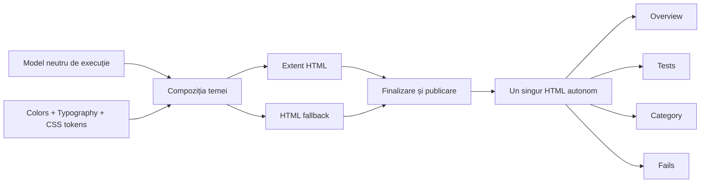
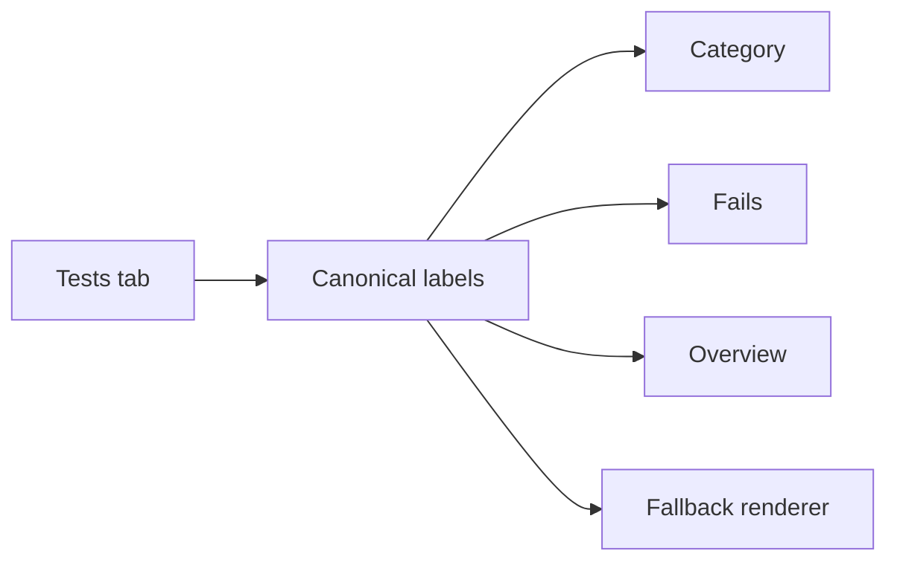

# ATF Reporting — contractul vizual al raportului Extent

Acest document este contractul normativ pentru raportul HTML autonom produs de
`atf-reporting`. Descrie cum trebuie să arate, să se comporte și să poată fi
verificat raportul complet, indiferent dacă artifactul este produs prin Extent
sau prin rendererul HTML fallback.

Nu este o colecție de preferințe CSS. Orice schimbare de culoare, suprafață,
tipografie, ierarhie, disclosure, navigare sau tabel este o schimbare de
contract și trebuie să păstreze cerințele de mai jos.

## Modelul de randare



Responsabilitățile sunt separate astfel:

| Rol | Responsabilitate | Nu decide |
|---|---|---|
| Sistemul de culoare | valori de culoare și suprafețe | structura HTML |
| Sistemul tipografic | fonturi, dimensiuni și line-height | verdicturi |
| Token-urile de temă | exportul token-urilor CSS | conținutul testului |
| Compoziția temei | regulile vizuale comune | transport/API |
| Proiecția markup-ului | markup semantic și roluri stabile | culori locale arbitrare |
| Formatterul de evidence | tabelele de evidence și assertions | verdictul de business |
| Documentul semantic | identity, ordering și arborele request → validation | HTML/CSS/JS |
| Sesiunea de raportare | lifecycle facade și fallback renderer | CSS duplicat |
| Finalizarea și publicarea | flush, asset-uri, atomizare și publicare | noi reguli vizuale |
| Inspectorul de artifact | verificarea raportului rezultat | repararea artifactului |

Rendererul primește modelul neutru și îl proiectează. Nu reconstruiește reguli
de business, statusuri sau relații între request și validation.

`atf-reporting` este consumatorul portului de raportare, nu proprietarul
validării. `atf-validation` evaluează response-ul și publică assertions prin
`atf.api.core.reporting.ValidationSink`; implementarea Extent oferă acest port
prin `AtfReportPorts.Request`. Astfel, acest modul rămâne singurul proprietar
al interacțiunii Extent, al HTML-ului, al CSS-ului și al finalizării artifactului,
iar validarea poate fi distribuită ca JAR fără să transporte rendererul.

Sesiunea publică `ExtentReportSession` este o fațadă intenționat mică. Ea deține
doar deschiderea/închiderea sesiunii, staging-ul, flush-ul și publicarea atomică;
arborele Extent este coordonat de `ExtentReportTree`, iar scope-urile de
scenario, phase, request și validation sunt separate în `reporting.extent`.
`ExtentNodeLifecycle` este singurul owner pentru maparea statusurilor și pentru
duratele pozitive ale nodurilor. Astfel, o modificare a lifecycle-ului nu mai
trebuie făcută în aceeași clasă cu staging-ul sau cu evidence-ul.
`ReportStagingWorkspace` este la rândul lui doar fațada workspace-ului: lease-ul
exclusiv și markerul sunt deținute de `ReportWorkspaceLease`, iar scanarea și
ștergerea workspace-urilor stale sunt deținute de `ReportWorkspaceSweeper`.
Acest boundary păstrează cleanup-ul sigur pentru rulări paralele și face
politica de sweeper testabilă fără să amestece lifecycle-ul sesiunii.

`ExtentReportFinalizer` este o fațadă publică mică. Implementarea internă
`ExtentReportPublicationPipeline` păstrează ordinea de publicare:
`assets → theme → navigation → views → overview metadata → runtime → atomic write → cleanup`.
Testul `ExtentReportFinalizerBoundaryTest` verifică artifactul lipsă,
injectarea theme/runtime și cleanup-ul fără director `spark`. Ordinea este
parte din contract; o extragere viitoare trebuie să păstreze HTML-ul observabil
și să adauge un test de caracterizare înainte de schimbarea layout-ului.

`AtfReportTheme` rămâne fațada de compoziție pentru CSS-ul Extent. Selectoarele
cu risc vizual mare pentru Overview, Category și tabelele scrollabile sunt
deținute de `AtfReportOverviewCss`, iar `AtfReportTheme` păstrează doar ordinea
finală a fragmentelor. `AtfReportOverviewCssTest` verifică disclosure-ul,
header-ele sticky, înălțimea scrollabilă și token-urile comune de font; testul
verifică și faptul că fragmentul este compus după regulile execution-page,
deoarece precedența selectorilor este parte din contract.

## Paleta obligatorie

Toate suprafețele neutre trebuie să folosească același token de bază. Nu se
introduc valori locale pentru un singur card, wrapper sau viewport.

| Token | Valoare | Utilizare |
|---|---|---|
| `--atf-bg` / `--atf-dark` | `#101723` | canvas, body, layout și suprafețe neutre |
| `--atf-panel` / `--atf-panel-2` | `#101723` | panouri și carduri standard |
| `--atf-border` | `#29364d` | linii, contururi și separatoare |
| `--atf-text` | `#e5ecf7` | text principal |
| `--atf-muted` | `#91a3bf` | text secundar, durate și metadata |
| `--atf-accent` | `#7aa2ff` | linkuri, selecție și accent TEST BODY |
| SETUP accent | `#56b6c2` | accentul lateral al fazei SETUP |
| PASS overview accent | `#35c759` | accent de succes pentru Overview și TEARDOWN |
| WARNING overview accent | `#f2b94b` | accent secundar pentru Overview și soft assertion |
| FAIL overview accent | `#ff6b81` | accent secundar pentru Overview și failure |
| INFO semantic | `#04a1f4` | evidence informativ |
| JSON surface | `#070a0e` | blocuri de cod JSON |
| JSON text | `#e6edf3` | conținut JSON |
| code text | `#d7e2f4` | text code/evidence |

Badge-urile de execuție folosesc suprafețele aprobate pentru contractul vizual
ATF Java:

| Badge | Background |
|---|---|
| Pass | `#9ccc65` |
| Warning | `#ffc107` |
| Fail | `#e57373` |
| Info | `#04a1f4` |

`#28a745`, `#dc3545` și alte valori Bootstrap pot exista în asset-ul vendor, dar
nu sunt contractul ATF și nu trebuie să ajungă în stilurile finale ale
raportului.

Badge-urile `Pass`, `Warning` și `Fail` folosesc aceeași geometrie compactă în toate
tab-urile (`Tests`, `Category`, `Fails`, `Overview` și proiecțiile de detail):

```text
height 18.2px · padding 0 5px · radius 4px · font 9.52px
line-height 18.2px · font-weight 400 · border 0
```

Containerul nu are voie să modifice dimensiunea sau culoarea semantică a
badge-ului. Badge-urile neutre de durată/metadata folosesc separat `22.4px`,
padding `5px 7px` și line-height `10.6624px`.

### Uniformitatea suprafețelor

`html`, `body`, layout-ul, navigarea, lista `Tests`, conținutul, marginile și
zona goală de sub clase trebuie să rezolve `var(--atf-bg)`. O bandă mai gri sau
mai deschisă în canvas-ul gol este regresie vizuală.

Este permis un tint local pentru rândul selectat sau pentru statusul unui test,
dar tint-ul nu se propagă în canvas, wrapper-e sau spațiul gol. Această regulă
este importantă deoarece un raport poate părea corect când are conținut, dar
poate expune suprafețe diferite când lista are puține teste.

## Tipografie și densitate

```text
font principal    Segoe UI, Inter, Helvetica Neue, Arial, sans-serif
font code         ui-monospace, Consolas, monospace
document root     14px
Overview          12.6px
table header      11.2px
table cell        12.6px
JSON              12.5px / 18.75px
status badge      9.52px / 18.2px, weight 400
```

Textul raportului folosește fontul sans-serif comun. Monospace este rezervat
JSON-ului și blocurilor code. Durata este neutră, compactă și afișată explicit
cu unitatea: `1 ms`, `16 ms`, `25 ms`; un număr fără `ms` este ambiguu și nu este
acceptat în UI.

Pentru agregarea duratelor, frunza păstrează durata măsurată. Un părinte afișează
durata proprie exclusivă, dacă există, plus suma totalurilor copiilor
structurali direcți. O durată Extent deja inclusivă nu se adună din nou cu
descendenții. Modelul trebuie să distingă durata `measured`, `exclusive` și
`inclusive`.

În navigatorul `Tests`, durata afișată lângă fiecare clasă este suma duratelor
scenariilor directe afișate în panoul din dreapta al acelei clase. Aceeași
valoare trebuie să apară și în header-ul clasei; durata brută Extent a clasei
nu poate înlocui suma dacă include deja aceleași scenarii.

## Ierarhia fazelor și a pașilor

```text
TestCase
├── SETUP
│   └── Request(s)
├── TEST BODY
│   ├── Request
│   │   ├── Technical trace
│   │   ├── Response details
│   │   └── Response JSON
│   └── Validation — sibling direct al request-ului owner
│       └── aggregate assertion table
└── TEARDOWN
    └── Request(s)
```

### Shell-ul unei faze

Fiecare fază este un container vizual, nu un pas HTTP obișnuit:

- border de `1px` cu `#29364d`;
- accent lateral de `3px`;
- radius de `8px`;
- background `#101723`;
- shadow `rgba(0,0,0,.18)`;
- header cu tint `rgba(122,162,255,.045)`;
- `SETUP` folosește accentul `#56b6c2`;
- `TEST BODY` folosește accentul `#7aa2ff`;
- `TEARDOWN` folosește accentul `#35c759`.

Request-ul și validation-ul sunt carduri sibling în shell-ul `TEST BODY`, cu
propriul header, durata și statusul. Nu există un al doilea rail vertical în
interiorul phase-ului; delimitarea vine numai de la shell-ul fazei.

### Contractul canonical al label-urilor

Label-urile vizibile în tab-ul `Tests` sunt sursa unică pentru toate celelalte
suprafețe (`Category`, `Fails`, `Overview` și fallback). Rendererul nu traduce
și nu scurtează aceste texte în funcție de tab:

| Rol | Label canonical |
|---|---|
| containerul trace-ului | `Response details · N fields` |
| clasificarea din container | `TECHNICAL TRACE` |
| payload de request | `REQUEST JSON` |
| payload de response | `RESPONSE JSON` |
| tabel agregat | `Assertions · N` |
| coloane assertions | `ASSERTION`, `EXPECTED`, `ACTUAL`, `RESULT` |

`N` este calculat din rândurile efectiv randate, nu dintr-o valoare hardcodata.
Prin urmare, `TECHNICAL TRACE` este o clasificare internă a blocului
`Response details`, nu titlul blocului. Această distincție trebuie păstrată și
în Fails, unde evidence-ul este o proiecție a aceluiași nod.



## Disclosure și evidence

Raportul trebuie să rămână scanabil. Nodurile verbose pornesc colapsate, iar
utilizatorul poate deschide exact evidence-ul dorit.

Disclosure-ul preferat pentru Java este:

```text
[-] collapse Response details · N fields
    TECHNICAL TRACE
```

Pentru request-urile API, technical trace conține numai câmpurile relevante:

```text
RESPONSE DURATION (ms) → valoare numerică observată
URL                    → URL-ul complet efectiv, derivat din base URL + ruta rezolvată
HTTP STATUS             → statusul răspunsului
Content-Type            → media type-ul răspunsului
Attempt                 → numărul încercării efective
```

Ruta semantică rămâne în titlul requestului și în contractul intern de routing;
nu se afișează ca substitut pentru URL-ul efectiv. Nu se copiază metadata verbose
dintr-un renderer extern. Aceeași disciplină se aplică pentru `RESPONSE JSON` și
tabelul agregat de assertions.

JSON-ul este un code block dark, scrollabil vertical, cu înălțime bounded și
fără să lărgească pagina. Validation-ul publică un singur tabel agregat de
assertions, nu câte un tabel pentru fiecare assertion.

## Tab-ul `Tests`

Navigatorul din stânga afișează numai:

- numele clasei;
- durata cu unitate (`N ms`);
- statusul semantic.

Nu afișează tag-uri și nu afișează timestamp. Timestamp-ul nu apare nici în
header-ul testului selectat și nici ca o coloană în tabelele de evidence.
Ora execuției poate rămâne în header-ul global sau în Overview, ca metadata a
rulării.

Tag-urile apar pe scenariile din dreapta și în agregările Overview, nu în lista
claselor din stânga. Badge-ul de durată este neutru; badge-ul de status este
semantic și are contrast constant pentru Pass, Warning, Fail și Info.
Statusurile semantice folosesc aceeași geometrie comună în fiecare tab:
`height:18.2px`, `padding:0 5px`, `border:0`, `radius:4px`, font `9.52px` și
line-height `18.2px`, cu aliniere centrală. Lățimea este naturală
(`width:auto`, `min-width:0`), astfel
încât textele cu lungimi diferite să nu fie forțate într-o lățime artificială.

În `Tests`, titlul fiecărui scenariu este aliniat la stânga în regiunea proprie
a titlului cardului, iar adnotările sunt imediat sub titlu, pe aceeași axă.
Grupul titlu+adnotări este centrat vertical în header. Indicatorul de expandare
rămâne separat la stânga, iar statusul și durata, inclusiv unitatea `ms`, rămân
în toolbar-ul propriu la dreapta și sunt centrate vertical pe același rând de
header; nicio zonă nu este mutată sau combinată cu alta.
Regula rămâne valabilă pentru titluri lungi, liste de tag-uri de dimensiuni
diferite și durate dinamice: textul nu se centrează orizontal, iar statusul și
durata nu coboară pe rândul adnotărilor.

Filtrele din `Tests` sunt parte din aceeași suprafață vizuală, nu componente
vendor cu tema implicită a browserului. Atât filtrul de status, cât și filtrul
de tag folosesc `--atf-dark` pentru fundal, `--atf-border` pentru contur și
`--atf-text` pentru text; hover-ul și starea activă folosesc suprafața
`--atf-panel`. Ambele dropdown-uri au aceeași tipografie, densitate și umbră,
se deschid numai la cerere, iar `Clear` readuce lista completă fără să
contamineze celălalt filtru. O suprafață albă sau textul gri al dropdown-ului
vendor reprezintă o încălcare a contractului.

Filtrarea este locală populației din `Tests`: statusul se aplică verdictului
owner-ului din navigatorul claselor, tag-ul se aplică numai scenariilor care îl
dețin, iar clasa este ascunsă dacă owner-ul nu corespunde sau nu mai are niciun
scenariu vizibil. Selecția interceptează
`href="#"`, păstrează `#test-view` și expune starea prin `aria-pressed`; tag-urile
de diagnostic (`failure`, `warning`, `skip`, `teardown`, `reporting`,
`soft-assert`) nu apar în dropdown-ul principal, dar rămân în metadata și
Overview.

### Organizarea informației pe tab-uri

```text
Overview → sumarul execuției și agregările globale
Tests    → clasă în stânga; scenarii, faze și evidence în dreapta
Category → aceeași populație grupată pe categorie/status
Fails    → numai failure-uri, cu phase → request → validation → assertion → cause
```

Navigarea este deep-linkabilă prin `#dashboard-view`, `#test-view`,
`#category-view`, `#atf-fails-view` și `#test-id=...`. Schimbarea unui filtru nu
este o schimbare de tab și nu are voie să activeze Overview.

## Overview, Category și Fails

### Overview

Overview-ul este sumarul navigabil al aceleiași populații de scenarii:

- counter cards pentru teste și pași;
- charts și Timeline fără panouri goale neintenționate;
- `Tags` și `System/Environment` cu aceeași tipografie, culoare de header,
  border și comportament de tabel;
- auditul de metadata în trei tabele paralele, fără tabel în tabel;
- coloane și scroll bounded pentru agregările lungi;
- metadatele rămân secundare și nu concurează cu verdictul.

### Category

Category agregă scenariile reale și păstrează același font, densitate, culori și
status mapping. Nu numără containere intermediare în locul scenariilor. Label-ul
vendor `others` nu este publicat ca verdict; este normalizat la `warnings`, la
fel ca în sumarul din Overview și în tabelul de Tags.

### Fails

Fails trebuie să păstreze proveniența failure-ului:

```text
phase → request → validation/assertion → actual → cause
```

Pentru teardown failure este valid să lipsească request-ul și validation-ul,
dar cauza exactă trebuie păstrată. Pentru un failure produs în TEST BODY,
request-ul, validation-ul, actualul și cauza trebuie să fie navigabile către
testul original.

După selectarea unei intrări, detail pane-ul Fails rămâne o proiecție index-only
a failure-ului: phase, request, validation/assertion, actual, cause și durata
sunt prezentate concis, fără să cloneze `test-contents` și fără să introducă un
al doilea arbore executabil. Evidence-ul complet rămâne în testul original din
`Tests`, iar butonul `Open in Tests` revine la acel nod prin deep-link. Astfel,
un failure nu poate produce duplicate DOM, verdicturi concurente sau o a doua
versiune a pașilor colapsabili.

Indexul Fails expune și `DURATION`: valoarea este derivată din
`RESPONSE DURATION (ms)`, nu din timestamp. Pentru teardown fără response se
afișează explicit `No response duration recorded`; timestamp-ul nu este parte
din indexul de failure.

## Reguli de implementare

1. O singură sursă pentru token-uri: `AtfReportColors`,
   `AtfReportTypography` și `AtfReportThemeTokens`.
2. Selectoarele nu introduc culori hardcodate dacă există token echivalent.
3. Extent și fallback folosesc aceeași compoziție de theme.
4. Markup-ul păstrează roluri semantice stabile pentru phase, request și
   validation.
5. Rendererul nu mută validation-ul în request și nu inventează metadata.
6. Finalizerul nu modifică forma raportului; doar finalizează, publică și
   curăță artifactul.
7. Orice ajustare vizuală trebuie verificată în artifactul HTML, nu numai prin
   substring-uri în sursă.

## Teste de contract

Contractul este întărit pe trei niveluri, fără să schimbe forma raportului:

1. `AtfReportColorsTest` verifică sursa unică a paletei și contrastul semantic
   al badge-urilor;
2. `AtfReportThemeTokensTest` verifică tokenurile calculate, CSS-ul Extent și
   fallback-ul pentru suprafețe, faze, tipografie, evidence și statusuri;
3. `HtmlReportSemanticDocumentTest` verifică identity deterministă, ordering,
   snapshot read-only și sibling-ul `request → validation`;
4. `HtmlReportSessionTest` verifică markup-ul autonom și fallback-ul offline;
5. `ExtentNodeLifecycleTest` verifică maparea tuturor statusurilor, duratele
   pozitive și respingerea inputului vendor invalid;
6. `ReportStagingWorkspaceTest` verifică lease-ul exclusiv, close idempotent,
    sweeper-ul bounded și validarea limitelor;
6. `ExtentReportInteractionContractTest`, `ReportArtifactContractChecksTest` și
   `ReportArtifactInspectorTest`
   verifică markup-ul și artifactul publicat:
   sibling direct request/validation, phase shell, trace compact, JSON bounded,
   tabel agregat, organizarea tab-urilor, deep-link-urile, controalele ambelor
   filtre, ownership-ul status/tag, deselectarea prin re-click și filtrarea pe
   scenarii.

În plus, contractul respinge culorile scrise direct în regulile rendererului
(`color:#...`, `background:#...`, `border-color:#...`). Zonele Overview,
Tests, Category, Fails și fallback trebuie să consume aceiași tokeni calculați
din `AtfReportColors`; o paletă corectă într-o singură zonă nu este suficientă.

Aceste teste sunt ratchet tests. Nu se șterg, nu se relaxează și nu se
rescriu pentru a ascunde un failure. Când un assertion pică, se repară sursa
implementării — token, markup, finalizer sau lifecycle — iar assertion-ul
rămâne protecția permanentă. Verificarea se rulează din rădăcina proiectului
cu `mvn -pl atf-reporting -am test`; pentru un host cu memorie limitată se
poate folosi un target temporar, fără a modifica testele sau artifactele live.

## Criterii de acceptare

O schimbare de reporting este acceptată numai când:

- toate suprafețele neutre au aceeași culoare calculată `#101723`;
- phase shell-urile au accentul, border-ul și shadow-ul corecte;
- request-ul și validation-ul sunt sibling direct;
- `Response details · N fields` este titlul disclosure-ului, iar
  `TECHNICAL TRACE` este clasificarea din interior; trace-ul rămâne compact și
  limitat la câmpurile relevante;
- JSON-ul este scrollabil și assertions sunt agregate într-un singur tabel;
- Tests nu afișează timestamp sau tag-uri în navigatorul claselor;
- filtrele de status și tag din `Tests` păstrează suprafața dark, conturul,
  tipografia și contrastul temei, fără dropdown alb vendor;
- Overview, Category și Fails păstrează același status mapping și aceeași
  tipografie;
- duratele vizibile folosesc forma `N ms`, iar totalurile părinte nu dublează
  durate Extent deja inclusive;
- badge-urile `Pass`, `Warning` și `Fail` păstrează aceeași geometrie și paletă
  în toate tab-urile și proiecțiile de detail;
- Fails păstrează cauza și owner-ul semantic;
- raportul final este autonom, fără asset-uri externe obligatorii;
- testele structurale și testele de artifact protejează token-urile și
  comportamentul observabil;
- verificarea finală se face prin navigare efectivă în TAB MCP.

Pentru lucrările încă neimplementate, vezi
[`docs/feedback/README.md`](../docs/feedback/README.md) și
[`docs/feedback/ATF_Reporting_Duration_Semantics.md`](../docs/feedback/ATF_Reporting_Duration_Semantics.md).
Feedback-ul păstrează numai ToDo-uri; acest README păstrează contractul stabil.
