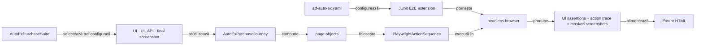

# ATF Automation Exercise — consumer UI E2E

`atf-test-auto-ex` este un consumer separat pentru site-ul gratuit
[Automation Exercise](https://automationexercise.com/). Nu depinde de
Practice Shop și nu mută configurație, pagini ori fixture-uri între cele două
aplicații.

## Pe scurt

- **Scop:** un purchase journey E2E opt-in, exercitat prin configurații distincte de evidence.
- **Owner:** `atf-test-auto-ex`; platforma reutilizabilă rămâne în modulele ATF.
- **Limită:** nu este ownerul API-ului public și nu extinde matricea de variații din browser.

## Boundary și adnotări

Modulul nu are cod de producție: întreaga compoziție rulează în
`src/test/java`, iar dependențele ATF sunt `test`-scope. Testul E2E folosește
direct contractele existente din `atf-test-kit`:

| Adnotare | Rol în modul |
|---|---|
| `@AtfE2eTest` | declară testul observabil la boundary-ul site-ului |
| `@AtfTestChannel(TestChannel.UI)` / `UI_API` | declară dacă verdictul folosește UI-ul vizibil sau și schimburile API observate în aceeași sesiune de browser |
| `@AutoExEvidenceMode(FINAL_SCREENSHOT_ONLY)` | cere un singur screenshot la starea terminală, păstrând flow-ul și aserțiunile |
| `@UiReportSubdirectory("auto-ex")` | publică Extent în subdirectorul consumerului |
| `@AtfConsoleMessages(DETAILS)` | selectează diagnosticul ATF pentru rularea directă |

Adnotările descriu natura și output-ul testului; `AutoExE2eExtension` este
adaptorul JUnit specific consumerului, care deschide browserul, raportul și
resursele per metodă. Nu introducem o adnotare AutoEx care să dubleze Test Kit.



<details>
<summary><strong>Legendă — boundary-ul consumerului AutoEx</strong></summary>

Configurația și extensia guvernează execuția; page objects și acțiunile dețin
interacțiunea; browserul produce evidence, iar Extent o publică. Contractele
generice nu se copiază în acest modul.
</details>

Responsabilitățile sunt delimitate astfel:

- `config` deține URL-ul, politica browserului și datele demo configurabile;
- `locator` deține rutele și selectorii CSS ai site-ului;
- `page` deține acțiunile și citirea fiecărei pagini;
- `support` deține lifecycle-ul JUnit, sink bridge-ul și identitatea sintetică;
- `tests/autoex/e2e` conține exclusiv scenarii de business executate pe site-ul public.

### Separarea testului de suport

În starea curentă, modulul nu are `src/main/java`: scenariul E2E și suportul
consumerului sunt toate în `src/test/java`, iar dependențele ATF/JUnit au scope
`test`. Ținta cerută este ca entrypoint-ul și verdictul scenariului să rămână
în `src/test/java`, iar suportul AutoEx să fie separat în `src/main/java`.
Ținta de separare este:

| `src/test/java` — teste | `src/main/java` — suportul consumerului |
|---|---|
| cele trei clase `AutoExPurchase*E2eTest`, `AutoExPurchaseSuite` și verificări strict legate de execuția testelor | `AutoExPurchaseJourney`, extensia/run adapter, page objects, rute/selectori, configurație, identitate sintetică, CMP/vignette și bridge de consolă |

Mutarea rămâne deschisă și trebuie făcută după rolul fiecărei clase:

- verifică API-urile folosite și promovează numai dependențele necesare codului
  din `main` la compile scope;
- păstrează JUnit engine-ul, runner-ul suitei și librăriile strict de test în
  scope-ul `test`, apoi inspectează conținutul JAR-ului;
- codul generic merge în modulul ATF owner, nu în `src/main/java` al acestui
  consumer.

Matricea comună și criteriile de acceptanță sunt în
[feedback-ul arhitecturii testelor consumer](../docs/feedback/ATF_Consumer_Test_Architecture_Feedback.md).

## Convenții pentru locatori UI

CSS este alegerea implicită pentru contractele DOM stabile, cu selector exact și
ancorat pe element/atribut, de forma `element[atribut='valoare']`. Exemple
potrivite sunt `a[href='/products']` și
`input[data-qa='signup-email']`. Pentru hook-uri stabile, preferă
`data-qa`, `id` sau `name`; pentru navigare, un `href` exact
este mai explicativ decât un selector bazat pe poziție sau pe aspectul vizual.

- Declară toți selectorii site-ului în `AutoExSelectors`; page objects îi
  consumă, nu construiesc CSS inline. Raportul publică selectorul efectiv în
  action trace, deci stabilitatea și lizibilitatea sunt parte din diagnostic.
- Refolosește `HtmlElement`/`HtmlAttribute` din `atf-ui` pentru
  tag-uri, atribute și escaping când compoziția rezultată rămâne clară.
  `HtmlElement.attributeEquals(String name, String value)` acoperă și atribute
  valide care nu au un enum dedicat, precum `data-qa`. Pentru selectori compuși sau
  specifici aplicației, păstrează CSS-ul explicit și numit local; nu extinde
  vocabularul generic pentru o singură pagină.
- Rutele, clasele DOM, valorile `data-qa` și textele site-ului sunt
  contracte AutoEx, nu constante de `atf-core`/`atf-ui`. Păstrează
  rutele în `AutoExRoutes`; selectorii `href` din `AutoExSelectors` se derivă
  din acel catalog, ca navigarea și locatorii să nu poată diverge accidental.
- Evită selectori fragili de poziție (`nth`/`first` fără un context
  unic demonstrat), clase pur vizuale și XPath. Folosește pseudo-selectori
  Playwright precum `:visible` sau `:has-text(...)` numai când
  vizibilitatea ori textul fac parte din precondiția reală și CSS-ul stabil nu
  poate exprima contractul.
- Nu extrage fiecare literal într-o constantă. Centralizează numai valori
  repetate sau contractuale; nu crea duplicate generice cu un singur consumator.

Compoziția și escaping-ul generic sunt probate de testele `atf-ui`. AutoEx nu
adaugă teste consumer cu DOM sintetic: E2E-ul real este dovada că selectorii
corespund markup-ului public actual, iar regula de ownership a selectorilor
poate fi apărată separat prin guvernanța ATF.

## Politica de testare și reutilizare

Acest consumer verifică business-ul Automation Exercise prin E2E-uri reale.
Nu adăugăm aici teste cu HTML/iframe inventat sau teste unitare ale helperelor,
configurării ori ale adnotărilor ATF: acestea nu dovedesc comportamentul
magazinului. Dacă o regulă este generică, testul ei aparține modulului ATF care
o deține; dacă este specifică site-ului, o verifică scenariul E2E real.

| Capacitate | Owner | Folosire aici |
|---|---|---|
| Clasificarea UI E2E, browser Playwright, secvența de acțiuni, capturile, sesiunea Extent și output-ul raportului | ATF (`atf-test-kit`, `atf-ui`, `atf-reporting`) | Folosim direct contractele existente; nu le clonăm în consumer. |
| Network Inspector și evidence API pentru schimburi observate în browser | ATF (`atf-ui`, `atf-reporting`) | Varianta AutoEx `UI_API` îl activează pentru hostul first-party și publică numai observații reale; validarea live/randarea suitei este încă deschisă în feedback. |
| Conturi locale, jurnal API/network, profiluri de setup și raport partajat pe suite | Practice Shop | Rămân specifice Shop; AutoEx nu le importă și nu le copiază. |
| Acțiunile pentru pagini, CMP și vignette | Acest consumer | Sunt adaptoare pentru interfața publică reală și sunt exercitate numai din E2E. |

Practice Shop și AutoEx au compoziții JUnit/report diferite: Shop suportă
setup-uri și suite API/UI partajate, iar `AutoExPurchaseSuite` compune trei
variante ale aceluiași journey într-un singur raport și păstrează un browser
per test. Lifecycle-ul comun este un candidat de platformă numai dacă se definește un
contract folosit de ambii consumatori fără configurație, locator sau model de
business al vreunuia. Nu mutăm `ShopE2eTestSupport` ca întreg și nu introducem o
abstracție generică doar pentru a elimina câteva apeluri locale.

Cele trei clase E2E reutilizează `AutoExPurchaseJourney` și verifică același
business flow:

| Variantă | Diferența verificată |
|---|---|
| UI | verdictul se bazează pe UI-ul vizibil |
| UI/API | verdictul include traficul first-party observat de același browser |
| UI final-only | păstrează flow-ul și assertions, cu o singură captură terminală |

`AutoExPurchaseSuite` le ordonează într-un singur raport. Datele sintetice sunt
input pentru formularele reale; variațiile schimbă evidence-ul, nu business-ul.

## Scenariul business

Flow-ul unic combină [Test Case 14 — Place Order: Register while Checkout](https://automationexercise.com/test_cases#collapse14)
cu factura din [Test Case 24 — Download Invoice after purchase](https://automationexercise.com/test_cases#collapse24).

| Zonă verificată | Dovada E2E |
|---|---|
| Magazin și catalog | disponibilitate, căutare, rută, produs, preț, stoc și cantitate |
| Checkout | total coș, înregistrare, adrese, plată demo și confirmare |
| Cleanup | factură descărcată și ștergerea contului temporar |
| Contract public | `data-qa="order-placed"`, mesajul din `#form` și ruta publică a facturii; nu se presupun hook-uri DOM absente |
| Canal UI/API | UI_API nu lansează endpoint separat; observă traficul first-party din același browser și eșuează dacă nu există exchange `/api/` |

Validarea live și auditul vizual al matricei rămân deschise în
[feedback-ul AutoEx](../docs/feedback/ATF_Automation_Exercise_Feedback.md).
Endpoint-urile documentate sunt în [Automation Exercise API List](https://automationexercise.com/api_list).

Datele stau în [`atf-auto-ex.yaml`](src/test/resources/atf-auto-ex.yaml).

- Fiecare rulare de cumpărare generează email și parolă unice.
- Formularul folosește numai câmpuri demo; nu se introduc date personale sau carduri reale.
- După confirmarea înregistrării, contul se șterge la final și cleanup-ul UI
  rulează la eșecurile ulterioare. Fereastra dintre submit-ul înregistrării și
  confirmarea care armează cleanup-ul nu este încă acoperită; vezi
  `AUTOEX-E2E-RESILIENCE-01` din feedback.
- Capturile din raport maschează câmpurile de formular.

Într-un browser fără consimțământ salvat, scenariul gestionează promptul vizibil
prin interfața CMP: deschide opțiunile, dezactivează scopurile opționale
preselectate și confirmă alegerea minimă. Pașii rămân în secvența Playwright din
raport; testul nu acceptă toate cookie-urile și nu ocolește overlay-ul.

Site-ul poate afișa un Google vignette după navigare; acesta este zgomot de mediu,
nu comportament de business.

- Handler-ul apasă exact „Close” numai când URL-ul indică vignette-ul.
- Clickul rămâne în trace; DOM-ul nu este modificat și nu se folosesc clickuri forțate.
- Lipsa controlului vizibil produce diagnostic explicit.
- Handler-ul este folosit numai de E2E-ul live; nu construim un iframe artificial
  ca să-l declarăm acoperire a site-ului.

Rularea live este oprită implicit pentru a nu crea comenzi în timpul unui build
obișnuit. Suita deține un singur raport partajat pentru cele trei scenarii în
`artifacts/reports/ui/auto-ex/`; numele include timestamp și identificator
unic. Raportul se închide o singură dată la terminarea root-ului JUnit.

## Rulare

Din root-ul reactorului:

```powershell
mvn -pl atf-test-auto-ex -am "-Dtest=AutoExPurchaseSuite" "-Datf.autoex.e2e.enabled=true" "-Dsurefire.failIfNoSpecifiedTests=false" test
```

- IntelliJ: rulează direct `AutoExPurchaseSuite` pentru matricea completă sau o
  clasă individuală pentru o singură variantă; runner-ul IDE activează E2E-ul
  fără VM option suplimentar.
- Maven: activează explicit testul cu `-Datf.autoex.e2e.enabled=true`, ca un
  build obișnuit să nu trimită comenzi către site.
- Browser/raport: browserul rămâne headless; output-ul este în
  `artifacts/reports/ui/auto-ex/`, indiferent de working directory.
- Configurație: `atf.autoex.config` selectează un YAML alternativ;
  `-Datf.autoex.e2e.enabled=false` dezactivează explicit rularea și din IDE.

Pentru arhitectură și cerințele deschise, vezi [feedback-ul AutoEx](../docs/feedback/ATF_Automation_Exercise_Feedback.md).
