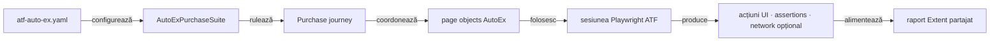

# ATF Automation Exercise — consumer UI E2E

`atf-test-auto-ex` verifică un journey de cumpărare pe site-ul public
[Automation Exercise](https://automationexercise.com/). Configurația, rutele,
selectorii, page objects și regulile business rămân specifice acestui consumer;
browserul și raportarea sunt furnizate de modulele ATF.

## Pe scurt

- Acest modul deține journey-ul E2E și suportul specific site-ului AutoEx.
- `atf-ui` deține execuția browserului; `atf-reporting` deține modelarea și
  publicarea evidence-ului.
- `@AtfUiEvidence(flow = UNIFIED_FLOW, screenshots = FINAL_ONLY)` produce o
  secvență unificată de acțiuni și o captură
  terminală; detaliile sunt în secțiunea despre suite.



<details>
<summary><strong>Legendă — scope-ul consumerului</strong></summary>

AutoEx deține datele și interacțiunile site-ului. `atf-ui` execută browserul,
iar `atf-reporting` publică evidence-ul. Suitele și adaptorul JUnit sunt
test-only; nu introduc cod de runner în suportul de producție al consumerului.
</details>

## Boundary-ul AutoEx

| Zonă | Conținut specific acestui consumer |
|---|---|
| `src/main` | Configurația site-ului, catalogul de rute/selectori, page objects, purchase journey și cleanup-ul contului sintetic |
| `src/test` | Teste componente AutoEx, cele trei variante E2E, suite și adaptorul JUnit pentru configurație/evidence |
| Rulare | Site-ul public; E2E-ul este opt-in în Maven, iar rularea directă din IntelliJ este suportată |

Configurația implicită este [`atf-auto-ex.yaml`](src/test/resources/atf-auto-ex.yaml)
și aparține profilului de test, nu unei biblioteci publicate:

- `AutoExConfigurationLoader` o citește din classpath, cu fallback la fișierul
  modulului pentru lansările IDE;
- un YAML alternativ se selectează prin `-Datf.autoex.config=<path>`; căile
  relative se rezolvă față de working directory-ul procesului;
- URL-ul, browserul, timeout-urile, produsul demo, identitatea sintetică, plata
  demo și directorul raportului sunt configurate acolo;
- E2E-ul rămâne dezactivat implicit.

Profilul conține numai date sintetice și date de plată demonstrative; nu introduce
în YAML date personale reale, parole sau instrumente de plată reale. Modelul
redactează câmpurile de înregistrare și plată din reprezentarea textuală.

`AutoExPurchaseJourney` consumă portul `AutoExPurchaseSession` din `src/main`;
`AutoExE2eRun` îl adaptează în `src/test` la browser, raport și lifecycle JUnit.
Separarea păstrează suportul specific site-ului testabil fără ca sursele de
producție ale consumerului să depindă de runner sau de Test Kit.

## Contractul testelor AutoEx

- `@AtfE2eTest` și `@AtfTestChannel(UI/UI_API)` clasifică cele trei teste după
  boundary și canal.
- Contractul comun `@AtfUiEvidence` din Test Kit declară separat forma flow-ului
  și politica de captură; adaptorul AutoEx îl mapează în profilul Reporting.
  Varianta final-only îl declară explicit, iar axele `CONFIGURED` păstrează
  profilul configurat. Declarația este direct pe clasa E2E; metadata nu pornește
  singură browserul sau lifecycle-ul.
- `@UiReportSubdirectory("auto-ex")` și `@AtfConsoleMessages(DETAILS)` păstrează
  output-ul și diagnosticul consumerului în locația/politica stabilite.
- `AutoExE2eExtension` compune sesiunea per test; `AutoExPurchaseSuite` rulează
  clasele secvențial și partajează raportul.

## Suite și variante de evidence

`AutoExPurchaseSuite` execută același journey în trei clase, cu un raport Extent
partajat:

| Clasă | Canal și evidence |
|---|---|
| `AutoExPurchaseUiE2eTest` | UI; checkpoint-uri și capturi conform profilului standard |
| `AutoExPurchaseUiApiE2eTest` | UI + observarea traficului first-party în aceeași sesiune de browser |
| `AutoExPurchaseUiFinalScreenshotE2eTest` | UI; o secvență consolidată de acțiuni și o singură captură terminală |

`AutoExComponentSuite` verifică local fără a deschide site-ul public:

- selectează testele componente din `atf.ui.tests.autoex.component`;
- acestea acoperă decizii și adaptoare specifice consumerului;
- ownership-ul cross-consumer este definit în [arhitectura ATF](../docs/ATF_Architecture.md)
  și în [ghidul de testare](../docs/ATF_Testing_Guide.md);
- limita de opt clase per pachet este definită în
  [bunele practici de cod](../docs/README_Atf_CodeBestPractices.md#coeziunea-pachetelor-pragul-de-opt-clase).
Contractele generice pentru browser și renderer sunt descrise în
[README-ul `atf-ui`](../atf-ui/README.md) și
[README-ul `atf-reporting`](../atf-reporting/README.md).

## Coeziunea suportului AutoEx

Codul din `src/main` este suport de producție specific site-ului, nu cod de
runner. Suportul este separat pe motive de schimbare, iar fiecare pachet rămâne
sub pragul comun de opt clase:

| Pachet | Responsabilitate | Clase |
|---|---|---:|
| `support.journey` | coordonarea purchase-ului și trace | 3 |
| `support.account` | cont sintetic și cleanup | 3 |
| `support.catalog` | snapshot și aserțiuni de catalog | 2 |
| `support.browser` | consimțământ și vignette | 2 |
| `api` | rute, request factory și cont API typed | 3 |

`AtfPackageCohesionGovernanceTest.automationExerciseProductionPackagesAreInTheGovernedInventory()`
verifică includerea modulului cu surse de producție și inventory-ul celor patru
pachete `support`. Schimbările cross-consumer se promovează separat numai când
abstracția este generică; rutele, payload-urile și regulile site-ului rămân în
AutoEx.

## Journey-ul de cumpărare

Scenariul combină [Test Case 14 — Place Order: Register while Checkout](https://automationexercise.com/test_cases#collapse14)
cu [Test Case 24 — Download Invoice after purchase](https://automationexercise.com/test_cases#collapse24):

1. deschide magazinul și caută produsul configurat;
2. verifică produsul, prețul, disponibilitatea și cantitatea în detalii/coș;
3. înregistrează un cont sintetic în checkout și verifică adresele și comanda;
4. finalizează plata demo, verifică confirmarea și descarcă factura;
5. șterge contul sintetic și verifică starea terminală.

Valorile de catalog, identitate și plată sunt date demo din YAML; fiecare
execuție generează email și parolă unice. Cleanup-ul este armat înainte de
submit-ul înregistrării, iar o eroare de cleanup nu maschează cauza primară.
Capturile redactează câmpurile de formular.

Dialogul CMP este tratat prin interfața vizibilă, cu alegerea minimă pentru
scopurile opționale. Dacă apare vignette-ul Google, handler-ul consumerului
apasă controlul vizibil „Close” numai pe pagina vignette-ului; nu modifică DOM-ul
și nu folosește click forțat. Aceste interacțiuni rămân în trace-ul E2E.

## Rute și locatori ai site-ului

`AutoExRoutes` este catalogul rutelor Automation Exercise, iar
`AutoExSelectors` deține selectorii site-ului. Selectorii `href` se derivă din
rute; page objects consumă catalogul și nu construiesc CSS inline. Aceste valori
sunt contracte ale aplicației AutoEx, nu vocabular generic ATF.

Regulile comune pentru selectori CSS, compoziția prin `HtmlElement` și
`HtmlAttribute`, escaping și evitarea locatorilor fragili sunt documentate și
testate de [`atf-ui` — Convenții pentru locatori UI](../atf-ui/README.md#convenții-pentru-locatori-ui).
Testele AutoEx exercită selectorii pe markup-ul public real; nu duplică testele
generice cu DOM sintetic ale modulului owner.

## API direct și limita evidence-ului UI/API

Rutele publice sunt inventariate în [API List](https://automationexercise.com/api_list).
AutoEx păstrează separat request-modelul, contractele offline și probele live:

| Suprafață | Contract în cod | Limită a dovezii |
|---|---|---|
| `AutoExApiRoute`, `AutoExApiRequestFactory`, `AutoExApiAccount` | opt rute; request-uri GET/form; model typed de cont cu `toString()` redactat | nu demonstrează singură schema ori comportamentul HTTP |
| `AutoExApiContractComponentTest` | 14 scenarii prin `ApiExecutor` și transport fixture; verifică route/method/status, exchange unic, câmpuri de cont, login/delete, query, encoding și câmp minim din body | statusul/body-ul sunt generate de fixture; nu validează schema JSON completă a serviciului |
| `AutoExApiLiveContractTest` / `AutoExApiLiveSuite` | 14 statusuri live; cont UUID sintetic, login/detail/update și cleanup armat înainte de create | suite opt-in, neexecutată în acest audit; verifică statusuri și email în detail, nu schema completă și nu produce raport Extent dedicat |
| `AutoExApiTrafficWindow` | separă schimburile precondiției de agregatul cauzal: journey-ul publică mai întâi checkpoint-ul catalogului, apoi marchează baseline-ul | baseline-ul este legat în codul journey-ului; testul existent verifică helper-ul, dar nu protejează încă poziționarea lui în lifecycle sau artifactul UI/API randat |

În `UI_API`, `GET /api/productsList` este o precondiție explicită, publicată în
propriul checkpoint. După checkpoint, journey-ul marchează baseline-ul, iar
agregatul de trafic cauzal pornește de la schimburile observate ulterior.
Căutarea din pagină folosește `/products?search=...`, nu endpoint-ul separat
`POST /api/searchProduct`; criteriul de regresie pentru ordinea baseline-ului și
dovada randată rămâne în [feedback-ul Automation Exercise](../docs/feedback/ATF_Automation_Exercise_Feedback.md).

## Rulare

Din root-ul reactorului, testele componente offline:

```powershell
mvn -pl atf-test-auto-ex -am "-Dtest=AutoExComponentSuite" "-Dsurefire.failIfNoSpecifiedTests=false" test
```

Contractele API live sunt un gate separat, fără rulare implicită:

```powershell
mvn -pl atf-test-auto-ex -am "-Dtest=AutoExApiLiveSuite" "-Datf.autoex.api.live.enabled=true" "-Dsurefire.failIfNoSpecifiedTests=false" test
```

Adresa implicită vine din `atf-auto-ex.yaml`; override-urile opționale sunt
`-Datf.autoex.api.base-url=<url>` și `-Datf.autoex.api.timeout=PT20S`. Acest gate
creează și șterge un cont sintetic pe serviciul selectat; `e2eEnabled: false`
nu dezactivează suita API, iar proprietatea `atf.autoex.api.live.enabled` rămâne
obligatorie.

Matricea E2E live, cu un singur raport pentru toate cele trei variante:

```powershell
mvn -pl atf-test-auto-ex -am "-Dtest=AutoExPurchaseSuite" "-Datf.autoex.e2e.enabled=true" "-Dsurefire.failIfNoSpecifiedTests=false" test
```

- În IntelliJ se poate rula direct `AutoExPurchaseSuite` sau o clasă E2E; adaptorul
  recunoaște runner-ul IDE. Proprietatea explicită
  `-Datf.autoex.e2e.enabled=false` dezactivează rularea și în IDE.
- Maven cere explicit `-Datf.autoex.e2e.enabled=true`; E2E-ul public nu pornește
  într-un build obișnuit. `e2eEnabled` din YAML este tot `false` implicit.
- Rapoartele sunt publicate sub `artifacts/reports/ui/auto-ex/`; execuția suitei
  partajează sesiunea de raportare și o finalizează la închiderea root-ului JUnit.

Deciziile închise și cerințele încă deschise ale consumerului sunt păstrate în
[feedback-ul Automation Exercise](../docs/feedback/ATF_Automation_Exercise_Feedback.md).
