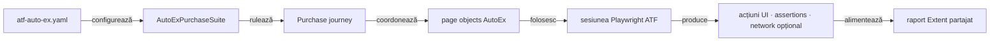

# ATF Automation Exercise — consumer UI E2E

`atf-test-auto-ex` verifică un journey de cumpărare pe site-ul public
[Automation Exercise](https://automationexercise.com/). Configurația, rutele,
selectorii, page objects și regulile business rămân specifice acestui consumer;
browserul și raportarea sunt furnizate de modulele ATF.

## Pe scurt

- Acest modul deține journey-ul E2E și suportul specific site-ului AutoEx.
- `atf-ui` deține execuția browserului; `atf-reporting` deține modelarea și
  publicarea evidence-ului.
- `FINAL_SCREENSHOT_ONLY` produce o secvență unificată de acțiuni și o captură
  terminală; detaliile sunt în secțiunea despre suite.



<details>
<summary><strong>Legendă — scope-ul consumerului</strong></summary>

AutoEx deține datele și interacțiunile site-ului. `atf-ui` execută browserul,
iar `atf-reporting` publică evidence-ul. Suitele și adaptorul JUnit sunt
test-only; nu introduc cod de runner în suportul de producție al consumerului.
</details>

## Boundary-ul AutoEx

| Zonă | Conținut specific acestui consumer |
|---|---|
| `src/main` | Configurația site-ului, catalogul de rute/selectori, page objects, purchase journey și cleanup-ul contului sintetic |
| `src/test` | Teste componente AutoEx, cele trei variante E2E, suite și adaptorul JUnit pentru configurație/evidence |
| Rulare | Site-ul public; E2E-ul este opt-in în Maven, iar rularea directă din IntelliJ este suportată |

Configurația implicită este [`atf-auto-ex.yaml`](src/main/resources/atf-auto-ex.yaml).
`AutoExConfigurationLoader` citește `-Datf.autoex.config=<path>` pentru un YAML
alternativ. URL-ul, viewport-ul, timeout-urile, produsul demo, datele sintetice
și directorul raportului sunt configurate acolo.

## Contractul testelor AutoEx

- `@AtfE2eTest` și `@AtfTestChannel(UI/UI_API)` clasifică cele trei teste după
  boundary-ul și evidence-ul lor.
- `@AutoExEvidenceMode(FINAL_SCREENSHOT_ONLY)` este folosită numai de varianta
  UI final-only și selectează flow-ul consolidat cu captura terminală.
- `@UiReportSubdirectory("auto-ex")` și `@AtfConsoleMessages(DETAILS)` păstrează
  output-ul și diagnosticul consumerului în locația/politica stabilite.
- `AutoExE2eExtension` compune sesiunea per test; `AutoExPurchaseSuite` rulează
  clasele secvențial și partajează raportul.

## Suite și variante de evidence

`AutoExPurchaseSuite` execută același journey în trei clase, cu un raport Extent
partajat:

| Clasă | Canal și evidence |
|---|---|
| `AutoExPurchaseUiE2eTest` | UI; checkpoint-uri și capturi conform profilului standard |
| `AutoExPurchaseUiApiE2eTest` | UI + observarea traficului first-party în aceeași sesiune de browser |
| `AutoExPurchaseUiFinalScreenshotE2eTest` | UI; o secvență consolidată de acțiuni și o singură captură terminală |

`AutoExComponentSuite` selectează testele componente din
`atf.ui.tests.autoex.component`; acestea verifică decizii și adaptoare locale
fără să deschidă site-ul public. Deciziile cross-consumer despre ownership-ul
lifecycle-ului rămân în
[feedback-ul arhitecturii testelor consumer](../docs/feedback/ATF_Consumer_Test_Architecture_Feedback.md).
Contractele generice pentru browser și renderer sunt descrise în
[README-ul `atf-ui`](../atf-ui/README.md) și
[README-ul `atf-reporting`](../atf-reporting/README.md).

## Journey-ul de cumpărare

Scenariul combină [Test Case 14 — Place Order: Register while Checkout](https://automationexercise.com/test_cases#collapse14)
cu [Test Case 24 — Download Invoice after purchase](https://automationexercise.com/test_cases#collapse24):

1. deschide magazinul și caută produsul configurat;
2. verifică produsul, prețul, disponibilitatea și cantitatea în detalii/coș;
3. înregistrează un cont sintetic în checkout și verifică adresele și comanda;
4. finalizează plata demo, verifică confirmarea și descarcă factura;
5. șterge contul sintetic și verifică starea terminală.

Valorile de catalog, identitate și plată sunt date demo din YAML; fiecare
execuție generează email și parolă unice. Cleanup-ul este armat înainte de
submit-ul înregistrării, iar o eroare de cleanup nu maschează cauza primară.
Capturile redactează câmpurile de formular.

Dialogul CMP este tratat prin interfața vizibilă, cu alegerea minimă pentru
scopurile opționale. Dacă apare vignette-ul Google, handler-ul consumerului
apasă controlul vizibil „Close” numai pe pagina vignette-ului; nu modifică DOM-ul
și nu folosește click forțat. Aceste interacțiuni rămân în trace-ul E2E.

## Rute și locatori ai site-ului

`AutoExRoutes` este catalogul rutelor Automation Exercise, iar
`AutoExSelectors` deține selectorii site-ului. Selectorii `href` se derivă din
rute; page objects consumă catalogul și nu construiesc CSS inline. Aceste valori
sunt contracte ale aplicației AutoEx, nu vocabular generic ATF.

Regulile comune pentru selectori CSS, compoziția prin `HtmlElement` și
`HtmlAttribute`, escaping și evitarea locatorilor fragili sunt documentate și
testate de [`atf-ui` — Convenții pentru locatori UI](../atf-ui/README.md#convenții-pentru-locatori-ui).
Testele AutoEx exercită selectorii pe markup-ul public real; nu duplică testele
generice cu DOM sintetic ale modulului owner.

## Limita evidence-ului API

Varianta `UI_API` observă traficul first-party din browser, dar nu este o suită
de contracte API. Journey-ul execută explicit `GET /api/productsList` ca
precondiție pentru catalog, înaintea căutării UI; acest exchange nu trebuie
atribuit căutării sau checkout-ului și nu demonstrează trafic API cauzat de o
acțiune UI. Căutarea din interfață folosește ruta `/products?search=...`, nu
endpoint-ul separat `POST /api/searchProduct`.

Consumerul nu are încă suită directă de contracte pentru API-urile publicate.
Coverage-ul cerut, separarea cauzală UI→network și criteriile pentru testele API
sunt urmărite în
[feedback-ul Automation Exercise — `AUTOEX-API-CONTRACT-01`](../docs/feedback/ATF_Automation_Exercise_Feedback.md#autoex-api-contract-01).
Lista endpoint-urilor publice este în [API List](https://automationexercise.com/api_list).

## Rulare

Din root-ul reactorului, testele componente offline:

```powershell
mvn -pl atf-test-auto-ex -am "-Dtest=AutoExComponentSuite" "-Dsurefire.failIfNoSpecifiedTests=false" test
```

Matricea E2E live, cu un singur raport pentru toate cele trei variante:

```powershell
mvn -pl atf-test-auto-ex -am "-Dtest=AutoExPurchaseSuite" "-Datf.autoex.e2e.enabled=true" "-Dsurefire.failIfNoSpecifiedTests=false" test
```

- În IntelliJ se poate rula direct `AutoExPurchaseSuite` sau o clasă E2E; adaptorul
  recunoaște runner-ul IDE. Proprietatea explicită
  `-Datf.autoex.e2e.enabled=false` dezactivează rularea și în IDE.
- Maven cere explicit `-Datf.autoex.e2e.enabled=true`; E2E-ul public nu pornește
  într-un build obișnuit. `e2eEnabled` din YAML este tot `false` implicit.
- Rapoartele sunt publicate sub `artifacts/reports/ui/auto-ex/`; execuția suitei
  partajează sesiunea de raportare și o finalizează la închiderea root-ului JUnit.

Deciziile închise și cerințele încă deschise ale consumerului sunt păstrate în
[feedback-ul Automation Exercise](../docs/feedback/ATF_Automation_Exercise_Feedback.md).
