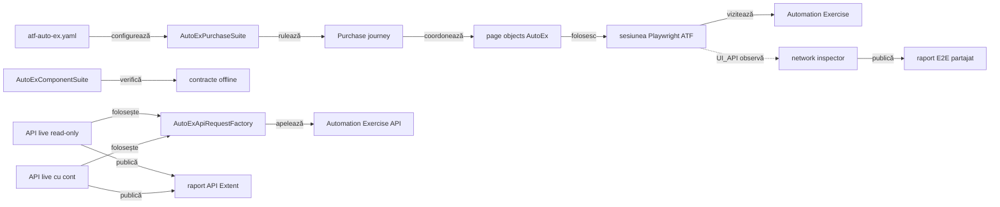
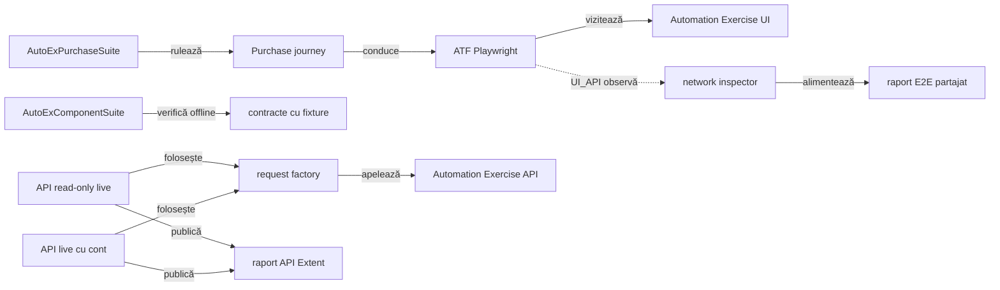

# ATF Automation Exercise — consumer UI E2E

`atf-test-auto-ex` verifică un journey de cumpărare pe site-ul public
[Automation Exercise](https://automationexercise.com/). Configurația, rutele,
selectorii, page objects și regulile business rămân specifice acestui consumer;
browserul și raportarea sunt furnizate de modulele ATF.

## Pe scurt

- Acest modul deține journey-ul E2E și suportul specific site-ului AutoEx.
- `atf-ui` deține execuția browserului; `atf-reporting` deține modelarea și
  publicarea evidence-ului.
- `@AtfUiEvidence(flow = UNIFIED_FLOW, screenshots = FINAL_ONLY)` produce o
  secvență unificată de acțiuni și o captură
  terminală; `Screen validation` include observația `Audit screen contract`,
  înregistrată înainte de drenarea secvenței. Aceasta declară separat numărul
  aserțiunilor și starea capturii, fără să devină acțiune Playwright sau sursă
  de verdict.



<details>
<summary><strong>Legendă — scope-ul consumerului</strong></summary>

AutoEx deține datele și interacțiunile site-ului. `UI_API` observă request-urile
produse de journey-ul din browser; suitele API live folosesc separat
`AutoExApiRequestFactory`, iar testele componente rămân offline. `atf-ui`
execută browserul și `atf-reporting` publică artifactele; niciunul nu primește
reguli business Automation Exercise.
</details>

## Boundary-ul AutoEx

| Zonă | Conținut specific acestui consumer |
|---|---|
| `src/main` | Configurația site-ului, catalogul de rute/selectori, page objects, purchase journey și cleanup-ul contului sintetic |
| `src/test` | Teste componente AutoEx, cele trei variante E2E, suite și adaptorul JUnit pentru configurație/evidence |
| Rulare | Site-ul public; E2E-ul este opt-in în Maven, iar rularea directă din IntelliJ este suportată |

Configurația implicită este [`atf-auto-ex.yaml`](src/test/resources/atf-auto-ex.yaml)
și aparține profilului de test, nu unei biblioteci publicate:

- `AutoExConfigurationLoader` o citește din classpath, cu fallback la fișierul
  modulului pentru lansările IDE;
- un YAML alternativ se selectează prin `-Datf.autoex.config=<path>`; căile
  relative se rezolvă față de working directory-ul procesului;
- URL-ul, browserul, timeout-urile, produsul demo, identitatea sintetică, plata
  demo și directorul raportului sunt configurate acolo;
- YAML-ul dezactivează E2E-ul implicit pentru rulările Maven obișnuite; extensia
  recunoaște markerul IntelliJ și îl poate activa chiar dacă `e2eEnabled: false`.
- `AutoExE2eActivationPolicy` deține precedența și motivul deciziei: proprietatea
  JVM explicită prevalează, urmată de YAML și apoi de heuristică IntelliJ.
- Proprietatea explicită `-Datf.autoex.e2e.enabled=false` oprește testul în orice
  runner; `AutoExE2eActivationPolicyComponentTest` probează sursele și override-ul.

Profilul conține numai date sintetice și date de plată demonstrative; nu introduce
în YAML date personale reale, parole sau instrumente de plată reale. Modelul
redactează câmpurile de înregistrare și plată din reprezentarea textuală.

- `AutoExPurchaseJourney` consumă portul `AutoExPurchaseSession` din `src/main`.
- `AutoExE2eRun` îl adaptează în `src/test` la browser, raport și lifecycle JUnit.
- Separarea păstrează suportul specific site-ului testabil, fără ca sursele de
  producție să depindă de runner sau de Test Kit.
- La teardown, inspectorul, finalizarea fazei, închiderea browserului și
  finalizarea scenariului sunt încercate independent.
- `FailureAwareCleanupTest` verifică ordinea și agregarea generică; deciziile
  locale AutoEx rămân în `AutoExE2eRun`, fără browser/report API în helper.

`AutoExE2eRun.finish` folosește `FailureAwareCleanup` pentru a încerca
independent publicarea network inspector-ului, închiderea fazei/scenariului și
închiderea browserului. O eroare de teardown nu împiedică pașii următori; cauza
inițială rămâne primară, iar eșecurile suplimentare sunt atașate ca `suppressed`.
`AutoExTeardownComponentTest` a fost păstrat ca probă a ordinii consumerului,
dar folosește acum primitiva comună din Test Kit; nu există un al doilea helper
de cleanup local.

`AutoExE2eInitialization` face rollback-ul inițializării cu factory-uri
injectabile. Contractul component verifică:

- eșec după fiecare handle dobândit: doar faza/scenariul disponibile sunt
  marcate FAIL, apoi browserul este închis;
- toate etapele de rollback sunt încercate; eroarea setup rămâne primară, iar
  eșecurile rollback sunt `suppressed`;
- nodurile Extent create intern înainte ca un factory să returneze handle-ul
  țin de atomicitatea contractului `atf-reporting`, nu de consumer.

**Decizie de boundary:** `AutoExPurchaseSession` rămâne în `src/main` ca API
intern al runtime-ului consumer, deoarece journey-ul de producție îl folosește.
Nu este API generic ATF; JUnit/evidence și lifecycle-ul browserului rămân în
`src/test`. Reevaluați decizia numai dacă se schimbă apelanții runtime sau dacă
testul de arhitectură nu mai confirmă acest ownership; orice extracție generică
trebuie demonstrată comportamental în ambii consumatori.

## Contractul testelor AutoEx

- `@AtfE2eTest` și `@AtfTestChannel(UI/UI_API)` clasifică cele trei teste după
  boundary și canal.
- Contractul comun `@AtfUiEvidence` din Test Kit declară separat forma flow-ului
  și politica de captură; adaptorul AutoEx îl mapează în profilul Reporting.
  Varianta final-only îl declară explicit, iar axele `CONFIGURED` păstrează
  profilul configurat. Declarația este direct pe clasa E2E; metadata nu pornește
  singură browserul sau lifecycle-ul.
- `@UiReportSubdirectory("auto-ex")` și `@AtfConsoleMessages(DETAILS)` păstrează
  output-ul și diagnosticul consumerului în locația/politica stabilite.
- `AutoExE2eExtension` compune sesiunea per test; `AutoExPurchaseSuite` rulează
  clasele secvențial și partajează raportul.

## Suite și variante de evidence

`AutoExPurchaseSuite` execută același journey în trei clase, cu un raport Extent
partajat:

| Clasă | Canal și evidence |
|---|---|
| `AutoExPurchaseUiE2eTest` | UI; checkpoint-uri și capturi conform profilului standard |
| `AutoExPurchaseUiApiE2eTest` | UI + observarea traficului first-party în aceeași sesiune de browser |
| `AutoExPurchaseUiFinalScreenshotE2eTest` | UI; o secvență consolidată de acțiuni și o singură captură terminală |

`AutoExComponentSuite` verifică local fără a deschide site-ul public:

Aplică [regula comună de ownership](../docs/ATF_Testing_Guide.md#owner-ul-testului-business-adaptor-sau-infrastructură);
punctele următoare descriu numai ce afirmă testele specifice Automation Exercise.

- selectează testele componente din `atf.ui.tests.autoex.component`;
- acestea acoperă decizii și adaptoare specifice consumerului;
- testele de catalog, contract API, cleanup de cont, răspunsuri și traffic window
  rămân aici chiar dacă folosesc fixture-uri, fiindcă afirmă reguli Automation
  Exercise, nu comportament generic ATF;
- `AutoExApiContractReportPublisherComponentTest` verifică adaptorul AutoEx:
  contractul `responseCode`/mesaj, titlul API și diagnosticarea eșecului JUnit.
  El nu este proprietarul formatării generice Extent; tabelul, disclosure-urile,
  redacția comună și lifecycle-ul rendererului se probează în
  [`atf-reporting-tests`](../atf-reporting-tests/README.md);
- directorul default și override-ul raportului API sunt specifice consumerului;
  validarea reutilizabilă a unui path relativ sub rădăcina proiectului, inclusiv
  prevenirea ieșirii prin traversal/reparse-point, aparține
  [`atf-test-kit`](../atf-test-kit/README.md#regula-de-promovare-a-testelor-reutilizabile);
- `AutoExEvidenceProfileComponentTest` verifică numai cum consumerul aplică
  adnotarea `@AtfUiEvidence` peste configurația lui. Test Kit deține declarația
  neutră și Reporting deține profilele/lifecycle-ul generic; nu se introduce o
  dependență Test Kit → Reporting pentru a elimina un adaptor al consumerului;
- ownership-ul cross-consumer este definit în [arhitectura ATF](../docs/ATF_Architecture.md)
  și în [ghidul de testare](../docs/ATF_Testing_Guide.md);
- limita de opt clase per pachet este definită în
  [bunele practici de cod](../docs/README_Atf_CodeBestPractices.md#coeziunea-pachetelor-pragul-de-opt-clase).
Contractele generice pentru browser și renderer sunt descrise în
[README-ul `atf-ui`](../atf-ui/README.md) și
[README-ul `atf-reporting`](../atf-reporting/README.md).

## Coeziunea suportului AutoEx

Codul din `src/main` este suport de producție specific site-ului, nu cod de
runner. Suportul este separat pe motive de schimbare, iar fiecare pachet rămâne
sub pragul comun de opt clase:

| Pachet | Responsabilitate |
|---|---|
| `support.journey` | coordonarea purchase-ului, trace și precondiția API read-only a catalogului |
| `support.account` | cont sintetic și cleanup |
| `support.catalog` | snapshot și aserțiuni de catalog |
| `support.browser` | consimțământ și tratarea vignette-ului |
| `api` | rute, request factory și cont API typed; folosit de probele API directe |

`AutoExConsumerArchitectureComponentTest` protejează boundary-ul source-set-ului
și compoziția entry-point-urilor; nu verifică inventory-ul exact al claselor de
producție. Inventarul este verificat separat de guvernanța whole-ATF, iar
`AutoExCatalogApiPrecondition` și proba sa sunt acum incluse în package-urile
owner corespunzătoare. Testele componente sunt împărțite pe subpachete tematice;
pragul de coeziune este regula ATF comună din
[bunele practici de cod](../docs/README_Atf_CodeBestPractices.md#coeziunea-pachetelor-pragul-de-opt-clase),
nu un număr de clase duplicat aici.

Rutele, payload-urile, browser handlers, trace-ul și purchase journey-ul rămân
specifice AutoEx. Primitivele comune se promovează numai după demonstrarea
aceluiași contract în consumatorii relevanți și păstrarea unui API neutru;
boundary-ul Test Kit este descris în [README-ul ownerului](../atf-test-kit/README.md)
și în [arhitectura ATF](../docs/ATF_Architecture.md).

## Journey-ul de cumpărare

Scenariul combină [Test Case 14 — Place Order: Register while Checkout](https://automationexercise.com/test_cases#collapse14)
cu [Test Case 24 — Download Invoice after purchase](https://automationexercise.com/test_cases#collapse24):

1. deschide magazinul și caută produsul configurat;
2. verifică produsul, prețul, disponibilitatea și cantitatea în detalii/coș;
3. înregistrează un cont sintetic în checkout și verifică adresele și comanda;
4. finalizează plata demo, verifică confirmarea și descarcă factura;
5. șterge contul sintetic și verifică starea terminală.

Valorile de catalog, identitate și plată sunt date demo din YAML; fiecare
execuție generează email și parolă unice. Cleanup-ul este armat înainte de
submit-ul înregistrării, iar o eroare de cleanup nu maschează cauza primară.
Capturile redactează câmpurile de formular.

Dialogul CMP este tratat prin interfața vizibilă, cu alegerea minimă pentru
scopurile opționale. Dacă apare vignette-ul Google, handler-ul consumerului
apasă controlul vizibil „Close” numai pe pagina vignette-ului; nu modifică DOM-ul
și nu folosește click forțat. Aceste interacțiuni rămân în trace-ul E2E.

## Rute și locatori ai site-ului

`AutoExRoutes` este catalogul rutelor Automation Exercise, iar
`AutoExSelectors` deține selectorii site-ului. Selectorii `href` se derivă din
rute; page objects consumă catalogul și nu construiesc CSS inline. Aceste valori
sunt contracte ale aplicației AutoEx, nu vocabular generic ATF.

Regulile comune pentru selectori CSS, compoziția prin `HtmlElement` și
`HtmlAttribute`, escaping și evitarea locatorilor fragili sunt documentate și
testate de [`atf-ui` — Convenții pentru locatori UI](../atf-ui/README.md#convenții-pentru-locatori-ui).
Testele AutoEx exercită selectorii pe markup-ul public real; nu duplică testele
generice cu DOM sintetic ale modulului owner.

## API direct și limita evidence-ului UI/API

Rutele publice sunt inventariate în [API List](https://automationexercise.com/api_list).
Varianta E2E `UI_API` rămâne un journey de browser: observă traficul produs de UI
în aceeași sesiune, nu execută direct `AutoExApiRequestFactory`. Diagrama
separă fluxul browserului, contractele componente offline și cele două porți
API live; ele nu sunt variante ale aceluiași test.



<details>
<summary><strong>Legendă — alegerea traseului API/UI</strong></summary>

- `UI_API` observă traficul pe care îl produce browserul și îl leagă de
  checkpoint-uri; nu apelează `AutoExApiRequestFactory`;
- `AutoExComponentSuite` verifică modele și adaptoare cu fixture-uri locale,
  fără serviciul public;
- `AutoExApiReadOnlyLiveSuite` trimite request-uri directe, inclusiv `POST`
  pentru căutare, dar nu creează și nu modifică un cont;
- `AutoExApiLiveSuite` este separat deoarece creează și actualizează un cont
  sintetic, apoi încearcă cleanup-ul;
- rapoartele UI și API au sesiuni și directoare distincte.

</details>

| Suprafață | Comportament verificat | Limită / efect |
|---|---|---|
| Model request | `AutoExApiRoute`, `AutoExApiRequestFactory` și `AutoExApiAccount` descriu rutele și request-urile typed; reprezentarea contului redactează datele sensibile | verifică forma request-ului, nu comportamentul serviciului live |
| Contract component | fixture-ul verifică metoda, ruta, query/form, răspuns JSON reprezentativ și exchange-ul raportat | offline; nu certifică serviciul public și nici schema lui completă |
| API live read-only | `AutoExApiReadOnlyLiveSuite`; `GET` products/brands și `POST` product search | cere `-Datf.autoex.api.readonly.live.enabled=true`; nu creează sau modifică conturi |
| API live cu cont | `AutoExApiLiveSuite`; contracte positive/negative și lifecycle-ul contului sintetic cu cleanup | cere `-Datf.autoex.api.live.enabled=true`; efect extern, opt-in |
| Raport API direct | `AutoExApiContractReportExtension` publică exchange-uri și assertions JSON; implicit `artifacts/reports/api/auto-ex`, override `atf.autoex.api.report-directory`; `@AtfReportPath` publică locația | publisher component verifică artifactul offline, dar nu substituie proba live |
| Traficul E2E `UI_API` | `AutoExCatalogApiPrecondition` publică precondiția catalogului înainte de baseline; `AutoExApiTrafficWindow` păstrează schimburile cauzale ulterioare | contractul verifică separat precondiția și traficul browserului; `0 exchanges` este valid când journey-ul nu emite request-uri first-party |

### Boundary-ul cauzal pentru `UI_API`

- `AutoExCatalogApiPrecondition` execută și publică o singură precondiție
  `GET /api/productsList` înainte să marcheze baseline-ul traficului browserului.
- Inspectorul agregă numai schimburile observate după baseline. Precondiția
  rămâne în checkpoint-ul ei `GIVEN`; nu este numărată din nou ca trafic UI/API
  cauzal.
- Un flow server-rendered poate produce zero request-uri API first-party după
  setup. Agregatul `0 exchanges` este valid și informativ, nu un motiv de eșec;
  testul nu trebuie să inventeze trafic sau să presupună că orice acțiune UI
  apelează API-ul.
- Când există schimburi cauzale, acestea rămân legate de fereastra și
  checkpoint-ul observat; căutarea UI navighează la `/products?search=...` și
  nu este confundată cu endpoint-ul direct `POST /api/searchProduct`.

Acest boundary este verificat de testele componente pentru baseline/fereastră
și de `AutoExPurchaseUiApiE2eTest`. Contractul API și decizia privind traficul
cauzal sunt descrise aici, în README-ul ownerului.

### Acoperirea celor 14 cazuri publicate în API List

`AutoExApiContractComponentTest` modelează offline cazurile de mai jos. Valorile
din coloana a treia sunt câmpul JSON `responseCode` publicat de API List, nu
statusul HTTP al transportului. Componenta verifică aceste două dimensiuni
separat și folosește corpuri fixture; tabelul nu este dovadă a serviciului live.

| Caz | Request / condiție | `responseCode` publicat | Efect / izolare |
|---|---|---:|---|
| API 1 | `GET /api/productsList` | 200 | read-only |
| API 2 | `POST /api/productsList` | 405 | metodă neacceptată |
| API 3 | `GET /api/brandsList` | 200 | read-only |
| API 4 | `PUT /api/brandsList` | 405 | metodă neacceptată |
| API 5 | `POST /api/searchProduct`, `search_product` prezent | 200 | căutare fără mutație |
| API 6 | `POST /api/searchProduct`, parametru lipsă | 400 | validare input |
| API 7 | `POST /api/verifyLogin`, credențiale valide | 200 | cont sintetic creat de test |
| API 8 | `POST /api/verifyLogin`, email lipsă | 400 | validare input |
| API 9 | `DELETE /api/verifyLogin` | 405 | metodă neacceptată |
| API 10 | `POST /api/verifyLogin`, credențiale invalide | 404 | folosește contul sintetic al testului |
| API 11 | `POST /api/createAccount` | 201 | creează un cont sintetic unic |
| API 12 | `DELETE /api/deleteAccount` | 200 | cleanup numai pentru contul testului |
| API 13 | `PUT /api/updateAccount` | 200 | actualizează numai contul testului |
| API 14 | `GET /api/getUserDetailByEmail` | 200 | citește identitatea sintetică a testului |

- API 11 armează cleanup-ul înaintea încercării de creare; API 7, 13 și 14
  folosesc aceeași identitate sintetică în suita live mutabilă.
- Testele componente nu creează conturi și nu accesează serviciul public.
- `responseCode` din API List este un rezultat JSON al aplicației, nu statusul
  HTTP. Suitele live asertează separat ambele valori.
- Serviciul observat a răspuns cu HTTP 200 și pentru rezultate precum
  `responseCode: 405` sau `201`. Este comportamentul probat în execuția curentă,
  nu o garanție permanentă; rerulează suitele live după schimbări upstream.
- `AutoExApiLiveContractTest` armează `AutoExApiAccountCleanup` înainte de
  încercarea de create; scope-ul încearcă ștergerea și la eșec. Proba componentă
  verifică nearmarea, cleanup-ul după failure și păstrarea cauzei inițiale când
  ștergerea eșuează; suita live confirmă cleanup-ul după succes.
- Păstrează `Content-Type` ca header de transport în evidence și validează body-ul
  JSON independent. Upstream-ul observat returnează uneori JSON valid cu
  `text/html; charset=utf-8`; nu impune `application/json` până când contractul
  public nu îl cere explicit.

Precondiția E2E citește `/api/productsList` și este publicată în checkpoint-ul
propriu. După acel checkpoint, journey-ul marchează baseline-ul; căutarea din
pagina UI folosește `/products?search=...`, nu endpoint-ul direct
`POST /api/searchProduct`. Astfel raportul nu amestecă setup-ul API cu traficul
cauzal al interacțiunilor browserului.

## Rulare

Din root-ul reactorului, testele componente offline:

```powershell
mvn -pl atf-test-auto-ex -am "-Dtest=AutoExComponentSuite" "-Dsurefire.failIfNoSpecifiedTests=false" test
```

Proba API live read-only este separată și nu creează conturi:

```powershell
mvn -pl atf-test-auto-ex -am "-Dtest=AutoExApiReadOnlyLiveSuite" "-Datf.autoex.api.readonly.live.enabled=true" "-Dsurefire.failIfNoSpecifiedTests=false" test
```

Contractele API live cu lifecycle de cont formează un gate distinct și explicit:

```powershell
mvn -pl atf-test-auto-ex -am "-Dtest=AutoExApiLiveSuite" "-Datf.autoex.api.live.enabled=true" "-Dsurefire.failIfNoSpecifiedTests=false" test
```

Ambele probe API folosesc configurarea `baseUrl` din `atf-auto-ex.yaml`; override-
urile opționale sunt `-Datf.autoex.api.base-url=<url>` și
`-Datf.autoex.api.timeout=PT20S`. Proprietățile lor de opt-in sunt independente
de `e2eEnabled`: read-only folosește
`atf.autoex.api.readonly.live.enabled`, iar proba cu cont folosește
`atf.autoex.api.live.enabled`. Numai a doua creează și șterge un cont sintetic
pe serviciul selectat.

Matricea E2E live, cu un singur raport pentru toate cele trei variante:

```powershell
mvn -pl atf-test-auto-ex -am "-Dtest=AutoExPurchaseSuite" "-Datf.autoex.e2e.enabled=true" "-Dsurefire.failIfNoSpecifiedTests=false" test
```

- În IntelliJ se poate rula direct `AutoExPurchaseSuite` sau o clasă E2E; markerul
  runner-ului activează implicit testul când proprietatea JVM lipsește, chiar
  dacă YAML-ul spune `e2eEnabled: false`. `-Datf.autoex.e2e.enabled=false` are
  precedență și îl dezactivează.
- În Maven, rularea obișnuită rămâne dezactivată de YAML-ul implicit. Opt-in-ul se
  face prin `e2eEnabled: true` sau `-Datf.autoex.e2e.enabled=true`; `false` explicit
  dezactivează în orice runner. Diagnosticul distinge YAML, proprietate JVM și
  detectarea IDE; markerul IDE nu este raportat ca opt-in explicit.
- Rapoartele sunt publicate sub `artifacts/reports/ui/auto-ex/`; execuția suitei
  partajează sesiunea de raportare și o finalizează la închiderea root-ului JUnit.
  Overview/System declară `Client = Playwright browser`; fallback-ul generic
  Reporting rămâne neutru pentru consumerii care nu furnizează acest context.

Contractele API și precondiția pentru `UI_API` sunt normate în acest README.
`AutoExPurchaseSession` rămâne boundary intern al runtime-ului consumer; nu
există un TODO activ de extracție generică; lifecycle-ul JUnit/evidence și
politica E2E rămân în adaptorul test-scoped.
