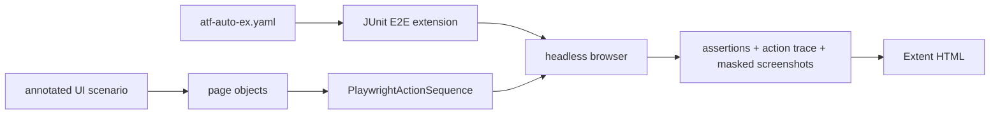

# ATF Automation Exercise — consumer UI E2E

`atf-test-auto-ex` este un consumer separat pentru site-ul gratuit
[Automation Exercise](https://automationexercise.com/). Nu depinde de
Practice Shop și nu mută configurație, pagini ori fixture-uri între cele două
aplicații.

## Boundary și adnotări

Modulul nu are cod de producție: întreaga compoziție rulează în
`src/test/java`, iar dependențele ATF sunt `test`-scope. Testul E2E folosește
direct contractele existente din `atf-test-kit`:

| Adnotare | Rol în modul |
|---|---|
| `@AtfE2eTest` | declară testul observabil la boundary-ul site-ului |
| `@AtfTestChannel(TestChannel.UI)` | declară că verdictul inițial este exclusiv UI |
| `@UiReportSubdirectory("auto-ex")` | publică Extent în subdirectorul consumerului |
| `@AtfConsoleMessages(DETAILS)` | selectează diagnosticul ATF pentru rularea directă |

Adnotările descriu natura și output-ul testului; `AutoExE2eExtension` este
adaptorul JUnit specific consumerului, care deschide browserul, raportul și
resursele per metodă. Nu introducem o adnotare AutoEx care să dubleze Test Kit.



Responsabilitățile sunt delimitate astfel:

- `config` deține URL-ul, politica browserului și datele demo configurabile;
- `locator` deține rutele și selectorii CSS ai site-ului;
- `page` deține acțiunile și citirea fiecărei pagini;
- `support` deține lifecycle-ul JUnit, sink bridge-ul și identitatea sintetică;
- `tests/autoex/e2e` conține numai scenariile lizibile și criteriile lor.

## Scenarii inițiale

1. Căutarea `Blue Top` confirmă pagina de rezultate, produsul și prețul.
2. Fluxul lung urmează [Test Case 14 — Place Order: Register while Checkout](https://automationexercise.com/test_cases#collapse14): caută produsul, verifică detaliul,
   setează cantitatea, confirmă coșul și totalul, creează un cont sintetic în
   checkout, verifică adresele și comanda, plasează o comandă demo, verifică
   factura descărcată conform [Test Case 24 — Download Invoice after purchase](https://automationexercise.com/test_cases#collapse24)
   și șterge contul temporar.

Ambele sunt `UI`: lista publică de API-uri documentează produse, căutare și
conturi, dar nu contracte de coș, comandă sau plată. Nu declarăm o verificare
`UI_API` până când nu există o corelare reală și probată între schimbul API și
același checkpoint UI.

Datele stau în [`atf-auto-ex.yaml`](src/test/resources/atf-auto-ex.yaml).
Fiecare rulare de cumpărare generează email și parolă unice, folosește exclusiv
date de profil sintetice și câmpurile demo ale formularului de plată; nu se
introduc date personale sau carduri reale. Contul se șterge la final, iar
extension-ul încearcă cleanup UI și la eșec după confirmarea creării contului.
Capturile din raport maschează câmpurile de formular.

Într-un browser fără consimțământ salvat, scenariul gestionează promptul vizibil
prin interfața CMP: deschide opțiunile, dezactivează scopurile opționale
preselectate și confirmă alegerea minimă. Pașii rămân în secvența Playwright din
raport; testul nu acceptă toate cookie-urile și nu ocolește overlay-ul.

Site-ul poate afișa și un Google vignette după navigarea între pagini. Boundary-ul
E2E îl închide numai prin controlul exact „Close” atunci când URL-ul indică
vignette-ul; clickul este păstrat în trace. Dacă un control vizibil nu există,
scenariul eșuează cu diagnostic explicit — nu dezactivează reclame, nu modifică
DOM-ul și nu folosește clickuri forțate. Componenta de tratare are teste locale
pentru control vizibil într-un frame, control absent și pagini fără vignette.

Rularea live este oprită implicit pentru a nu crea comenzi în timpul unui build
obișnuit. Raportul este generat per test în
`artifacts/reports/ui/auto-ex/`; numele include timestamp și identificator
unic. Nu se suprascrie un raport anterior.

## Rulare

Din root-ul reactorului:

```powershell
mvn -pl atf-test-auto-ex -am "-Dtest=AutoExConfigurationTest" "-Dsurefire.failIfNoSpecifiedTests=false" test
mvn -pl atf-test-auto-ex -am "-Dtest=AutoExPurchaseE2eTest" "-Datf.autoex.e2e.enabled=true" "-Dsurefire.failIfNoSpecifiedTests=false" test
```

Pentru IntelliJ, se rulează direct clasa sau metoda `AutoExPurchaseE2eTest` și
se adaugă VM option `-Datf.autoex.e2e.enabled=true`. Browserul rămâne headless;
raportul se află în subdirectorul `auto-ex` indiferent de working directory.
`atf.autoex.config` poate indica o configurație YAML alternativă; override-ul
`atf.autoex.e2e.enabled` permite activarea/dezactivarea fără editarea YAML-ului.

Pentru arhitectură și cerințele deschise, vezi [feedback-ul AutoEx](../docs/feedback/ATF_Automation_Exercise_Feedback.md).
