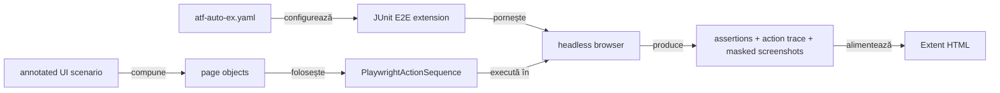

# ATF Automation Exercise — consumer UI E2E

`atf-test-auto-ex` este un consumer separat pentru site-ul gratuit
[Automation Exercise](https://automationexercise.com/). Nu depinde de
Practice Shop și nu mută configurație, pagini ori fixture-uri între cele două
aplicații.

## Pe scurt

- **Scop:** un consumer UI E2E opt-in pentru un flow de cumpărare demonstrabil.
- **Owner:** `atf-test-auto-ex`; platforma reutilizabilă rămâne în modulele ATF.
- **Limită:** nu este sursă de contract API și nu extinde matricea de variații din browser.

## Boundary și adnotări

Modulul nu are cod de producție: întreaga compoziție rulează în
`src/test/java`, iar dependențele ATF sunt `test`-scope. Testul E2E folosește
direct contractele existente din `atf-test-kit`:

| Adnotare | Rol în modul |
|---|---|
| `@AtfE2eTest` | declară testul observabil la boundary-ul site-ului |
| `@AtfTestChannel(TestChannel.UI)` | declară că verdictul inițial este exclusiv UI |
| `@UiReportSubdirectory("auto-ex")` | publică Extent în subdirectorul consumerului |
| `@AtfConsoleMessages(DETAILS)` | selectează diagnosticul ATF pentru rularea directă |

Adnotările descriu natura și output-ul testului; `AutoExE2eExtension` este
adaptorul JUnit specific consumerului, care deschide browserul, raportul și
resursele per metodă. Nu introducem o adnotare AutoEx care să dubleze Test Kit.



<details>
<summary><strong>Legendă — boundary-ul consumerului AutoEx</strong></summary>

Configurația și extensia guvernează execuția; page objects și acțiunile dețin
interacțiunea; browserul produce evidence, iar Extent o publică. Contractele
generice nu se copiază în acest modul.
</details>

Responsabilitățile sunt delimitate astfel:

- `config` deține URL-ul, politica browserului și datele demo configurabile;
- `locator` deține rutele și selectorii CSS ai site-ului;
- `page` deține acțiunile și citirea fiecărei pagini;
- `support` deține lifecycle-ul JUnit, sink bridge-ul și identitatea sintetică;
- `tests/autoex/e2e` conține exclusiv scenarii de business executate pe site-ul public.

## Politica de testare și reutilizare

Acest consumer verifică business-ul Automation Exercise prin E2E-uri reale.
Nu adăugăm aici teste cu HTML/iframe inventat sau teste unitare ale helperelor,
configurării ori ale adnotărilor ATF: acestea nu dovedesc comportamentul
magazinului. Dacă o regulă este generică, testul ei aparține modulului ATF care
o deține; dacă este specifică site-ului, o verifică scenariul E2E real.

| Capacitate | Owner | Folosire aici |
|---|---|---|
| Clasificarea E2E/canalului, browser Playwright, secvența de acțiuni, capturile, sesiunea Extent și output-ul raportului | ATF (`atf-test-kit`, `atf-ui`, `atf-reporting`) | Folosim direct contractele existente; nu le clonăm în consumer. |
| Conturi locale, jurnal API/network, profiluri de setup și raport partajat pe suite | Practice Shop | Rămân specifice Shop; AutoEx nu le importă și nu le copiază. |
| Acțiunile pentru pagini, CMP și vignette | Acest consumer | Sunt adaptoare pentru interfața publică reală și sunt exercitate numai din E2E. |

Practice Shop și AutoEx au compoziții JUnit/report diferite: Shop suportă
setup-uri și suite API/UI partajate, AutoEx publică o sesiune UI per test.
Lifecycle-ul comun este un candidat de platformă numai dacă se definește un
contract folosit de ambii consumatori fără configurație, locator sau model de
business al vreunuia. Nu mutăm `ShopE2eTestSupport` ca întreg și nu introducem o
abstracție generică doar pentru a elimina câteva apeluri locale.

Modulul are, intenționat, numai clasa de teste E2E pentru business. Configurația
YAML este consumată de acele scenarii, iar politica ATF/IntelliJ este infrastructură;
nu sunt suite de componentă separate în consumer.

## Scenariul business

Modulul are un singur flow E2E complet, inspirat din
[Test Case 14 — Place Order: Register while Checkout](https://automationexercise.com/test_cases#collapse14)
și extins cu factura din
[Test Case 24 — Download Invoice after purchase](https://automationexercise.com/test_cases#collapse24).
În aceeași călătorie verifică disponibilitatea magazinului, căutarea și ruta
produsului, detaliul/prețul/stocul, cantitatea, totalul coșului, înregistrarea
în checkout, adresele, plata demo, confirmarea, factura descărcată și ștergerea
contului temporar. Nu există un E2E separat pentru căutare: ar repeta primele
asserții ale flow-ului complet fără un rezultat business suplimentar.

Validarea rezultatului folosește markup-ul public curent (`data-qa="order-placed"`
și mesajul de confirmare din `#form`); label-ul din pagina de test case poate fi
mai vechi decât textul randat efectiv. Factura este găsită prin ruta ei publică,
nu printr-un `data-qa` absent în markup.

Scenariul este declarat `UI`.

- API-urile publice documentează produse, căutare și conturi.
- Coșul, comanda și plata nu au încă o corelare API probată cu același checkpoint UI.
- `UI_API` rămâne dezactivat până când această trasabilitate este demonstrată.

Datele stau în [`atf-auto-ex.yaml`](src/test/resources/atf-auto-ex.yaml).

- Fiecare rulare de cumpărare generează email și parolă unice.
- Formularul folosește numai câmpuri demo; nu se introduc date personale sau carduri reale.
- Contul se șterge la final, inclusiv prin cleanup UI după un eșec ulterior.
- Capturile din raport maschează câmpurile de formular.

Într-un browser fără consimțământ salvat, scenariul gestionează promptul vizibil
prin interfața CMP: deschide opțiunile, dezactivează scopurile opționale
preselectate și confirmă alegerea minimă. Pașii rămân în secvența Playwright din
raport; testul nu acceptă toate cookie-urile și nu ocolește overlay-ul.

Site-ul poate afișa un Google vignette după navigare; acesta este zgomot de mediu,
nu comportament de business.

- Handler-ul apasă exact „Close” numai când URL-ul indică vignette-ul.
- Clickul rămâne în trace; DOM-ul nu este modificat și nu se folosesc clickuri forțate.
- Lipsa controlului vizibil produce diagnostic explicit.
- Handler-ul este folosit numai de E2E-ul live; nu construim un iframe artificial
  ca să-l declarăm acoperire a site-ului.

Rularea live este oprită implicit pentru a nu crea comenzi în timpul unui build
obișnuit. Raportul este generat per test în
`artifacts/reports/ui/auto-ex/`; numele include timestamp și identificator
unic. Nu se suprascrie un raport anterior.

## Rulare

Din root-ul reactorului:

```powershell
mvn -pl atf-test-auto-ex -am "-Dtest=AutoExPurchaseE2eTest" "-Datf.autoex.e2e.enabled=true" "-Dsurefire.failIfNoSpecifiedTests=false" test
```

În IntelliJ se rulează direct clasa sau metoda `AutoExPurchaseE2eTest`; runner-ul
IDE activează E2E-ul fără VM option suplimentar. Maven rămâne opt-in pentru a nu
trimite comenzi externe la un build obișnuit. Browserul este headless, iar
raportul se află în subdirectorul `auto-ex` indiferent de working directory.
`atf.autoex.config` poate indica o configurație YAML alternativă;
`-Datf.autoex.e2e.enabled=false` dezactivează explicit și o rulare din IDE.

Pentru arhitectură și cerințele deschise, vezi [feedback-ul AutoEx](../docs/feedback/ATF_Automation_Exercise_Feedback.md).
