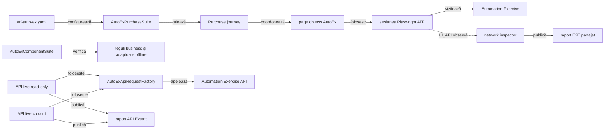
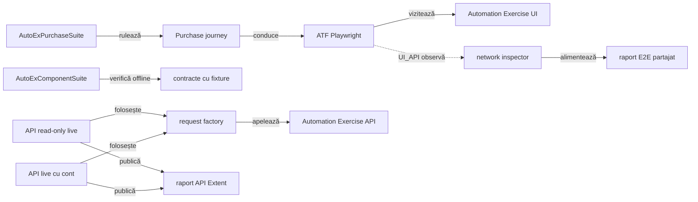

# ATF Automation Exercise — consumer UI E2E

`atf-test-auto-ex` verifică un journey de cumpărare pe site-ul public
[Automation Exercise](https://automationexercise.com/). Configurația, rutele,
selectorii, page objects și regulile business rămân specifice acestui consumer;
browserul și raportarea sunt furnizate de modulele ATF.

## Pe scurt

- Acest modul deține journey-ul E2E și suportul specific site-ului AutoEx.
- Gate-ul uzual selectează direct `AutoExPurchaseUiE2eTest` și execută cumpărarea o singură dată.
  Profilele de evidence sunt opțiuni de execuție ale aceluiași business, nu
  obiective suplimentare de acoperire.
- `atf-ui` deține execuția browserului; `atf-reporting` deține modelarea și
  publicarea evidence-ului.
- `@AtfUiEvidence(flow = UNIFIED_FLOW, screenshots = FINAL_AND_FAILURE)` produce o
  secvență unificată de acțiuni și o captură
  terminală la succes și captură la failure; `Screen validation` include observația `Audit screen contract`,
  înregistrată înainte de drenarea secvenței. Aceasta declară separat numărul
  aserțiunilor și starea capturii, fără să devină acțiune Playwright sau sursă
  de verdict.



<details>
<summary><strong>Legendă — scope-ul consumerului</strong></summary>

AutoEx deține datele și interacțiunile site-ului. `UI_API` observă request-urile
produse de journey-ul din browser; suitele API live folosesc separat
`AutoExApiRequestFactory`, iar testele componente rămân offline. `atf-ui`
execută browserul și `atf-reporting` publică artifactele; niciunul nu primește
reguli business Automation Exercise.
</details>

## Boundary-ul AutoEx

| Zonă | Conținut specific acestui consumer |
|---|---|
| `src/main` | Configurația site-ului, catalogul de rute/selectori, page objects, purchase journey și cleanup-ul contului sintetic |
| `src/test` | Gate business E2E, selecții manuale de evidence, contracte componente AutoEx și adaptorul JUnit |
| Rulare | Site-ul public; E2E-ul este opt-in în Maven, iar rularea directă din IntelliJ este suportată |

Configurația implicită este [`atf-auto-ex.yaml`](src/test/resources/atf-auto-ex.yaml)
și aparține profilului de test, nu unei biblioteci publicate:

- `AutoExConfigurationLoader` o citește din classpath, cu fallback la fișierul
  modulului pentru lansările IDE;
- un YAML alternativ se selectează prin `-Datf.autoex.config=<path>`; căile
  relative se rezolvă față de working directory-ul procesului;
- URL-ul, browserul, timeout-urile, produsul demo, identitatea sintetică, plata
  demo și directorul raportului sunt configurate acolo;
- YAML-ul dezactivează E2E-ul implicit pentru rulările Maven obișnuite; extensia
  recunoaște markerul IntelliJ și îl poate activa chiar dacă `e2eEnabled: false`.
- `AutoExE2eExtension` extrage semnalele specifice AutoEx (proprietate JVM,
  `e2eEnabled` din YAML și marker IntelliJ) și le transmite resolverului neutru
  `AtfE2eActivationPolicy` din `atf-test-kit`.
- Precedența comună este override JVM explicit → opt-in configurat → fallback
  IDE → dezactivat; `false` explicit oprește testul în orice runner, iar valorile
  invalide eșuează închis. Test Kit probează politica, iar guvernanța whole-ATF
  protejează wiring-ul consumatorilor.

Profilul conține numai date sintetice și date de plată demonstrative; nu introduce
în YAML date personale reale, parole sau instrumente de plată reale. Modelul
redactează câmpurile de înregistrare și plată din reprezentarea textuală.

- `AutoExPurchaseJourney` consumă portul `AutoExPurchaseSession` din `src/main`.
- `AutoExE2eRun` îl adaptează în `src/test` la browser, raport și lifecycle JUnit.
- `AutoExConsoleBridge` transmite câmpurile Reporting fabricii neutre
  `AtfConsoleEvent.fromExternalEnums(...)` din Core; Console rămâne independent
  de Reporting, iar compatibilitatea lor este probată în Reporting Tests.
- Separarea păstrează suportul specific site-ului testabil, fără ca sursele de
  producție să depindă de runner sau de Test Kit.
- La eșec, inspectorul și captura `Failure evidence` sunt publicate cât pagina
  Playwright este încă disponibilă; browserul se închide apoi, iar faza și
  scenariul se finalizează independent.
- `FailureAwareCleanupTest` verifică ordinea generică a capturii, cleanup-ului,
  diagnosticului și close-ului; `AutoExE2eRun` furnizează numai callback-urile
  business/UI ale consumerului.

- Dacă testul a eșuat înainte de teardown, `AutoExE2eRun.finish` capturează
  viewport-ul și redactează câmpurile sensibile înainte ca cleanup-ul contului
  să poată naviga pagina.
- Apoi rulează cleanup-ul și publică inspectorul de rețea. Dacă primul eșec apare
  chiar în teardown, captura se face după diagnostic și înainte de browser close.
- Faza și scenariul se finalizează independent; cauza inițială rămâne primară, iar
  erorile ulterioare sunt atașate ca `suppressed`.
- `FailureEvidenceCleanup` din Test Kit deține orchestrarea generică. Testele
  componente AutoEx verifică profilul și wiring-ul adaptorului, fără să dubleze
  primitivele generice.

`AutoExE2eRun` folosește `TestRunInitialization` din Test Kit pentru achiziția
cu factory-uri injectabile. Ownerul generic și `TestRunInitializationTest`
garantează ordinea și păstrarea cauzei; AutoEx furnizează callback-urile:

- eșec după fiecare handle dobândit: doar faza/scenariul disponibile sunt
  marcate FAIL, apoi browserul este închis;
- toate etapele de rollback sunt încercate; eroarea setup rămâne primară, iar
  eșecurile rollback sunt `suppressed`;
- nodurile Extent create intern înainte ca un factory să returneze handle-ul
  țin de atomicitatea contractului `atf-reporting`, nu de consumer.

**Decizie de boundary:** `AutoExPurchaseSession` rămâne în `src/main` ca API
intern al runtime-ului consumer, deoarece journey-ul de producție îl folosește.
Nu este API generic ATF; JUnit/evidence și lifecycle-ul browserului rămân în
`src/test`. Reevaluați decizia numai dacă se schimbă apelanții runtime sau dacă
testul de arhitectură nu mai confirmă acest ownership; orice extracție generică
trebuie demonstrată comportamental în ambii consumatori.

## Contractul testelor AutoEx

- `@AtfE2eTest` și `@AtfTestChannel(UI/UI_API)` clasifică cele trei teste după
  boundary și canal; varianta UI este selecția uzuală de business.
- Contractul comun `@AtfUiEvidence` din Test Kit declară separat forma flow-ului
  și politica de captură; adaptorul AutoEx îl mapează în profilul Reporting.
  Varianta cu o captură la succes folosește `FINAL_AND_FAILURE`: nu adaugă
  capturi la checkpoint-uri, dar păstrează captura terminală și una la failure.
  Axele `CONFIGURED` păstrează
  profilul configurat. Declarația este direct pe clasa E2E; metadata nu pornește
  singură browserul sau lifecycle-ul.
- `@UiReportSubdirectory("auto-ex")` și `@AtfConsoleMessages(DETAILS)` păstrează
  output-ul și diagnosticul consumerului în locația/politica stabilite.
- `AutoExE2eExtension` compune sesiunea per test; `AutoExPurchaseSuite` rulează
  clasele secvențial și partajează raportul.

## Suite și variante de evidence

Rularea uzuală selectează `AutoExPurchaseUiE2eTest`: un cont, o comandă demo,
o factură și cleanup.

Celelalte clase se aleg explicit din IntelliJ sau prin `-Dtest=<clasă>` atunci
când este necesară altă politică de evidence:

| Clasă | Canal și evidence | Contribuție |
|---|---|---|
| `AutoExPurchaseUiE2eTest` | UI; checkpoint-uri și capturi standard | journey business pe UI |
| `AutoExPurchaseUiApiE2eTest` | UI + trafic first-party observat | precondiție API de catalog și integrarea traficului cu journey-ul real |
| `AutoExPurchaseUiFinalScreenshotE2eTest` | UI; flow consolidat, captură finală și la failure | profil de evidence pentru același journey UI |

- Varianta final-screenshot nu adaugă altă regulă business; reducerea repetării
  live cere proba locală a adnotării până la publicare.
- Clasa este folosită de `AutoExEvidenceProfileComponentTest`, iar selecția
  suitei este protejată de guvernanță; criteriile sunt în
  [feedback-ul profilelor E2E](../docs/feedback/ATF_Consumer_Business_Test_Focus_Feedback.md#consumer-e2e-profiles-01--variantele-de-evidence-și-acoperirea-business).

Aceste trei selecții consumă aceeași implementare `AutoExPurchaseJourney`.
Nu se rulează toate pentru a demonstra mai mult business și nu se adaugă o
variantă de purchase pentru fiecare combinație de captură sau layout. Testele
formatării, navigării și redării raportului aparțin `atf-reporting-tests`.

`AutoExPurchaseSuite` păstrează matricea explicită cu toate cele trei profile,
protejată de guvernanța existentă. Se lansează numai când se dorește acea
matrice; rularea normală de business folosește clasa UI direct.

`AutoExComponentSuite` verifică local fără a deschide site-ul public:

Aplică [regula comună de ownership](../docs/ATF_Testing_Guide.md#owner-ul-testului-business-adaptor-sau-infrastructură);
punctele următoare descriu numai ce afirmă testele specifice Automation Exercise.

- selectează testele componente din `atf.ui.tests.autoex.component`;
- acestea acoperă decizii și adaptoare specifice consumerului;
- testele de catalog, contract API, cleanup de cont, răspunsuri și traffic window
  rămân aici chiar dacă folosesc fixture-uri, fiindcă afirmă reguli Automation
  Exercise, nu comportament generic ATF;
- `AutoExApiContractReportPublisherComponentTest` verifică adaptorul AutoEx:
  contractul `responseCode`/mesaj, titlul API și diagnosticarea eșecului JUnit.
  Cazurile negative resping JSON invalid, cod/mesaj diferit și HTTP nereușit
  chiar când body-ul declară succes; DTO-ul păstrează form-encoding și MIME-ul
  upstream. Artifactele Extent și fallback sunt verificate pentru lipsa parolei,
  iar formatarea și redactarea comune se probează în
  [`atf-reporting-tests`](../atf-reporting-tests/README.md);
- replay-ul form-encoded fără adaptor este probat prin
  `ApiManualReplayProjectionTest` în Reporting Tests; aici rămâne verificarea
  că artifactul efectiv AutoEx nu expune parola;
- directorul default și override-ul raportului API sunt specifice consumerului;
  validarea reutilizabilă a unui path relativ sub rădăcina proiectului, inclusiv
  prevenirea ieșirii prin traversal/reparse-point, aparține
  [`atf-test-kit`](../atf-test-kit/README.md#regula-de-promovare-a-testelor-reutilizabile);
- `AutoExEvidenceProfileComponentTest` verifică numai cum consumerul aplică
  adnotarea `@AtfUiEvidence` peste configurația lui. Test Kit deține declarația
  neutră și Reporting deține profilele/lifecycle-ul generic; nu se introduce o
  dependență Test Kit → Reporting pentru a elimina un adaptor al consumerului;
- factory-urile și rollback-ul neutru sunt implementate și probate în Test Kit;
  AutoEx păstrează alegerea browserului, crearea scenariului și marcarea FAIL.
  Guvernanța verifică folosirea primitivei comune și absența copiei locale;
- ownership-ul cross-consumer este definit în [arhitectura ATF](../docs/ATF_Architecture.md)
  și în [ghidul de testare](../docs/ATF_Testing_Guide.md);
- limita de opt clase per pachet este definită în
  [bunele practici de cod](../docs/README_Atf_CodeBestPractices.md#coeziunea-pachetelor-pragul-de-opt-clase).
Contractele generice pentru browser și renderer sunt descrise în
[README-ul `atf-ui`](../atf-ui/README.md) și
[README-ul `atf-reporting`](../atf-reporting/README.md).

## Coeziunea suportului AutoEx

Codul din `src/main` este suport de producție specific site-ului, nu cod de
runner. Suportul este separat pe motive de schimbare, iar fiecare pachet rămâne
sub pragul comun de opt clase:

| Pachet | Responsabilitate |
|---|---|
| `support.journey` | coordonarea purchase-ului, trace și precondiția API read-only a catalogului |
| `support.account` | cont sintetic și cleanup |
| `support.catalog` | snapshot și aserțiuni de catalog |
| `support.checkout` | date observate și reguli business pentru adresă, rândul comenzii și factură |
| `support.browser` | consimțământ și tratarea vignette-ului |
| `api` | rute, request factory și cont API typed; folosit de probele API directe |

`ConsumerModuleArchitectureGovernanceTest` din `atf-tests` protejează boundary-ul
source-set-ului și compoziția entry-point-urilor Shop/AutoEx; nu verifică
inventory-ul exact al claselor de producție. Inventarul este verificat separat
de guvernanța whole-ATF, iar
`AutoExCatalogApiPrecondition` și proba sa sunt acum incluse în package-urile
owner corespunzătoare. Testele componente sunt împărțite pe subpachete tematice;
pragul de coeziune este regula ATF comună din
[bunele practici de cod](../docs/README_Atf_CodeBestPractices.md#coeziunea-pachetelor-pragul-de-opt-clase),
nu un număr de clase duplicat aici.

Rutele, payload-urile, browser handlers, trace-ul și purchase journey-ul rămân
specifice AutoEx. Primitivele comune se promovează numai după demonstrarea
aceluiași contract în consumatorii relevanți și păstrarea unui API neutru;
boundary-ul Test Kit este descris în [README-ul ownerului](../atf-test-kit/README.md)
și în [arhitectura ATF](../docs/ATF_Architecture.md).

## Journey-ul de cumpărare

Scenariul combină [Test Case 14 — Place Order: Register while Checkout](https://automationexercise.com/test_cases#collapse14)
cu [Test Case 24 — Download Invoice after purchase](https://automationexercise.com/test_cases#collapse24):

1. deschide magazinul și caută produsul configurat;
2. verifică produsul, prețul, disponibilitatea și cantitatea în detalii/coș;
3. înregistrează un cont sintetic în checkout și verifică adresele și comanda;
4. finalizează plata demo, verifică confirmarea și descarcă factura;
5. șterge contul sintetic și verifică starea terminală.

`CheckoutPage.downloadInvoice()` citește acum fișierul descărcat;
`AutoExInvoiceAssertions` verifică numele `invoice.txt`, clientul și suma față
de comanda configurată. Probe pozitive și negative sunt în
`AutoExPurchaseBusinessComponentTest`; journey-ul UI exercită aceleași reguli
pe comanda și factura obținute de la magazinul public.

| Etapă | Așteptare business | Sursa așteptării |
|---|---|---|
| Căutare și produs | identitate, preț exact și disponibilitate | catalogul YAML |
| Coș | produs, preț unitar, cantitate și total de linie | catalog + calculul cantității |
| Checkout | destinatar, companie, ambele linii de adresă, localitate/stat/cod poștal, țară și telefon, în ambele adrese | profilul de înregistrare YAML |
| Review order | aceeași linie din coș și totalul general | catalog + totalul calculat |
| Plată demo | formular și confirmarea comenzii | contractul UI al site-ului |
| Factură | fișier descărcat, clientul și suma acestei comenzi | identitatea și totalul curente |
| Cleanup | cont șters și revenire la magazin | identitatea creată în această execuție |

`AutoExCheckoutAssertions` compară liniile adreselor după normalizarea
spațiilor de prezentare și folosește aceeași regulă pentru rândul din coș și
checkout. Un nume corect nu poate ascunde un cod poștal, telefon, preț sau
cantitate greșite.

`AutoExInvoiceAssertions` verifică textul facturii; un fișier
existent, dar gol ori al altei comenzi, produce FAIL. Aceste reguli sunt probate
cu date business pozitive și negative în `AutoExPurchaseBusinessComponentTest`.

- Catalogul, identitatea și plata folosesc valori demo din YAML; emailul și
  parola sunt unice pentru fiecare execuție.
- Cleanup-ul contului este armat înainte de submit-ul înregistrării, iar o eroare
  de cleanup nu maschează cauza primară.
- Capturile redactează câmpurile de formular. Valoarea returnată de `Get text`
  este folosită numai în aserțiunea din memorie; recorderul `atf-ui` păstrează
  `[REDACTED]` în raport și trace, fără să împiedice validarea textului real.

- Înainte de citirea fiecărei adrese, `AccountPage` așteaptă numele sintetic
  configurat în containerul de delivery, respectiv invoice.
- Journey-ul validează apoi adresa completă și order review-ul folosind
  condiția semantică `waitForText`, nu un `sleep` fix.
- `AutoExCheckoutAddressComponentTest` verifică ordinea așteptare → citire pentru
  ambii locatori; acțiunea generică rămâne deținută de `atf-ui`.

- Dialogul CMP este tratat prin interfața vizibilă, cu alegerea minimă pentru
  scopurile opționale.
- Dacă apare vignette-ul Google, handler-ul consumerului apasă controlul vizibil
  „Close” și așteaptă dispariția fragmentului vignette din URL.
- Handler-ul nu modifică DOM-ul și nu folosește click forțat; interacțiunile rămân
  în trace-ul E2E.
- În cleanup, o pagină rămasă pe `#google_vignette` este înlocuită prin navigare
  explicită la magazin înaintea ștergerii contului. Navigarea este înregistrată
  de ATF și nu reexecută plata; failure evidence este capturat înainte de
  recuperare și verdictul inițial rămâne FAIL.

### Contul creat și cleanup-ul sub vignette

| Situație observată | Comportament | Limită de siguranță |
|---|---|---|
| Crearea este confirmată | `AccountPage` reține confirmarea înaintea checkpoint-ului și a navigării Continue | schimbarea paginii nu transformă contul creat într-un cleanup `NO_OP` |
| Submit-ul creării este întrerupt | păstrează și faptul că încercarea a început; dacă documentul magazinului s-a pierdut, îl redeschide și încearcă login-ul identității curente | nu presupune că lipsa confirmării înseamnă cont inexistent; eșecul rămâne primar |
| Cleanup începe sau este întrerupt pe vignette | navighează la Home și publică triggerul și destinația observate | cel mult o reluare după o întrerupere nouă; fără DOM injectat, hash fabricat sau retry de plată |
| Clientul este delogat | reautentifică numai contul sintetic deja confirmat | numele din header trebuie să coincidă exact cu identitatea rulării înainte de Delete account |
| Ștergerea este confirmată | dezarmează imediat callback-ul, înaintea capturii și a Continue | o eroare ulterioară nu repetă ștergerea unui cont deja eliminat |

Ordinea generică a capturii, conservarea cauzei primare și a erorilor
`suppressed` sunt probate în Test Kit. Proba integrată negativă cu reclama
reală a confirmat recuperarea și ștergerea contului, păstrând eroarea inițială;
închiderea vignette-ului în fluxul nominal rămâne
[deschisă](../docs/feedback/ATF_Automation_Exercise_Feedback.md).

## Coș și continuitatea sesiunii

`AutoExCartUiE2eTest` delegă două povești independente către `AutoExCartJourney`.
Fiecare metodă primește o sesiune de browser izolată prin aceeași extensie ATF.

| Poveste | Interacțiuni business | Rezultat verificat |
|---|---|---|
| Recalculare și eliminare | adaugă o unitate, apoi cantitatea configurată a aceluiași produs, apoi elimină rândul | preț unitar, cantitate cumulată, total calculat și mesajul coșului gol |
| Guest cart după login | creează un cont sintetic, face logout, adaugă produsul ca guest și se autentifică din nou | aceeași identitate și aceeași linie de coș înainte/după login; apoi ștergere explicită |

- Cantitate: site-ul nu permite editarea directă în rând; testul adaugă din nou
  același produs, fără mutații DOM sau endpoint inventat.
- Așteptări: `Catalog.withQuantity(...)` calculează totalul; rezultatul
  căutării este așteptat înainte de deschiderea produsului.
- Coș gol: se citește `#empty_cart` vizibil, nu elementul omonim ascuns.
- Vignette: AutoEx folosește `zoomPercent: 100` pentru geometria nativă a
  iframe-ului; click-ul standard Close este probat pe reclama reală. Zoom CSS
  70% și focus + Enter nu au demonstrat aceeași interacțiune. Contractul
  generic de geometrie aparține [ATF UI](../atf-ui/README.md).
- Ownership: `support.cart` deține journey-urile, `support.trace` propozițiile
  Gherkin și portul `AutoExTraceStep`; purchase rămâne separat, iar Reporting
  acceptă ambele vocabulare.

## Rute și locatori ai site-ului

`AutoExRoutes` este catalogul rutelor Automation Exercise, iar
`AutoExSelectors` deține selectorii site-ului. Selectorii `href` se derivă din
rute; page objects consumă catalogul și nu construiesc CSS inline. Aceste valori
sunt contracte ale aplicației AutoEx, nu vocabular generic ATF.

Regulile comune pentru selectori CSS, compoziția prin `HtmlElement` și
`HtmlAttribute`, escaping și evitarea locatorilor fragili sunt documentate și
testate de [`atf-ui` — Convenții pentru locatori UI](../atf-ui/README.md#convenții-pentru-locatori-ui).
Testele AutoEx exercită selectorii pe markup-ul public real; nu duplică testele
generice cu DOM sintetic ale modulului owner.

### Reutilizare după analiza Practice Shop

| Capabilitate deja comună | Owner reutilizat de AutoEx | Date care rămân locale |
|---|---|---|
| Clasificare, activare E2E, output, consolă și evidence | `atf-test-kit`: adnotări și `AtfE2eActivationPolicy` | YAML-ul site-ului și semnalele runnerului |
| Cleanup și conservarea cauzei inițiale | `FailureAwareCleanup`, `FailureEvidenceCleanup` | identificarea și ștergerea contului AutoEx |
| Browser, acțiuni, captură și redactare | `atf-ui` | rute, selectori, CMP și vignette AutoEx |
| Profil per scenariu, assertions și network inspector | `atf-reporting` | așteptările checkout-ului și asocierea observațiilor la pași |

Nu există dependență AutoEx → Practice Shop. Validatoarele de ecran și jurnalul
Shop includ selectorii, identitatea și contractul API Shop; mutarea lor integrală
în infrastructură ar transfera business-ul. O extracție nouă trebuie să aibă un
API neutru și același comportament probat în consumatorii relevanți.

În acest
increment se refolosesc primitivele comune existente; regulile de adresă,
comandă și factură rămân în `support.checkout` AutoEx.

## API direct și limita evidence-ului UI/API

Rutele publice sunt inventariate în [API List](https://automationexercise.com/api_list).
Varianta E2E `UI_API` rămâne un journey de browser: observă traficul produs de UI
în aceeași sesiune, nu execută direct `AutoExApiRequestFactory`. Diagrama
separă fluxul browserului, contractele componente offline și cele două porți
API live; ele nu sunt variante ale aceluiași test.



<details>
<summary><strong>Legendă — alegerea traseului API/UI</strong></summary>

- `UI_API` observă traficul pe care îl produce browserul și îl leagă de
  checkpoint-uri; nu apelează `AutoExApiRequestFactory`;
- `AutoExComponentSuite` verifică modele și adaptoare cu fixture-uri locale,
  fără serviciul public;
- `AutoExApiReadOnlyLiveSuite` trimite request-uri directe, inclusiv `POST`
  pentru căutare, dar nu creează și nu modifică un cont;
- `AutoExApiLiveSuite` este separat deoarece creează și actualizează un cont
  sintetic, apoi încearcă cleanup-ul;
- rapoartele UI și API au sesiuni și directoare distincte.

</details>

| Suprafață | Comportament verificat | Limită / efect |
|---|---|---|
| Model request | `AutoExApiRoute`, `AutoExApiRequestFactory` și `AutoExApiAccount` descriu rutele și request-urile typed; reprezentarea contului redactează datele sensibile | verifică forma request-ului, nu comportamentul serviciului live |
| Contract component | fixture-ul verifică metoda, ruta, query/form, răspuns JSON reprezentativ și exchange-ul raportat | offline; nu certifică serviciul public și nici schema lui completă |
| API live read-only | `AutoExApiReadOnlyLiveSuite`; `GET` products/brands și `POST` product search | cere `-Datf.autoex.api.readonly.live.enabled=true`; nu creează sau modifică conturi |
| API live cu cont | `AutoExApiLiveSuite`; contracte positive/negative și lifecycle-ul contului sintetic cu cleanup | cere `-Datf.autoex.api.live.enabled=true`; efect extern, opt-in |
| Raport API direct | `AutoExApiContractReportExtension` publică exchange-uri și assertions JSON; implicit `artifacts/reports/api/auto-ex`, override `atf.autoex.api.report-directory`; `@AtfReportPath` publică locația | publisher component verifică artifactul offline, dar nu substituie proba live |
| Traficul E2E `UI_API` | precondiția catalogului este publicată separat de fereastra cauzală | selecția actuală `/api/` omite XHR-ul coșului; jurnalul bounded include și asset-uri; remedierea este în [feedback-ul Network](../docs/feedback/ATF_UI_Network_Inspection_Feedback.md) |

### Boundary-ul cauzal pentru `UI_API`

- `AutoExCatalogApiPrecondition` execută și publică o singură precondiție
  `GET /api/productsList` înainte să marcheze baseline-ul traficului browserului.
- Inspectorul agregă numai schimburile observate după baseline. Precondiția
  rămâne în checkpoint-ul ei `GIVEN`; nu este numărată din nou ca trafic UI/API
  cauzal.
- În prezent, adaptorul selectează numai rute cu prefix `/api/`; XHR-ul real
  `GET /add_to_cart/1` este capturat de inspector, dar exclus din evidence-ul
  publicat pentru coș.
- Jurnalul comun include și resursele statice ale hostului; poate atinge
  plafonul înainte de checkout. `0 exchanges` descrie selecția publicată și nu
  certifică absența traficului sau completitudinea capturii.
- Când există schimburi cauzale, acestea rămân legate de fereastra și
  checkpoint-ul observat; căutarea UI navighează la `/products?search=...` și
  nu este confundată cu endpoint-ul direct `POST /api/searchProduct`.

Testele componente pentru baseline/fereastră verifică separarea setup/causal.
Selecția traficului și completitudinea capturii au criterii deschise în
[feedback-ul Network](../docs/feedback/ATF_UI_Network_Inspection_Feedback.md),
cu probe generice în `atf-ui` / `atf-reporting-tests` și probe business la AutoEx.

### Acoperirea celor 14 cazuri publicate în API List

`AutoExApiContractComponentTest` modelează offline cazurile de mai jos. Valorile
din coloana a treia sunt câmpul JSON `responseCode` publicat de API List, nu
statusul HTTP al transportului. Componenta verifică aceste două dimensiuni
separat și folosește corpuri fixture; tabelul nu este dovadă a serviciului live.

| Caz | Request / condiție | `responseCode` publicat | Efect / izolare |
|---|---|---:|---|
| API 1 | `GET /api/productsList` | 200 | read-only |
| API 2 | `POST /api/productsList` | 405 | metodă neacceptată |
| API 3 | `GET /api/brandsList` | 200 | read-only |
| API 4 | `PUT /api/brandsList` | 405 | metodă neacceptată |
| API 5 | `POST /api/searchProduct`, `search_product` prezent | 200 | căutare fără mutație |
| API 6 | `POST /api/searchProduct`, parametru lipsă | 400 | validare input |
| API 7 | `POST /api/verifyLogin`, credențiale valide | 200 | cont sintetic creat de test |
| API 8 | `POST /api/verifyLogin`, email lipsă | 400 | validare input |
| API 9 | `DELETE /api/verifyLogin` | 405 | metodă neacceptată |
| API 10 | `POST /api/verifyLogin`, credențiale invalide | 404 | folosește contul sintetic al testului |
| API 11 | `POST /api/createAccount` | 201 | creează un cont sintetic unic |
| API 12 | `DELETE /api/deleteAccount` | 200 | cleanup numai pentru contul testului |
| API 13 | `PUT /api/updateAccount` | 200 | actualizează numai contul testului |
| API 14 | `GET /api/getUserDetailByEmail` | 200 | citește identitatea sintetică a testului |

- API 11 armează cleanup-ul înaintea încercării de creare; API 7, 13 și 14
  folosesc aceeași identitate sintetică în suita live mutabilă.
- Testele componente nu creează conturi și nu accesează serviciul public.
- `responseCode` din API List este un rezultat JSON al aplicației, nu statusul
  HTTP. Suitele live asertează separat ambele valori.
- Serviciul observat a răspuns cu HTTP 200 și pentru rezultate precum
  `responseCode: 405` sau `201`. Este comportamentul probat în execuția curentă,
  nu o garanție permanentă; rerulează suitele live după schimbări upstream.
- `AutoExApiLiveContractTest` armează `AutoExApiAccountCleanup` înainte de
  încercarea de create; scope-ul încearcă ștergerea și la eșec. Proba componentă
  verifică nearmarea, cleanup-ul după failure și păstrarea cauzei inițiale când
  ștergerea eșuează; suita live confirmă cleanup-ul după succes.
- Păstrează `Content-Type` ca header de transport în evidence și validează body-ul
  JSON independent. Upstream-ul observat returnează uneori JSON valid cu
  `text/html; charset=utf-8`; nu impune `application/json` până când contractul
  public nu îl cere explicit.

Precondiția E2E citește `/api/productsList` și este publicată în checkpoint-ul
propriu. După acel checkpoint, journey-ul marchează baseline-ul; căutarea din
pagina UI folosește `/products?search=...`, nu endpoint-ul direct
`POST /api/searchProduct`. Astfel raportul nu amestecă setup-ul API cu traficul
cauzal al interacțiunilor browserului.

## Rulare

Din root-ul reactorului, testele componente offline:

```powershell
mvn -pl atf-test-auto-ex -am "-Dtest=AutoExComponentSuite" "-Dsurefire.failIfNoSpecifiedTests=false" test
```

### Suite API independente

| Suită | Nivel și perimetru | Activare / efect extern |
|---|---|---|
| `AutoExApiComponentSuite` | modele, assertions și adaptoare API din `component.api` | offline; este deja inclusă semantic în selecția mai largă `AutoExComponentSuite` |
| `AutoExApiReadOnlyLiveSuite` | catalog, branduri și căutare pe serviciul real | opt-in read-only; fără mutații de cont |
| `AutoExApiLiveSuite` | contractele API publicate și lifecycle sintetic create/login/read/update/delete | opt-in separat; cleanup armat înainte de create |

Nu se adaugă o suită unit goală pentru simetrie cu Shop. Componentele API
existente au acest nivel declarat; o suită unit separată se justifică numai
când apar teste unit reale. Suitele live nu selectează teste UI/E2E.

```powershell
mvn -pl atf-test-auto-ex -am "-Dtest=AutoExApiComponentSuite" "-Dsurefire.failIfNoSpecifiedTests=false" test
```

Proba API live read-only este separată și nu creează conturi:

```powershell
mvn -pl atf-test-auto-ex -am "-Dtest=AutoExApiReadOnlyLiveSuite" "-Datf.autoex.api.readonly.live.enabled=true" "-Dsurefire.failIfNoSpecifiedTests=false" test
```

Contractele API live cu lifecycle de cont formează un gate distinct și explicit:

```powershell
mvn -pl atf-test-auto-ex -am "-Dtest=AutoExApiLiveSuite" "-Datf.autoex.api.live.enabled=true" "-Dsurefire.failIfNoSpecifiedTests=false" test
```

Ambele probe API folosesc configurarea `baseUrl` din `atf-auto-ex.yaml`; override-
urile opționale sunt `-Datf.autoex.api.base-url=<url>` și
`-Datf.autoex.api.timeout=PT20S`. Proprietățile lor de opt-in sunt independente
de `e2eEnabled`: read-only folosește
`atf.autoex.api.readonly.live.enabled`, iar proba cu cont folosește
`atf.autoex.api.live.enabled`. Numai a doua creează și șterge un cont sintetic
pe serviciul selectat.

Gate-ul business E2E live, cu o singură cumpărare și un raport:

```powershell
mvn -pl atf-test-auto-ex -am "-Dtest=AutoExPurchaseUiE2eTest" "-Datf.autoex.e2e.enabled=true" "-Dsurefire.failIfNoSpecifiedTests=false" test
```

Gate-ul complet al celor trei povești business distincte, fără variantele
redundante de evidence ale aceleiași comenzi:

```powershell
mvn -pl atf-test-auto-ex -am "-Dtest=AutoExBusinessSuite" "-Datf.autoex.e2e.enabled=true" "-Dsurefire.failIfNoSpecifiedTests=false" test
```

Clasele și suitele pot fi lansate direct din IntelliJ. `AutoExPurchaseSuite`
rămâne matricea manuală a formatelor de evidence, nu gate-ul minim de business.

- În IntelliJ se poate rula direct `AutoExPurchaseSuite` sau o clasă E2E; markerul
  runner-ului activează implicit testul când proprietatea JVM lipsește, chiar
  dacă YAML-ul spune `e2eEnabled: false`. `-Datf.autoex.e2e.enabled=false` are
  precedență și îl dezactivează.
- În Maven, rularea obișnuită rămâne dezactivată de YAML-ul implicit. Opt-in-ul se
  face prin `e2eEnabled: true` sau `-Datf.autoex.e2e.enabled=true`; `false` explicit
  dezactivează în orice runner. Diagnosticul distinge YAML, proprietate JVM și
  detectarea IDE; markerul IDE nu este raportat ca opt-in explicit.
- Rapoartele sunt publicate sub `artifacts/reports/ui/auto-ex/`; execuția suitei
  finalizează sesiunea de raportare la închiderea root-ului JUnit.
  Overview/System declară `Client = Playwright browser`; fallback-ul generic
  Reporting rămâne neutru pentru consumerii care nu furnizează acest context.

Contractele API și precondiția pentru `UI_API` sunt normate în acest README.
`AutoExPurchaseSession` rămâne boundary intern al runtime-ului consumer; nu
există un TODO activ de extracție generică; lifecycle-ul JUnit/evidence și
politica E2E rămân în adaptorul test-scoped.
