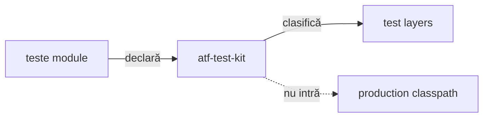

# ATF Test Kit

`atf-test-kit` este contractul transversal, strict test-only, pentru toate
modulele ATF. Nu conține renderer, mock transport, browser sau cod de producție.

## Pe scurt



<details>
<summary><strong>Legendă — contractul transversal al testelor</strong></summary>

- modulele declară stratul prin adnotare, iar kit-ul îl verifică;
- cele patru straturi sunt executable test layers: unit, component, integration și E2E;
- support este cod auxiliar, nu al cincilea strat executabil;
- muchia punctată este o interdicție: test-kit-ul nu intră în classpath-ul de producție.
</details>

| Conține | Nu conține | Gate |
|---|---|---|
| meta-anotații, layer guard și loaderul YAML pentru test-kit | renderer, mock, browser | `AtfTestLayerArchitectureTest` |
| clasificare test | business flow | fiecare clasă are un singur nivel |
| reguli transversale | runtime dependency | fail-closed la drift |

## Clasificare

Fiecare clasă executabilă declară exact un nivel:

```text
@AtfUnitTest        → @Tag("unit")
@AtfComponentTest   → @Tag("component")
@AtfIntegrationTest → @Tag("integration")
@AtfE2eTest         → @Tag("e2e")
```

### Ce verifică guvernanța

- `AtfTestLayerArchitectureTest` inspectează toate directoarele `*/src/test/java`;
- verifică adnotarea, package-ul, importurile interzise și izolarea `support`;
- rezolvă din surse și adnotările compuse, prin import sau același package,
  inclusiv compoziția imbricată; ciclurile nu inventează un nivel;
- regula este fail-closed: o clasă fără nivel sau cu mai multe niveluri oprește
  build-ul, inclusiv când nivelurile provin din adnotări compuse.

### Verificări de compoziție

- `AtfModuleTest`/`AtfModuleTestCondition` rămân specifice suitei
  `atf-reporting-tests`, în `atf.api.reporting.test`;
- un modul lipsă poate produce `SKIPPED` prin gate-ul dedicat;
- kit-ul nu introduce o booleană UI paralelă.

### Limite de responsabilitate pentru extensii viitoare

- selecția transversală `UI` / `API` / `UI_API`, distinctă de layer, este propusă în
  [feedback-ul adnotărilor de canal](../docs/feedback/ATF_Test_Channel_Annotations_Feedback.md);
  nu este încă implementată și nu înlocuiește adaptoarele consumerilor;
- extracția adnotărilor output/setup/docs este analizată în
  [feedback-ul infrastructurii de adnotări](../docs/feedback/ATF_Test_Infrastructure_Annotations_Feedback.md);
  contractele propuse nu sunt încă implementate în kit;
- contractul generic pentru flow mode, screenshot policy și capture source este în
  [`docs/ATF_Evidence_Capture_Contract.md`](../docs/ATF_Evidence_Capture_Contract.md);
- `atf-test-kit` poate deține mapping-ul transversal numai după un contract typed
  și un gate lower-level;
- politica publisherului și flow-urile Practice Shop rămân în ownerii lor.

## Limite de responsabilitate

```text
module tests → atf-test-kit (test scope)
atf-test-kit -X-> production
reporting composition test scope → atf.api.reporting.test
atf-reporting-tests --test--> atf-reporting production
```

Modulele rămân ownerii semantic ai testelor lor. Kit-ul doar normalizează
vocabularul și enforce-uiește ierarhia; nu mută assertions, fixtures, locators,
CSS, JavaScript sau flow-uri între module. Săgeata `--test-->` este intenționată:
compoziția poate consuma librăria reporting în test scope, în timp ce
`atf-reporting/src/main` rămâne fără dependențe ATF.
