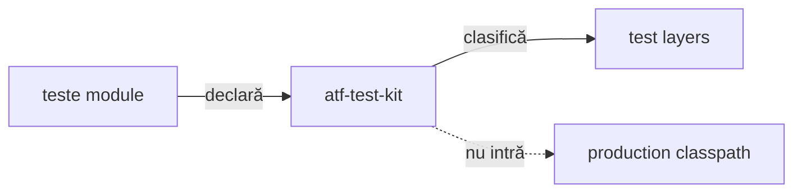

# ATF Test Kit

`atf-test-kit` este contractul transversal, strict test-only, pentru toate
modulele ATF. Nu conține renderer, mock transport, browser sau cod de producție.

## Pe scurt



<details>
<summary><strong>Legendă — contractul transversal al testelor</strong></summary>

- modulele declară stratul prin adnotare, iar kit-ul îl verifică;
- cele patru straturi sunt executable test layers: unit, component, integration și E2E;
- support este cod auxiliar, nu al cincilea strat executabil;
- muchia punctată este o interdicție: test-kit-ul nu intră în classpath-ul de producție.
</details>

| Conține | Nu conține | Gate |
|---|---|---|
| adnotări de nivel/canal/console/output/setup/docs/UI evidence, resolvere neutre | renderer, mock, browser | teste Test Kit; clasificarea globală în `atf-tests` |
| clasificare test | business flow | fiecare clasă are un singur nivel |
| reguli transversale | runtime dependency | fail-closed la drift |

## Clasificare

Fiecare clasă executabilă declară exact un nivel:

```text
@AtfUnitTest        → @Tag("unit")
@AtfComponentTest   → @Tag("component")
@AtfIntegrationTest → @Tag("integration")
@AtfE2eTest         → @Tag("e2e")
```

### Ce verifică guvernanța

- `AtfTestLayerArchitectureTest`, din `atf-tests` și suita whole-ATF, inspectează toate directoarele `*/src/test/java`;
- verifică adnotarea, package-ul, importurile interzise și izolarea `support`;
- rezolvă din surse și adnotările compuse, prin import sau același package,
  inclusiv compoziția imbricată; ciclurile nu inventează un nivel;
- regula este fail-closed: o clasă fără nivel sau cu mai multe niveluri oprește
  build-ul, inclusiv când nivelurile provin din adnotări compuse.
- Nivelul aparține clasei executabile, nu numelui fișierului sau profilului
  raportului; fixture-urile de meta-adnotări sunt separate de ownerul executabil.
- Probele Reporting care folosesc direct Playwright rămân la ownerul component UI,
  în `atf.ui.tests.extent.component`; un contract API randat nu justifică o excepție.

### Verificări de compoziție

- `AtfModuleTest`/`AtfModuleTestCondition` rămân specifice suitei
  `atf-reporting-tests`, în `atf.api.reporting.test`;
- un modul lipsă poate produce `SKIPPED` prin gate-ul dedicat;
- kit-ul nu introduce o booleană UI paralelă.

### Adnotări de infrastructură implementate

| Package | API | Aplicare |
|---|---|---|
| `atf.api.testkit.channel` | `AtfTestChannel`, `TestChannelPlan`, resolver | canal UI/API/UI_API, separat de tag-ul JUnit al nivelului |
| `atf.api.testkit` + `.console` | `AtfConsoleMessages`, `AtfConsoleMessagePolicyResolver` | politică typed de consolă; `atf-console` o aplică fără sink/formatter duplicat |
| `atf.api.testkit.reporting` | `AtfReportPath`, `AtfReportPathPolicyResolver` | opt-in separat pentru calea raportului publicat |
| `atf.api.testkit.output` | adnotările de director și `ReportOutputDirectory` | ancoră UI prin adnotare sau path project-relative validat pentru un artifact |
| `atf.api.testkit.setup.api` | `ApiScenarioSetup`, `ApiTestRef` | declarații; catalogul și executarea rămân la consumator |
| `atf.api.testkit.documentation` | `DocumentationTarget` repeatable | selecție de documente; validatorii rămân în ATF Tests |
| `atf.api.testkit.evidence` | `AtfUiEvidence`, `AtfUiEvidenceFlow`, `AtfUiScreenshotPolicy` | declară independent gruparea flow-ului și intenția capturilor; adaptorii consumer le mapează în profilul Reporting |
| `atf.api.testkit.lifecycle` | `TestRunInitialization`, `CloseOnceResource`, `ArmedCleanup`, `FailureAwareCleanup`, `FailureEvidenceCleanup`, `AtfE2eActivationPolicy` | achiziție/rollback, cleanup și activare E2E neutre; fără API UI/Reporting |

`atf.api.testkit.lifecycle` este un pachet al modulului existent
`atf-test-kit`, nu un modul nou. Nu introduce dependențe către UI sau Reporting.

| Contract | Comportament și probă |
|---|---|
| Inițializare | `TestRunInitialization.create(...)` primește factory-uri pentru resursă → scenariu → fază → run; la eșec execută callback-urile inverse pentru handle-urile returnate. `TestRunInitializationTest` verifică succesul, fiecare punct de eșec, `Error` și erorile `suppressed`. |
| Închidere unică | `CloseOnceResource` păstrează handle-ul și încearcă close o singură dată, inclusiv dacă acesta eșuează; `closeAfter(primary)` păstrează cauza inițială fără self-suppression. |
| Compensare | `ArmedCleanup.arm()` se apelează înainte de mutație; succesul dezarmează, iar eșecul păstrează posibilitatea unui retry explicit. Nu reprezintă cleanup automat retry și nu știe ce este un cont. |
| Cleanup | `FailureAwareCleanup` încearcă toate etapele, păstrează prima eroare și atașează restul ca `suppressed`; resursele se închid invers. |
| Failure evidence | `FailureEvidenceCleanup` capturează înaintea cleanup-ului care poate schimba pagina; consumerul deține callback-urile. Ambele primitive sunt probate în `FailureAwareCleanupTest`. |
| Activare | `AtfE2eActivationPolicy`: override JVM → opt-in configurat → fallback IDE → dezactivare; extensiile citesc semnalele, iar `AtfE2eActivationPolicyTest` verifică precedența și respingerea valorilor invalide. |
| Integrare | Guvernanța whole-ATF verifică limitele Shop/AutoEx; kit-ul nu citește YAML și nu pornește browserul. |

- API, precedență și probe: [adnotările de infrastructură](../docs/ATF_Test_Infrastructure_Annotations.md).
- Verificarea manuală IntelliJ pentru output project-relative:
  [ghidul suitei Extent](../atf-reporting-tests/src/test/java/atf/ui/tests/extent/README.md#rulare-directă-din-intellij).

### Politica pentru calea raportului publicat

`@AtfReportPath` este `DISABLED` în absență; adnotarea fără valoare sau cu
`AtfReportPath.Policy.ENABLED` activează notificarea după publicarea artifactului.
`DISABLED` poate suprascrie o declarație moștenită; meta-adnotările sunt
acceptate, iar politici contradictorii la același nivel eșuează fail-fast.
Într-un artifact partajat, agregatorul din `atf-console` primește fiecare owner
prin `AtfReportPathOptIn.include(owner)` și notifică dacă cel puțin un owner a
activat opțiunea.

### Limite de responsabilitate

- `AtfUiEvidence` deține numai vocabularul declarat: `CONFIGURED` lasă fiecare
  axă la configurația consumerului, iar o valoare explicită este intenția clasei;
  kit-ul nu citește YAML și nu creează profil Reporting;
- fiecare consumer aplică precedența și mapează valorile în profilul său:
  configurația furnizează baza, iar valoarea explicită din adnotare suprascrie
  numai axa declarată. AutoEx și Practice Shop aplică ambele axe; izolarea
  profilelor între scenarii dintr-un raport partajat rămâne responsabilitatea
  lifecycle-ului consumerului, nu a Test Kit;
- adnotarea UI evidence nu este moștenită și nu compune automat harness-uri;
- capture source, publisherul, lifecycle-ul browserului și flow-urile Practice
  Shop rămân la ownerii lor; Test Kit nu depinde de `atf-reporting` sau Playwright;
- resolverul `AtfReportPathPolicyResolver` gestionează separat meta-adnotările,
  ierarhia claselor și conflictele politicii de output.

### Limita suportului E2E comun

Nu se creează un modul UI nou și nu se mută harness-urile consumerilor ca atare.

| Contract | Owner / limită |
|---|---|
| `FailureAwareCleanup`: închiderea inversă a resurselor dobândite și agregarea eșecurilor | implementat în `atf-test-kit`; probat direct și prin adaptoarele Shop/AutoEx, fără API UI/Reporting |
| Browser, `Page`, Playwright, Extent, capture profile, network inspector și business | adaptorul `src/test` al fiecărui consumer; nu intră în Test Kit |
| Lifecycle-ul sau extensia JUnit UI | rămân locale până când ambele consumatoare demonstrează același contract; `atf-ui` consumă deja Test Kit în test scope, deci dependența inversă ar crea ciclu |
| Scope-ul Shop pentru Test Kit | importurile și dependența Maven sunt în `test` scope; verificat de `ConsumerModuleArchitectureGovernanceTest` din `atf-tests` |
| Clasificare, evidence și instalare | `@AtfE2eTest` și `@AtfTestChannel` clasifică testul; `@AtfUiEvidence` declară forma dovezii; extensia și resursele rămân la consumer. Contractul adnotărilor este în [documentația infrastructurii de test](../docs/ATF_Test_Infrastructure_Annotations.md), iar alegerea layer-ului în [ghidul de testare](../docs/ATF_Testing_Guide.md). |
| Activare E2E | `AtfE2eActivationPolicy` rezolvă semnalele deja colectate de extensia consumerului; nu citește YAML sau proprietăți de sistem și nu pornește browserul |

## Dependențe

```text
module tests → atf-test-kit (test scope)
atf-test-kit -X-> production
atf-console --optional--> atf-test-kit (JUnit policy bridge only)
reporting composition test scope → atf.api.reporting.test
atf-reporting-tests --test--> atf-reporting production
```

Modulele rămân ownerii semantic ai testelor lor. Kit-ul doar normalizează
vocabularul și enforce-uiește ierarhia; nu mută assertions, fixtures, locators,
CSS, JavaScript sau flow-uri între module. Săgeata `--test-->` este intenționată:
compoziția poate consuma librăria reporting în test scope, în timp ce
`atf-reporting/src/main` rămâne fără dependențe ATF.

### Regula de promovare a testelor reutilizabile

Se aplică [regula comună de ownership a testelor](../docs/ATF_Testing_Guide.md#owner-ul-testului-business-adaptor-sau-infrastructură);
această secțiune delimitează API-urile și probele specifice Test Kit.

| Contractul testat | Owner | Rămâne în afara ownerului |
|---|---|---|
| Adnotări, clasificare și primitive neutre de lifecycle/path | `atf-test-kit` | teste de business și harness-uri UI ale consumerilor |
| Model, publisher, markup, CSS/JS, disclosure și randare | `atf-reporting-tests` | maparea semantică specifică Shop/AutoEx |
| Maparea unui contract de aplicație către porturile ATF | consumerul respectiv | reguli de renderer generic |

Test Kit deține și probele componentă pentru primitivele sale; nu este un
depozit pentru teste extrase din Shop/AutoEx doar pentru a elimina dubluri.
Nu primește dependențe de `atf-reporting`, `atf-ui` sau modulele consumerilor.

AutoEx avea o validare locală a directoarelor API raport, fără verificare a
reparse-point-urilor. Criteriul generic a fost promovat în
`ReportOutputDirectory.resolveProjectRelative(...)` și este probat aici; AutoEx
păstrează numai alegerea default-ului și path-ului său configurat. Nu a rezultat
o bibliotecă de harness UI: `AtfE2eActivationPolicy`, cleanup-ul și
adnotările evidence sunt comune, iar profilele Reporting, captura browserului,
corelarea traficului și redactarea identității au proprietari diferiți sau reguli
dependente de consumer.

- `FailureAwareCleanupTest.partiallyAcquiredResourcesCloseInReverseAndKeepAcquisitionFailurePrimary`
  este proba neutră pentru închiderea inversă și păstrarea cauzei primare.
- Handle-urile lipsă, mai multe erori de close și repropagarea cauzei primare
  fără self-suppression sunt probate în aceeași clasă neutră.
- Copia directă Shop a fost eliminată; `ShopE2eFailureBoundaryTest` păstrează
  publicarea failure-ului prin adaptorul propriu.
- Inițializarea cu factory-uri și probele sale neutre sunt aici, nu în AutoEx.
  Consumerul furnizează callback-urile browser/report; Kit-ul nu le implementează.
- Factory-ul rămâne responsabil pentru resursele dobândite intern înainte de
  returnarea unui handle; succesul transferă cleanup-ul normal către run.
- `ConsumerModuleArchitectureGovernanceTest` respinge recrearea copiei AutoEx,
  dependențele Kit către UI/Reporting și importurile consumer în probele neutre.
