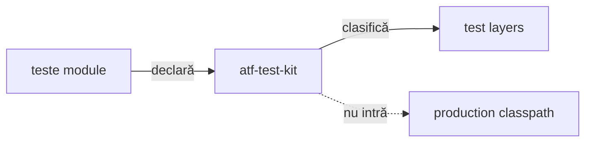

# ATF Test Kit

`atf-test-kit` este contractul transversal, strict test-only, pentru toate
modulele ATF. Nu conține renderer, mock transport, browser sau cod de producție.

## Pe scurt



<details>
<summary><strong>Legendă — contractul transversal al testelor</strong></summary>

- modulele declară stratul prin adnotare, iar kit-ul îl verifică;
- cele patru straturi sunt executable test layers: unit, component, integration și E2E;
- support este cod auxiliar, nu al cincilea strat executabil;
- muchia punctată este o interdicție: test-kit-ul nu intră în classpath-ul de producție.
</details>

| Conține | Nu conține | Gate |
|---|---|---|
| adnotări de nivel/canal/console/output/setup/docs/UI evidence, resolvere neutre și layer guard | renderer, mock, browser | teste TestKit și `AtfTestLayerArchitectureTest` |
| clasificare test | business flow | fiecare clasă are un singur nivel |
| reguli transversale | runtime dependency | fail-closed la drift |

## Clasificare

Fiecare clasă executabilă declară exact un nivel:

```text
@AtfUnitTest        → @Tag("unit")
@AtfComponentTest   → @Tag("component")
@AtfIntegrationTest → @Tag("integration")
@AtfE2eTest         → @Tag("e2e")
```

### Ce verifică guvernanța

- `AtfTestLayerArchitectureTest` inspectează toate directoarele `*/src/test/java`;
- verifică adnotarea, package-ul, importurile interzise și izolarea `support`;
- rezolvă din surse și adnotările compuse, prin import sau același package,
  inclusiv compoziția imbricată; ciclurile nu inventează un nivel;
- regula este fail-closed: o clasă fără nivel sau cu mai multe niveluri oprește
  build-ul, inclusiv când nivelurile provin din adnotări compuse.

### Verificări de compoziție

- `AtfModuleTest`/`AtfModuleTestCondition` rămân specifice suitei
  `atf-reporting-tests`, în `atf.api.reporting.test`;
- un modul lipsă poate produce `SKIPPED` prin gate-ul dedicat;
- kit-ul nu introduce o booleană UI paralelă.

### Adnotări de infrastructură implementate

| Package | API | Aplicare |
|---|---|---|
| `atf.api.testkit.channel` | `AtfTestChannel`, `TestChannelPlan`, resolver | canal UI/API/UI_API, separat de tag-ul JUnit al nivelului |
| `atf.api.testkit` + `.console` | `AtfConsoleMessages`, `AtfConsoleMessagePolicyResolver` | politică typed de consolă; `atf-console` o aplică fără sink/formatter duplicat |
| `atf.api.testkit.reporting` | `AtfReportPath`, `AtfReportPathPolicyResolver` | opt-in separat pentru calea raportului publicat |
| `atf.api.testkit.output` | cele două adnotări de director și `ReportOutputDirectory` | ancoră UI sau project-relative furnizată de consumator |
| `atf.api.testkit.setup.api` | `ApiScenarioSetup`, `ApiTestRef` | declarații; catalogul și executarea rămân la consumator |
| `atf.api.testkit.documentation` | `DocumentationTarget` repeatable | selecție de documente; validatorii rămân în ATF Tests |
| `atf.api.testkit.evidence` | `AtfUiEvidence`, `AtfUiEvidenceFlow`, `AtfUiScreenshotPolicy` | declară independent gruparea flow-ului și intenția capturilor; adaptorii consumer le mapează în profilul Reporting |
| `atf.api.testkit.lifecycle` | `FailureAwareCleanup` | primitive test-only pentru acumularea cleanup-ului și închiderea inversă a resurselor parțial dobândite; fără API UI/Reporting |

`FailureAwareCleanup` păstrează prima eroare ca primară, atașează eșecurile
ulterioare ca `suppressed`, încearcă toate etapele declarate și închide
resursele dobândite în ordine inversă. Este folosit numai din source set-ul de
teste; fiecare consumer păstrează local decizia privind resursele și etapele pe
care le deține. Comportamentul generic este probat în
`FailureAwareCleanupTest`, iar testele Shop/AutoEx rămân la boundary-ul lor.

Contractul complet, precedența, exemplele și probele sunt în
[Adnotări de infrastructură pentru teste](../docs/ATF_Test_Infrastructure_Annotations.md).
Selecția canalului și contractul generic de output nu au gap-uri funcționale
deschise. Smoke-testul IntelliJ pentru compoziția project-relative aparține
modulului Reporting Tests, care deține acel root; pașii se rulează la schimbări
relevante și sunt documentați în
[ghidul suitei Extent](../atf-reporting-tests/src/test/java/atf/ui/tests/extent/README.md#rulare-directă-din-intellij).

### Politica pentru calea raportului publicat

`@AtfReportPath` este `DISABLED` în absență; adnotarea fără valoare sau cu
`AtfReportPath.Policy.ENABLED` activează notificarea după publicarea artifactului.
`DISABLED` poate suprascrie o declarație moștenită; meta-adnotările sunt
acceptate, iar politici contradictorii la același nivel eșuează fail-fast.
Într-un artifact partajat, agregatorul din `atf-console` primește fiecare owner
prin `AtfReportPathOptIn.include(owner)` și notifică dacă cel puțin un owner a
activat opțiunea.

### Limite de responsabilitate

- `AtfUiEvidence` deține numai vocabularul declarat: `CONFIGURED` lasă fiecare
  axă la configurația consumerului, iar o valoare explicită este intenția clasei;
  kit-ul nu citește YAML și nu creează profil Reporting;
- fiecare consumer aplică precedența și mapează valorile în profilul său:
  configurația furnizează baza, iar valoarea explicită din adnotare suprascrie
  numai axa declarată. AutoEx și Practice Shop aplică ambele axe; izolarea
  profilelor între scenarii dintr-un raport partajat rămâne responsabilitatea
  lifecycle-ului consumerului, nu a Test Kit;
- adnotarea UI evidence nu este moștenită și nu compune automat harness-uri;
- capture source, publisherul, lifecycle-ul browserului și flow-urile Practice
  Shop rămân la ownerii lor; Test Kit nu depinde de `atf-reporting` sau Playwright;
- resolverul `AtfReportPathPolicyResolver` gestionează separat meta-adnotările,
  ierarhia claselor și conflictele politicii de output.

### Limita suportului E2E comun

Nu se creează un modul UI nou și nu se mută harness-urile consumerilor ca atare.

| Contract | Owner / limită |
|---|---|
| `FailureAwareCleanup`: închiderea inversă a resurselor dobândite și agregarea eșecurilor | implementat în `atf-test-kit`; probat direct și prin adaptoarele Shop/AutoEx, fără API UI/Reporting |
| Browser, `Page`, Playwright, Extent, capture profile, network inspector și business | adaptorul `src/test` al fiecărui consumer; nu intră în Test Kit |
| Lifecycle-ul sau extensia JUnit UI | rămân locale până când ambele consumatoare demonstrează același contract; `atf-ui` consumă deja Test Kit în test scope, deci dependența inversă ar crea ciclu |
| Scope-ul Shop pentru Test Kit | importurile și dependența Maven sunt în `test` scope; verificat de `ShopArchitectureTest` |
| Clasificare, evidence, activare și instalare | `@AtfE2eTest`, `@AtfUiEvidence` și extensia/configurația consumerului au roluri distincte; detalii în [feedback-ul E2E](../docs/feedback/ATF_E2E_Test_Support_Architecture_Feedback.md) |

## Dependențe

```text
module tests → atf-test-kit (test scope)
atf-test-kit -X-> production
atf-console --optional--> atf-test-kit (JUnit policy bridge only)
reporting composition test scope → atf.api.reporting.test
atf-reporting-tests --test--> atf-reporting production
```

Modulele rămân ownerii semantic ai testelor lor. Kit-ul doar normalizează
vocabularul și enforce-uiește ierarhia; nu mută assertions, fixtures, locators,
CSS, JavaScript sau flow-uri între module. Săgeata `--test-->` este intenționată:
compoziția poate consuma librăria reporting în test scope, în timp ce
`atf-reporting/src/main` rămâne fără dependențe ATF.
