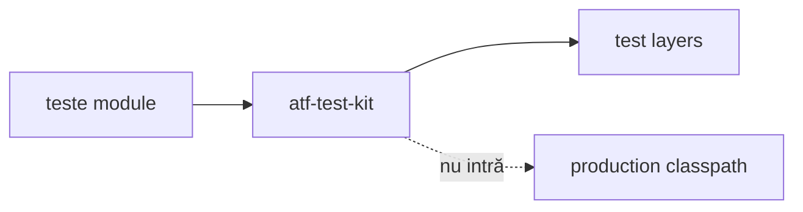

# ATF Test Kit

`atf-test-kit` este contractul transversal, strict test-only, pentru toate
modulele ATF. Nu conține renderer, mock transport, browser sau cod de producție.

## Overall



<details>
<summary><strong>Legendă — contractul transversal al testelor</strong></summary>

- modulele declară stratul prin adnotare, iar kit-ul îl verifică;
- cele patru straturi sunt executable test layers: unit, component, integration și E2E;
- support este cod auxiliar, nu al cincilea strat executabil;
- muchia punctată este o interdicție: test-kit-ul nu intră în classpath-ul de producție.
</details>

| Conține | Nu conține | Gate |
|---|---|---|
| meta-anotații, layer guard și loaderul YAML pentru test-kit | renderer, mock, browser | `AtfTestLayerArchitectureTest` |
| clasificare test | business flow | fiecare clasă are un singur nivel |
| reguli transversale | runtime dependency | fail-closed la drift |

## Clasificare

Fiecare clasă executabilă declară exact un nivel:

```text
@AtfUnitTest        → @Tag("unit")
@AtfComponentTest   → @Tag("component")
@AtfIntegrationTest → @Tag("integration")
@AtfE2eTest         → @Tag("e2e")
```

`AtfTestLayerArchitectureTest` inspectează toate directoarele
`*/src/test/java` din proiect și verifică annotarea, package-ul, importurile
interzise și faptul că `support` nu devine strat executabil. Regula este
fail-closed: o clasă nouă fără nivel sau cu mai multe niveluri oprește build-ul.

Gate-ul `AtfModuleTest`/`AtfModuleTestCondition` pentru composition roots care
cer module configurate rămâne specific suitei `atf-reporting-tests`, în
`atf.api.reporting.test`; nu este copiat artificial în kitul transversal.
Gate-ul poate inhiba un test cu `SKIPPED` când modulul lipsește; nu există o
booleană UI paralelă.

Contractul generic pentru flow mode, screenshot policy și capture source este
documentat separat în
[`docs/ATF_Evidence_Capture_Contract.md`](../docs/ATF_Evidence_Capture_Contract.md).
`atf-test-kit` poate deveni owner-ul mapping-ului transversal numai după un
contract typed și un gate lower-level; în prezent nu preia politica publisherului
și nu o confundă cu un flow Practice Shop.

## Boundary

```text
module tests → atf-test-kit (test scope)
atf-test-kit -X-> production
reporting composition test scope → atf.api.reporting.test
atf-reporting-tests --test--> atf-reporting production
```

Modulele rămân ownerii semantic ai testelor lor. Kit-ul doar normalizează
vocabularul și enforce-uiește ierarhia; nu mută assertions, fixtures, locators,
CSS, JavaScript sau flow-uri între module. Săgeata `--test-->` este intenționată:
compoziția poate consuma librăria reporting în test scope, în timp ce
`atf-reporting/src/main` rămâne fără dependențe ATF.
