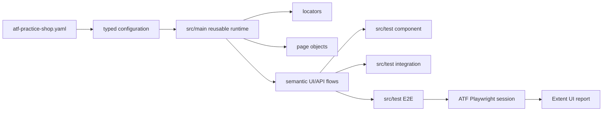
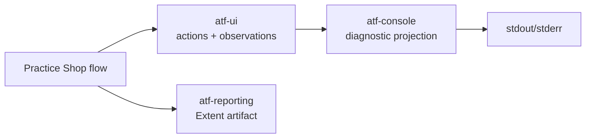
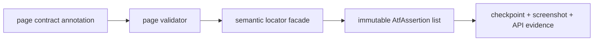
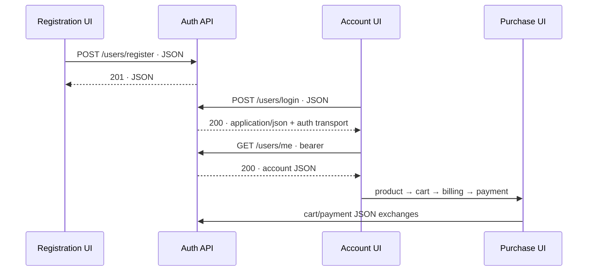
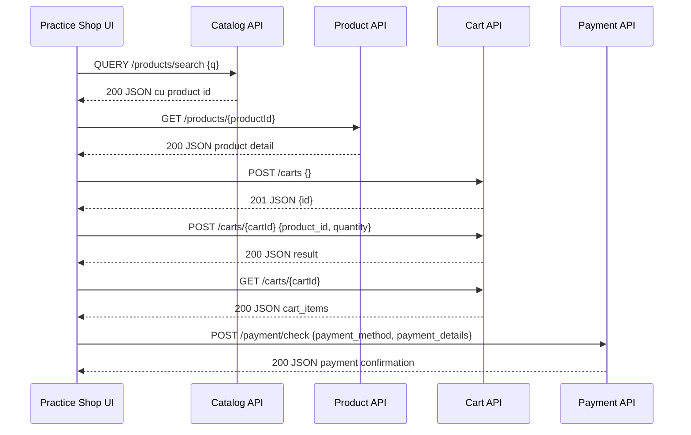
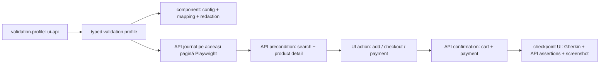
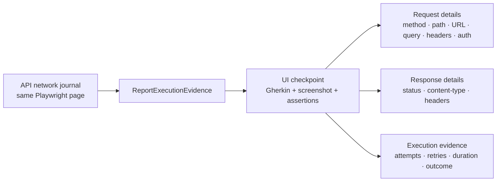

# ATF Test Practice Shop — consumer plug-and-play

## Overall

Acest modul este suita izolată pentru `https://practicesoftwaretesting.com`.
Este un consumer de test al infrastructurii ATF, nu parte din reporting și nu
parte din governance-ul whole-reactor.



<details>
<summary><strong>Legendă — compoziția consumerului</strong></summary>

- YAML-ul furnizează valori dinamice, iar `src/main` expune runtime-ul reutilizabil;
- `component`, `integration` și `e2e` sunt niveluri de test distincte;
- Playwright și reporting-ul sunt consumate la boundary, nu ascunse în page objects;
- acest modul verifică aplicația Practice Shop, nu implementarea rendererului Extent.

</details>

## Consola diagnostică ATF

Politica Practice Shop este să folosească
[`atf-console`](../atf-console/README.md) ca proiecție diagnostică a execuției UI/API;
raportul Extent rămâne artifactul HTML, iar consola rămâne canalul pentru pași
observabili în timpul rulării:



<details>
<summary><strong>Legendă — separarea raportului de consolă</strong></summary>

- `atf-console` este singurul owner al `stdout`/`stderr`;
- composition root-ul Practice Shop injectează sink-ul configurat, nu folosește
  `println` și nu deține `PrintStream`;
- acțiunile UI trebuie să fie observabile ca pași `click`, `fill`, `wait` sau
  `navigate`, cu statusul lifecycle-ului;
- `reporting.console.enabled` controlează activarea, iar `detailsEnabled`
  controlează numai detaliile;
- consola nu decide verdictul și nu înlocuiește assertions, evidence sau HTML-ul;
- erorile browserului din `PracticeShopRuntimeDiagnostics` rămân diagnostic
  runtime și se reconciliază cu statusul semantic al raportului.

</details>

**Stare live:** contractul este stabilit, însă wiring-ul consumerului nu este încă
închis. `PracticeShopE2eContext` folosește momentan sink-uri `noOp`, iar cele două
contracte duplicate `AtfConsoleEvent/Sink` trebuie reconciliate înainte ca aceeași
instanță configurată să deservească UI-ul și lifecycle-ul reporting. Gap-ul este
urmărit în [`SHOP-CONSOLE-01/02`](../docs/feedback/ATF_Practice_Shop_API_Screen_Pyramid_Feedback.md)
și în registrul [feedback](../docs/feedback/README.md).

## Boundary și OOP

```text
src/main/java/atf/ui/practiceshop/
  config/   → records imutabile și loader YAML
  api/      → request factory, client și screen API flows
  locators/ → singurul owner al CSS/data-test selectorilor
  pages/    → interacțiuni semantice pe o pagină
  flow/     → facade public + stage-uri business reutilizabile
  support/  → lifecycle browser, API evidence, capture/select seams și publisher API reusable
src/test/java/atf/ui/tests/practiceshop/
  component/       → contracte rapide fără browser sau network
  api/component/   → variații pozitive/negative pe transport fake
  api/integration/ → verificări live opt-in cu precondiție de login
  e2e/             → dovada minimă a journey-ului complet
    checkpoint → Gherkin + assertions + actions + screenshot per page
```

Regula de packaging este intenționată: clasele reutilizabile nu locuiesc în
`src/test` și nu sunt ascunse sub `atf.ui.tests.practiceshop`. Testele sunt
singurele care rămân în acel namespace; o excepție este permisă numai pentru
un helper strict semantic de test, documentat și verificat de
`PracticeShopArchitectureTest`.

Testele nu folosesc `page.locator(...)` direct și nu cunosc markup-ul aplicației.
Orice selector nou intră în `PracticeShopLocators`, este verificat de
`PracticeShopArchitectureTest` și este consumat de un page object. Configurația
checkout-ului este typed (`quantity`, guest identity, billing și payment
method), astfel încât flow-ul nu ascunde valori de business în cod.

Publisher-ul `PracticeShopApiReportPublisher` este runtime support și rămâne în
`src/main`; `PracticeShopStandaloneApiReportTest` păstrează doar orchestration-ul
testului, transportul fake și verificările artifactului. În `src/test` nu se
mută logică reusable doar pentru a scurta un test.

`PracticeShopApiNetworkJournal` coordonează numai sesiunea și verdictul API.
`PracticeShopApiTrafficCapture` deține filtrarea hostului și sanitizarea
exchange-ului, iar `PracticeShopApiExchangeSelector` deține selecția pură a
precondițiilor/read-back-urilor. Astfel capture-ul și selecția pot fi testate
fără browser. Purchase-ul are acum două seam-uri business explicite:
`PracticeShopCatalogPurchaseStage` pregătește home → product → add-to-cart,
iar `PracticeShopCheckoutPurchaseStage` execută cart → identity → billing →
payment → confirmation. `PracticeShopPurchaseJourneyContext` transportă
configurația, validators, journal-ul și observer-ul de evidence; facade-ul
`PracticeShopPurchaseFlow` păstrează exact API-ul public existent și doar
compune stage-urile. Nu se multiplică E2E, iar fiecare stage poate fi evoluat
și verificat separat fără a muta responsabilități în `src/test`.

Deoarece `src/main/java/atf/ui/practiceshop` este support reutilizabil, dependențele
ATF consumate de el (`atf-core`, `atf-test-kit`, `atf-reporting`, `atf-ui`) sunt
compile-scope în POM; numai JUnit rămâne test-scope. Gate-ul verifică această regulă
și previne ca un build incremental să ascundă o eroare de classpath.

## Contracte declarative pentru validarea fiecărui ecran

Fiecare page object din purchase journey declară prin
`@PracticeShopPageContract` ecranul, ruta și controalele semantice obligatorii.
`PracticeShopPageValidator` proiectează contractul în assertions auditabile,
folosind exclusiv `PracticeShopLocators`; flow-urile și testele nu duplică CSS.



<details>
<summary><strong>Legendă — contractul unui ecran</strong></summary>

- adnotarea descrie topologia stabilă a ecranului;
- validatorul folosește locatorii deținuți de modul și produce assertions typed;
- checkpoint-ul publică evidence, dar nu reimplementează HTML-ul raportului;
- valorile configurabile rămân în YAML și în modelul typed al consumerului.

</details>

Implementarea păstrează responsabilitățile API separate: `PracticeShopApiNetworkJournal`
capturează și selectează exchange-urile din sesiunea UI, `PracticeShopApiAssertions`
proiectează contractele JSON în assertions, iar `PracticeShopApiEvidenceMapper`
transformă exchange-ul în evidence Extent (request, response, headers, auth și
attempt). Flow-ul rămâne composition root-ul subțire care le orchestrează; niciun
page object nu cunoaște formatul intern al raportului.

Regula de lifecycle este explicită: `fill → validate → submit` pentru formulare.
Guest checkout verifică emailul, prenumele, numele și controlul de submit înainte
de tranziția către billing; apoi următorul checkpoint validează noul ecran.
Astfel controalele tranzitorii nu sunt cerute după ce aplicația le ascunde, iar
un fail de contract devine `FAIL` auditabil, nu un pas fals `PASS`.

Adnotările descriu topologia statică, YAML-ul păstrează valorile dinamice, iar
component testele verifică separat contractele și imutabilitatea rezultatului.
Se păstrează două E2E intenționate — guest și authenticated — iar variațiile se
testează în component/API, nu prin multiplicarea journey-urilor.

## Cont reutilizabil și explorarea registration → login → purchase

Înaintea automatizării, flow-ul a fost explorat manual în ATF Debug/browser MCP:



`PracticeShopRegistrationPage` și `PracticeShopRegistrationData` păstrează
registration-ul în `src/main`, dar registration-ul nu este repetat ca E2E la
fiecare rulare. După explorarea live, contul reutilizabil este fixture-ul
intenționat al modulului:

```text
atf-test-practice-shop/src/test/resources/
  atf-practice-shop.yaml
  practice-software-testing-account.properties
```

Fișierul properties conține credentiale demo în clar, conform deciziei explicite
pentru acest proiect. El este consumat doar prin `PracticeShopCredentials`, nu
este introdus în acțiuni, assertions, console sau HTML. Pentru CI sau un cont
nou, `-Datf.practice.account-file=<absolute-properties-file>` (sau
`ATF_PRACTICE_ACCOUNT_FILE`) înlocuiește fixture-ul fără modificarea codului.

Fixture-ul din repository este revalidat periodic împotriva aplicației externe.
Dacă login-ul răspunde `Invalid email or password`, se reface registration-ul
prin flow-ul dedicat/contractul JSON al aplicației, se verifică separat login-ul
cu status `200`, apoi se actualizează numai fișierul properties și se rerulează
E2E-ul autentificat. Nu se modifică timeout-uri sau assertions pentru a masca un
cont expirat; parola rămâne absentă din actions, assertions și HTML.

`PracticeShopAuthenticatedPurchaseE2eTest` reutilizează aceeași precondiție de
login și execută un purchase complet. `PracticeShopAccountAndCatalogE2eTest`
rămâne un smoke slice opt-in pentru account/catalog, iar
`PracticeShopPurchaseE2eTest` rămâne journey-ul guest-safe. Nu se adaugă câte un
E2E pentru registration, login, fiecare API sau fiecare componentă; componentele
rapide și fake API variation matrix acoperă variațiile, iar E2E-urile dovedesc
orchestrarea reală.

Contractele active acoperă toate ecranele declarate ale journey-ului, inclusiv
ecranele reutilizabile de login și account:

| Screen | Route contract | Controls validated |
|---|---|---:|
| HOME | `/` | 16 |
| PRODUCT | `/product/*` | 5 |
| CART | `/checkout` | 3 |
| GUEST_CHECKOUT | `/checkout` | 4 |
| BILLING | `/checkout` | 7 |
| PAYMENT | `/checkout` | 2 |
| CONFIRMATION | `/checkout` | 1 |
| LOGIN | `/auth/login` | 3 |
| ACCOUNT | `/account` | 1 |

`PracticeShopPageContractTest` este gate-ul rapid pentru această listă și pentru
rezultatul agregat immutable. Orice screen nou trebuie să adauge contractul,
locatori semantici și cazul component înainte de a fi introdus în E2E.

Primul ecran al purchase flow-ului este intenționat împărțit în trei checkpoint-uri
fără browser reset și fără test E2E nou:

```text
GIVEN catalog home structure displays navigation, branding and banner
  → route, navbar, brand link, banner visibility, render area și style invariants
AND catalog home filters expose sorting, price, search and category controls
  → sort, price range, search/reset/submit, category/brand/eco filters și cardinalități
AND catalog home renders product cards, pagination and footer
  → card grid, card names, card images, pagination, footer și cardinalități egale
```

Fiecare checkpoint consumă exclusiv locatori din `PracticeShopLocators`, execută
assertions Playwright pentru componenta lui și publică propriul screenshot inline.
Cardinalitățile sunt dinamice (`>= 1`, iar names/images trebuie să egaleze numărul
de carduri), astfel încât testul rămâne plug-and-play când catalogul își schimbă
numărul de produse. Colecțiile sunt folosite pentru diagnostic/count; sincronizarea
și click-ul folosesc primul element explicit pentru a respecta strict mode.

Celelalte ecrane păstrează aceeași disciplină, dar rămân câte un singur
checkpoint deoarece componentele lor încap într-o captură completă la zoom
100%; nu sunt fragmentate artificial în teste sau module noi:

```text
PRODUCT       → name, price, description, quantity și add-to-cart
CART          → product title, quantity și proceed
GUEST         → guest tab, email, first name, last name și submit
BILLING       → country, postal code, house number, street, city, state și proceed
PAYMENT       → payment method și finish
CONFIRMATION  → payment success
```

`PracticeShopPurchaseScreenValidator` proiectează fiecare listă în același
checkpoint existent. Pentru fiecare componentă sunt verificate compact
cardinalitatea și zona randată (`count >= 1`, bounding box nenul), iar pentru
controalele interactive și disponibilitatea (`enabled`). Screenshot-ul este
al ecranului întreg, iar acțiunile Playwright rămân în disclosure-ul acelui
checkpoint. Guest este verificat corect înainte de tranziție (`fill → validate →
submit`); `guest-proceed`, care apare numai după submit, rămâne evidențiat prin
acțiunea de tranziție și nu este pretins ca existent pe ecranul anterior.

Rezultatul este o piramidă compactă: Home are trei zone deoarece are catalog,
filtre și grid suficient de bogate; toate celelalte ecrane au o singură zonă
completă, cu component assertions, acțiuni și imagine inline. Nu se adaugă
teste E2E pentru a obține această granularitate.

## Journey acoperit și evidence per ecran

```text
search product
  → open product
  → set quantity and add to cart
  → verify cart product + quantity
  → continue as guest
  → fill billing address
  → select Cash on Delivery
  → confirm payment and verify “Payment was successful”
```

Același test E2E publică nouă subpași, fără să mărească numărul de teste:

```text
SETUP
  GIVEN typed guest checkout configuration is ready
TEST BODY
  GIVEN catalog home exposes product search
  GIVEN product page displays the configured product and ready-to-buy fields
  WHEN cart displays the configured product with the requested quantity
  AND guest checkout form contains the configured identity
  AND billing form is completed with the configured address
  AND payment form displays the configured demo method
  THEN payment confirmation is displayed for the completed purchase
```

Fiecare subpas are propriul set de assertions, acțiunile executate până la
acel ecran și un screenshot inline. Formularele nu publică valorile sensibile
în clar; dovada este semantică (câmpuri completate și confirmate), iar
identitatea guest rămâne configurată în YAML.

Testul guest rămâne intenționat account-independent. Pentru journey-ul
autentificat, fixture-ul typed este încărcat în SETUP, iar raportul publică
login-ul ca precondiție API/UI înainte de catalog. Astfel un raport poate fi
citit ca `SETUP → login → screen checkpoints → cart/payment confirmation`, fără
ca parola să apară în evidence.

## Explorare ATF Debug: hartă UI → API pentru integrare

<details>
<summary><strong>Detalii exploratorii și semnale de integrare</strong></summary>

Fluxul poate fi reexplorat cu ATF Debug și Playwright headless, cu network capture
activ în aceeași sesiune. Capturile brute rămân în staging extern și nu sunt
referințe normative sau fixture-uri copiate în repository.



<details>
<summary><strong>Legendă — contracte observabile UI → API</strong></summary>
- secvența arată boundary-urile observate, nu garantează că fiecare endpoint este contract public permanent;
- identificatorii și body-urile se verifică prin teste de integrare configurabile;
- guest, payment și lookup au politici explicite: răspunsul așteptat nu este confundat cu eroarea runtime.
</details>

Contractele observate și invariants-urile utile pentru viitoarele teste de
integrare sunt:

| Boundary | Observație live | Invariant de testat |
|---|---|---|
| catalog → product | `QUERY /products/search` întoarce ID-ul curent pentru produsul configurat; detaliul este `GET /products/{id}` | ID-ul din search este același cu ID-ul din detail și cu cel trimis în cart |
| product → cart | `POST /carts` întoarce un `cartId`, apoi `POST /carts/{cartId}` primește JSON cu `product_id` și `quantity` | cart-ul citit ulterior conține produsul și cantitatea cerută |
| cart → checkout | `GET /carts/{cartId}` expune `cart_items`, inclusiv produsul și cantitatea | UI-ul nu confirmă checkout înainte de cart read consistent |
| checkout → payment | `POST /payment/check` primește JSON și răspunde JSON `Payment was successful` | metoda selectată și mesajul răspunsului sunt mapate în checkpoint-ul UI final |
| guest identity | `/users/me` răspunde `401 {message: Unauthorized}` de mai multe ori pentru guest | 401 este ramura guest așteptată, nu fail de business; erorile runtime neașteptate rămân fail |
| postcode lookup | lookup-ul răspunde 200, dar adresa demo returnată diferă de valorile introduse | trebuie decis explicit dacă lookup-ul este advisory sau autoritativ; nu se asertează egalitatea implicit |

`QUERY` este verbul observat de aplicație pentru catalog și trebuie păstrat ca
fapt al sistemului până când contractul este confirmat; testele nu îl
normalizează arbitrar la POST. În schimb, request-urile POST observate au
`Content-Type: application/json` și body JSON, iar răspunsurile lor sunt JSON;
acest lucru trebuie verificat în testele de integrare cu aceeași evidență
request/response folosită în raportul API.

### Semnal de integrare găsit în flow-ul guest

Explorarea guest a arătat două clase de semnal care trebuie separate: `401`
pentru `/users/me` poate fi ramura guest așteptată, în timp ce
`TypeError: Cannot read properties of null (reading 'cart_items')` este eroare
runtime. Aceasta nu justifică încă o modificare mecanică a page objects: se adaugă
mai întâi un test de reziliență care distinge guest-ul acceptat de excepția reală
și verifică faptul că UI-ul nu încearcă să randeze `cart_items` înainte de cart read.

Prioritatea de testare este: component/integration pentru contractele și
mapping-ul de mai sus, apoi journey-urile guest și authenticated pentru purchase,
care verifică invariants între UI și network. Nu se multiplică E2E-urile pentru
fiecare endpoint. `PracticeShopCatalogApi` extrage dinamic ID-ul API din search și îl
propagă în product detail/cart. `productPath` este strict când conține o rută
`/product/<id>`; pentru catalogul extern volatil, `auto` selectează primul card
pentru `productName` și validează obligatoriu ruta `/product/*`.


</details>

## Piramida configurabilă UI + API



<details>
<summary><strong>Legendă — piramida configurabilă</strong></summary>
- component verifică mapping-ul și redaction-ul fără network;
- integration verifică journal-ul API și invariants între boundary-uri;
- un E2E selectat demonstrează orchestration-ul real și randarea;
- profilul decide dacă API evidence este obligatorie sau UI-only, fără boolean paralel.
</details>

Profilul este configurat prin `practiceShop.validation.profile`:

| Profil | Scop | Network/API obligatoriu |
|---|---|---|
| `ui-api` | flow mixt implicit; API-ul pregătește sau confirmă fiecare boundary critic | da |
| `ui-only` | fallback pentru investigații strict vizuale sau medii fără API observabil | nu |

Nu există un `ui.enabled` boolean și nu se pornește un al doilea cart pentru
precondiții. `PracticeShopApiNetworkJournal` ascultă request/response pe aceeași
pagină și publică în checkpoint-ul UI doar date redacted și relevante:

```text
search + product detail API  → precondiție înainte de add-to-cart
UI add-to-cart               → cart POST + cart GET confirmate prin API
UI payment confirmation      → payment/check POST + JSON response confirmate
```

Astfel component tests verifică rapid profilul, JSON parsing, invariants și
redaction; guest purchase și authenticated purchase sunt cele două E2E
intenționate pentru orchestration-ul real, iar variațiile API rămân în
component/integration tests. Account/catalog rămâne opt-in și condiționat de
fixture-ul de cont. Dacă un API precondiționat lipsește, flow-ul eșuează explicit și checkpoint-ul rămâne
auditabil, în loc să continue cu o stare UI presupusă.

## API evidence în checkpoint-urile UI și standalone

În purchase E2E, API-ul nu dublează assertion table-ul UI. `PracticeShopApiNetworkJournal`
transformă schimburile observate în
`ReportExecutionEvidence`, iar `PracticeShopE2eContext` le atașează aceluiași
checkpoint de pagină:



<details>
<summary><strong>Legendă — evidence atașată checkpoint-ului</strong></summary>
- un checkpoint UI poate avea zero, unul sau mai multe schimburi API;
- request, response și execution rămân disclosure-uri surori, închise implicit;
- jurnalul observă aceeași pagină Playwright; nu creează un test API artificial.
</details>

Pentru fiecare checkpoint pot exista zero, unul sau mai multe schimburi API.
Fiecare schimb este redat în disclosure-urile existente, închise implicit:

- `Request details` conține metoda observată, path-ul, URL-ul, query params,
  transportul, tipul de autentificare, headerele redacted și `REQUEST JSON`;
- `Response details` conține status, content type, headerele redacted și
  `RESPONSE JSON`;
- `Execution evidence` conține URL-ul final, statusul, durata, attempt-ul,
  retry count și outcome-ul.

Body-urile sunt limitate de `reporting.bodyMaxDisplayCharacters` din
`atf.yaml` (implicit 12000), iar valorile de assertion de
`reporting.assertionMaxDisplayCharacters` (implicit 240). Redaction-ul se
aplică înainte de publicare. Setup-ul declară profilul (`ui-api`/`ui-only`) și
politica de disclosures, astfel încât raportul arată preliminar dacă evidence
API este activă.

Regula de corelare este strictă: pentru product detail se acceptă path-ul
exact `/products/{productId}`, nu un prefix care ar putea selecta
`/products/{productId}/related`. Astfel un request API greșit nu poate trece
doar pentru că seamănă textual cu cel așteptat.

Component test-ul `ExtentReportUiEvidencePublishingTest` verifică proiecția
într-un checkpoint UI (JSON, headers, auth și execution), iar purchase E2E
verifică aceeași structură în raportul generat. Toate disclosure-urile rămân
închise în starea inițială; verificarea de browser le deschide doar pentru
auditul de randare.

Pentru variații rapide și pentru auditul reporting fără browser există și
`PracticeShopStandaloneApiReportTest`. Acesta rulează același
`PracticeShopApiScreenFlow` pe transport fake și scrie un artifact API în
`artifacts/reports/`, configurat de `atf.yaml`. Fiecare request publică separat
method/path/query/auth, `Request details`, `REQUEST JSON` când există body,
`Response details`, `RESPONSE JSON`, status și `Execution evidence`. În disclosure-ul
de request, metadata este explicită (`URL`, `AUTH TYPE`, `QUERY PARAMS`,
`REQUEST HEADERS`); în disclosure-ul de response este explicită (`CONTENT TYPE`,
`RESPONSE HEADERS`). Publisher-ul fail-fast respinge orice POST/PUT fără body
JSON și orice execuție fără response body, iar testul standalone verifică aceste
invariante înainte de a publica artifactul.
Credentialele sunt redacted înainte de HTML. Astfel API screen flow-ul poate fi
testat și inspectat independent de browser, fără să crească numărul de E2E.

Pentru login-ul extern, serverul poate răspunde cu payload JSON comprimat pe care
Chromium îl eliberează înainte ca CDP/Playwright Java să-l poată citi prin
`Network.getResponseBody`. Jurnalul nu inventează tokenul: marchează transparent
`body unavailable`, păstrează `content-type`, `content-length`, statusul și
headerele redacted, iar `GET /users/me` 200 validează efectiv sesiunea. Contractul
component `PracticeShopApiLoginAssertionsTest` verifică această politică; pentru
cart/payment, request și response JSON rămân afișate și validate normal.

Variațiile de catalog și cart sunt component-first:

```text
GET /products             → sort, brand/category, price range, rental, page
GET /categories           → category contract
GET /products/{id}        → in_stock true/false
PUT /carts/{id}/product/quantity → product_id + quantity JSON
DELETE /carts/{id}/product/{id}  → remove contract
```

Rutele sunt centralizate în `PracticeShopApiRoutes`, query-ul este typed prin
`PracticeShopProductQuery`, iar request factory-ul este singurul owner al
serializării. Component matrix-ul folosește fake transport și nu execută
modificări live.

`postcode-lookup` are politică explicită `ADVISORY` în
`PracticeShopCheckoutApi.CheckoutScreen`: valorile introduse de test rămân
sursa de adevăr pentru billing chiar dacă lookup-ul răspunde cu altă adresă.

Ramura guest este de asemenea explicită: `401 /users/me` este un rezultat API
așteptat, nu un fail de business. `PracticeShopRuntimeDiagnostics` ascultă
console errors și page errors din aceeași sesiune Playwright; combinația exactă
`401/Unauthorized` + `Cannot read properties of null (reading 'cart_items')`
este publicată ca WARNING auditabil în pașii raportului, iar orice altă eroare
runtime face fail al purchase E2E.

## Configurare

Sursa este `src/test/resources/atf-practice-shop.yaml`. Exemplul minim:

```yaml
practiceShop:
  baseUrl: https://practicesoftwaretesting.com
  zoomPercent: 70
  api:
    endpoint: https://api.practicesoftwaretesting.com
    mode: acceptance
    precondition: authenticated
    timeout: PT20S
  validation:
    profile: ui-api
  productName: Pliers
  productPath: auto
  checkout:
    quantity: 2
    guest:
      email: atf.practice.shop@example.test
      firstName: ATF
      lastName: PracticeShop
    billing:
      country: Romania
      postalCode: 010101
      houseNumber: 10
      street: Test Street
      city: Bucharest
      state: Bucharest
    paymentMethod: Cash on Delivery
```

Valorile pot fi schimbate prin YAML sau override-uri de proces fără refactor în
flow. `zoomPercent: 70` este default-ul acestui consumer și modifică zoom-ul
documentului Playwright, nu viewport-ul; loader-ul aplică fallback-uri
deterministe și validează input-ul înainte de deschiderea browserului.
`productPath` este un contract UI configurabil: o rută `/product/<id>` folosește
locatorul exact `a[href='<productPath>']`, iar `auto` folosește numai primul
locator semantic pentru `productName` și verifică ruta `/product/*`. ID-ul API nu
este hardcodat în request factory; este descoperit de screen API flow din search.
Pentru un fixture determinist se schimbă perechea `productName`/`productPath`,
apoi se rulează component gate și singurul E2E de purchase.

## Teste și gates

```text
mvn -pl atf-test-practice-shop -am -Dtest=PracticeShopArchitectureTest,PracticeShopConfigurationTest,PracticeShopCheckoutConfigurationTest,PracticeShopApiRequestFactoryTest,PracticeShopApiContractVariantTest,PracticeShopApiScreenFlowTest,PracticeShopApiCatalogCartVariantTest,PracticeShopStandaloneApiReportTest,PracticeShopGuestResilienceTest test
mvn -pl atf-test-practice-shop -am -Dtest=PracticeShopPurchaseE2eTest test
```

Component tests verifică configurația, locator boundary și invariants fără
network; API component tests verifică request factory, autentificare, status
401/404/2xx, JSON, variații de payment și catalog/cart fără browser. Testul
`PracticeShopStandaloneApiReportTest` verifică și artifactul API configurat.
Integration test-ul live este opt-in, reutilizează login API ca precondiție și nu
rulează implicit fără account file. `PracticeShopPurchaseE2eTest` verifică
journey-ul guest complet, `PracticeShopAccountAndCatalogE2eTest` verifică login
și catalog, iar `PracticeShopAuthenticatedPurchaseE2eTest` verifică purchase-ul
complet după login. Toate publică report Extent în directorul UI configurat de
consumer. Pentru explorare se folosește ATF Debug sau browser MCP;
browserul Windows real nu face parte din protocol.

Build-ul se execută într-un staging extern proiectului. La sync live se
promovează doar fișierele acestui module și actualizările contractuale aprobate;
nu se suprascriu refactorizări paralele din alte module.
