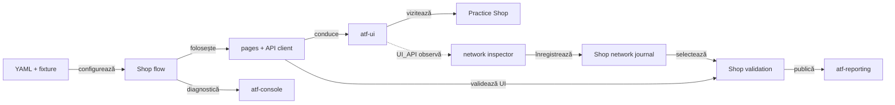

# ATF Test Practice Shop — consumer UI/API

## Pe scurt

`atf-test-practice-shop` este modulul consumer care verifică UI-ul și API-ul
real al aplicației Practice Software Testing. El deține fixture-ul aplicației,
configurația, page objects, flow-urile și probele consumer; nu deține
implementarea generică Playwright, Extent sau JUnit.



<details>
<summary><strong>Legendă — boundary-ul modulului</strong></summary>

- `YAML + fixture` conține valori și profile specifice aplicației;
- `Shop flow` compune paginile și checkpoint-urile; paginile cunosc rutele și
  controalele Practice Shop;
- săgeata punctată este numai observarea opțională `UI_API`; UI-only continuă să
  trimită traficul normal al aplicației, dar nu publică API evidence;
- journal-ul păstrează traficul observat, iar mapper-ul promovează doar
  exchange-urile selectate pentru checkpoint-uri;
- `atf-reporting` și `atf-console` rămân ownerii generici ai output-ului; Shop
  deține mapping-ul și semantica business.

</details>

## Ce deține modulul

| Suprafață | Owner în modul | Limită |
|---|---|---|
| Configurație | `src/test/resources/atf-practice-shop.yaml`, `ShopConfigurationLoader` | valori și fixture-uri Practice Shop, nu configurare globală ATF |
| UI | `routes`, `locators`, `pages`, `flow` în `src/main/java/atf/ui/practiceshop` | semantică a aplicației; browserul generic rămâne în `atf-ui` |
| API | `api` și `support/api` în același source root | contractele wire și maparea către dovezile Shop; transportul generic rămâne în `atf-core` |
| Evidence consumer | `support`, `support/reporting`, `support/evidence` | mapping-ul și lifecycle-ul Shop; rendererul și schema Extent rămân în `atf-reporting` |
| Teste | `src/test/java/atf/ui/tests/practiceshop` | compun și verifică Shop; testele reutilizabile ATF aparțin modulului care deține contractul generic |

Comportamentele Shop folosesc `atf-core`, `atf-console`, `atf-reporting` și
`atf-ui`. POM-ul declară momentan și `atf-test-kit` fără scope, deși importurile
sale sunt în `src/test`; această dependență trebuie restrânsă la `test` scope.
Niciun modul generic ATF nu depinde de Practice Shop.

<details>
<summary><strong>Harta source roots și a responsabilităților locale</strong></summary>

```text
src/main/java/atf/ui/practiceshop
├── config/       YAML, modele typed și profile
├── api/          request factory, operații, rute și screen APIs
├── routes/       rute UI relative
├── locators/     CSS selectors și selecția exactă a produsului
├── pages/        page objects, inclusiv account flows
├── flow/         journey-ul semantic și stage-urile lui
└── support/      checkpoint, validation, network journal și adaptere Shop

src/test/java/atf/ui/tests/practiceshop
├── e2e/          composition roots pentru journey-uri reale
├── suites/       selecția și ordinea suitei
├── component/    config, catalog, evidence, purchase și architecture guards
├── api/
│   ├── component/{contract,exchange,auth,reporting}
│   ├── integration/  API live opt-in
│   ├── network/      observație UI și settlement controlat
│   ├── reporting/    auditul exchange-urilor de componentă
│   └── support/      fixture-uri și transporturi locale test-only
└── support/      harness, fixture-uri și probe ale lifecycle-ului E2E
```

`src/main` nu conține clase de test; `src/test` nu devine owner pentru
comportamente reutilizabile de aplicație. Suita consumatorului rămâne concentrată
pe `e2e`, `component` și `api`; `support` este infrastructură de test, nu un al
treilea tip de test.

`ShopE2eTestSupport` compune testele; `ShopE2eContext` se află în prezent în
`src/main`, iar folosirea directă a `atf-test-kit` este în sursele de test, deși
POM-ul îl declară fără scope. Acestea sunt fapte despre layout-ul live, nu
contracte de API public și nici dovada că tot pachetul `support` trebuie mutat.

Decizia privind primitivele comune de lifecycle și boundary-ul adaptorului
console–Reporting rămâne în feedback-urile ownerilor:
[suport E2E](../docs/feedback/ATF_E2E_Test_Support_Architecture_Feedback.md) și
[arhitectura consumerilor](../docs/feedback/ATF_Consumer_Test_Architecture_Feedback.md).
Browserul, raportarea și regulile Practice Shop nu sunt promovate în Test Kit
fără un contract generic demonstrat de ambii consumatori.

</details>

## Traseul de achiziție

Journey-ul guest folosește produsul și datele declarate în YAML:

```text
catalog → product → cart → guest checkout → billing → payment → confirmation
```

`ShopPurchaseFlow` compune ecranele și checkpoint-urile. Testul E2E afirmă
rezultatul observat; nu duplică selectorii, request factory-ul sau lifecycle-ul
raportului.

Nu confunda verificarea metodei de plată cu plasarea comenzii: `POST /payment/check`
confirmă metoda demo, iar acțiunea explicită de confirmare
creează comanda/invoice-ul. Checkpoint-ul `THEN` verifică mesajul și numărul
`INV-`; în profilul `UI_API`, răspunsul API și numărul din UI sunt corelate.

### Contracte de ecran și locatori

`ShopScreen` stabilește identitățile semantice, iar `@ShopPageContract` leagă
page objects de rute și controale obligatorii. Ecranele de checkout au rute
identice în aplicație; diferența dintre cart, guest identity, billing, payment
și confirmation este dată de contractul observat, nu de URL.

| Ecran | Rută UI | Contract observat |
|---|---|---|
| `HOME` | `/` | navigare, banner, filtre, grilă, paginare și footer |
| `PRODUCT` | `/product/*` | produs, preț, descriere, cantitate și add-to-cart |
| `CART` | `/checkout` | produsul selectat, cantitate și continuarea checkout-ului |
| `GUEST_CHECKOUT` / `BILLING` | `/checkout` | identitate guest, adresă și continuarea formularului |
| `AUTHENTICATED_CHECKOUT` | `/checkout` | acțiunea de continuare pentru sesiunea autentificată |
| `PAYMENT` / `CONFIRMATION` | `/checkout` | metoda demo, verificarea plății și confirmarea comenzii |
| `LOGIN` / `ACCOUNT` / `REGISTRATION` | `/auth/login`, `/account`, `/auth/register` | controale de autentificare, identitatea contului și formularul de înregistrare |

`ShopLocators` este ownerul selectorilor folosiți de page objects. Pentru
catalog, `ShopProductSelector` identifică produsul după numele complet, în
cardul lui, și escape-uiește valoarea dinamică; astfel testul nu depinde de ID-ul
rotativ al produsului sau de potrivire parțială. Hook-urile stabile (`data-test`,
`id`, `name`, `href`) sunt preferate claselor vizuale sau selectorilor ambigui;
convenția CSS generică este în [`atf-ui`](../atf-ui/README.md).

### Vocabularul Gherkin și cardinalitatea journey-ului

`ShopPurchaseTraceStep` este dicționarul local al propozițiilor statice. El nu
ține produsul, cantitatea, URL-ul ori exchange-urile în enum; acestea sunt
observații/evidence runtime. Pentru guest, vocabularul publicat este:

| Ordine | Keyword | Checkpoint |
|---:|---|---|
| 1 | `GIVEN` | catalog home |
| 2–4 | `AND` | filtre, product grid și product page |
| 5 | `WHEN` | cart-ul conține produsul și cantitatea configurată |
| 6–9 | `AND` | guest checkout, billing, payment method și payment check |
| 10 | `THEN` | confirmarea comenzii |

Detaliile care definesc contractul consumerului sunt:

- `SETUP` pentru autentificare rămâne în afara celor zece checkpoint-uri guest;
- ramura autentificată folosește `AUTHENTICATED_CHECKOUT` în loc de guest checkout;
- `ShopPurchaseTraceStepTest` protejează vocabularul, iar
  `ShopPurchaseCheckpoint` separă aserțiunile UI de `UiApiValidationEvidence`;
- când există ambele dovezi, ele apar sub aceeași propoziție Gherkin, fără un al
  doilea pas cu titlu duplicat.

Forma vizuală generică este în
[contractul Reporting](../docs/ATF_Reporting_Contract.md#dovezile-unei-cereri).

## Variantele E2E

`ShopE2eSuite` rulează clasele în ordinea `@Order` de mai jos. Rularea suitei
creează efecte externe în demo-ul Practice Shop; folosește testele component
pentru variații care nu au nevoie de browser sau de server.

| Ordine | Clasă | Contract specific |
|---:|---|---|
| 1 | `ShopNewAccountPurchaseE2eTest` | înregistrează un cont sintetic și confirmă login-ul în `SETUP`, apoi finalizează achiziția autentificată |
| 2 | `ShopAuthenticatedPurchaseE2eTest` | login cu un cont existent în `SETUP`, apoi achiziție autentificată; în suită reutilizează contul creat la pasul 1 |
| 3 | `ShopPurchaseE2eTest` | achiziție guest cu validări UI și API evidence selectată |
| 4 | `ShopUiOnlyPurchaseE2eTest` | același business journey guest, fără publicarea API evidence |
| 5 | `ShopUiOnlySingleFlowPurchaseE2eTest` | UI-only, declară `UNIFIED_FLOW`; la configurația YAML curentă agregă flow-ul și păstrează captura reușită la final |

Profilele sunt compuse pe axe distincte, nu prin schimbarea journey-ului:

| Axă | Owner / valoare live | Efect |
|---|---|---|
| Canal | `@AtfTestChannel(UI)` sau `UI_API` pe clasă | `UI` nu publică API evidence; `UI_API` cere inspector allowlisted și checkpoint-uri selectate înainte de deschiderea browserului |
| Formă | `@AtfUiEvidence(flow = UNIFIED_FLOW)` numai pe `ShopUiOnlySingleFlowPurchaseE2eTest`; `CONFIGURED` moștenește YAML-ul | schimbă gruparea evidence-ului, nu pașii business sau verdictul; valoarea explicită se aplică per scenariu și în raportul partajat |
| Capturi | YAML `reporting.screenshotPolicy: each-checkpoint`; `@AtfUiEvidence(screenshots = ...)` poate suprascrie explicit valoarea pentru scenariul propriu | politica efectivă determină capturile admise, fără scurgere între scenarii-surori |
| Detalii acțiuni | `@WithE2eHarness(actionDetails = CONFIGURED)` implicit | păstrează setarea profilului, fără a opri capturarea acțiunilor |

`UI_ONLY` oprește capturarea/publicarea API evidence, nu request-urile browserului.
`@AtfUiEvidence` declară intenția clasei; consumerul rezolvă axele lăsate
`CONFIGURED`. Modelul generic al adnotărilor este în
[`atf-test-kit`](../atf-test-kit/README.md).

### Conturile autentificate

`ShopAuthenticatedPurchaseE2eTest` poate fi pornit individual din IntelliJ.
Adnotarea clasei selectează un fixture local existent; VM options nu sunt
necesare.

```text
atf-test-practice-shop/src/test/resources/
└── practice-software-testing-account.local.properties
```

Formatul fixture-ului local ignorat de Git:

```properties
email=<registered-test-account-email>
password=<registered-test-account-password>
firstName=<test-first-name>
lastName=<test-last-name>
```

Preflight-ul cere fixture complet, înregistrat, cu email ne-rezervat și aflat
sub `src/test/resources`. Credențialele nu sunt incluse în aserțiuni, consolă,
Overview/System sau mesajele de skip. Testele guest nu inspectează și nu cer
fixture-ul local de cont; acesta este încărcat numai de profilurile care aleg
autentificare.

| Mod de cont | Utilizare în codul curent | Reguli locale |
|---|---|---|
| `REUSE_FIXTURE` | `ShopAuthenticatedPurchaseE2eTest`; în suită reutilizează contul creat de testul anterior | folosește `practice-software-testing-account.local.properties` |
| `REGISTER_PER_RUN + SYNTHETIC` | `ShopNewAccountPurchaseE2eTest` | `@AllowsRegistrationPerRun`; email `atf.invalid` și parolă generate |
| `REGISTER_PER_RUN + LOCAL` | suportat de `@AuthenticatedE2e`, dar nefolosit de suita curentă | copiază exemplul în `practice-software-testing-registration.local.properties`; `{runId}` apare exact o dată și domeniul este controlat de owner |

Registration este o mutație remote; nu se reîncearcă automat și contul nu este
șters la teardown. Preflight-ul verifică profilul local fără să afișeze valorile.

### Raport partajat — starea consumerului

Profilul UI evidence este rezolvat per scenariu, iar izolarea politicilor de
captură între scenarii-surori este verificată component-level. Shop păstrează
încă `SETUP` și `TEST BODY` ca faze distincte; agregarea lor într-un singur
`UNIFIED_FLOW` rămâne deschisă până când se păstrează proveniența și semantica
unui setup eșuat. Criteriul activ și starea live sunt urmărite în
[SHOP-CAPTURE-01](../docs/feedback/ATF_Reporting_Feedback.md#shop-capture-01--profil-per-scenariu-și-flow-unificat-peste-faze);
contractul generic de lifecycle și randare rămâne în [`atf-reporting`](../atf-reporting/README.md).

## Configurația modulului

Sursa canonică este
[`atf-practice-shop.yaml`](src/test/resources/atf-practice-shop.yaml). Loaderul
o citește din classpath și are fallback pentru lansarea din IntelliJ sau din
checkout-ul modulului.

| Cheie YAML | Valoare implicită relevantă | Efect în acest consumer |
|---|---|---|
| `baseUrl` | `https://practicesoftwaretesting.com` | singurul host de bază pentru rutele UI |
| `browser`, `headless`, `timeout`, `navigationTimeout`, `viewport`, `zoomPercent` | Chromium, headed, 20 s, 45 s, 1440×1000, 70% | configurează browserul de test |
| `validation.profile` | `ui-api` | profilul de bază; adnotarea `@AtfTestChannel` a E2E-ului selectează explicit `UI` sau `UI_API` |
| `validation.apiEvidence` | `product`, `registration`, `login`, `cart`, `payment`, `order` | checkpoint-urile cărora li se poate atașa API evidence |
| `networkInspector` | enabled; allowlist `api.practicesoftwaretesting.com` | observă traficul real relevant; nu retrimite request-uri |
| `retry` | `maxAttempts: 1`, fără operații eligibile | nu reia acțiunile mutative ale browserului |
| `api.endpoint`, `api.mode`, `api.precondition`, `api.timeout` | API Practice Shop, `live`, `authenticated`, 20 s | configurarea API standalone; precondiția aceasta nu autentifică sesiunea UI |
| `reports.ui`, `reports.api` | `artifacts/reports/ui`, `artifacts/reports/api` | destinații distincte, relative la rădăcina reactorului |
| `reporting.systemBodyPreviewCharacters` | `100` | limita preview-ului furnizat de Shop pentru Overview/System |
| `reporting.screenshotPolicy` | `each-checkpoint` | profilul de captură de bază; limita profilurilor class-level în raportul partajat este descrisă mai sus |
| `authenticatedE2eEnabled` | `false` | default-ul YAML rămâne guest; profilul `@AuthenticatedE2e` activează explicit clasa autentificată |
| `productName`, `productPath`, `checkout` | `Pliers`, `auto`, cantitate 2, Cash on Delivery | fixture-ul business al demo-ului; produsul este căutat după nume, nu după ID rotativ |

Inspectorul este bounded de setările consumerului din YAML: maximum `256`
observații, preview de body de maximum `12000` caractere și compactarea numai a
semnăturilor consecutive în stream-ul de prezentare. Settlement-ul după acțiune
este dezactivat implicit (`10 s` timeout, `100 ms` polling dacă este activat).
Cursorul de observație permite un read-back ulterior unei mutații; nu reexecută
acțiunea și nu transformă timeout-ul în succes.

Produsul trebuie să fie disponibil pentru vânzare: un produs epuizat poate
dezactiva controlul cantității și este tratat ca precondiție eșuată. Înaintea
unui E2E live, verifică disponibilitatea produsului ales; nu fixa un ID de
catalog care se rotește.

### Override-uri suportate

Loaderul expune numai override-urile de mai jos; celelalte valori se schimbă
în YAML-ul modulului. Proprietățile de proces nu înlocuiesc adnotările de canal
ale claselor E2E.

<details>
<summary>System properties și variabila de mediu acceptate</summary>

| System property | Variabilă de mediu | Valoare controlată |
|---|---|---|
| `atf.practice.base-url` | — | host UI |
| `atf.practice.account-file` | `ATF_PRACTICE_ACCOUNT_FILE` | fixture local de cont, restricționat la `src/test/resources` |
| `atf.practice.product-name` | — | produsul selectat după nume |
| `atf.practice.product-path` | — | rută exactă sau `auto` |
| `atf.practice.validation-profile` | — | `ui-only` sau `ui-api` pentru harness-ul configurat |
| `atf.practice.api-evidence-checkpoints` | — | listă CSV de checkpoint-uri API |
| `atf.practice.api-endpoint` | — | host API |
| `atf.practice.api-mode` | — | modul de transport API |
| `atf.practice.api-precondition` | — | precondiția API standalone |
| `atf.practice.ui-report-directory` | — | director raport UI |
| `atf.practice.api-report-directory` | — | director raport API |
| `atf.practice.authenticated-e2e` | — | activarea explicită a fixture-ului autentificat pentru consumatorii care o cer |

</details>

## Dovezi și comportament vizibil

- `UI` păstrează validările și acțiunile browserului, dar nu publică API
  validation sau network aggregate; traficul browserului continuă normal.
- `UI_API` leagă exchange-urile capturate de checkpoint-urile declarate în
  `validation.apiEvidence`; aggregate-ul de rețea este un sumar, nu o a doua
  copie a exchange-urilor canonice.
- Journal-ul păstrează observațiile HTTP ordonate, însă numai exchange-urile
  asociate unui checkpoint configurat ajung la validarea API. Un răspuns fără
  owner de checkpoint nu este promovat automat la dovadă business; un request
  eșuat fără response rămâne explicit `Unavailable`, fără JSON inventat.
- Body preview-urile sunt limitate și sensibile la redactarea datelor; datele
  din fixture-urile locale și checkout nu sunt copiate în Overview/System.
- Înainte de journal/publicare, `ShopJsonEvidence` redactează câmpurile sensibile
  și datele personale; body-urile malformed/non-JSON sunt omise fail-closed,
  nu publicate ca text brut. Colapsarea consecutivă schimbă numai prezentarea,
  nu auditul complet ținut de journal.
- Metadatele System provin dintr-o allowlist Shop și descriu mediul/configurația
  relevantă, nu suite, clase de test sau pași de business.
- Captura terminală `Screen validation` include observația `Audit screen contract`
  înregistrată înainte de drenarea evidence-ului; aceasta rămâne `OBSERVE`, nu
  acțiune Playwright sau verdict. Fallback-ul fără screenshot nu pretinde
  evidence vizuală.
- `ShopBrowserCaptureProvider` maschează în screenshot controalele `input`,
  `textarea`, `select` și `[contenteditable]`; nu dezactiva această mască pentru
  a obține o captură mai lizibilă a datelor introduse.
- Pentru billing, profilul `UI_ONLY` introduce țara, codul poștal și numărul
  casei, apoi lasă aplicația să completeze strada/orașul/statul și validează
  valorile observate. `UI_API` introduce și verifică valorile explicite din
  fixture, pentru a putea afirma determinist request-ul asociat checkpoint-ului.
- Meta-adnotarea `@WithE2eHarness` include `@AtfConsoleMessages(DETAILS)` și
  `@AtfReportPath`; după publicare, calea absolută Extent este trimisă la consolă
  când output-ul este activ. `reporting.console.enabled: false` rămâne
  autoritar. Detaliile generice aparțin `atf-console` și `atf-test-kit`.

<details>
<summary><strong>Operații API deținute de consumer</strong></summary>

Rutele și intențiile stabile sunt centralizate în `ShopApiRoutes` și
`ShopApiOperation`; ID-urile rămân dinamice. Operațiile relevante pentru
journey-uri sunt:

| Seam | Operații și rute |
|---|---|
| Cont | `POST /users/register` pentru cont nou; `POST /users/login` pentru sesiune |
| Catalog | `GET /products/search`; `GET /products/{productId}` |
| Coș | `POST /carts`; `POST /carts/{cartId}`; `GET /carts/{cartId}` |
| Billing API | `GET /postcode-lookup` în flow-urile API care verifică lookup-ul |
| Payment | `POST /payment/check` verifică metoda selectată, nu creează comanda |
| Order | `POST /invoices/guest` sau `POST /invoices` după confirmarea explicită |

Testele API de componentă verifică separat rutele și metodele typed, variantele
guest/authenticated, payload-ul și semantica exchange-ului prin transporturi
controlate. Ele nu certifică serviciul live; `ShopStandaloneApiReportTest` este
proba opt-in separată, iar testele generice pentru renderer și markup aparțin
[`atf-reporting-tests`](../atf-reporting-tests/README.md).

`PUT` pentru actualizarea cantității și `DELETE` pentru eliminarea unui produs
sunt contracte API ale modulului, nu pași din purchase-ul E2E curent. În UI-only,
pagina folosește lookup-ul propriu de adresă; UI+API setează valorile billing
din fixture pentru validarea deterministă.

</details>

Contractele de randare, tabele, disclosure, capturi și modelul Extent sunt
deținute de [`atf-reporting`](../atf-reporting/README.md) și de
[contractul de raportare](../docs/ATF_Reporting_Contract.md). Inspectorul,
locatori CSS și lifecycle-ul browserului generic sunt deținute de
[`atf-ui`](../atf-ui/README.md). Acest README păstrează doar modul în care
consumerul le configurează și le leagă de checkpoint-urile Practice Shop.

## Cum se verifică modulul

Comenzile de mai jos rulează suitele definite în `src/test`; `-am` construiește
și modulele ATF de care depinde consumerul.

`ShopComponentSuite` include contracte de configurare, UI/API, evidence și
arhitectură; selectorul său exclude pachetele E2E și integration. `ShopApiCallAuditSuite`
rulează numai testele cu tag-ul `api-call`, care folosesc transporturile proprii
de test.

Component/API contracts fără journey-uri live:

```text
mvn -pl atf-test-practice-shop -am "-Dtest=ShopComponentSuite" "-Dsurefire.failIfNoSpecifiedTests=false" test
```

Subsetul de contracte și rapoarte API component:

```text
mvn -pl atf-test-practice-shop -am "-Dtest=ShopApiComponentSuite" "-Dsurefire.failIfNoSpecifiedTests=false" test
```

Auditul componentelor care emit API exchanges prin transporturile lor de test:

```text
mvn -pl atf-test-practice-shop -am "-Dtest=ShopApiCallAuditSuite" "-Dsurefire.failIfNoSpecifiedTests=false" test
```

Un singur journey guest UI + API:

```text
mvn -pl atf-test-practice-shop -am "-Dtest=ShopPurchaseE2eTest" "-Dsurefire.failIfNoSpecifiedTests=false" test
```

Toate cele cinci journey-uri în ordinea suitei, cu setup-urile autentificate și
efectele remote aferente:

```text
mvn -pl atf-test-practice-shop -am "-Dtest=ShopE2eSuite" "-Dsurefire.failIfNoSpecifiedTests=false" test
```

E2E autentificat cu cont existent necesită fixture-ul local descris mai sus.
`ShopNewAccountPurchaseE2eTest` și `ShopE2eSuite` pot crea conturi în demo-ul
extern; rulează-le numai când accepți acel efect remote.

Pornirea unei clase sau suite E2E din IntelliJ deschide browserul către aplicația
live; nu există un opt-in prin property pentru această execuție. Pentru
verificări fără browser și fără mutații în serviciul demo, pornește una dintre
suitele component. `ShopAuthenticatedPurchaseE2eTest` rulat singur cere fixture-ul
local, în timp ce `ShopNewAccountPurchaseE2eTest` face înregistrarea sintetică
remote.

Pentru rulare individuală din Maven cu un cont existent:

```text
mvn -pl atf-test-practice-shop -am "-Dtest=ShopAuthenticatedPurchaseE2eTest" "-Dsurefire.failIfNoSpecifiedTests=false" test
```

Proba API business live este `ShopStandaloneApiReportTest` și cere explicit
`atf.practice.authenticated-e2e=true` plus un fixture autentificat valid în
`src/test/resources`. Ea este separată de suitele component/API, care verifică
variațiile fără a depinde de un cont remote. Proba live autentifică utilizatorul,
caută produsul, pregătește un coș și verifică checkout/payment; nu execută
confirmarea UI și nu creează invoice-ul final.

## Modificări și întreținere

- Schimbarea de produs sau checkout începe în configurația/fixture-ul Shop;
  schimbarea rutei, selectorului sau contractului de ecran începe în ownerul
  dedicat din `src/main`.
- Variațiile deterministe se adaugă în component/API component; API live rămâne
  opt-in, iar E2E-ul se păstrează pentru wiring-ul și efectul real în browser.
- Schimbările generic Playwright, reporting, console sau TestKit se fac la
  ownerul ATF respectiv, nu prin fork local în Practice Shop.
- Un contract stabil intră aici; registrul de feedback păstrează doar gap-ul
  încă deschis și criteriul său de închidere.

Pentru convențiile transversale de test și cod vezi
[bunele practici de cod ATF](../docs/README_Atf_CodeBestPractices.md); nu sunt
copiate aici ca reguli paralele.

## Documentație owner

- [Arhitectura ATF](../docs/ATF_Architecture.md) — limite între module și ownership;
- [Ghidul de testare ATF](../docs/ATF_Testing_Guide.md) — niveluri de verificare și traseul canonic;
- [Contractul adnotărilor](../docs/ATF_Test_Infrastructure_Annotations.md) — declarațiile de nivel, canal, fixture și output;
- [Contractul de captură](../docs/ATF_Evidence_Capture_Contract.md) — axele generice pentru flow, acțiuni și screenshot;
- [`atf-core`](../atf-core/README.md) — contracte neutre și transport;
- [`atf-console`](../atf-console/README.md) — politica diagnosticelor și afișarea căii raportului;
- [`atf-ui`](../atf-ui/README.md) — contractul browserului, locatorilor și inspectorului;
- [`atf-reporting`](../atf-reporting/README.md) — modelul și randarea raportului;
- [`atf-test-kit`](../atf-test-kit/README.md) — adnotările și selecția testelor;
- [Bune practici de documentație](../docs/README_Atf_DocumentationBestPractices.md) — structură și guvernanța README-urilor;
- [Registrul feedback-ului](../docs/feedback/README.md) — numai gap-urile active.
