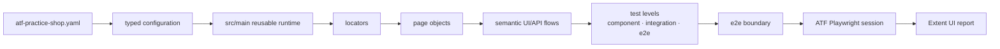
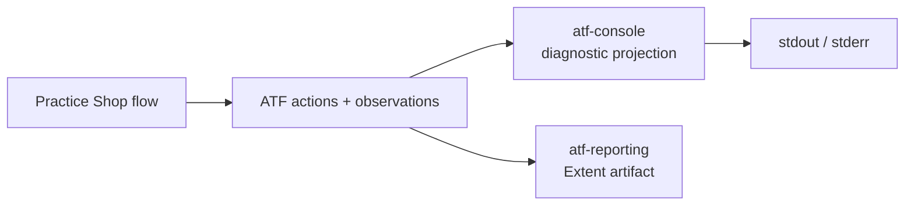
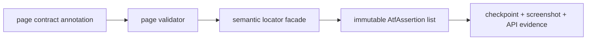
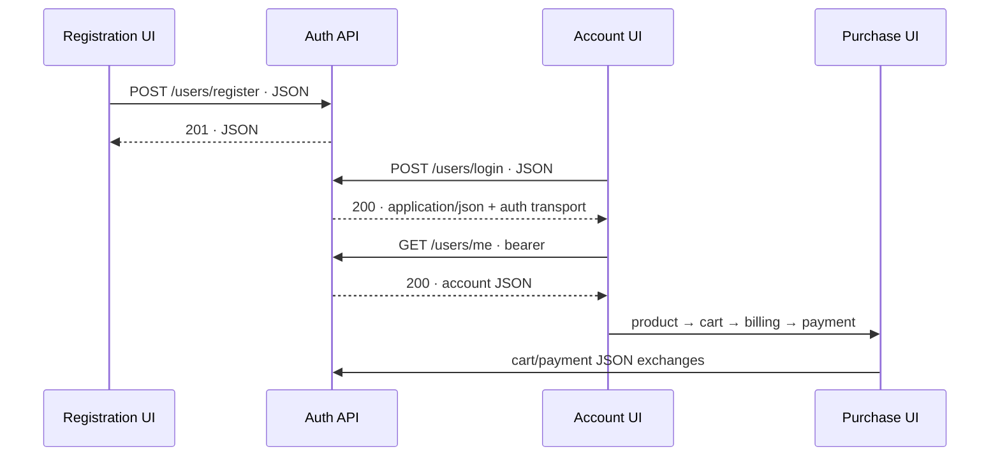
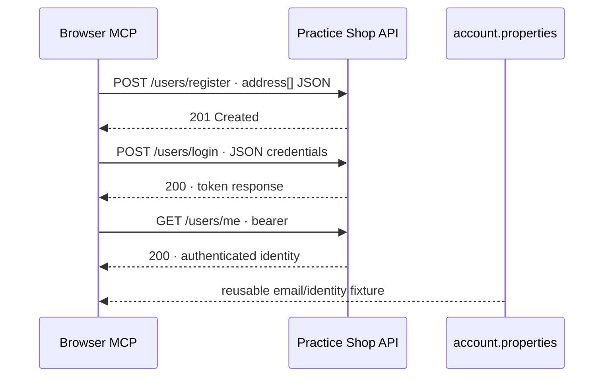
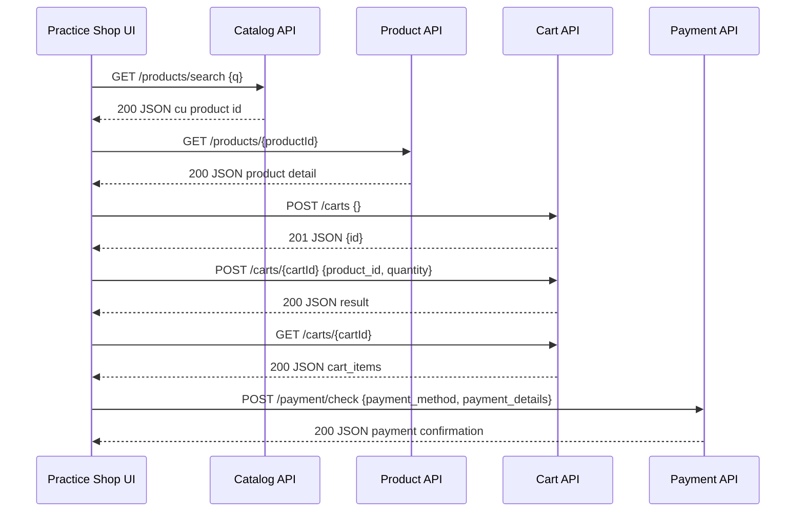
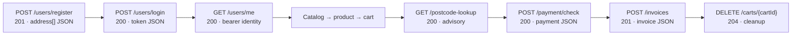
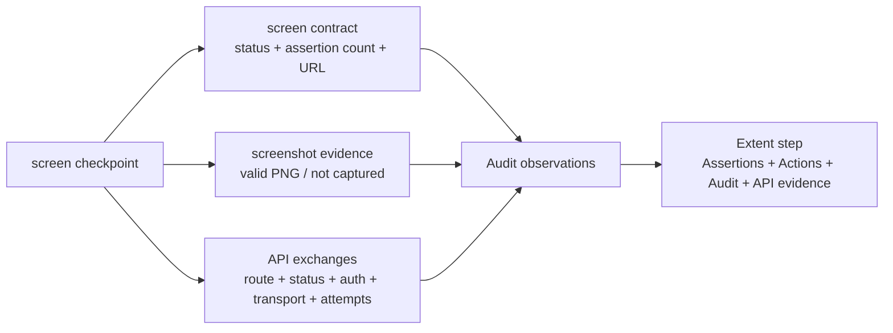
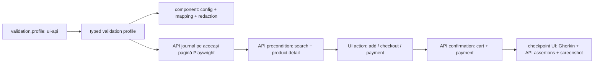
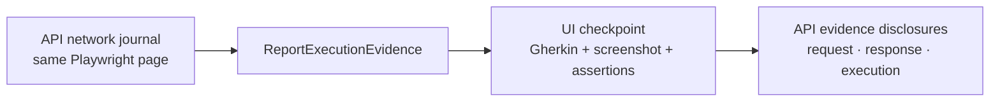

# ATF Test Practice Shop — consumer plug-and-play

## Overall

Acest modul este suita izolată pentru aplicația Practice Software Testing.
Este un consumer de test al infrastructurii ATF, nu parte din reporting și nu
parte din governance-ul whole-reactor.



<details>
<summary><strong>Legendă — compoziția consumerului</strong></summary>

- YAML-ul furnizează valori dinamice, iar `src/main` expune runtime-ul reutilizabil;
- `TestLevels` grupează nivelurile `component`, `integration` și `e2e`; numai
  boundary-ul E2E continuă spre Playwright;
- Playwright și reporting-ul sunt consumate la boundary, nu ascunse în page objects;
- acest modul verifică aplicația Practice Shop, nu implementarea rendererului Extent.

</details>

## Consola diagnostică ATF

Politica Practice Shop este să folosească
[`atf-console`](../atf-console/README.md) ca proiecție diagnostică a execuției UI/API;
raportul Extent rămâne artifactul HTML, iar consola rămâne canalul pentru pași
observabili în timpul rulării:



<details>
<summary><strong>Legendă — separarea raportului de consolă</strong></summary>

- `atf-console` este singurul owner al `stdout`/`stderr`;
- composition root-ul Practice Shop injectează sink-ul configurat, nu folosește
  `println` și nu deține `PrintStream`;
- acțiunile UI trebuie să fie observabile ca pași `click`, `fill`, `wait` sau
  `navigate`, cu statusul lifecycle-ului;
- `reporting.console.enabled` controlează activarea, iar `detailsEnabled`
  controlează numai detaliile;
- publisher-ul API standalone publică în același sink secvența
  `REQUEST → details(auth/transport) → VALIDATION → COMPLETE(status,duration)`;
- consola nu decide verdictul și nu înlocuiește assertions, evidence sau HTML-ul;
- erorile browserului din `PracticeShopRuntimeDiagnostics` rămân diagnostic
  runtime și se reconciliază cu statusul semantic al raportului.

</details>

**Stare live:** wiring-ul UI este activ. `PracticeShopE2eContext` injectează
`AtfConsoleReporter.configuredStdout()` în sesiunea Playwright, deci toate E2E-urile
care folosesc contextul proiectează acțiunile UI în consola configurată prin
`reporting.console`; flow-urile nu dețin `PrintStream` și nu folosesc `println`.
`PracticeShopStandaloneApiReportTest` injectează același sink în
`PracticeShopApiReportPublisher`, astfel încât și request-urile API sunt
observabile dinamic în consolă, în timp ce JSON-urile complete rămân în raportul
Extent.
`atf-reporting` rămâne standalone și are portul său de consolă independent de
`atf-core`; reconcilierea acestor două porturi este o decizie cross-module,
urmărită numai în [`SHOP-CONSOLE-02`](../docs/feedback/ATF_Practice_Shop_API_Screen_Pyramid_Feedback.md).

## Boundary și OOP

```text
src/main/java/atf/ui/practiceshop/
  config/   → records imutabile și loader YAML
  api/      → request factory, client și screen API flows
  locators/ → singurul owner al CSS/data-test selectorilor
  pages/    → interacțiuni semantice pe o pagină
  flow/     → facade public + stage-uri business reutilizabile
  support/  → lifecycle browser, API evidence, capture/select seams și publisher API reusable
src/test/java/atf/ui/tests/practiceshop/
  component/       → contracte rapide fără browser sau network
  api/component/   → variații pozitive/negative pe transport local determinist,
                      strict test-scope
  api/integration/ → verificări live opt-in cu precondiție de login
  e2e/             → dovada minimă a journey-ului complet
    checkpoint → Gherkin + assertions + actions + screenshot per page
```

Regula de packaging este intenționată: clasele reutilizabile nu locuiesc în
`src/test` și nu sunt ascunse sub `atf.ui.tests.practiceshop`. Testele sunt
singurele care rămân în acel namespace; o excepție este permisă numai pentru
un helper strict semantic de test, documentat și verificat de
`PracticeShopArchitectureTest`.

Testele nu folosesc `page.locator(...)` direct și nu cunosc markup-ul aplicației.
Orice selector nou intră în `PracticeShopLocators`, este verificat de
`PracticeShopArchitectureTest` și este consumat de un page object. Configurația
checkout-ului este typed (`quantity`, guest identity, billing și payment
method), astfel încât flow-ul nu ascunde valori de business în cod.

Publisher-ul `PracticeShopApiReportPublisher` este runtime support și rămâne în
`src/main`; `PracticeShopStandaloneApiReportTest` păstrează doar orchestration-ul
testului, transportul local determinist și verificările artifactului. În `src/test` nu se
mută logică reusable doar pentru a scurta un test.

`PracticeShopApiNetworkJournal` coordonează numai sesiunea și verdictul API.
`PracticeShopApiTrafficCapture` deține filtrarea hostului și sanitizarea
exchange-ului, iar `PracticeShopApiExchangeSelector` deține selecția pură a
precondițiilor/read-back-urilor. Astfel capture-ul și selecția pot fi testate
fără browser. Purchase-ul are acum două seam-uri business explicite:
`PracticeShopCatalogPurchaseStage` pregătește home → product → add-to-cart,
iar `PracticeShopCheckoutPurchaseStage` execută cart → identity → billing →
payment → confirmation. `PracticeShopPurchaseJourneyContext` transportă
configurația, validators, journal-ul și observer-ul de evidence; facade-ul
`PracticeShopPurchaseFlow` păstrează exact API-ul public existent și doar
compune stage-urile. Nu se multiplică E2E, iar fiecare stage poate fi evoluat
și verificat separat fără a muta responsabilități în `src/test`.

Deoarece `src/main/java/atf/ui/practiceshop` este support reutilizabil, dependențele
ATF consumate de el (`atf-core`, `atf-test-kit`, `atf-reporting`, `atf-ui`) sunt
compile-scope în POM; numai JUnit rămâne test-scope. Gate-ul verifică această regulă
și previne ca un build incremental să ascundă o eroare de classpath.

## Contracte declarative pentru validarea fiecărui ecran

Fiecare page object din purchase journey declară prin
`@PracticeShopPageContract` ecranul, ruta și controalele semantice obligatorii.
`PracticeShopPageValidator` proiectează contractul în assertions auditabile,
folosind exclusiv `PracticeShopLocators`; flow-urile și testele nu duplică CSS.



<details>
<summary><strong>Legendă — contractul unui ecran</strong></summary>

- adnotarea descrie topologia stabilă a ecranului;
- validatorul folosește locatorii deținuți de modul și produce assertions typed;
- checkpoint-ul publică evidence, dar nu reimplementează HTML-ul raportului;
- valorile configurabile rămân în YAML și în modelul typed al consumerului.

</details>

Implementarea păstrează responsabilitățile API separate: `PracticeShopApiNetworkJournal`
capturează și selectează exchange-urile din sesiunea UI, `PracticeShopApiAssertions`
proiectează contractele JSON în assertions, iar `PracticeShopApiEvidenceMapper`
transformă exchange-ul în evidence Extent (request, response, headers, auth și
attempt). Flow-ul rămâne composition root-ul subțire care le orchestrează; niciun
page object nu cunoaște formatul intern al raportului.

Regula de lifecycle este explicită: `fill → validate → submit` pentru formulare.
Guest checkout verifică emailul, prenumele, numele și controlul de submit înainte
de tranziția către billing; apoi următorul checkpoint validează noul ecran.
Astfel controalele tranzitorii nu sunt cerute după ce aplicația le ascunde, iar
un fail de contract devine `FAIL` auditabil, nu un pas fals `PASS`.

Adnotările descriu topologia statică, YAML-ul păstrează valorile dinamice, iar
component testele verifică separat contractele și imutabilitatea rezultatului.
Se păstrează două E2E intenționate — guest și authenticated — iar variațiile se
testează în component/API, nu prin multiplicarea journey-urilor.

## Cont reutilizabil și explorarea registration → login → purchase

Înaintea automatizării, flow-ul a fost explorat manual în ATF Debug/browser MCP:



`PracticeShopRegistrationPage` și `PracticeShopRegistrationData` păstrează
registration-ul în `src/main`, dar registration-ul nu este repetat ca E2E la
fiecare rulare. După explorarea live, contul reutilizabil este fixture-ul
intenționat al modulului:

```text
atf-test-practice-shop/src/test/resources/
  atf-practice-shop.yaml
  practice-software-testing-account.properties
```

Fișierul properties conține credentiale demo în clar, conform deciziei explicite
pentru acest proiect. El este consumat doar prin `PracticeShopCredentials`, nu
este introdus în acțiuni, assertions, console sau HTML. Pentru CI sau un cont
nou, `-Datf.practice.account-file=<absolute-properties-file>` (sau
`ATF_PRACTICE_ACCOUNT_FILE`) înlocuiește fixture-ul fără modificarea codului.

Fixture-ul din repository este revalidat periodic împotriva aplicației externe.
Dacă login-ul răspunde `Invalid email or password`, se reface registration-ul
prin flow-ul dedicat/contractul JSON al aplicației, se verifică separat login-ul
cu status `200`, apoi se actualizează numai fișierul properties și se rerulează
E2E-ul autentificat. Nu se modifică timeout-uri sau assertions pentru a masca un
cont expirat; parola rămâne absentă din actions, assertions și HTML.

`PracticeShopAuthenticatedPurchaseE2eTest` reutilizează aceeași precondiție de
login și execută un purchase complet. `PracticeShopAccountAndCatalogE2eTest`
rămâne un smoke slice opt-in pentru account/catalog, iar
`PracticeShopPurchaseE2eTest` rămâne journey-ul guest-safe. Nu se adaugă câte un
E2E pentru registration, login, fiecare API sau fiecare componentă; componentele
rapide și local API variation matrix acoperă variațiile, iar E2E-urile dovedesc
orchestrarea reală.

### Revalidare live a contului reutilizabil — 2026-10-20

Contul din `practice-software-testing-account.properties` a fost recreat în
aplicația reală după ce credentialul anterior a devenit invalid și a fost
verificat separat prin browser MCP/ATF Debug:



Rezultatul confirmat este `register=201`, `login=200` și `users/me=200`.
Fișierul rămâne singura sursă module-owned pentru account setup; parola nu este
afișată în loguri, assertions, actions sau HTML. Dacă fixture-ul expiră, se
repetă numai registration → login → `users/me`, apoi se schimbă strict liniile
de identitate din properties. Nu se transformă un login invalid în warning și
nu se introduc credentiale în YAML sau în testele de business.

Această revalidare confirmă setup-ul live, dar nu închide automat ToDo-urile de
component API pentru registration, auth negative paths, invoice și cleanup;
acestea sunt urmărite separat în feedback și trebuie implementate pe clientul
real, fără catalog mock.

### De ce există două journey-uri și cum este tratat bootstrap-ul extern

`PracticeShopPurchaseE2eTest` este intenționat guest-safe și nu folosește fixture-ul
de cont. `PracticeShopAuthenticatedPurchaseE2eTest` este journey-ul separat care
încarcă `practice-software-testing-account.properties` în SETUP, verifică login-ul
real și apoi reutilizează sesiunea pentru purchase. Dacă fixture-ul vechi este
respins cu `401`, acesta trebuie recreat și reverificat prin `register → login →
users/me`; nu se schimbă assertions sau timeout-uri ca să ascundă problema.

Site-ul extern poate emite asincron, în bootstrap-ul anonim, `GET /users/me → 401`
și `cart_items` null chiar dacă login-ul ulterior, `/users/me` și checkout-ul
reușesc. `PracticeShopRuntimeDiagnostics` le clasifică strict ca semnale cunoscute
și `Scenario` le publică drept `WARNING` cu mesajul complet. Un diagnostic care nu
se potrivește exact rămâne `FAIL`, iar warning-ul nu poate transforma un login
invalid în succes.

Ultima revalidare a contului a trecut `register=201`, `login=200`, `users/me=200`;
purchase E2E a trecut **1/1**, iar gate-ul component focalizat a trecut **8/8**.
Raportul proaspăt este în `artifacts/reports/ui/`, cu login/API evidence și
warning-ul extern vizibil în pașii raportului.

Contractele active acoperă toate ecranele declarate ale journey-ului, inclusiv
ecranele reutilizabile de login și account:

| Screen | Route contract | Controls validated |
|---|---|---:|
| HOME | `/` | 16 |
| PRODUCT | `/product/*` | 5 |
| CART | `/checkout` | 3 |
| GUEST_CHECKOUT | `/checkout` | 4 |
| BILLING | `/checkout` | 7 |
| PAYMENT | `/checkout` | 2 |
| CONFIRMATION | `/checkout` | 1 |
| LOGIN | `/auth/login` | 3 |
| ACCOUNT | `/account` | 1 |

`PracticeShopPageContractTest` este gate-ul rapid pentru această listă și pentru
rezultatul agregat immutable. Orice screen nou trebuie să adauge contractul,
locatori semantici și cazul component înainte de a fi introdus în E2E.

Primul ecran al purchase flow-ului este intenționat împărțit în trei checkpoint-uri
fără browser reset și fără test E2E nou:

```text
GIVEN catalog home structure displays navigation, branding and banner
  → route, navbar, brand link, banner visibility, render area și style invariants
AND catalog home filters expose sorting, price, search and category controls
  → sort, price range, search/reset/submit, category/brand/eco filters și cardinalități
AND catalog home renders product cards, pagination and footer
  → card grid, card names, card images, pagination, footer și cardinalități egale
```

Fiecare checkpoint consumă exclusiv locatori din `PracticeShopLocators`, execută
assertions Playwright pentru componenta lui și publică propriul screenshot inline.
Cardinalitățile sunt dinamice (`>= 1`, iar names/images trebuie să egaleze numărul
de carduri), astfel încât testul rămâne plug-and-play când catalogul își schimbă
numărul de produse. Colecțiile sunt folosite pentru diagnostic/count; sincronizarea
și click-ul folosesc primul element explicit pentru a respecta strict mode.

Celelalte ecrane păstrează aceeași disciplină, dar rămân câte un singur
checkpoint deoarece componentele lor încap într-o captură completă la zoom
100%; nu sunt fragmentate artificial în teste sau module noi:

```text
PRODUCT       → name, price, description, quantity și add-to-cart
CART          → product title, quantity și proceed
GUEST         → guest tab, email, first name, last name și submit
BILLING       → country, postal code, house number, street, city, state și proceed
PAYMENT       → payment method și finish
CONFIRMATION  → payment success
```

`PracticeShopPurchaseScreenValidator` proiectează fiecare listă în același
checkpoint existent. Pentru fiecare componentă sunt verificate compact
cardinalitatea și zona randată (`count >= 1`, bounding box nenul), iar pentru
controalele interactive și disponibilitatea (`enabled`). Screenshot-ul este
al ecranului întreg, iar acțiunile Playwright rămân în disclosure-ul acelui
checkpoint. Guest este verificat corect înainte de tranziție (`fill → validate →
submit`); `guest-proceed`, care apare numai după submit, rămâne evidențiat prin
acțiunea de tranziție și nu este pretins ca existent pe ecranul anterior.

Rezultatul este o piramidă compactă: Home are trei zone deoarece are catalog,
filtre și grid suficient de bogate; toate celelalte ecrane au o singură zonă
completă, cu component assertions, acțiuni și imagine inline. Nu se adaugă
teste E2E pentru a obține această granularitate.

## Journey acoperit și evidence per ecran

```text
search product
  → open product
  → set quantity and add to cart
  → verify cart product + quantity
  → continue as guest
  → fill billing address
  → select Cash on Delivery
  → confirm payment and verify “Payment was successful”
```

Același test E2E publică nouă subpași, fără să mărească numărul de teste:

```text
SETUP
  GIVEN typed guest checkout configuration is ready
TEST BODY
  GIVEN catalog home exposes product search
  GIVEN product page displays the configured product and ready-to-buy fields
  WHEN cart displays the configured product with the requested quantity
  AND guest checkout form contains the configured identity
  AND billing form is completed with the configured address
  AND payment form displays the configured demo method
  THEN payment confirmation is displayed for the completed purchase
```

Fiecare subpas are propriul set de assertions, acțiunile executate până la
acel ecran și un screenshot inline. Formularele nu publică valorile sensibile
în clar; dovada este semantică (câmpuri completate și confirmate), iar
identitatea guest rămâne configurată în YAML.

Testul guest rămâne intenționat account-independent. Pentru journey-ul
autentificat, fixture-ul typed este încărcat în SETUP, iar raportul publică
login-ul ca precondiție API/UI înainte de catalog. Astfel un raport poate fi
citit ca `SETUP → login → screen checkpoints → cart/payment confirmation`, fără
ca parola să apară în evidence.

## Explorare ATF Debug: hartă UI → API pentru integrare

<details>
<summary><strong>Detalii exploratorii și semnale de integrare</strong></summary>

Fluxul poate fi reexplorat cu ATF Debug și Playwright headless, cu network capture
activ în aceeași sesiune. Capturile brute rămân în staging extern și nu sunt
referințe normative sau fixture-uri copiate în repository.



<details>
<summary><strong>Legendă — contracte observabile UI → API</strong></summary>
- secvența arată boundary-urile observate, nu garantează că fiecare endpoint este contract public permanent;
- identificatorii și body-urile se verifică prin teste de integrare configurabile;
- guest, payment și lookup au politici explicite: răspunsul așteptat nu este confundat cu eroarea runtime.
</details>

Contractele observate și invariants-urile utile pentru viitoarele teste de
integrare sunt:

| Boundary | Observație live | Invariant de testat |
|---|---|---|
| catalog → product | `GET /products/search` întoarce ID-ul curent pentru produsul configurat; detaliul este `GET /products/{id}` | ID-ul din search este același cu ID-ul din detail și cu cel trimis în cart |
| product → cart | `POST /carts` întoarce un `cartId`, apoi `POST /carts/{cartId}` primește JSON cu `product_id` și `quantity` | cart-ul citit ulterior conține produsul și cantitatea cerută |
| cart → checkout | `GET /carts/{cartId}` expune `cart_items`, inclusiv produsul și cantitatea | UI-ul nu confirmă checkout înainte de cart read consistent |
| checkout → payment | `POST /payment/check` primește JSON și răspunde JSON `Payment was successful` | metoda selectată și mesajul răspunsului sunt mapate în checkpoint-ul UI final |
| guest identity | `/users/me` răspunde `401 {message: Unauthorized}` de mai multe ori pentru guest | 401 este ramura guest așteptată, nu fail de business; erorile runtime neașteptate rămân fail |
| postcode lookup | lookup-ul răspunde 200, dar adresa demo returnată diferă de valorile introduse | trebuie decis explicit dacă lookup-ul este advisory sau autoritativ; nu se asertează egalitatea implicit |

`SEARCH` rămâne intenția de business a catalogului, dar transportul real este
`GET /products/search`; raportul nu inventează un pseudo-verb `QUERY`. Titlul
semantic publicat este `GET /products/search — find configured product`, iar
`PracticeShopApiOperation` păstrează separat intenția stabilă, metoda HTTP și
template-ul de rută. ID-urile de produs/cart rămân valori dinamice în flow și
nu sunt mutate în enum. În schimb, request-urile POST observate au
`Content-Type: application/json` și body JSON, iar răspunsurile lor sunt JSON;
acest lucru trebuie verificat în testele de integrare cu aceeași evidență
request/response folosită în raportul API.

### Semnal de integrare găsit în flow-ul guest

Explorarea guest a arătat două clase de semnal care trebuie separate: `401`
pentru `/users/me` poate fi ramura guest așteptată, în timp ce
`TypeError: Cannot read properties of null (reading 'cart_items')` este eroare
runtime. Aceasta nu justifică încă o modificare mecanică a page objects: se adaugă
mai întâi un test de reziliență care distinge guest-ul acceptat de excepția reală
și verifică faptul că UI-ul nu încearcă să randeze `cart_items` înainte de cart read.

Prioritatea de testare este: component/integration pentru contractele și
mapping-ul de mai sus, apoi journey-urile guest și authenticated pentru purchase,
care verifică invariants între UI și network. Nu se multiplică E2E-urile pentru
fiecare endpoint. `PracticeShopCatalogApi` extrage dinamic ID-ul API din search și îl
propagă în product detail/cart. `productPath` este strict când conține o rută
`/product/<id>`; pentru catalogul extern volatil, `auto` selectează primul card
pentru `productName` și validează obligatoriu ruta `/product/*`.


</details>

## Explorare live actualizată: account → purchase → cleanup

Revalidarea manuală a contului și explorarea checkout-ului au confirmat și
boundary-urile de finalizare care nu trebuie amestecate cu un test guest:



Observațiile sunt live, nu fixture-uri copiate în repository:

| Boundary | Ce s-a confirmat | Cum intră în piramidă |
|---|---|---|
| registration | body JSON cu `address[]`, răspuns `201` | component request/response + caz negativ pentru shape greșit și email duplicat |
| login/session | login `200`, token response, apoi `/users/me` `200`; guest `/users/me` rămâne `401` | component auth matrix și setup API reutilizabil |
| postcode | query lookup `200`, dar datele demo pot diferi de input | assertion `ADVISORY`, fără egalitate forțată în billing |
| payment | `POST /payment/check` primește JSON și răspunde JSON cu confirmarea plății | component matrix pe metodele suportate de UI |
| invoice | `POST /invoices` primește billing/payment/cart JSON și răspunde `201` cu id, user, total și date | component contract + integrare după cart/payment |
| cleanup | `DELETE /carts/{cartId}` răspunde `204` | teardown explicit, fără a ascunde eșecul purchase |

Pentru un raport UI/API, fiecare exchange trebuie legat de checkpoint-ul în
care s-a produs: request metadata, request JSON, response metadata, response
JSON și execution evidence. Tokenul și parola se redacționează; statusurile,
metodele, ruta, content type, auth profile și body-urile non-secrete rămân
vizibile. Retry-urile și apelurile repetate `/users/me` se păstrează distinct,
nu se selectează arbitrar doar ultimul request.

## Audit observabil în fiecare checkpoint

Fiecare checkpoint existent publică acum o zonă distinctă `Audit observations`;
nu se creează un test suplimentar și nu se repetă assertion table-ul. Observația
este construită dinamic în `PracticeShopAuditObservations` și este atașată
aceleiași secvențe de acțiuni. Calea de compatibilitate pentru testele
account/catalog (`PracticeShopE2eContext.Scenario.pass`) folosește aceeași
proiecție de audit; nu există un al doilea model de evidence pentru scenariile
care încă publică o singură validare de ecran:



Regulile sunt deliberate:

- assertions decid verdictul; audit observations explică de ce există evidence-ul;
- fiecare exchange din checkpoint are o observație proprie, cu route/status și
  metadata safe, fără request/response body duplicat și fără token/parolă;
- evidence invalidă sau incompletă nu este inventată: exchange-ul este omis din
  observațiile API, iar assertion/evidence contractul rămâne responsabil de fail;
- URL-ul, cardinalitatea assertion-urilor și starea screenshot-ului sunt preluate
  din execuția curentă, nu din YAML static;
- component test-ul verifică cardinalitatea, sursa `OBSERVE`, statusul API,
  label-ul de transport și calea account/catalog; E2E-ul doar dovedește wiring-ul real.

Astfel raportul rămâne lizibil: `Playwright action sequence`, `Audit observations`
și `Assertions` sunt zone diferite, în aceeași ordine și pe același checkpoint.

## Piramida configurabilă UI + API



<details>
<summary><strong>Legendă — piramida configurabilă</strong></summary>
- component verifică mapping-ul și redaction-ul fără network;
- integration verifică journal-ul API și invariants între boundary-uri;
- un E2E selectat demonstrează orchestration-ul real și randarea;
- profilul decide dacă API evidence este obligatorie sau UI-only, fără boolean paralel.
</details>

Profilul este configurat prin `practiceShop.validation.profile`:

| Profil | Scop | Network/API obligatoriu |
|---|---|---|
| `ui-api` | flow mixt implicit; API-ul pregătește sau confirmă fiecare boundary critic | da |
| `ui-only` | fallback pentru investigații strict vizuale sau medii fără API observabil | nu |

Nu există un `ui.enabled` boolean și nu se pornește un al doilea cart pentru
precondiții. `PracticeShopApiNetworkJournal` ascultă request/response pe aceeași
pagină și publică în checkpoint-ul UI doar date redacted și relevante:

```text
search + product detail API  → precondiție înainte de add-to-cart
UI add-to-cart               → cart POST + cart GET confirmate prin API
UI payment confirmation      → payment/check POST + JSON response confirmate
```

Astfel component tests verifică rapid profilul, JSON parsing, invariants și
redaction; guest purchase și authenticated purchase sunt cele două E2E
intenționate pentru orchestration-ul real, iar variațiile API rămân în
component/integration tests. Account/catalog rămâne opt-in și condiționat de
`authenticatedE2eEnabled: true` plus fixture-ul de cont. Dacă un API
precondiționat lipsește, flow-ul eșuează explicit și checkpoint-ul rămâne
auditabil, în loc să continue cu o stare UI presupusă.

## API evidence în checkpoint-urile UI și standalone

În purchase E2E, API-ul nu dublează assertion table-ul UI. `PracticeShopApiNetworkJournal`
transformă schimburile observate în
`ReportExecutionEvidence`, iar `PracticeShopE2eContext` le atașează aceluiași
checkpoint de pagină:



<details>
<summary><strong>Legendă — evidence atașată checkpoint-ului</strong></summary>

- un checkpoint UI poate avea zero, unul sau mai multe schimburi API;
- `Disclosures` este doar o grupare vizuală pentru a păstra ramificațiile locale;
  nu introduce un layer runtime sau un nou nod în raport;
- request, response și execution rămân disclosure-uri surori, închise implicit;
- jurnalul observă aceeași pagină Playwright; nu creează un test API artificial.
</details>

Pentru fiecare checkpoint pot exista zero, unul sau mai multe schimburi API.
Fiecare schimb este redat în disclosure-urile existente, închise implicit:

- `Request details` conține metoda observată, path-ul, URL-ul, query params,
  transportul, tipul de autentificare, headerele redacted și `REQUEST JSON`;
- `Response details` conține status, content type, headerele redacted și
  `RESPONSE JSON`;
- `Execution evidence` conține URL-ul final, statusul, durata, attempt-ul,
  retry count și outcome-ul.

Body-urile sunt limitate de `reporting.bodyMaxDisplayCharacters` din
`atf.yaml` (implicit 12000), iar valorile de assertion de
`reporting.assertionMaxDisplayCharacters` (implicit 240). Redaction-ul se
aplică înainte de publicare. Setup-ul declară profilul (`ui-api`/`ui-only`) și
politica de disclosures, astfel încât raportul arată preliminar dacă evidence
API este activă.

Regula de corelare este strictă: pentru product detail se acceptă path-ul
exact `/products/{productId}`, nu un prefix care ar putea selecta
`/products/{productId}/related`. Astfel un request API greșit nu poate trece
doar pentru că seamănă textual cu cel așteptat.

Component test-ul `ExtentReportUiEvidencePublishingTest` verifică proiecția
într-un checkpoint UI (JSON, headers, auth și execution), iar purchase E2E
verifică aceeași structură în raportul generat. Toate disclosure-urile rămân
închise în starea inițială; verificarea de browser le deschide doar pentru
auditul de randare.

Pentru variații rapide și pentru auditul reporting fără browser există și
`PracticeShopStandaloneApiReportTest`. Acesta rulează același
`PracticeShopApiScreenFlow` pe transport local determinist și scrie un artifact API în
`artifacts/reports/`, configurat de `atf.yaml`. Fiecare request publică separat
method/path/query/auth, `Request details`, `REQUEST JSON` când există body,
`Response details`, `RESPONSE JSON`, status și `Execution evidence`. În disclosure-ul
de request, metadata este explicită (`URL`, `AUTH TYPE`, `QUERY PARAMS`,
`REQUEST HEADERS`); în disclosure-ul de response este explicită (`CONTENT TYPE`,
`RESPONSE HEADERS`). Publisher-ul fail-fast respinge orice POST/PUT fără body
JSON și orice execuție fără response body, iar testul standalone verifică aceste
invariante înainte de a publica artifactul.
Credentialele sunt redacted înainte de HTML. Astfel API screen flow-ul poate fi
testat și inspectat independent de browser, fără să crească numărul de E2E.

Pentru login-ul extern, serverul poate răspunde cu payload JSON comprimat pe care
Chromium îl eliberează înainte ca CDP/Playwright Java să-l poată citi prin
`Network.getResponseBody`. Jurnalul nu inventează tokenul: marchează transparent
`body unavailable`, păstrează `content-type`, `content-length`, statusul și
headerele redacted, iar `GET /users/me` 200 validează efectiv sesiunea. Contractul
component `PracticeShopApiLoginAssertionsTest` verifică această politică; pentru
cart/payment, request și response JSON rămân afișate și validate normal.

Variațiile de catalog și cart sunt component-first:

```text
GET /products             → sort, brand/category, price range, rental, page
GET /categories           → category contract
GET /products/{id}        → in_stock true/false
PUT /carts/{id}/product/quantity → product_id + quantity JSON
DELETE /carts/{id}/product/{id}  → remove contract
```

Rutele sunt centralizate în `PracticeShopApiRoutes`, query-ul este typed prin
`PracticeShopProductQuery`, operațiile raportabile sunt descrise de
`PracticeShopApiOperation`, iar request factory-ul este singurul owner al
serializării. Metodele HTTP, media types, auth profiles și vocabularul de
evidence auth sunt enums/core constants; testele nu repetă
literaluri pentru `POST`, `PUT`, `application/json`, `none` sau `bearer`.

Component tests folosesc un singur boundary determinist,
`PracticeShopApiComponentFixture`, iar valorile de scenariu sunt în
`PracticeShopApiScenarioFixture`: credentials, IDs, query values și payload-uri
expected. Astfel testele descriu intenția (`login → catalog → cart → checkout`),
nu reimplementează transportul. Fixture-ul este strict test-scope și nu schimbă
API-ul live; integration/E2E folosesc aplicația/API-ul Practice Shop real. Nu
există un catalog mock sau o dependență `atf-mock` în acest consumer.

Regulă de mentenanță:

```text
PracticeShopApiRoutes       → path-uri și template-uri
PracticeShopApiRequestFactory → request + serializare JSON
PracticeShopApiScenarioFixture → date/expected-uri ale scenariului
PracticeShopApiComponentFixture → transport determinist al componentelor
PracticeShopApiScreenFlow   → ordinea semantică a ecranelor API
PracticeShopApiOperation    → intenție, HTTP method, route template și titlu reportabil
```

Un nou endpoint se adaugă întâi în `PracticeShopApiRoutes` și request factory,
apoi în fixture-ul component numai dacă este necesar pentru un test browser-free;
nu se adaugă path-uri hardcodate în testele de business.

Pentru raportare, fiecare execution publică aceeași formă lizibilă:
`HTTP_METHOD relativePath — very-short intent`. Publisher-ul adaugă în
`Response details` și `Execution evidence` câmpurile `OPERATION KIND` și
`ROUTE TEMPLATE`, astfel încât un cititor poate lega request-ul runtime de
contractul stabil fără să confunde ID-urile dinamice cu definiția operației.

Pentru vocabularul stabil al contractului API folosim enum-uri locale, cu owner
semantic și fără a muta date dinamice în enum-uri globale:

```text
PracticeShopApiHttpStatus      → coduri HTTP așteptate în contracte
PracticeShopApiJsonField       → chei JSON request/response
PracticeShopApiQueryParameter  → chei query și lookup
PracticeShopApiAuthProfile     → profilul de autentificare al requestului
PracticeShopApiAuthType        → mecanismul observat în evidence
PracticeShopApiReportMetadataFixture → nume/tag-uri stabile ale standalone report
```

`PracticeShopApiScenarioFixture` păstrează în continuare ID-uri, credentials și
payload-uri de scenariu; acestea sunt date configurabile ale fixture-ului, nu
enum-uri. Astfel factory-ul, assertions și transportul component folosesc aceeași
ortografie wire, iar testele verifică intenția prin `PracticeShopApiHttpStatus.OK`
și `PracticeShopApiJsonField.PRODUCT_ID`, nu prin numere sau chei repetate.
Enum-urile sunt strict module-local; nu se adaugă un vocabular Practice Shop în
`atf-core` doar pentru a evita un literal al aplicației.

`PracticeShopApiClient.live(...)` propagă provenance `LIVE_HTTP`, iar
`forTransport(...)` rămâne `ACCEPTANCE_MOCK` implicit; testul de contract verifică
această separare, astfel încât raportul să nu prezinte un transport local ca trafic
real sau invers.

### Regula de citire pentru testele API

Testele Practice Shop păstrează intenția în variabile cu nume semantic și nu
repetă lanțuri care ascund ce se validează. Un rezultat se capturează o singură
dată înaintea assertions-urilor:

```java
var filteredResponse = filtered.response();
var updatedRequest = updated.request();

assertTrue(PracticeShopApiHttpStatus.OK.matches(filteredResponse.status()));
assertEquals(HttpMethod.PUT.value(), updatedRequest.method());
```

`PracticeShopApiHttpStatus` este owner-ul comportamentului HTTP: `matches(int)`
pentru comparația semantică, `wireValue()` pentru expected-ul publicat și
`isSuccess(int)` pentru regula generică 2xx. `.code()` rămâne numai la boundary-ul
care construiește un model core ce cere un `int`, nu este repetat în fiecare test.
Aceeași regulă se aplică publisher-ului: request-ul, response-ul, body-ul și
content type-ul sunt alias-uri locale, astfel încât request JSON, response JSON și
assertion-ul raportului descriu aceeași execuție.

Importurile statice sunt explicite și nominale: assertions JUnit, DSL-ul stabil
`check(...)` și constantele de scenariu dintr-un singur fixture pot fi importate
static când numele rămâne neambiguu (`PRODUCT_NAME`, `QUANTITY`, `COUNTRY`). Nu
se folosesc wildcard imports și nu se importă static valori dinamice, metode de
flow sau enum-uri din domenii diferite. Astfel codul testului citește intenția,
iar owner-ul rămâne vizibil în numele fixture-ului și în README. Datele dinamice
rămân în fixture/config; enum-urile păstrează numai contracte stabile (`status`,
chei JSON, query și auth).

Pentru body-uri JSON, regula este semantică: testul parsează request-ul sau
response-ul o singură dată prin `PracticeShopJsonEvidence`, păstrează rezultatul
într-un alias local (`updateRequestBody`, `updateResponseBody`) și verifică
field-urile prin `PracticeShopApiJsonField`. Nu se folosesc substring-uri pentru
a demonstra un contract JSON; substring-ul rămâne permis numai pentru smoke
checks de HTML sau pentru text diagnostic. Astfel un test nu poate trece deoarece
un fragment apare accidental în alt câmp sau într-o valoare formatată diferit.

Pentru mutation tests, `PUT update` și `DELETE remove` sunt contracte distincte
atât timp cât fixture-ul nu modelează stare și read-back. Dacă este necesară o
tranzacție reală, se adaugă un flow separat `add → update → read → remove → read`
cu mock stateful sau API live explicit; nu se lasă un test de component să pară
stateful doar prin ordinea a două apeluri independente.

Lifecycle-ul nu se orchestrează cu `try/catch/finally` în test. `Scenario.execute`
publică failure-ul și închide scena, iar `PracticeShopApiReportPublisher` deține
închiderea phase/scenario/session pentru raportul standalone. Testul rămâne o
succesiune de setup → acțiune → assertion → verdict; resource management-ul și
preservarea primary failure-ului sunt responsabilitatea helper-ului owner-uit.

`postcode-lookup` are politică explicită `ADVISORY` în
`PracticeShopCheckoutApi.CheckoutScreen`: valorile introduse de test rămân
sursa de adevăr pentru billing chiar dacă lookup-ul răspunde cu altă adresă.

Ramura guest este de asemenea explicită: `401 /users/me` este un rezultat API
așteptat, nu un fail de business, numai când este observat structurat pe
`GET /users/me` cu status `401`. `PracticeShopRuntimeDiagnostics` ascultă
console errors și page errors din aceeași sesiune Playwright; un
`TypeError: Cannot read properties of null (reading 'cart_items')` este FAIL,
nu WARNING și nu poate fi mascat de 401-ul guest.

## Configurare

Sursa este `src/test/resources/atf-practice-shop.yaml`. `practiceShop.baseUrl`
este singurul owner al hostului UI. Testele și page objects nu repetă URL-uri
complete: folosesc rutele relative din `PracticeShopUiRoutes`, apoi
`PracticeShopConfiguration.uri(...)` le rezolvă la baza configurată. Exemplul minim:

```yaml
practiceShop:
  # external UI base URL; all UI route values remain relative in Java
  baseUrl: https://practicesoftwaretesting.com
  zoomPercent: 70
  api:
    endpoint: https://api.practicesoftwaretesting.com
    mode: live
    precondition: authenticated
    timeout: PT20S
  reports:
    ui: artifacts/reports/ui
    api: artifacts/reports
  authenticatedE2eEnabled: false
  validation:
    profile: ui-api
  productName: Pliers
  productPath: auto
  checkout:
    quantity: 2
    guest:
      email: atf.practice.shop@example.test
      firstName: ATF
      lastName: PracticeShop
    billing:
      country: Romania
      postalCode: 010101
      houseNumber: 10
      street: Test Street
      city: Bucharest
      state: Bucharest
    paymentMethod: Cash on Delivery
```

Valorile pot fi schimbate prin YAML sau override-uri de proces fără refactor în
flow. `zoomPercent: 70` este default-ul acestui consumer și modifică zoom-ul
documentului Playwright, nu viewport-ul; loader-ul aplică fallback-uri
deterministe și validează input-ul înainte de deschiderea browserului.
`productPath` este un contract UI configurabil: o rută `/product/<id>` folosește
locatorul exact `a[href='<productPath>']`, iar `auto` folosește numai primul
locator semantic pentru `productName` și verifică ruta `/product/*`. ID-ul API nu
este hardcodat în request factory; este descoperit de screen API flow din search.
Pentru un fixture determinist se schimbă perechea `productName`/`productPath`,
apoi se rulează component gate și singurul E2E de purchase.

## Teste și gates

```text
mvn -pl atf-test-practice-shop -am "-Dtest=PracticeShopArchitectureTest,PracticeShopConfigurationTest,PracticeShopCheckoutConfigurationTest,PracticeShopApiRoutesTest,PracticeShopApiRequestFactoryTest,PracticeShopApiExchangeSelectorTest,PracticeShopApiLoginAssertionsTest,PracticeShopApiScreenFlowTest,PracticeShopApiCatalogCartVariantTest,PracticeShopApiContractVariantTest,PracticeShopStandaloneApiReportTest,PracticeShopGuestResilienceTest,PracticeShopJsonEvidenceTest,PracticeShopApiAssertionsTest,PracticeShopApiClientContractTest,PracticeShopPageContractTest,PracticeShopPurchaseCheckpointTest,PracticeShopValidationProfileTest" "-Dsurefire.failIfNoSpecifiedTests=false" test
mvn -pl atf-test-practice-shop -am -Dtest=PracticeShopPurchaseE2eTest test
```

Component tests verifică configurația, locator boundary și invariants fără
browser; testele API prin `PracticeShopApiComponentFixture` verifică request
factory, autentificare, status 401/404/2xx, JSON, variații de payment și
catalog/cart fără să pornească un server sau să copieze transportul în fiecare
test. Testul
`PracticeShopStandaloneApiReportTest` verifică și artifactul API configurat.
`PracticeShopApiClientContractTest` verifică separat provenance-ul: fixture-ul
local este `ACCEPTANCE_MOCK`, iar un transport configurat `LIVE` este publicat ca
`LIVE_HTTP`.
Integration test-ul live este opt-in, reutilizează login API ca precondiție și nu
rulează implicit fără `api.mode=live` și `authenticatedE2eEnabled: true`; existența
fixture-ului singură nu îl activează. Testele authenticated cer aceeași politică.
`PracticeShopPurchaseE2eTest` verifică
journey-ul guest complet, `PracticeShopAccountAndCatalogE2eTest` verifică login
și catalog, iar `PracticeShopAuthenticatedPurchaseE2eTest` verifică purchase-ul
complet după login. Toate publică report Extent în directorul UI configurat de
consumer. Pentru explorare se folosește ATF Debug sau browser MCP;
browserul Windows real nu face parte din protocol.

Build-ul se execută într-un staging extern proiectului. La sync live se
promovează doar fișierele acestui module și actualizările contractuale aprobate;
nu se suprascriu refactorizări paralele din alte module.
