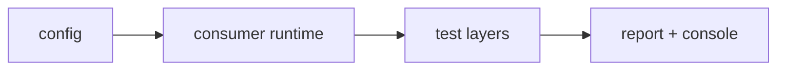
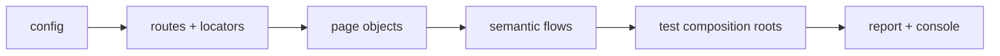
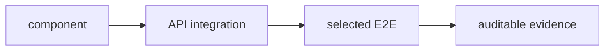
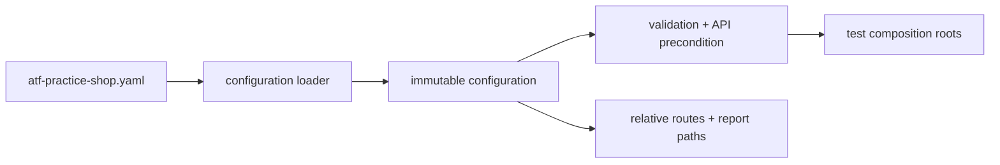
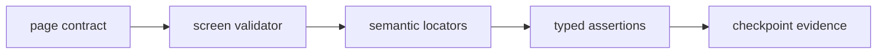
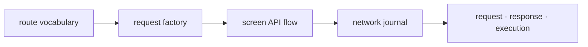
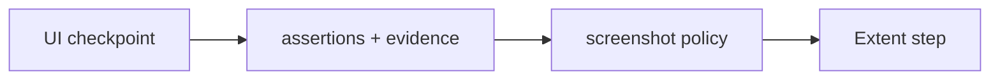
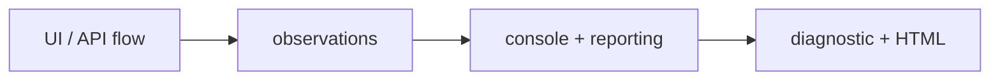

# ATF Test Practice Shop — consumer plug-and-play

## Overall

- consumer configurabil pentru UI și API-ul Practice Software Testing;
- runtime reutilizabil în `src/main`;
- composition roots și teste în `src/test`;
- `atf-reporting` consumat ca bibliotecă standalone;
- `atf-console` folosit ca proiecție diagnostică, nu ca verdict;
- journey-uri E2E puține, cu variații mutate în component și API integration.



<details>
<summary><strong>Legendă — rolul consumerului</strong></summary>

- **Config**: valori externe, profile de validare, rute relative și precondiții;
- **Runtime**: API client, page objects, flows, validators, capture și publisher;
- **Pyramid**: aceeași intenție este verificată la cel mai jos nivel posibil;
- **Evidence**: raportul Extent păstrează verdictul și evidence-ul, consola păstrează observațiile de execuție;
- modulul verifică Practice Shop, nu implementează rendererul Extent.

</details>

Surse de aprofundare:

- [`atf-core`](../atf-core/README.md) — modele și contracte neutre;
- [`atf-ui`](../atf-ui/README.md) — boundary-ul Playwright;
- [`atf-reporting`](../atf-reporting/README.md) — biblioteca de raportare;
- [`atf-console`](../atf-console/README.md) — diagnostic runtime;
- [`atf-test-kit`](../atf-test-kit/README.md) — meta-anotații și convenții de test;
- [feedback Practice Shop](../docs/feedback/ATF_Practice_Shop_API_Screen_Pyramid_Feedback.md) — ToDo-uri și decizii dinamice.

## Harta internă a consumerului



<details>
<summary><strong>Legendă — direcția responsabilităților</strong></summary>

- `config/` deține valori typed și loaderul YAML;
- `api/` deține request factory, client, screen APIs și vocabularul wire;
- `routes/` și `locators/` sunt ownerii selectorilor și rutelor relative;
- `pages/` execută interacțiuni semantice pe un ecran;
- `flow/` compune journey-uri și stage-uri business;
- `support/` deține lifecycle, audit, capture, evidence și publisher;
- testele doar compun și verifică; nu reimplementează aceste responsabilități.

</details>

### Boundary-uri și ownership

| Zonă | Owner live | Regula de mentenanță |
|---|---|---|
| host UI și output | `PracticeShopConfiguration` | un singur `baseUrl`; directoare configurabile |
| rute UI | `PracticeShopUiRoutes` | numai segmente relative; ID-urile sunt validate |
| rute API | `PracticeShopApiRoutes` | path-uri și template-uri centralizate |
| selectorii CSS | `PracticeShopLocators` | testele nu folosesc `page.locator(...)` direct |
| contracte de ecran | `@PracticeShopPageContract` + `PracticeShopPageValidator` | topologia este declarativă, assertions sunt typed |
| flow-uri | `PracticeShop*Flow` și stage-urile purchase | business order, fără detalii de renderer |
| API evidence | journal + capture + selector + mapper | orchestration, selecție și publicare separate |
| lifecycle | `PracticeShopE2eContext` / publisher | testele nu gestionează manual raportul |

Packaging-ul este intenționat:

- clasele reutilizabile rămân în `src/main/java/atf/ui/practiceshop`;
- `src/test/java` conține teste, fixture-uri și support strict test-only;
- `atf-core`, `atf-console`, `atf-test-kit`, `atf-reporting` și `atf-ui` sunt
  compile dependencies ale runtime-ului consumerului;
- `atf-mock` nu este dependency al modulului; transportul determinist pentru
  component tests rămâne local și strict test-scope;
- `atf-reporting` nu primește dependență inversă către Practice Shop.

## Piramida de testare



<details>
<summary><strong>Legendă — niveluri, izolare și proof</strong></summary>

- **component** — verifică rapid și determinist config, routes, locators, JSON,
  mapping, status, redaction și invariants;
- **API integration** — verifică contracte reale și precondiții autentificate,
  numai cu API live configurat explicit;
- **E2E** — verifică wiring-ul, journey-ul și randarea observabilă prin
  Playwright; nu reproduce matricea de variații a componentelor;
- **support** — fixture-uri și transport determinist strict test-only, fără
  business logic ascuns;
- **evidence** — rezultatul observabil este publicat în Extent, iar diagnosticul
  de execuție rămâne separat în consolă.

| Nivel | Suprafață curentă | Browser/network | Scop |
|---|---|---|---|
| component | `src/test/.../component` și `api/component` | nu | contracte și variații locale |
| API integration | `src/test/.../api/integration` | API live, explicit | precondiții și contracte reale |
| E2E | `src/test/.../e2e` | Playwright + aplicația reală | wiring, journey, randare |
| support | `src/main/.../support` + `src/test/.../api/support` | nu implicit | lifecycle, evidence, fixture-uri |

</details>

Principiul de selecție:

- variațiile de endpoint, status, body și mapping se testează component-first;
- integration este opt-in prin configurație explicită;
- E2E demonstrează orchestration-ul real, nu fiecare combinație de API;
- nu se adaugă un test E2E pentru o variație care poate fi verificată fără browser.

### E2E configurabile

| Journey | Clasă | Activare |
|---|---|---|
| guest purchase | `PracticeShopPurchaseE2eTest` | implicit pentru configurația UI validă |
| authenticated purchase | `PracticeShopAuthenticatedPurchaseE2eTest` | `authenticatedE2eEnabled` + precondiție `authenticated` + account fixture |
| account/catalog smoke | `PracticeShopAccountAndCatalogE2eTest` | aceeași activare explicită; smoke slice separat |

<details>
<summary><strong>Legendă — rezultate E2E și structură test-kit</strong></summary>

- guest purchase poate publica `PASS` sau `WARNING` pentru ramuri guest
  cunoscute și auditabile;
- authenticated purchase poate publica `PASS` sau `WARNING` pentru semnale
  externe declarate; diagnosticul necunoscut rămâne `FAIL`;
- integration și journey-urile autentificate inactive sunt `SKIP`, nu `PASS`;
- `component` păstrează matricea de status/body/query; E2E păstrează doar
  journey-uri cu valoare de wiring și randare;
- `src/main` conține suportul reutilizabil al consumerului;
- `src/test` conține composition roots, fixtures și transport local test-only.

```text
src/test/java/atf/ui/tests/practiceshop
├── component/          config, routes, locators, contracts, diagnostics
├── api/
│   ├── component/      request, status, JSON, mapping, publisher
│   ├── integration/    un flow live opt-in
│   └── support/        fixture-uri și transport local
└── e2e/                guest și authenticated composition roots
```

</details>

Contul nu este o condiție pentru journey-ul guest. Pentru authenticated, setup-ul
API este precondiție și parola rămâne în afara actions, assertions, consolă și HTML.

## Configurare plug-and-play

Sursa principală este
`src/test/resources/atf-practice-shop.yaml`. Override-urile de proces sunt
rezolvate de `PracticeShopConfigurationLoader`; nu se modifică flow-urile pentru
a schimba mediul.



<details>
<summary><strong>Legendă — configurație, policy și composition root</strong></summary>

- **YAML** — input extern; nu conține logică de flow;
- **loader** — parsează, validează și raportează cheia invalidă;
- **snapshot** — record immutable folosit de main și test scope;
- **policy** — decide profile-ul UI/API, precondiția și capture policy;
- **roots** — testele compun obiectele; nu rezolvă manual `baseUrl` sau
  lifecycle-ul raportului.

</details>

```yaml
practiceShop:
  baseUrl: "<ui-base-url>"
  browser: chromium
  headless: true
  timeout: PT20S
  navigationTimeout: PT45S
  zoomPercent: 70
  validation:
    profile: ui-api
  api:
    endpoint: "<api-endpoint>"
    mode: acceptance
    precondition: anonymous
    timeout: PT20S
  reports:
    ui: artifacts/reports/ui
    api: artifacts/reports
  authenticatedE2eEnabled: false
  screenshotOnFailure: true
  productName: "<configured-product>"
  productPath: auto
  accountFile: "<external-account-properties>"
  checkout:
    quantity: 1
    guest:
      email: "<guest-email>"
      firstName: "<first-name>"
      lastName: "<last-name>"
    billing:
      country: "<country>"
      postalCode: "<postal-code>"
      houseNumber: "<house-number>"
      street: "<street>"
      city: "<city>"
      state: "<state>"
    paymentMethod: "<supported-payment-method>"
```

| Configurație | Semnificație |
|---|---|
| `validation.profile` | `ui-api` publică API evidence; `ui-only` păstrează fallback-ul strict vizual |
| `api.mode` | `acceptance` pentru transport determinist; `live` numai la boundary explicit |
| `api.precondition` | `anonymous` sau `authenticated`; authenticated E2E nu pornește fără precondiția potrivită |
| `productPath` | `auto` acceptă numai ruta `/product/*`; o rută exactă e fail-fast dacă nu există |
| `screenshotOnFailure` | controlează capturarea la checkpoint prin `PracticeShopScreenshotPolicy`; failure-ul are întotdeauna evidence, iar PASS-ul numai când policy-ul este activ |
| `accountFile` | fixture extern/opțional pentru setup autentificat; nu este copiat în evidence |

Reguli de configurare:

- testele și page objects folosesc rute relative din `PracticeShopUiRoutes`;
- `PracticeShopConfiguration.uri(...)` este singurul resolver `baseUrl + route`;
- ID-urile de produs și cart sunt dinamice și nu intră în enum-uri;
- profile-ul este typed (`UI_API`, `UI_ONLY`), fără matrice de booleeni paraleli;
- loaderul eșuează clar la URI, timeout, path sau combinație de precondiții invalidă.
- implementarea curentă are policy explicită `screenshotOnFailure`, izolată într-un
  seam pur și verificată pentru matricea PASS/FAIL; modurile distincte „după
  fiecare screen / o singură captură finală / fără captură” nu se declară
  implementate aici până când contractul generic de reporting este închis în
  ownerul său.

## Contracte UI și selectors



<details>
<summary><strong>Legendă — contract UI și boundary-ul locatorilor</strong></summary>

- **page contract** — descrie topologia și intenția unui screen;
- **screen validator** — transformă starea observată în assertions typed;
- **semantic locators** — sunt centralizate în `PracticeShopLocators`;
- **typed assertions** — decid verdictul, nu doar existența unui nod DOM;
- **checkpoint evidence** — păstrează acțiuni, observations, API evidence și
  screenshot conform policy-ului.

</details>

Ecranele declarate în `PracticeShopScreen` și în contractele page object sunt:

| Screen | Rută relativă | Contract |
|---|---|---|
| `HOME` | `/` | catalog, filtre, grid și footer |
| `PRODUCT` | `/product/*` | produs, preț, descriere și add-to-cart |
| `CART` | `/checkout` | produs, cantitate și proceed |
| `GUEST_CHECKOUT` | `/checkout` | identitate guest și submit |
| `BILLING` | `/checkout` | address fields și proceed |
| `PAYMENT` | `/checkout` | payment method și finish |
| `CONFIRMATION` | `/checkout` | confirmarea plății |
| `LOGIN` | `/auth/login` | credential controls |
| `ACCOUNT` | `/account` | account identity |
| `REGISTRATION` | `/auth/register` | registration controls |

Reguli pentru selectors:

- `PracticeShopLocators` este singurul owner al selectorilor;
- se preferă locatorii semantici și forma stabilă `element[attribute=value]`;
- clasele CSS generate, textul parțial și XPath-ul ambiguu nu sunt fallback-uri;
- valorile dinamice inserate în CSS trec prin `PracticeShopCssEscaper`;
- `PracticeShopArchitectureTest` apără boundary-ul și scanează și package-ul `component`.

### Validare pe checkpoint

Purchase-ul guest păstrează un număr mic de teste și mai multe dovezi locale:

- HOME poate fi împărțit semantic în structură, filtre și product grid;
- PRODUCT, CART, GUEST, BILLING, PAYMENT și CONFIRMATION rămân checkpoint-uri
  complete, fără fragmentare artificială;
- fiecare checkpoint publică assertions, acțiuni, audit observations și screenshot
  conform configurației;
- `fill → validate → submit` este regula pentru formulare;
- un control apărut după submit se validează în checkpoint-ul următor, nu retroactiv.

## API screen flow și evidence



<details>
<summary><strong>Legendă — ownerii API și proiecția evidence</strong></summary>

- `PracticeShopApiRoutes` — path-uri, prefixe și template-uri;
- `PracticeShopApiRequestFactory` — request și serializare JSON;
- `PracticeShopApiScreenFlow` — ordinea semantică a operațiilor;
- `PracticeShopApiTrafficCapture` — host filtering și sanitizare;
- `PracticeShopApiBodyEvidence` — marker bounded pentru body indisponibil și cauza transportului;
- `PracticeShopLoginBodyRecovery` — boundary typed `recovered/unavailable` pentru recovery-ul opțional;
- `PracticeShopApiExchangeSelector` — selecție pură a exchange-urilor;
- `PracticeShopApiNetworkJournal` — orchestration și sequence/phase;
- `PracticeShopApiAssertions` — status, JSON și headers;
- `PracticeShopApiEvidenceMapper` — proiecția în evidence Extent;
- `PracticeShopApiReportPublisher` — artifact API standalone.

Rutele live sunt grupate pe intenție, nu repetate în fiecare test:

| Domeniu | Contracte |
|---|---|
| auth | `POST /users/login`, `GET /users/me` |
| catalog | `GET /products/search`, `GET /products/{id}`, `GET /categories` |
| cart | `POST /carts`, `GET /carts/{id}`, update quantity, remove product |
| checkout | `GET /postcode-lookup`, `POST /payment/check` |

</details>

Variațiile de status, body și query rămân în component tests. Nu se introduce
catalog mock sau dependency `atf-mock` în acest consumer. Integration folosește
API-ul live numai prin opt-in explicit.

### API evidence în UI



<details>
<summary><strong>Legendă — payload-ul checkpoint-ului și publicarea</strong></summary>

- **checkpoint** este punctul semantic al UI flow-ului;
- **payload** grupează assertions, audit observations și API evidence;
- **screenshot policy** decide dacă payload-ul primește captură;
- **Extent step** publică rezultatul observabil;
- **assertions** decid verdictul, iar observations explică evidence-ul;
- fiecare exchange păstrează route, method, status, auth, transport, attempt și
  phase;
- request/response JSON rămân în disclosure-urile API, nu sunt duplicate în
  audit;
- body-urile și headers sensibile sunt redacted înainte de publicare;
- `body unavailable` este explicit și include sursa/cauza bounded, niciodată token inventat; un status HTTP non-2xx din recovery rămâne în evidence cu ruta și statusul, nu este degradat la body gol;
- recovery-ul opțional de login nu întoarce body gol și nu înghite failure-ul: publică
  evidence `unavailable`, iar browser exchange-ul rămâne verdictul autoritativ;
- retry-urile rămân distincte prin sequence și signature;
- exchange-ul malformed este omis din audit și nu produce evidence falsă.

</details>

## Consolă diagnostică



<details>
<summary><strong>Legendă — două proiecții, un singur flow</strong></summary>

- `atf-console` proiectează diagnosticul în `stdout`/`stderr`;
- `atf-reporting` proiectează artifactul în Extent HTML;
- `PracticeShopE2eContext` injectează reporterul configurat la boundary-ul UI;
- publisher-ul API folosește același concept de sink pentru pași request/validation;
- flow-urile nu dețin `PrintStream` și nu folosesc `println`;
- consola nu decide verdictul și nu înlocuiește assertions sau HTML-ul;
- `SHOP-CONSOLE-02` rămâne cross-module: porturile `atf-core` și
  `atf-reporting` nu se unifică printr-un adapter duplicat local.

</details>

## Vocabular typed și citire semantică

Valorile stabile sunt owner-uite local:

```text
PracticeShopApiHttpStatus      → statusuri HTTP
PracticeShopApiJsonField       → chei JSON
PracticeShopApiQueryParameter  → chei query
PracticeShopApiAuthProfile     → profil auth
PracticeShopApiAuthType        → auth observat
PracticeShopApiOperation       → intenție + method + route template
PracticeShopPaymentMethod      → metode de plată suportate
```

Reguli:

- enum-urile păstrează vocabular stabil, nu date dinamice;
- ID-urile, credentials și payload-urile rămân în config/fixture typed;
- testele capturează response/request o singură dată în aliasuri semantice;
- se preferă `PracticeShopApiHttpStatus.OK.matches(status)` în loc de numere brute;
- JSON-ul se parsează ca tree/path, nu prin `contains`, cu excepția smoke text;
- importurile statice sunt nominale și numai când owner-ul rămâne evident;
- testele nu folosesc `try/catch/finally` pentru lifecycle; support-ul păstrează
  primary failure și închide raportul.

## Feedback și evoluție controlată

Feedback-ul module-owned este registrul din
[`ATF_Practice_Shop_API_Screen_Pyramid_Feedback.md`](../docs/feedback/ATF_Practice_Shop_API_Screen_Pyramid_Feedback.md).
README-ul păstrează contractele stabile; feedback-ul păstrează ToDo-urile care
se pot schimba dinamic.

<details>
<summary><strong>ToDo-uri active după ultima reconciliere live</strong></summary>

- `SHOP-CONFIG-01` — parțial doar cross-module: seam-ul local PASS/FAIL este
  închis și testat; compatibilitatea UI-only și parity-ul generic se auditează
  în ownerul reporting;
- `SHOP-CONSOLE-02` — cross-module: porturile console core/reporting au nevoie
  de decizie ATF, nu de mapping duplicat în Practice Shop;
- `SHOP-NET-02` — mediu extern: warning-urile de bootstrap anonim rămân vizibile
  până la mediu curat sau aprobare explicită de policy.

Deciziile deja implementate și documentate aici includ: ownership-ul rutelor și
selectorilor, screen contracts, audit observations, capture/select seams,
vocabularul typed, provenance-ul transportului, lifecycle-ul E2E, contractul
stateful al cart-ului la nivel component și limitarea numărului de journey-uri.

</details>

Nu se copiază în README:

- timestamp-uri de rulare;
- numărători istorice de teste;
- linkuri către artifacte generate;
- capturi sau rapoarte care nu sunt păstrate ca sursă normativă.

## Gates

Component/API gate:

```text
mvn -pl atf-test-practice-shop -am "-Dtest=PracticeShopConfigurationTest,PracticeShopApiRoutesTest" "-Dsurefire.failIfNoSpecifiedTests=false" test
```

E2E selectat:

```text
mvn -pl atf-test-practice-shop -am "-Dtest=PracticeShopPurchaseE2eTest" test
```

Reguli de rulare:

- integrarea live și authenticated E2E sunt opt-in;
- output-ul se redirecționează în directoarele configurate, niciodată în surse;
- un build verde nu închide un ToDo fără evidence relevantă;
- sync-ul live promovează numai sursele/documentele aprobate;
- raportul Extent și consola sunt verificate separat: artifactul pentru randare,
  consola pentru pași observabili.

## Întreținere

- schimbă mai întâi ownerul semantic: route, locator, enum, config sau support;
- adaugă test component înainte de integrare și integrare înainte de E2E;
- păstrează testele E2E ca composition roots scurte și configurabile;
- actualizează feedback-ul pentru deciziile dinamice, nu transforma README-ul în jurnal;
- dacă o decizie devine stabilă, mută esența în secțiunea relevantă și marchează
  ToDo-ul în feedback numai după dovadă.
