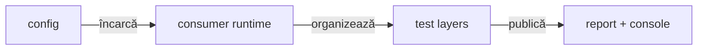
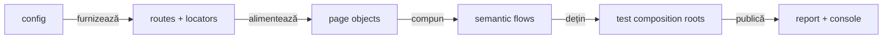
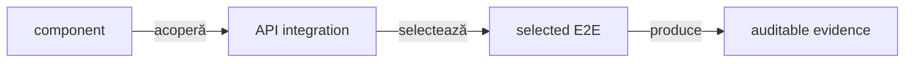
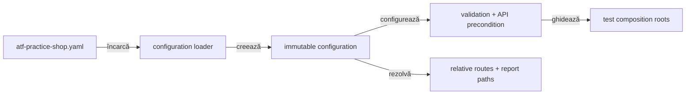
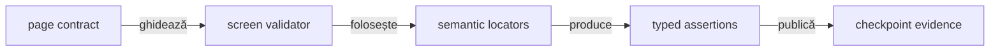
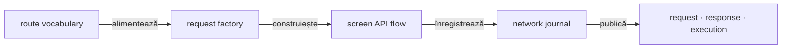
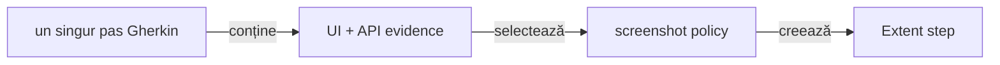
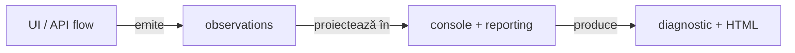

# ATF Test Practice Shop — modul consumator plug-and-play

## Pe scurt

- consumer configurabil pentru UI și API-ul Practice Software Testing;
- runtime reutilizabil în `src/main`;
- composition roots și teste în `src/test`;
- `atf-reporting` consumat ca bibliotecă standalone;
- `atf-console` folosit ca proiecție diagnostică, nu ca verdict;
- journey-uri E2E puține; variațiile rămân în component și API integration.



<details>
<summary><strong>Legendă — rolul consumerului</strong></summary>

- **Config**: valori externe, profile de validare, rute relative și precondiții;
- **Runtime**: API client, page objects, flows, validators, capture și publisher;
- **Pyramid**: aceeași intenție este verificată la cel mai jos nivel posibil;
- **Evidence**: raportul Extent păstrează verdictul și evidence-ul, consola păstrează observațiile de execuție;
- modulul verifică Practice Shop, nu implementează rendererul Extent.

</details>

Surse de aprofundare:

- [`atf-core`](../atf-core/README.md) — modele și contracte neutre;
- [`atf-ui`](../atf-ui/README.md) — boundary-ul Playwright;
- [`atf-reporting`](../atf-reporting/README.md) — biblioteca de raportare;
- [`atf-console`](../atf-console/README.md) — diagnostic runtime;
- [`atf-test-kit`](../atf-test-kit/README.md) — meta-anotații și convenții de test;
- [bune practici de documentație](../docs/README_Atf_DocumentationBestPractices.md) — stil și guvernanță README.

### Contractul implementat și limitele reale

| Suprafață | Comportament curent | Interpretare |
|---|---|---|
| component/API | contracte typed pentru config, routes, JSON, status, mapping și evidence | matricea de variații se verifică fără browser |
| guest E2E | purchase complet `product → cart → checkout → billing → payment → confirmation` | proof business prin starea UI și exchange-urile live observate |
| authenticated E2E/API | `ShopAuthenticatedPurchaseE2eTest` reutilizează contul local înregistrat; `ShopNewAccountPurchaseE2eTest` creează un cont sintetic nou | ambele demonstrează login în `SETUP`, apoi purchase complet; primul nu înregistrează cont și poate fi rulat individual din IntelliJ cu fixture-ul local |
| retry Playwright | suport generic fail-closed există în `atf-ui`; YAML-ul Practice Shop declară explicit `maxAttempts`, `backoff`, `eligibleOperations` și `reason` | policy-ul implicit rămâne un singur attempt; numai operații read-only typed pot fi activate ulterior |
| API evidence binding | `validation.apiEvidence` selectează checkpoint-uri typed (`product`, `registration`, `login`, `cart`, `payment`, `order`); override-ul system property este acceptat | binding-ul fail-closed aparține consumerului; publisher-ul primește numai evidence selectat |
| Overview → System | snapshot allowlist-uit, redacted și bounded; API precondition și starea de configurare UI sunt rezumate separat | nu se publică dump YAML, secrete, path-uri locale, identitatea suitei/testului, pași sau date de checkout |
| output | `artifacts/reports/ui` și `artifacts/reports/api` | rolurile UI/API nu se suprapun |

Contracte și limite curente:

- binding-ul per checkpoint, aggregate-ul nested, diagnosticele bounded și
  exchange-urile canonicale multiple sunt verificate;
- `authenticatedE2eEnabled: false` din YAML este default-ul guest, nu un blocaj
  pentru clasele autentificate. `@AuthenticatedE2e` activează profilul clasei și
  selectează fixture-ul local ignorat; fixture-ul sintetic urmărit de Git rămâne
  separat și nu este sursă pentru login live;
- `-Datf.practice.account-file` și `ATF_PRACTICE_ACCOUNT_FILE` pot selecta
  fixture-ul numai în interiorul `src/test/resources`; căile externe sunt
  respinse. Preflight-ul respinge domeniile rezervate `example`, `example.com`,
  `example.net`, `example.org`, `.test`, `.invalid` și `.localhost` (inclusiv
  subdomeniile), dar nu validează contul remote;
- selectarea clasei cu `@AuthenticatedE2e` este opt-in-ul explicit; dacă fixture-ul
  lipsește, este incomplet sau folosește email rezervat, JUnit face `SKIP` cu
  remediere fără să expună valorile credențialelor. Un fixture valid structural
  nu dovedește singur autentificarea la serviciul remote;
- `Account fixture policy` se evaluează numai când profilul cere autentificare.
  Setup-ul guest nu inspectează `accountFile`, nu îl raportează drept precondiție
  și nu poate eșua din cauza unei căi de fixture nefolosite; flow-ul authenticated
  cere fixture-ul și îi verifică ownership-ul;
- retry-ul generic al mutațiilor este exclus de `atf-ui`; Practice Shop nu reia
  click-ul, submit-ul sau purchase-ul după timeout.

### Inspectorul de rețea UI — configurabil, fără retrimiterea cererilor

Practice Shop folosește inspectorul generic din `atf-ui`, nu un listener local
în test. Configurația urmărită îl activează pentru profilul `ui-api`; `ui-only`
nu publică API evidence.

```text
Playwright response / request-failed
  → UiNetworkInspector
  → ShopApiNetworkJournal
  → checkpoint-uri Gherkin: UI validation + API validation configurată
  → dovada finală de ecran sau de eșec
  → un singur API network inspector — journey summary (ultimul nod tehnic)
  → se închide TEST BODY
```

Configurația este în `src/test/resources/atf-practice-shop.yaml` și limitează
colectarea la host-ul API configurat:

```yaml
networkInspector:
  enabled: true
  allowedHosts: [api.practicesoftwaretesting.com]
  maxObservations: 256
  maxBodyPreviewCharacters: 12000
  collapseConsecutiveSignatures: true
```

Inspectorul publică method, safe path, status, service, mechanism, auth
method/source și signature, fără credentiale sau body nelimitat. Contractul
consumerului este:

- `UI_API` înregistrează exact un aggregate pentru `TEST BODY`; lifecycle-ul îl publică după checkpoint-urile Gherkin, validările UI/API și failure evidence;
- acesta este ultimul nod tehnic al fazei, nu o propoziție Gherkin sau o acțiune de business;
- dacă nu există exchange-uri, summary-ul `0 exchanges` rămâne vizibil; `UI_ONLY` nu îl solicită și nu publică API evidence;
- summary-ul este pasiv, nu schimbă verdictul și nu dublează request/response JSON-ul canonical atașat checkpoint-ului/API validation;
- `observations()` păstrează auditul complet, iar stream-ul de prezentare colapsează doar semnăturile consecutive.

Journal-ul consumerului păstrează trace-ul ordonat.

- `ShopJsonEvidence.redact` aplică înainte de journal/model politica
  field-aware comună pentru secrete, identitate, contact și adresă.
- Aliasurile normalizează casing-ul și separatorii (`first_name`, `firstName`,
  `postal-code`).
- Body-urile malformed/non-JSON sunt înlocuite cu marker fail-closed; marker-ele
  explicite de body indisponibil rămân intacte.
- Header-ele folosesc aceeași clasificare de câmpuri.

- Un request eșuat înainte de response rămâne evidence explicită: status
  `Unavailable`, motiv bounded, fără `RESPONSE JSON` inventat.
- Adapterul Practice Shop poate atașa un alias de serviciu; host allowlist-ul
  și semnătura generică rămân neschimbate.
- Publicarea rămâne limitată la checkpoint-urile API configurate și evaluate,
  plus transport failures; un răspuns HTTP reușit fără owner de checkpoint nu
  este promovat automat în `API validation` sau în sumarul public.
- Request-urile HTTP fără checkpoint API configurat nu devin pași de business
  sau `API validation` implicită.

UI validation și API evidence au roluri separate:

- propoziția Gherkin nu afișează `Request details · 2 fields` pentru identitatea
  sa și URL-ul paginii: `request.action`/`request.target` rămân context intern
  în Reporting. Acțiunile, target-urile, verificările și capturile rămân în
  `UI validation`; request/response/execution apar numai la exchange-ul API;

- `UiNetworkInspector` și journal-ul dețin toate observațiile HTTP de pe
  host-urile configurate; statusurile și exchange-urile apar numai în dovezile API;
- inspectorul de journey primește numai exchange-uri API și checkpoint-urile
  lor; nu conține diagnostice browser ca pași sau copii ai unui pas Gherkin;
- nu se colectează erori de consolă sau de pagină în acest flow; lipsa unui
  pas diagnostic nu este dovadă că runtime-ul browserului nu a avut erori;
- nu există publisher sau pas Gherkin separat pentru diagnostice runtime;
  validarea UI rămâne la checkpoint, iar traficul HTTP la inspectorul API;
- autentificarea live trebuie dovedită de pagina de cont; dacă login-ul eșuează,
  flow-ul rămâne `FAIL` și nu marchează boundary-ul ca autentificat.

Selecția generică pe checkpoint și ownership-ul traficului sunt verificate fără
browser de `ShopApiNetworkJournalTest`.

Settlement-ul pentru acțiuni care modifică serverul este separat și dezactivat
implicit:

- cursorul este capturat înainte de acțiune; read-back-ul bounded caută numai
  observații ulterioare prin `awaitAfter(...)` și nu repetă acțiunea;
- inspectorul nu reia mutații, indiferent de timeout sau de observația capturată;
- `ShopUiNetworkSettlementFixture` acoperă read-back-ul idempotent,
  excluderea unui GET anterior acțiunii, compactarea response-urilor
  consecutive și timeout-ul fără replay sau false-green;
- o viitoare facilitate consumer-owned ar cere separat identity stabilă,
  payload complet asociat și idempotency garantată de server; această facilitate
  nu este activată în Practice Shop.

Contractul generic și criteriile pentru o posibilă extindere sunt în
[README-ul `atf-ui`](../atf-ui/README.md); configurația și comportamentul
consumerului rămân documentate aici.

## Harta internă a consumerului



<details>
<summary><strong>Legendă — direcția responsabilităților</strong></summary>

- `config/` deține valori typed și loaderul YAML;
- `api/` deține request factory, client, screen APIs și vocabularul wire;
- `routes/` și `locators/` sunt ownerii selectorilor și rutelor relative;
- `pages/` execută interacțiuni semantice pe un ecran;
- `flow/` compune journey-uri și stage-uri business;
- `support/` deține lifecycle, audit, capture, evidence și publisher;
- testele doar compun și verifică; nu reimplementează aceste responsabilități.

</details>

### Limite de responsabilitate și proprietari

| Zonă | Owner live | Regula de mentenanță |
|---|---|---|
| host UI și output | `ShopConfiguration` | un singur `baseUrl`; directoare configurabile |
| rute UI | `ShopUiRoutes` | numai segmente relative; ID-urile sunt validate |
| rute API | `ShopApiRoutes` | path-uri și template-uri centralizate |
| selectorii CSS | `ShopLocators` | testele nu folosesc `page.locator(...)` direct |
| contracte de ecran | `@ShopPageContract` + `ShopPageValidator` | topologia este declarativă, assertions sunt typed |
| flow-uri | `Shop*Flow` și stage-urile purchase | business order, fără detalii de renderer |
| API evidence | journal + capture + selector + mapper | orchestration, selecție și publicare separate |
| lifecycle | `ShopE2eContext` / publisher | testele nu gestionează manual raportul |
| scanări de arhitectură | `AtfPathLocator` + `AtfFileTree` din `atf-core` | root discovery și file traversal sunt reutilizate; filtrele include/exclude specifice consumerului rămân lângă guard-ul Practice Shop |

Packaging-ul este intenționat:

- clasele reutilizabile rămân în `src/main/java/atf/ui/practiceshop`;
- `src/test/java` conține teste, fixture-uri și support strict test-only;
- `atf-core`, `atf-console`, `atf-test-kit`, `atf-reporting` și `atf-ui` sunt
  compile dependencies ale runtime-ului consumerului;
- `atf-mock` nu este dependency al modulului; transportul determinist pentru
  component tests rămâne local și strict test-scope;
- `atf-reporting` nu primește dependență inversă către Practice Shop.

## Piramida de testare



<details>
<summary><strong>Legendă — niveluri, izolare și proof</strong></summary>

- **component** — verifică rapid și determinist config, routes, locators, JSON,
  mapping, status, redaction și invariants;
- **API integration** — verifică contracte reale și precondiții autentificate,
  numai cu API live configurat explicit;
- **E2E** — verifică wiring-ul, journey-ul și randarea observabilă prin
  Playwright; nu reproduce matricea de variații a componentelor;
- **support** — fixture-uri și transport determinist strict test-only, fără
  business logic ascuns;
- **evidence** — rezultatul observabil este publicat în Extent, iar diagnosticul
  de execuție rămâne separat în consolă.

| Nivel | Suprafață curentă | Browser/network | Scop |
|---|---|---|---|
| component | `src/test/.../component` și `api/component` | nu | contracte și variații locale |
| API integration | `src/test/.../api/integration` | API live, explicit | precondiții și contracte reale |
| E2E | `src/test/.../e2e` | Playwright + aplicația reală | wiring, journey, randare |
| support | `src/main/.../support` + `src/test/.../api/support` | nu implicit | lifecycle, evidence, fixture-uri |

</details>

Principiul de selecție:

- variațiile de endpoint, status, body și mapping se testează component-first;
- integration este opt-in prin configurație explicită;
- E2E demonstrează orchestration-ul real, nu fiecare combinație de API;
- nu se adaugă un test E2E pentru o variație care poate fi verificată fără browser.

### Suitele de componente API și auditul apelurilor

`ShopApiComponentSuite` grupează contractele deterministe din `api/component`:

- `ShopApiEndpointMatrixTest` verifică rutele folosite în achiziție, inclusiv
  înregistrarea, facturarea autentificată și facturarea guest;
- fiecare caz verifică metoda, ruta, statusul, antetele JSON, sintaxa body-ului
  și rezultatul transportului determinist;
- cazurile negative acoperă credentiale invalide, resursă inexistentă, produs
  invalid în coș și câmpuri obligatorii lipsă (`401`, `404`, `422`);
- înregistrarea și crearea coșului verifică `201`, facturile verifică `200`, iar
  eliminarea produsului verifică `204`;
- testele fabricii verifică separat schema efectivă a cererii.

Titlul unui caz parametrizat exprimă intenția de business; metadatele protocolului
rămân la schimbul API:

- titlu: `login rejects invalid fixture identity`;
- request/report: metoda, ruta, statusul așteptat și probele JSON;
- nu duplicăm aceste metadate în titlu și nu folosim `toString()` implicit al
  unui record de fixture.

Responsabilitățile request-ului sunt separate:

- `ShopApiRequestBodies` definește DTO-urile tipizate pentru JSON;
- `ShopApiRequestFactory` selectează metoda, ruta și autentificarea și
  serializează payload-ul;
- strategia Jackson convertește câmpurile în `snake_case` și omite câmpurile
  opționale nule ale facturii;
- `ShopApiRequestFactoryTest` protejează forma pe fir și respinge chei
  `camelCase`; matricea protejează metoda, ruta, statusul și JSON-ul valid.

Contractul facturării este protejat de matrice și fixture-ul determinist:

- `POST /invoices` și `POST /invoices/guest` verifică statusul `200`, conform
  [specificației OpenAPI](https://api.practicesoftwaretesting.com/docs?api-docs.json);
- fixture-ul verifică contractul ATF, nu trafic real; validarea serviciului
  real rămâne responsabilitatea E2E.

Lansare reproductibilă din IntelliJ: rulează `ShopApiComponentSuite`. Din Maven,
din root-ul ATF:

```text
mvn -pl atf-test-practice-shop -am "-Dtest=ShopApiComponentSuite" "-Dsurefire.failIfNoSpecifiedTests=false" test
```

Extensia grupează testele `@ShopApiCallComponentTest` într-un raport Extent:

- destinație: directorul API configurat de Practice Shop;
- fiecare schimb păstrează metoda/ruta, detaliile request/response și execuția;
- `Contract validation` apare doar când schimbului îi este asociat un contract
  HTTP tipizat; statusul așteptat este comparat cu cel observat;
- verdictul JUnit aparține scenariului; completitudinea capturii rămâne
  metadata internă, fără bandă `Audit details` în faza API;
- cauzele JUnit și asocierile lipsă folosesc portul diagnostic typed și apar
  redactate în scenariu; Fails păstrează diagnosticul fazelor eșuate;
- auditul nu repetă verdictul JUnit sau numărul total de schimburi per request;
- suita folosește transporturi deterministe și nu apelează serviciul public.
`ShopApiCallAuditSuite` rulează numai selecția de teste pentru audit, în timp ce
`ShopApiComponentSuite` include și componentele fără schimburi HTTP.

În matrice, cererile de înregistrare și de facturare pentru vizitator folosesc
numai transportul determinist; nu se creează conturi sau comenzi în serviciul
real. Fluxul E2E rămâne proba separată a integrării și a rezultatului de business
în aplicația reală.

### E2E configurabile

| Flux | Clasă | Activare |
|---|---|---|
| Achiziție ca vizitator, UI + API | `ShopPurchaseE2eTest` | profil explicit `UI_API`; publică dovezile UI și schimburile API selectate în YAML |
| Achiziție ca vizitator, doar UI | `ShopUiOnlyPurchaseE2eTest` | profil explicit `UI_ONLY`; publică numai dovezile UI, fără validare API sau agregarea traficului |
| Achiziție ca vizitator, doar UI, un singur flux | `ShopUiOnlySingleFlowPurchaseE2eTest` | profil `UI_ONLY` + prezentare `UNIFIED_FLOW`; un singur rând Gherkin, acțiuni agregate și capturi după fiecare tabel Playwright conform YAML-ului |
| Achiziție cu un cont sintetic nou | `ShopNewAccountPurchaseE2eTest` | `SETUP` creează și autentifică un cont sintetic; `TEST BODY` finalizează achiziția |
| Achiziție cu un cont înregistrat anterior | `ShopAuthenticatedPurchaseE2eTest` | citește fixture-ul `.local.properties`, demonstrează login în `SETUP`, apoi rulează purchase complet fără registration |

- `@AtfTestChannel(UI | UI_API)` selectează canalul în testul lansat din
  IntelliJ; harness-ul îl aplică înaintea browserului.
- `@WithE2eHarness` păstrează layout-ul și detaliile acțiunilor; parametrul
  legacy `profile` rămâne compatibil și un profil explicit contradictoriu este refuzat.
- `ShopPurchaseE2eTest` fixează `UI_API`, iar
  `ShopUiOnlyPurchaseE2eTest` fixează `UI_ONLY`; lansarea ambelor repetă
  purchase-ul demo.
- Pentru o singură rulare, folosește valoarea din adnotarea clasei; nu deduce
  profilul din YAML și nu schimba profilul global.
- Ambele moduri lasă traficul browserului să continue normal. `UI_ONLY` oprește
  numai capturarea/publicarea API evidence.

Canalul TestKit și preflight-ul sunt implementate conform
[contractului adnotărilor](../docs/ATF_Test_Infrastructure_Annotations.md).
Harness-ul browser acceptă UI/UI_API, iar auditul API cere API; lacunele de
paritate și lifecycle sunt în [feedback-ul canalelor](../docs/feedback/ATF_Test_Channel_Annotations_Feedback.md).

Cele două E2E autentificate au aceeași structură de purchase; setup-ul contului
este intenționat diferit:

| Parte | Contract |
|---|---|
| Profil | `ShopNewAccountPurchaseE2eTest`: `SYNTHETIC`, email unic pe `atf.invalid` și parolă generată la rulare; Auth standalone: fixture local existent |
| `SETUP` | înregistrare și autentificare confirmată înainte de journey |
| `TEST BODY` | purchase complet până la confirmarea comenzii |
| Sesiuni | `ShopNewAccountPurchaseE2eTest` înregistrează un cont sintetic; `ShopAuthenticatedPurchaseE2eTest` folosește fixture-ul local standalone, dar în `ShopE2eSuite` reutilizează contul sintetic creat de testul anterior |
| Reutilizare în suită | `ShopE2eSuite` ordonează înregistrarea înaintea autentificării și pasează credentialele în memorie între cele două flow-uri; nu scrie contul sintetic pe disc |

Separă patru axe care nu trebuie să schimbe flow-ul de business:

| Axă | Ce există acum | Ce trebuie să poată selecta testul |
|---|---|---|
| Validare | `@AtfTestChannel(UI / UI_API)` este mapat în profilul typed local; profilele legacy rămân compatibile | canal explicit pe clasa E2E, independent de presentation și capturi; API-only este refuzat de harness-ul browser |
| Forma raportului | `reportFlow = CONFIGURED`, `SCREEN_CHECKPOINTS` sau `UNIFIED_FLOW` în `@WithE2eHarness`; implicit moștenește profilul configurat | layout-ul efectiv apare în Overview → System → `UI evidence layout` |
| Capturi | `reporting.screenshotPolicy` din YAML este autoritară atât pentru clasele individuale, cât și pentru `ShopE2eSuite`; adnotările aleg layout-ul și detaliile acțiunilor, nu politica de captură | `each-checkpoint` atașează captura stării rezultate fiecărui tabel Playwright nevid din `SETUP` și `TEST BODY`; controalele de formular sunt mascate; `none` dezactivează capturile fără să elimine acțiunile sau aserțiunile |
| Pași UI intermediari | `@WithE2eHarness(actionDetails = CONFIGURED \| INCLUDED_COLLAPSED \| SUMMARY_ONLY)` selectează disclosure-ul fără să schimbe capturarea acțiunilor | `CONFIGURED` păstrează profilul compus; `INCLUDED_COLLAPSED` este default-ul sigur; niciun mod nu schimbă validările, verdictul sau arborele Gherkin |

**Invariantă:** configurația schimbă proiecția evidence-ului, nu journey-ul.

```text
AtfTestChannel → profil de validare; WithE2eHarness → layout + detalii acțiuni
YAML     → screenshot policy pentru rulări individuale și ShopE2eSuite
flow business, acțiuni, aserțiuni, request-uri, verdict → neschimbate
```

`Overview → System` arată politica efectivă. `UI_ONLY` oprește publicarea API
evidence, nu traficul real al browserului.

Selecția curentă separă intenționat cele două contracte: `ShopAuthenticatedPurchaseE2eTest`
folosește contul local deja înregistrat (`REUSE_FIXTURE`), iar
`ShopNewAccountPurchaseE2eTest` rămâne demonstrația `REGISTER_PER_RUN + SYNTHETIC`.
Pașii manuali sunt colapsați:

<details>
<summary>Setup autentificat: fixture reutilizat sau cont nou — IntelliJ / Maven</summary>

`ShopAuthenticatedPurchaseE2eTest` declară explicit politica și fișierul local,
fără VM options:

```java
@ShopTestSupport.AuthenticatedE2e(
    accountSetup = ShopTestSupport.AccountSetupMode.REUSE_FIXTURE,
    accountFile = "atf-test-practice-shop/src/test/resources/"
        + "practice-software-testing-account.local.properties")
```

Profilul sintetic din `ShopNewAccountPurchaseE2eTest` este limitat la demo-ul
Practice Software Testing: generează un email unic pe domeniul non-livrabil
`atf.invalid`, o parolă aleatoare și date
de test. Nu folosește mailbox, cont pre-creat, credențiale locale sau date reale.
Nu îl reutiliza pentru producție ori alte aplicații.

Numai clasele care chiar creează un cont folosesc profilul local de registration:

```java
@ShopTestSupport.AuthenticatedE2e(
    accountSetup = ShopTestSupport.AccountSetupMode.REGISTER_PER_RUN,
    registrationProfile = ShopTestSupport.RegistrationProfileMode.LOCAL,
    registrationProfileFile = "atf-test-practice-shop/src/test/resources/"
        + "practice-software-testing-registration.local.properties")
```

Numai `ShopNewAccountPurchaseE2eTest` declară marker-ul `@AllowsRegistrationPerRun`.
Testul de contract verifică separarea dintre contul reutilizat și capabilitatea
cu efect extern de registration.

### `REUSE_FIXTURE`

Configurează un cont dedicat, deja înregistrat și acceptat de aplicație.
Păstrează emailul/parola numai în fișierul local ignorat de Git:

```text
atf-test-practice-shop/src/test/resources/practice-software-testing-account.local.properties
```

Formatul fișierului:

```properties
email=<registered-test-account-email>
password=<registered-test-account-password>
firstName=<first-name>
lastName=<last-name>
```

Preflight-ul verifică existența fișierului, câmpurile obligatorii, domeniul
emailului și ownership-ul în `src/test/resources`; nu tipărește valorile.
Preflight-ul nu poate demonstra că acel cont există remote: login-ul UI și
exchange-ul HTTP live din `SETUP` sunt dovada finală. Nu folosi adresă rezervată
(`example`, `.test`, `.invalid` sau `.localhost`) și nu copia fixture-ul urmărit
de Git peste fișierul local.

### `REGISTER_PER_RUN` + `LOCAL`

Copiază [exemplul de profil](src/test/resources/practice-software-testing-registration.example.properties)
în fișierul local ignorat de Git:

```text
atf-test-practice-shop/src/test/resources/practice-software-testing-registration.local.properties
```

`emailTemplate` trebuie să conțină exact un `{runId}` și să folosească un domeniu
real, controlat de owner, care acceptă aliasurile generate. Înlocuiește valorile
demonstrative cu date sintetice acceptate de aplicație; nu pune secrete în
adnotare, YAML sau surse urmărite de Git. Preflight-ul validează profilul
înainte de browser și nu afișează valorile.

Flow-ul raportat separă explicit pregătirea contului de autentificare. În ambele
teste, purchase-ul începe numai după setup-ul complet:

```text
SETUP
├─ GIVEN account source ready
│  ├─ REUSE_FIXTURE → selectează contul existent
│  ├─ REGISTER_PER_RUN → creează un cont o dată per class-run
│  └─ Details → Setup evidence; API validation dacă este selectată
├─ AND authenticated session confirmed
│  └─ Details → Setup evidence; API validation dacă este selectată
└─ PASS → TEST BODY: purchase complet până la confirmarea comenzii
```

| Checkpoint / boundary | Ce demonstrează | Ce apare în raport |
|---|---|---|
| `GIVEN` — cont pregătit | `ShopAuthenticatedPurchaseE2eTest`: fixture local înregistrat încărcat; `ShopNewAccountPurchaseE2eTest`: registration sintetică unică | **Setup evidence**: `CHECK / EXPECTED / ACTUAL / RESULT`, valori de credentiale redactate și API validation dacă profilul este `UI_API` |
| `AND` — sesiune autentificată | pagina `My account` și exchange-ul de login confirmă sesiunea | **Setup evidence** separat; `TEST BODY` nu începe înainte de succes |
| `UI_API` cu fixture reutilizat | exchange-urile reale de `login` și purchase sunt publicate o singură dată; nu există `registration` | payload-urile de identitate și credentiale sunt redactate |
| `UI_API` cu cont sintetic nou | exchange-urile `registration`, `login` și purchase sunt publicate o singură dată | payload-urile de identitate, adresă și contact sunt redactate |
| `UI_ONLY` | request-urile reale continuă, dar API evidence nu se publică | interacțiunile UI rămân verificabile, fără proiecția schimburilor API |

În fluxul de registration, formularul alege țara, codul poștal și numărul casei;
aplicația completează strada, orașul și statul. Profilul local aplică valorile
finale după lookup, iar action evidence redactează datele personale.

**Siguranța mutației pentru conturile noi:** submit-ul de înregistrare se execută
o singură dată; ATF nu șterge contul și nu reîncearcă un rezultat incert. Eșecul
confirmării oprește setup-ul înainte de login. O rulare nouă poate crea un alt
cont, deci după timeout/failure se verifică mai întâi starea remote. Capturile
sunt oprite automat pentru `REGISTER_PER_RUN`; acțiunile și aserțiunile rămân în
`SETUP`.

Nu folosi `practice-software-testing-account.properties`: este fixture-ul
urmărit de Git.

Fiecare clasă este lansabilă individual din IntelliJ, fără VM options și fără
selectarea celeilalte clase. `ShopE2eSuite` este declarat în pachetul
`atf.ui.tests.practiceshop.suites` (sub `src/test/java`) și rulează toate cele cinci journey-uri
E2E în ordinea documentată mai jos. Primele două sunt flow-urile autentificate:
`ShopNewAccountPurchaseE2eTest` creează contul, iar
`ShopAuthenticatedPurchaseE2eTest` îl reutilizează din cache-ul run-scoped. La
rularea clasei `ShopE2eSuite`, extensia detectează automat rădăcina JUnit
Platform și toate cele cinci contexte publică într-o singură sesiune Extent;
credentialele rămân numai în memorie, iar cache-ul este șters la închiderea
suitei. Rularea unei clase E2E direct păstrează raportul și preflight-ul
standalone. Proprietatea `-Datf.practice.shop.e2e.suite=true` rămâne disponibilă
pentru agregarea explicită a claselor individuale pornite împreună, fără clasa
Suite. Politica de captură rămâne cea din YAML și în modul agregat; nu există o
suprascriere separată pentru suite.
`@AuthenticatedE2e` aplică browser headed la zoom
70%, API live și precondiția authenticated. În `REUSE_FIXTURE`, fixture-ul local
trebuie să fie valid; în `REGISTER_PER_RUN` + `LOCAL`, profilul trebuie să fie
complet. `SYNTHETIC` nu cere fișier local. Altfel JUnit face skip cu instrucțiune
sigură, fără valori secrete.

`ShopE2eSuite` selectează toate cele cinci E2E-uri în această ordine:
`NewAccount → Authenticated → UI+API guest → UI-only guest → UI-only single-flow`.
Contul creat este reutilizat numai între primele două flow-uri; fiecare clasă
primește browser context propriu, iar raportarea este agregată într-un singur
Extent HTML. Pentru rulări live, `productName` trebuie să indice un produs
disponibil; catalogul poate marca produsele epuizate, iar controlul cantității
dezactivat este tratat ca precondiție eșuată, nu ocolit.

Din IntelliJ, rămâi cu **Working directory** la root-ul repository-ului și
rulează suita sau una dintre clase:

- `ShopE2eSuite` — toate cele cinci purchase journey-uri, într-o singură sesiune
  de raportare; contul creat este reutilizat numai de al doilea flow;
- `ShopComponentSuite` — testele de componentă, contract și arhitectură pentru
  shop, fără journey-urile E2E și fără integrarea live;

- `ShopNewAccountPurchaseE2eTest` — cont sintetic creat și autentificat în SETUP,
  apoi purchase complet;
- `ShopAuthenticatedPurchaseE2eTest` — cont deja înregistrat din fixture-ul local,
  login demonstrat în SETUP, apoi purchase complet; fixture-ul lipsă sau invalid
  produce un skip cu diagnostic sigur, fără afișarea valorilor.

Înainte de rulările IntelliJ, importă root `pom.xml` ca proiect Maven și execută
**Reload All Maven Projects**; configurația trebuie să folosească modulul
`atf-test-practice-shop`. Dacă o clasă din `atf-reporting` lipsește numai în
IntelliJ, verifică modelul modulelor și reproduce întâi testul de staging prin
reactorul Maven, înainte de a modifica codul reporting.

Echivalentul Maven, din root:

```text
mvn -pl atf-test-practice-shop -am "-Dtest=ShopE2eSuite" "-Dsurefire.failIfNoSpecifiedTests=false" test
```

Politica de captură acceptă `each-checkpoint`, `final-only`, `failure-only`,
`final-and-failure` sau `none`, configurate prin `reporting.screenshotPolicy`
în YAML. Valoarea implicită a fixture-ului Practice Shop este
`each-checkpoint`; aceeași valoare se aplică și în `ShopE2eSuite`, care emite o
singură sesiune Extent agregată. Pentru un raport mai compact, schimbă explicit
valoarea din YAML în `final-and-failure`; nu o înlocui prin proprietăți de sistem.

Pentru audit vizual, păstrează `reporting.screenshotPolicy: each-checkpoint`
în YAML și folosește comanda Maven de mai sus, cu fork-ul Surefire normal.

- Heap-ul fork-ului este implicit 2 GiB, configurabil prin
  `-Datf.test.heap.max=3g`; `MAVEN_OPTS` nu modifică acel fork.
- În IntelliJ JUnit direct, configurează VM options separat, conform
  [bugetului JVM](../docs/ATF_Build_And_Execution_Safety.md#memoria-jvm-pentru-teste-și-publicare).
- `each-checkpoint` mărește și memoria necesară finalizării HTML; nu reduce
  politica de captură ca remediere implicită pentru un heap insuficient.
- Înaintea unui E2E live, configurează un produs disponibil pentru vânzare;
  disponibilitatea catalogului se poate schimba.

Suita de componentă se rulează separat, după validarea E2E:

```text
mvn -pl atf-test-practice-shop -am "-Dtest=ShopComponentSuite" "-Dsurefire.failIfNoSpecifiedTests=false" test
```

Rularea colectivă E2E include journey-uri care folosesc aplicația live, creează
un cont demo și finalizează comenzi; aplică aceleași condiții de siguranță și
configurare ca rularea individuală. `ShopComponentSuite` nu execută aceste
acțiuni live.

```text
mvn -pl atf-test-practice-shop -am "-Dtest=ShopNewAccountPurchaseE2eTest" "-Dsurefire.failIfNoSpecifiedTests=false" test
```

```text
mvn -pl atf-test-practice-shop -am "-Dtest=ShopAuthenticatedPurchaseE2eTest" "-Dsurefire.failIfNoSpecifiedTests=false" test
```

Raportul UI agregat al suitei este scris în `artifacts/reports/ui`. Ambele scenarii
finalizează o comandă demo; numai `ShopNewAccountPurchaseE2eTest` creează un cont.
Rulează scenariile live numai când accepți aceste efecte externe.

Un rezultat `SKIPPED` cu explicația domeniului rezervat înseamnă că fixture-ul
local nu reprezintă un cont reutilizabil; nu relaxa preflight-ul și nu publica
credentiale pentru a forța rularea.

Existența fixture-ului nu dovedește că acel cont este încă activ: login-ul live
din `SETUP` este verificarea finală. Nu pune credențiale sau date personale în
surse urmărite de Git, YAML, adnotări, loguri, capturi sau raport.

</details>

- `@WithE2eHarness` injectează harness-ul ca parametru metodei de test.
- Extensia JUnit creează configurația, contextul, browserul și locatorii per metodă, apoi închide contextul și raportul la teardown.
- `harness.run(title, overview, journey -> ...)` gestionează lifecycle-ul scenariului și publicarea failure-ului.
- Testul păstrează flow-ul business și assertions observate; dacă teardown-ul eșuează, eroarea se atașează ca `suppressed`, iar failure-ul business rămâne principal.

Scurtarea composition root-urilor nu scurtează journey-ul de purchase:

- guest E2E păstrează în aceeași rulare `product → cart → checkout → billing
  → payment check → order confirmation`; `POST /payment/check` validează metoda
  selectată, dar nu creează comanda. Utilizatorul confirmă explicit comanda;
  checkpoint-ul final verifică mesajul și prezența identificatorului de factură
  (`INV-`). În profilul `UI_API`, aserțiunile verifică și factura non-blank din
  răspunsul `200 POST /invoices/guest` și corelarea exactă cu UI-ul;
- authenticated purchase folosește setup-ul selectat prin adnotare, confirmă
  login-ul înainte de `TEST BODY` și păstrează flow-ul complet până la
  confirmarea comenzii;
- checkout-ul authenticated identifică butonul semantic de continuare
  (`AUTHENTICATED_PROCEED`) și verifică starea lui observată; textul generic al
  body-ului nu este contract de UI, fiindcă extractorul poate omite conținutul
  din afara tabelului;
- numai lifecycle-ul, wiring-ul și publicarea diagnosticelor se pot muta în
  support; pașii business și assertions finale nu se elimină și nu se
  înlocuiesc cu un smoke de cart/catalog.

### Contractul Gherkin al fluxului de achiziție

Keyword-urile și titlurile statice sunt deținute de enum-ul consumerului
`ShopPurchaseTraceStep`; datele dinamice (produs, cantitate, rută și
exchange-uri) rămân în evidence. Renderer-ul generic nu rescrie pașii
Practice Shop.

| Ordine | Checkpoint guest | Keyword |
|---:|---|---|
| 1 | catalog home — navigation, branding, banner | `GIVEN` |
| 2 | filtre catalog | `AND` |
| 3 | product grid | `AND` |
| 4 | product page | `AND` |
| 5 | cart și cantitatea cerută | `WHEN` |
| 6 | guest checkout | `AND` |
| 7 | billing | `AND` |
| 8 | payment method | `AND` |
| 9 | payment check | `AND` |
| 10 | order confirmation | `THEN` |

- Secvența pentru vizitator este `1 GIVEN → 1 WHEN → 7 AND → 1 THEN`.
- `SETUP` este separat de `TEST BODY`; nu intră în cei zece checkpoint-uri.
- `UI validation`, `API validation` și network aggregate nu creează pași Gherkin suplimentari; UI/API sunt copii ai aceluiași checkpoint.
- `AUTHENTICATED_CHECKOUT` aparține ramurii authenticated, în afara acestei cardinalități guest.

Regresia locală a vocabularului rulează fără browser sau trafic extern:

```text
mvn -pl atf-test-practice-shop -am "-Dtest=ShopPurchaseTraceStepTest,ShopApiNetworkJournalTest" "-Dsurefire.failIfNoSpecifiedTests=false" test
```

E2E-ul guest verifică wiring-ul și ordinea efectiv publicată într-un raport
fresh; nu înlocuiește testul component și nu extinde această regulă la alți
consumatori.

<details>
<summary><strong>Legendă — rezultate E2E și structură test-kit</strong></summary>

- guest și authenticated purchase publică `PASS` după business complet;
- raportul nu publică un pas separat `Runtime diagnostic`; request-urile HTTP
  aparțin inspectorului de network, iar UI/API validation rămân legate de
  checkpoint-urile Gherkin;
- integration și journey-urile autentificate inactive sunt `SKIP`, nu `PASS`;
- `component` păstrează matricea de status/body/query; E2E păstrează doar
  journey-uri cu valoare de wiring și randare;
- `src/main` conține suportul reutilizabil al consumerului;
- `src/test` conține composition roots, fixtures și transport local test-only.

```text
src/test/java/atf/ui/tests/practiceshop
├── component/
│   ├── architecture/   boundary-uri și reguli ale suitei
│   ├── catalog/        selecție produs, pagini și rute
│   ├── configuration/  config, credentials și politici UI
│   ├── evidence/       API/UI evidence, observații și metadata
│   ├── purchase/       checkpoint-uri și pași de purchase
│   └── validation/     profilul de validare al consumerului
├── api/
│   ├── component/
│   │   ├── auth/       contracte de autentificare
│   │   ├── contract/   routes, request factory și variante de contract
│   │   ├── exchange/   operații, assertions și fluxuri de exchange
│   │   └── reporting/  evidence, redaction și publicarea raportului
│   ├── integration/    API live opt-in flows
│   └── support/        fixture-uri și transport local
└── e2e/                guest și authenticated composition roots
```

</details>

### Contractul unui test Practice Shop

```text
metadata + config → fixture → flow semantic → stare observată → evidence/verdict
```

- composition root-ul leagă configurația, contextul și flow-ul; nu reconstruiește
  browser, raport, locatori sau transport;
- `expected` vine din configurație/fixture, iar `actual` vine din UI, API sau DOM;
- assertions-urile verifică efecte observate; nu se acceptă `expected == actual`,
  `true` hardcodat sau URL validat prin fragment arbitrar;
- fiecare journey E2E poate rula independent; un context partajat cere reset
  explicit și ownership vizibil;
- variațiile de status, body, headers, query și selector rămân în component/API
  integration, nu sunt multiplicate în browser;
- contractele HTML folosesc un helper semantic pentru structură, ordine și
  redaction; `contains` rămâne doar pentru smoke text sau secrete interzise;
- lifecycle-ul browserului, API clientului, raportului, screenshot-ului și
  retry-ului aparține support/harness-ului, nu corpului testului;
- selecția se face prin adnotare și configurație typed; nu se copiază metode
  `isConfigured()` în fiecare composition root.

<details>
<summary><strong>Model minim pentru composition root</strong></summary>

```text
@AtfE2eTest
test()
  → load once
  → open context once
  → execute configured flow
  → assert observed state
  → support closes resources
```

Un test care conține detalii de renderer, directoare de raport, selectori,
retry sau cleanup manual a depășit boundary-ul composition root-ului.
</details>

Contul nu este o condiție pentru journey-ul guest. Pentru authenticated, setup-ul
API este precondiție și parola rămâne în afara actions, assertions, consolă și HTML.

## Configurare plug-and-play

Sursa principală este
`src/test/resources/atf-practice-shop.yaml`. Override-urile de proces sunt
rezolvate de `ShopConfigurationLoader`; nu se modifică flow-urile pentru
a schimba mediul.



<details>
<summary><strong>Legendă — configurație, policy și composition root</strong></summary>

- **YAML** — input extern; nu conține logică de flow;
- **loader** — parsează, validează și raportează cheia invalidă;
- **snapshot** — record immutable folosit de main și test scope;
- **policy** — decide profile-ul UI/API, precondiția și capture policy;
- **roots** — testele compun obiectele; nu rezolvă manual `baseUrl` sau
  lifecycle-ul raportului.

</details>

```yaml
practiceShop:
  baseUrl: "<ui-base-url>"
  browser: chromium
  headless: false
  timeout: PT20S
  navigationTimeout: PT45S
  viewport:
    width: 1440
    height: 1000
  zoomPercent: 70
  validation:
    profile: ui-api
    apiEvidence: [product, registration, login, cart, payment, order]
  networkInspector:
    enabled: true
    allowedHosts: [api.practicesoftwaretesting.com]
    maxObservations: 256
    maxBodyPreviewCharacters: 12000
    collapseConsecutiveSignatures: true
    settlement:
      enabled: false
      timeout: PT10S
      pollInterval: PT0.1S
  retry:
    maxAttempts: 1
    backoff: PT0S
    eligibleOperations: []
    reason: bounded read-only UI retry
  api:
    endpoint: "<api-endpoint>"
    mode: live
    precondition: authenticated
    timeout: PT20S
  reports:
    ui: artifacts/reports/ui
    api: artifacts/reports/api
  reporting:
    systemBodyPreviewCharacters: 100
    screenshotPolicy: each-checkpoint
  authenticatedE2eEnabled: false
```

Fragmentul reflectă policy-ul urmărit în YAML; endpoint-urile și datele de
checkout sunt configurate separat și nu sunt necesare pentru a înțelege aceste
limite.

| Configurație | Semnificație |
|---|---|
| `validation.profile` / `apiEvidence` | `ui-api` publică exchange-urile selectate la checkpoint; `ui-only` oprește capture subscription și API evidence în raportul E2E |
| `api.mode` | `live` folosește HTTP real; testele component injectează transport determinist direct, nu simulează live prin YAML |
| `api.precondition` | precondiția API este independentă de browser; YAML-ul descrie default-ul, iar `@AuthenticatedE2e` promovează numai cele două clase selectate la `LIVE` + `authenticated` |
| `networkInspector` | capturează numai host-urile permise; preview-ul de 12.000 caractere este pentru checkpoint evidence, nu pentru Overview/System |
| `retry` | un singur attempt și nicio operație eligibilă; mutațiile UI nu sunt reluate |
| `reporting.systemBodyPreviewCharacters` | limitează la 100 caractere preview-ul de body din System; disclosure-urile de evidence au limita lor separată |
| `reports.ui` / `reports.api` | directoare relative distincte pentru artifactele UI și API |
| `productName` / `productPath` | produsul trebuie să fie disponibil pentru vânzare. `auto` acceptă ruta dinamică `/product/*`; o rută exactă e fail-fast dacă nu există |
| `reporting.screenshotPolicy` | valoarea YAML se aplică identic rulărilor individuale și `ShopE2eSuite`; opțiuni: `each-checkpoint`, `final-only`, `failure-only`, `final-and-failure`, `none`. Adnotările nu modifică politica. Cheia legacy `screenshotOnFailure` se folosește numai când politica typed lipsește: `true` → `each-checkpoint`, `false` → `failure-only` |
| `accountFile` | fixture de cont în `src/test/resources`; `ShopAuthenticatedPurchaseE2eTest` reutilizează un cont de test deja înregistrat, iar `ShopNewAccountPurchaseE2eTest` folosește profil sintetic; căile externe sunt respinse și valorile nu ajung în evidence |

Exemplele guest presetate declară canalul clasei (`UI_API` sau `UI`) și îl
mapează în profilul local. Fără canal și cu harness `CONFIGURED`, fallback-ul
legacy păstrează `validation.profile` din YAML:

```yaml
practiceShop:
  validation:
    profile: ui-only
```

- `ui-only` publică UI evidence fără `API validation` sau network aggregate
  pentru clasele care folosesc profilul `CONFIGURED`; clasa
`ShopUiOnlyPurchaseE2eTest` impune același profil explicit;
- traficul browserului către aplicație continuă normal — profilul nu blochează
  request-uri și nu schimbă testele API standalone;
- `ui-api` publică exchange-urile din `validation.apiEvidence`.

`ShopPurchaseE2eTest` impune `UI_API`, deci publică validările UI și
exchange-urile API configurate chiar dacă profilul global este `ui-only`.

Flow presentation pentru Practice Shop:

- `atf-reporting` implementează `UNIFIED_FLOW`: un singur request Gherkin,
  validare UI agregată și API validation sibling; `SCREEN_CHECKPOINTS` păstrează
  comportamentul independent per checkpoint;
- `@WithE2eHarness.reportFlow` selectează forma flow-ului, nu politica
  screenshot. Standalone se aplică YAML-ul; în `ShopE2eSuite`, system
  property-ul dedicat are prioritate peste YAML;
- `ShopPurchaseFlow` continuă să emită checkpoint-uri în ambele moduri;
  `UNIFIED_FLOW` le agregă în raport, nu transformă click-urile în pași Gherkin
  și nu sare peste acțiunile intermediare;
- Overview → System afișează `UI evidence layout` și `Screenshot policy` din
  profilul rezolvat folosit la deschiderea raportului. Metadatele sunt
  operaționale și concise; numele testului/suitei și fixture-ul apar în alte
  suprafețe, nu în System. Setările endpoint/transport/precondiție/timeout,
  inspector și body preview apar numai pentru `UI_API`; `UI_ONLY` nu listează
  configurații API inactive și identifică clientul real ca `Playwright browser`.
- alegerea modului de disclosure Playwright este suportată generic și selectabilă
  per clasă prin `@WithE2eHarness(actionDetails = ...)`; testul component verifică
  rezolvarea profilului, fără lansarea browserului.

`api.precondition` descrie setup-ul API, nu autentificarea sesiunii din browser.
Precondiția API configurată nu transformă guest purchase într-un journey UI
autentificat.

Reguli de configurare:

- testele și page objects folosesc rute relative din `ShopUiRoutes`;
- `ShopConfiguration.uri(...)` este singurul resolver `baseUrl + route`;
- output-ul este separat pe tip de artifact și rămâne relativ la workspace:
  ```text
  atf/artifacts/reports/
  ├── ui/   # rapoarte Extent produse de flow-urile Playwright
  └── api/  # rapoarte Extent produse de flow-urile API
  ```
- `reports.ui` și `reports.api` nu se suprapun și nu primesc căi absolute din
  YAML; loaderul le rezolvă la boundary-ul configurației;
- ID-urile de produs și cart sunt dinamice și nu intră în enum-uri;
- profile-ul este typed (`UI_API`, `UI_ONLY`), fără matrice de booleeni paraleli;
- loaderul eșuează clar la URI, timeout, path sau combinație de precondiții invalidă.
- mapping-ul YAML furnizează default-urile standalone; `@WithE2eHarness` poate
  suprascrie flow mode pentru clasa selectată, iar numai modul suitei permite
  override-ul screenshot policy prin system property.
- `Overview → System/Environment` afișează etichete lizibile pentru layout și
  screenshot policy rezolvate (de ex. `One consolidated flow`, `Final
  screenshot only`), nu valori brute YAML sau enum-uri; astfel metadatele
  descriu exact evidence-ul publicat.

## Contracte UI și selectori



<details>
<summary><strong>Legendă — contract UI și boundary-ul locatorilor</strong></summary>

- **page contract** — descrie topologia și intenția unui screen;
- **screen validator** — transformă starea observată în assertions typed;
- **semantic locators** — sunt centralizate în `ShopLocators`;
- **typed assertions** — decid verdictul, nu doar existența unui nod DOM;
- **checkpoint evidence** — păstrează acțiuni, observations, API evidence și
  screenshot conform policy-ului.

</details>

Ecranele declarate în `ShopScreen` și în contractele page object sunt:

| Screen | Rută relativă | Contract |
|---|---|---|
| `HOME` | `/` | catalog, filtre, grid și footer |
| `PRODUCT` | `/product/*` | produs, preț, descriere și add-to-cart |
| `CART` | `/checkout` | produs, cantitate și proceed |
| `GUEST_CHECKOUT` | `/checkout` | identitate guest și submit |
| `BILLING` | `/checkout` | address fields și proceed |
| `PAYMENT` | `/checkout` | payment method și finish |
| `CONFIRMATION` | `/checkout` | confirmarea plății |
| `LOGIN` | `/auth/login` | credential controls |
| `ACCOUNT` | `/account` | account identity |
| `REGISTRATION` | `/auth/register` | registration controls |

Reguli pentru selectors:

- `ShopLocators` este singurul owner al selectorilor;
- se preferă locatorii semantici și forma stabilă `element[attribute=value]`;
- pentru un produs configurat se folosește `ShopProductSelector`, cu
  `a[data-test^='product-']:has([data-test='product-name']:text-is(...))`;
  potrivirea exactă este obligatorie pentru a nu selecta accidental un produs
  cu nume parțial, indisponibil sau cu alt contract de cumpărare;
- clasele CSS generate, textul parțial și XPath-ul ambiguu nu sunt fallback-uri;
- valorile dinamice inserate în CSS trec prin `ShopCssEscaper`;
- țara de billing acceptă numele sau codul opțiunii configurate, apoi selectează
  după label-ul vizibil; `ShopCountryOptionTest` protejează potrivirea și
  diagnosticul care păstrează numele împreună cu codul;
- `ShopArchitectureTest` apără boundary-ul și scanează și package-ul `component`.

### Validare pe checkpoint

Purchase-ul guest păstrează un număr mic de teste și mai multe dovezi locale:

- HOME poate fi împărțit semantic în structură, filtre și product grid;
- PRODUCT, CART, GUEST, BILLING, PAYMENT și CONFIRMATION rămân checkpoint-uri
  complete, fără fragmentare artificială;
- cu politica `each-checkpoint`, fiecare checkpoint cu acțiuni Playwright
  publică tabelul de acțiuni urmat de screenshot-ul stării rezultate; același
  contract se aplică în `SETUP` și `TEST BODY`, atât UI-only, cât și UI/API;
- checkpoint-urile fără acțiuni nu primesc o imagine artificială; capturile
  finale/de eșec urmează aceeași politică YAML în rulări individuale și în
  suita agregată;
- screenshot-urile maschează `input`, `textarea`, `select` și câmpurile
  `[contenteditable]`, astfel încât dovezile autentificate să nu expună
  credențiale sau date introduse în formulare;
- `fill → validate → submit` este regula pentru formulare;
- un control apărut după submit se validează în checkpoint-ul următor, nu retroactiv.

### Screen validation și captura terminală

- `ShopE2eContext.pass(...)` capturează punctul `FINAL` conform YAML-ului
  și publică `Screen validation` numai când există PNG valid; dacă YAML-ul
  dezactivează captura, publică validarea `THEN` fără a pretinde că există
  evidence vizual; auditul de ecran este o observație, nu o acțiune Playwright.
- `ShopUiOnlySingleFlowPurchaseE2eTest` folosește această cale după aserțiunea de
  confirmare. Acțiunile reale rămân în checkpoint-urile anterioare, iar captura
  surprinde starea finală.
- `ShopNewAccountPurchaseE2eTest` și `ShopAuthenticatedPurchaseE2eTest` apelează
  `journey.completePurchase(result)`: acesta verifică confirmarea observată și
  publică `Screen validation` cu captura `FINAL` când politica YAML o permite.
  Capturile de setup și purchase urmează aceeași politică configurată; nici
  adnotarea testului, nici profilul contului nu le pot dezactiva.
- Validarea terminală este read-only; nu adăuga acțiuni Playwright artificiale.
  Registration/login rămân în `SETUP`, iar acțiunile purchase rămân la
  checkpoint-urile unde s-au executat.
- Flow-urile autentificate curente sunt `ShopAuthenticatedPurchaseE2eTest` și
  `ShopNewAccountPurchaseE2eTest`: primul reutilizează un cont local înregistrat,
  al doilea creează un cont sintetic; ambele confirmă autentificarea în `SETUP`
  înainte de journey-ul complet de purchase.
- Orice raport folosit la acceptare trebuie generat după codul curent și verificat
  în MCP: un singur pas Gherkin final, acțiunile numai acolo unde au fost
  executate, captură efectivă după fiecare tabel Playwright când politica YAML
  permite, fără PII. Policy-ul din
  System sau un test component nu dovedește singur capturarea.

```text
UI_ONLY  country + postcode + number → site lookup → keep + verify street/city/state
UI_API  explicit fixture values ───────────────────→ verify requested values
```

În `UI_ONLY`, testul nu suprascrie câmpurile completate de site. Raportul
distinge valorile finale observate de sugestiile lookup-ului; datele runtime nu
sunt prezentate ca valori constante.

## Fluxul API prin interfață și dovezi



<details>
<summary><strong>Legendă — ownerii API și proiecția evidence</strong></summary>

- `ShopApiRoutes` — path-uri, prefixe și template-uri;
- `ShopApiRequestFactory` — request și serializare JSON;
- `ShopApiScreenFlow` — ordinea semantică a operațiilor;
- `ShopApiTrafficCapture` — host filtering și sanitizare;
- `ShopApiBodyEvidence` — marker bounded pentru body indisponibil și cauza transportului;
- `ShopLoginBodyRecovery` — boundary typed `recovered/unavailable` pentru recovery-ul opțional;
- `ShopApiExchangeSelector` — selecție pură a exchange-urilor;
- `ShopApiNetworkJournal` — orchestration și sequence/phase;
- `ShopApiAssertions` — status, JSON și headers;
- `ShopApiEvidenceMapper` — trace-ul Shop și redactarea field-aware,
  aplicată uniform la toate body-urile înainte de
  proiecția datelor comune prin `ReportModelAdapters` și `ReportQueryParameters`;
- `ShopApiReportPublisher` — artifact API standalone.

Maparea retry-urilor, provenienței, UI actions și decodarea query-urilor sunt
contracte reutilizabile de `atf-reporting`; Shop nu întreține copii ale acestor
transformări. Consumerul păstrează numai comportamentul dependent de aplicație:
filtrarea host-ului, selecția operațiilor/checkpoint-urilor și corelarea
flow-ului. Body-urile API folosesc aceeași redactare field-aware; payload-urile
malformate sau non-JSON sunt înlocuite cu un marker fail-closed, iar marker-ele
de indisponibilitate a transportului rămân explicite.

Rutele live sunt grupate pe intenție, nu repetate în fiecare test:

| Domeniu | Contracte |
|---|---|
| auth | `POST /users/login` |
| catalog | `GET /products/search`, `GET /products/{id}`, `GET /categories` |
| cart | `POST /carts`, `GET /carts/{id}`, update quantity, remove product |
| checkout | `GET /postcode-lookup`, `POST /payment/check`, `POST /invoices/guest` |

</details>

Variațiile de status, body și query rămân în component tests. Nu se introduce
catalog mock sau dependency `atf-mock` în acest consumer. Integration folosește
API-ul live numai prin opt-in explicit.

Transportul și scopul raportului trebuie să se potrivească:

- fixture determinist → contracte component, variante și erori izolate;
- flow business → provenance `LIVE_HTTP` și comparație cu datele observate ale
  produsului, cart-ului și payment-ului;
- `ACCEPTANCE_MOCK` nu este dovadă business, chiar dacă assertions structurale
  sunt verzi.

Separarea raporturilor este obligatorie:

| Scop | Owner | Transport | Verdict |
|---|---|---|---|
| contract/variante | `api/component/ShopApiContractReportComponentTest` | fixture deterministic local | contract component; niciodată dovadă business |
| flow business | `api/integration/ShopStandaloneApiReportTest` | `ShopApiClient.live(...)` | numai `LIVE_HTTP`, cu assertions exacte pe login/catalog/cart/payment |

Raportul live este fail-closed: provenance `ACCEPTANCE_MOCK` sau `UNKNOWN`,
un status non-2xx, o validare business eșuată ori un exchange lipsă propagă
failure-ul în `TEST BODY` și în tab-ul `Fails`. Dacă login-ul live nu trece,
se publică numai evidence-ul exchange-ului real și testul se oprește; nu se
continuă cu cart/payment simulate. Rularea explicită este:

```text
mvn -pl atf-test-practice-shop -am "-Dtest=ShopStandaloneApiReportTest" "-Dsurefire.failIfNoSpecifiedTests=false" "-Datf.practice.authenticated-e2e=true" "-Datf.practice.api-mode=live" test
```

Verificarea raportului live folosește un artifact proaspăt, configurația run-ului
și tab-urile `Tests`, `Fails` și `Overview` din MCP.

- `401` înseamnă precondiție externă eșuată; nu se degradează la PASS și nu
  justifică activarea mock-ului;
- un failure UI real trebuie să proiecteze `Failure evidence` și cauza în
  `Fails`, chiar dacă există o validare semantică verde;
- Practice Shop nu adaugă assertions artificiale pentru a influența proiecția.

### Dovezi API în UI



<details>
<summary><strong>Legendă — payload-ul checkpoint-ului și publicarea</strong></summary>

- **checkpoint** este singurul nod semantic al propoziției Gherkin;
- **payload** grupează separat copii `UI validation` și `API validation`, plus
  assertions, audit observations și evidence-ul selectat;
- **screenshot policy** decide dacă payload-ul primește captură;
- **Extent step** publică rezultatul observabil;
- **assertions** decid verdictul, iar observations explică evidence-ul;
- fiecare exchange păstrează route, method, status, auth, transport, attempt și
  phase;
- request/response JSON rămân în disclosure-urile API, nu sunt duplicate în
  audit;
- body-urile JSON și header-ele cu secrete/date personale sunt redactate
  field-aware înainte de publicare; payload-urile malformed/non-JSON sunt
  înlocuite integral cu marker fail-closed;
- `body unavailable` este explicit și include sursa/cauza bounded, niciodată token inventat; un status HTTP non-2xx din recovery rămâne în evidence cu ruta și statusul, nu este degradat la body gol;
- recovery-ul opțional de login nu întoarce body gol și nu înghite failure-ul: publică
  evidence `unavailable`, iar browser exchange-ul rămâne verdictul autoritativ;
- retry-urile rămân distincte prin sequence și signature;
- signature-ul și digestul body-ului sunt folosite intern pentru corelare, dar
  HTML-ul public afișează numai starea bounded `body=present|absent` și markerul
  `internal digest hidden`, niciodată SHA-256-ul brut;
- exchange-ul malformed rămâne identificabil, dar body-ul publicat este markerul
  fail-closed și validarea JSON eșuează pe payload-ul original; conținutul brut
  nu ajunge în artifact.
- aceeași propoziție Gherkin nu se publică a doua oară doar pentru că are și
  evidence API; un pas poate avea copii diferiți UI și API, dar nu frați cu
  același titlu și aceeași intenție.

</details>

### Contract de trasabilitate pentru API în UI

Fiecare exchange publicat în checkpoint păstrează metadata causală comună cu
publisher-ul API.

- `EVENT ID`, `SEQUENCE`, `PHASE`, `ROLE`, `STEP ID`, `INITIATOR`, `CORRELATION`;
- `REQUEST SIGNATURE`, body-state marker, source, `EXPECTED`, `OBSERVED`;
- signature-ul intern = method + safe target + digestul body-ului JSON
  canonicalizat; HTML-ul public proiectează numai `body=present|absent`, iar
  digestul brut rămâne ascuns;
- obiectele JSON sunt sortate, array-urile își păstrează ordinea, iar body absent
  este diferit de `{}`.

<details>
<summary><strong>Aggregate-ul bounded al journey-ului</strong></summary>

- `authentication`, `correlation`, `transport`, `signatures`, `diagnostics`;
- signatures păstrează count și statusuri;
- trace-ul ordonat și metadata fiecărui exchange rămân în `Execution evidence`;
- request repetat ≠ retry, iar body diferit ≠ aceeași signature doar pentru că
  ruta este aceeași.

</details>

<details>
<summary><strong>Binding și proiecție HTML</strong></summary>

- `ShopApiEvidenceBinding` decide înaintea publicării ce checkpoint-uri
  intră în journal;
- profilul `UI_API` fără selecție activează checkpoint-urile known; valoarea
  necunoscută fail-fast;
- renderer-ul nu filtrează business evidence și nu reconstituie liste locale;
- bridge-ul publică aggregate-ul într-un singur nod `TRACE` collapsed, cu
  secțiuni nested, nu în `Overview → System`;
- trace-ul trebuie să păstreze ierarhia vizibilă
  `un pas Gherkin → UI validation și API validation → detalii collapsed`;
  `UI validation` și `API validation`
  sunt copii semantici frați ai aceluiași pas, nu două teste sau două carduri
  Gherkin cu titlu repetat;
- trace-ul trebuie să reutilizeze și forma API canonicală per exchange:
  `Request details` → `Response details` → `Execution evidence`; un tabel
  comun `API 1/API 2` este doar un index insuficient pentru audit;
- fiecare `Execution evidence` trebuie să fie legat vizibil de exchange-ul său;
  `Exchange n` este identificatorul local când checkpoint-ul produce mai multe
  request-uri, nu un motiv pentru duplicarea propoziției Gherkin;
- retry-ul aceluiași request rămâne un singur exchange în raport; numărul de
  attempts și retry history apar în `Execution evidence`, nu ca pași `API n`
  suplimentari;
- `TRACE PARENT STEP` și `TRACE POSITION` sunt context al trace-ului, nu rânduri
  repetate în response details; URL-ul complet rămâne vizibil fără wrapping
  arbitrar în identificator.

</details>

Regula de citire este:

```text
SETUP/precondition → UI action → 0..n API exchanges → business assertion → read-back/cleanup
```

Body-ul sau headers-ul afișate nu sunt assertions. `ShopApiAssertions`
publică separat status, JSON path, identity, quantity, payment message și trace;
un `PASS` business nu poate fi produs doar prin faptul că body-ul este vizibil.

## Consolă diagnostică

Detaliile sunt active implicit pentru UI și API, inclusiv din IntelliJ fără
VM options.

- `ShopApiClient` și contextul browserului primesc consola configurată.
- YAML restrânge explicit proiecția prin `reporting.console.detailsEnabled: false`
  sau `enabled: false`; un sink injectat explicit permite fixture-uri fără output.
- Politica Shop redactează body-urile după câmp și ascunde valorile query înainte
  de consolă; parola, tokenul și datele personale nu devin vizibile prin activarea
  detaliilor.

`ConsoleDefaultsGovernanceTest` protejează această conectare. Excepția Shop de
la regula controlului schimbărilor de teste nu exclude modulul din guvernanța
consolei, coeziunii sau arhitecturii.



<details>
<summary><strong>Legendă — două proiecții, un singur flow</strong></summary>

- `atf-console` proiectează diagnosticul în `stdout`/`stderr`;
- `atf-reporting` proiectează artifactul în Extent HTML;
- `ShopE2eContext` injectează reporterul configurat la boundary-ul UI;
- publisher-ul API folosește același concept de sink pentru pași request/validation;
- flow-urile nu dețin `PrintStream` și nu folosesc `println`;
- consola nu decide verdictul și nu înlocuiește assertions sau HTML-ul;
- cross-module boundary: porturile `atf-core` și `atf-reporting` nu se unifică
  printr-un adapter duplicat local; compatibilitatea rămâne test-only în
  composition root-ul dedicat.

</details>

## Vocabular typed și citire semantică

Valorile stabile de produs sunt owner-uite local, iar vocabularul generic este
reutilizat din ATF:

```text
ShopApiHttpStatus      → statusuri HTTP
ShopApiJsonField       → chei JSON
ShopApiQueryParameter  → chei query
ShopApiOperation       → intenție + method + route template
ShopPaymentMethod      → metode de plată suportate
AuthProfiles/AuthType  → profiluri și tipuri auth generice (atf-core)
ReportAuthMethod       → clasificarea auth observată (atf-reporting)
ApiUris/HttpHeaderProfiles/ThrowableDiagnostics → protocol și diagnostic generic (atf-core)
HtmlElement/HtmlAttribute/CssPseudoClass → vocabular DOM și compoziție CSS (atf-ui)
```

Reguli:

- enum-urile păstrează vocabular stabil, nu date dinamice;
- Shop nu menține copii pentru `none`/`bearer`, clasificarea headerelor auth,
  scheme URI, profile de headere sau compactarea excepțiilor;
- `ShopLocators` păstrează semantica aplicației, dar reutilizează tag-urile,
  atributele și pseudo-clasele canonice din `atf-ui`;
- ID-urile, credentials și payload-urile rămân în config/fixture typed;
- testele capturează response/request o singură dată în aliasuri semantice;
- se preferă `ShopApiHttpStatus.OK.matches(status)` în loc de numere brute;
- JSON-ul se parsează ca tree/path, nu prin `contains`, cu excepția smoke text;
- importurile statice sunt nominale și numai când owner-ul rămâne evident;
- testele nu folosesc `try/catch/finally` pentru lifecycle; support-ul păstrează
  primary failure și închide raportul.

## Feedback și evoluție controlată

Registrul [feedback ATF](../docs/feedback/README.md) indexează gap-urile active.
- Selectorul per-clasă pentru disclosure-ul acțiunilor Playwright există prin
  `@WithE2eHarness(actionDetails = ...)`; nu mai este un gap activ.
- Fixture-ul reutilizat este contract separat de contul sintetic nou:
  `ShopAuthenticatedPurchaseE2eTest` publică în `SETUP` `GIVEN` (fixture local
  încărcat) și `AND` (login confirmat), fără registration; `ShopNewAccountPurchaseE2eTest`
  publică `GIVEN` (cont sintetic înregistrat) și `AND` (login confirmat).
  `TEST BODY` începe
  numai după succes și continuă până la confirmarea comenzii.

Reguli de păstrare și redeschidere:

- contractele implementate rămân în acest README; feedback-ul păstrează numai
  gap-urile active și criteriile lor de închidere;
- checkpoint-ul are o singură propoziție Gherkin cu validări UI/API copil; o
  duplicare în raport redeschide contractul, nu justifică logică locală de renderer;
- artifactul este probă numai pentru build-ul și configurația din care a fost
  generat; un gap de randare/integrare cere testul relevant și artifact proaspăt.

Pentru regula completă privind artifacte și conținut normativ, vezi
[bunele practici de documentație ATF](../docs/README_Atf_DocumentationBestPractices.md).

## Verificări automate

Component/API gate:

```text
mvn -pl atf-test-practice-shop -am "-Dtest=ShopConfigurationTest,ShopApiRoutesTest" "-Dsurefire.failIfNoSpecifiedTests=false" test
```

E2E selectat:

Rularea folosește aplicația externă și finalizează o comandă demo; nu o folosi
ca înlocuitor pentru gate-urile locale component sau de guvernanță.

```text
mvn -pl atf-test-practice-shop -am "-Dtest=ShopPurchaseE2eTest" "-Dsurefire.failIfNoSpecifiedTests=false" test
```

Varianta UI-only, cu același journey de business și fără publicare/captură de
evidence API:

```text
mvn -pl atf-test-practice-shop -am "-Dtest=ShopUiOnlyPurchaseE2eTest" "-Dsurefire.failIfNoSpecifiedTests=false" test
```

Pentru un raport condensat într-un singur flow (UI-only, fără copii API,
un singur tabel agregat de acțiuni, capturi pe checkpoint și captura finală,
toate guvernate de politica YAML):

```text
mvn -pl atf-test-practice-shop -am "-Dtest=ShopUiOnlySingleFlowPurchaseE2eTest" "-Dsurefire.failIfNoSpecifiedTests=false" test
```

Ambele teste finalizează o comandă demo. Pentru a proba că profilurile clasei
au prioritate și peste o setare globală `ui-only`, rulează-le împreună cu
`-Datf.practice.validation-profile=ui-only`; testul canonic trebuie să păstreze
API validation și network inspector, iar cel UI-only trebuie să le omită.

```text
mvn -pl atf-test-practice-shop -am "-Dtest=ShopUiOnlyPurchaseE2eTest,ShopPurchaseE2eTest" "-Dsurefire.failIfNoSpecifiedTests=false" "-Datf.practice.validation-profile=ui-only" test
```

Guvernanța documentației pentru țintele `@DocumentationTarget`:

```text
mvn -pl atf-tests -am "-Dtest=DocumentationTargetGovernanceTest" "-Dsurefire.failIfNoSpecifiedTests=false" test
```

Reguli de rulare:

- integrarea live și authenticated E2E sunt opt-in;
- output-ul se redirecționează în directoarele configurate, niciodată în surse;
- un build verde nu închide un ToDo fără evidence relevantă;
- sync-ul live promovează numai sursele/documentele aprobate;
- raportul Extent și consola sunt verificate separat: artifactul pentru randare,
  consola pentru pași observabili.

## Întreținere

- schimbă mai întâi ownerul semantic: route, locator, enum, config sau support;
- adaugă test component înainte de integrare și integrare înainte de E2E;
- păstrează composition roots E2E scurte și configurabile, dar flow-ul de
  purchase complet până la confirmarea observată;
- actualizează feedback-ul pentru deciziile dinamice, nu transforma README-ul în jurnal;
- dacă o decizie devine stabilă, mută esența în secțiunea relevantă și marchează
  ToDo-ul în feedback numai după dovadă.
