# ATF Tests — scenarii, integrare și dovada end-to-end

`atf-tests` este test layer-ul consumator al framework-ului. Aici sunt definite
scenariile API concrete și testele care demonstrează că API layer-ul,
execuția, validarea și raportarea colaborează corect.

## Organizarea testelor

Modulul separă explicit codul reutilizabil de clasele care chiar execută teste.
Regula de citire este simplă: `src/main/java` descrie scenarii și compoziția
reutilizabilă, iar `src/test/java` conține clasele JUnit care pornesc testele,
host-urile de raport și adaptoarele strict necesare testării. Astfel,
`UsersApiTests` este un test real, iar `UsersApiScenarios` este o proiecție
reutilizabilă pentru raportul agregat — nu un al doilea test ascuns.

Structura este grupată după API și intenție, în aceeași manieră ușor de urmărit
ca un proiect API de consumator:

```text
src/main/java/atf/api/tests
├── api
│   ├── users/UsersApiScenarios              scenarii reutilizabile pentru Users
│   ├── posts/PostsApiScenarios              scenarii reutilizabile pentru Posts
│   ├── requests
│   │   ├── RequestVariantRoutes              request-uri și contracte partajate
│   │   └── RequestVariantsApiScenarios       scenarii pentru request-uri variate
│   ├── headers/ApiHeadersAndEdgeCaseScenarios edge-case-uri HTTP pentru raport
│   └── lifecycle/LifecycleApiScenarios       lifecycle pentru raportul agregat
└── support
    ├── ApiAcceptancePlanBuilder              DSL pentru metadata și lifecycle
    └── ApiAcceptancePublisher                bridge execuție → validation → evidence

src/test/java/atf/api/tests
├── api
│   ├── users/UsersApiTests                    teste efective pentru Users API
│   ├── posts/PostsApiTests                    teste efective pentru Posts API
│   ├── requests/RequestVariantsApiTests      query params, body-uri și auth variat
│   ├── headers/ApiHeadersAndEdgeCasesTests   headere, cache, paginare și rate-limit
│   ├── lifecycle/ApiLifecycleAndCombinationsTests  setup → test body → teardown
│   └── reporting
│       ├── ApiAcceptanceReportTest            coordinator pentru artifactul complet
│       ├── ApiReportSmokeTest                 dovadă API → report minimală
│       ├── EndToEndContractTest               rută → service → validation → report
│       └── ApiLiveReportTest                  scenarii live, opt-in
├── architecture/ArchitectureBoundaryTest    reguli de module și source-set-uri
└── support
    ├── ApiTestFixture                         composition root offline pentru teste
    ├── ApiResourceTestBase                    compoziție pentru rularea directă
    ├── ApiReportTestContext                   legătura test → scenario Extent
    ├── AtfExtentReportTestExtension           sesiune Extent per clasă
    ├── RecordingApiTransport                  request semantic pentru evidence
    └── TestReportPaths                        output izolat pentru rulări paralele
```

`ArchitectureBoundaryTest` inventariază și package-urile de producție. Pragul
de coeziune este de 8 clase; orice package nou peste limită face build-ul să
ceară o allow-list motivată. Excepțiile actuale sunt documentate în test și în
`docs/README_Atf_BestPractices.md`, astfel încât o separare viitoare să fie
semantică, nu cosmetică.

`api/reporting` din `src/test/java` conține verificările cross-resource și
boundary-urile de raportare. `ApiAcceptanceReportTest` coordonează suita și
verifică artifactul final; nu conține logica fiecărei resurse. Pachetele
`users` și `posts` păstrează aceeași organizare semantică în ambele source-set-uri:
testul efectiv este în `src/test/java`, iar scenariul reutilizabil este în
`src/main/java`. Astfel, un contributor vede clar ce se execută și ce se
reutilizează, fără să confunde o proiecție de raport cu un test JUnit.
Pachetul `lifecycle` izolează testele care verifică secvența
`SETUP → TEST BODY → TEARDOWN → report`, fără să o amestece cu testele de
resursă. Clasele `*ApiScenarios` păstrează doar proiecția reutilizabilă necesară
artifactului agregat. `src/main/java/.../support` conține DSL-ul de scenarii și
publisher-ul comun, reutilizabile de mai multe host-uri. `src/test/java/.../support`
conține fixture-uri, extensii JUnit și adaptoare strict legate de rularea
testelor; scenariile reutilizabile nu se ascund acolo.

Secvența din pachetul `lifecycle` este un caz intenționat, nu o regulă pentru
toate testele. Un test autonom poate avea numai `TEST BODY`; `SETUP` se adaugă
doar pentru precondiții/fixture-uri, iar `TEARDOWN` doar pentru cleanup,
read-back sau un outcome de lifecycle care are valoare de audit. Raportul
publică numai fazele create explicit de test.

Pachetul `api/requests` verifică variațiile care trebuie să rămână vizibile în
raport, fără să amestece intenția lor cu testele Users sau Posts:

| Scenariu | Ce dovedește |
|---|---|
| `GET /public/v2/search` | query params, Bearer auth și response JSON nested |
| `POST /public/v2/bulk-import` | body JSON mare, API key și status `202` |
| `PUT /public/v2/profiles/1` | body nested, Basic auth și query `expand` |
| `PATCH /public/v2/preferences` | Custom auth, query `locale` și body nested |

Fiecare request este un nod Extent separat, iar `Request details`, `Response
details` și `Contract validation` rămân copii ai aceluiași `TEST BODY`.
Body-urile sunt randate în zone expandabile distincte; pentru payload-uri mari,
containerul JSON rămâne scrollabil fără să lărgească pagina. Technical Trace
include URL-ul complet cu query string, `HTTP STATUS`, `AUTH PROFILE`, `AUTH
TYPE`, `QUERY PARAMS` și headerele request-ului. Testele rulează offline prin
`AtfMockTransport`, dar păstrează URL-ul semantic pentru evidence.

Pachetul `api/headers` verifică situații HTTP care apar frecvent în integrare:
headere de negociere și corelare trimise de client, headere de rate-limit și
ETag primite de la server, răspuns `429 Too Many Requests` cu `Retry-After` și
răspuns condițional `304 Not Modified`. Mock-ul verifică headerele obligatorii
case-insensitive înainte să returneze fixture-ul, iar raportul publică separat
`REQUEST HEADERS` și `RESPONSE HEADERS`, astfel încât cele două direcții să nu
fie confundate.

Regula de citire este: caută mai întâi resursa în `api/users` sau `api/posts`,
apoi urmărește publisher-ul din `support` pentru secvența comună. Pentru
comportamentul transversal și fluxul complet, citește `api/lifecycle` și
`api/reporting`. Nu copia transportul, validarea sau randarea în fiecare test.

Testele de resursă sunt clase JUnit executabile direct, nu doar date pentru un
host de raportare:

```text
UsersApiTests / PostsApiTests
    → ApiResourceTestBase
        → ApiTestFixture
            → service API
                → AtfMockTransport
            → contract validation
            → report adapter (dacă reporting.extent.enabled=true)
```

`ApiResourceTestBase` este compoziția comună pentru testele orientate pe
resursă: atașează consola, atașează adaptorul Extent și construiește fixture-ul
izolat. Testul rămâne explicit — apelează serviciul și contractul — iar
`ApiReportTestContext` publică aceeași execuție, request/response evidence și
validation sibling în artifactul Extent. Pachetul `api/reporting` rămâne
rezervat testelor care verifică raportul agregat, contractul visual și rularea
live; nu devine un loc pentru a ascunde testele Users sau Posts.

## Cum se citește un test pe layere

```mermaid
flowchart LR
    Test[UsersApiTests / PostsApiTests] --> Fixture[ApiTestFixture]
    Fixture --> Module[ApiModule]
    Module --> Service[UsersService / PostsService]
    Service --> Executor[ApiExecutor]
    Executor --> Transport[AtfMockTransport sau HTTP live]
    Transport --> Response[ApiExecutionResult / ApiResponse]
    Response --> Contract[ContractValidators / ResponseContract]
    Contract --> Verdict[ValidationDecision]
    Verdict --> Report[ApiAcceptancePublisher → Extent]
```

## Pachetul `atf.ui.tests`

Testele UI sunt un pachet al acestui modul, nu un modul Maven separat. Ele
verifică raportul Extent deja generat de testele API prin Playwright; nu
construiesc un renderer UI paralel și nu mută responsabilitatea HTML în codul
de test.

Pentru investigație manuală, modulul [`atf-debug-ui`](../atf-debug-ui/README.md)
publică read-only un HTML existent pe loopback și afișează URL-ul pentru
Playwright/TAB MCP. El nu este un modul de teste și nu schimbă raportul.

```text
atf-tests
└── src/test/java
    ├── atf/api/tests   teste API executabile
    └── atf/ui/tests
        ├── ApiExtentReportUiTest           contract de navigare al raportului
        └── exploratory
            ├── ApiExtentReportExploratoryTest  generează input API + audit E2E
            └── ExistingExtentReportExploratoryTest  audită un HTML existent
```

Activarea este explicită pentru ca build-ul API offline să nu depindă de o
instalare de browser:

```text
mvn -pl atf-tests -am test
mvn -pl atf-tests -am -Datf.ui.enabled=true -Dtest=atf.ui.tests.ApiExtentReportUiTest test
mvn -pl atf-tests -am -Datf.ui.enabled=true -Dtest=atf.ui.tests.exploratory.ApiExtentReportExploratoryTest test
mvn -pl atf-tests -am -Datf.ui.enabled=true \
  -Datf.ui.report="artifacts/reports/ui/ui-atf-extent-report-TIMESTAMP.html" \
  -Dtest=atf.ui.tests.exploratory.ExistingExtentReportExploratoryTest test
```

`ExistingExtentReportExploratoryTest` primește un raport Extent existent prin
`-Datf.ui.report`, îl servește read-only și îl auditează fără să reruleze
API-urile. Testul deține separat raportul UI al auditului, astfel încât inputul
rămâne neschimbat. Clasele, scenariile, fazele, validările și disclosures sunt
numărate din DOM la runtime; nu sunt presupuse din exemplul folosit la
configurare.

Inputul poate fi setat și declarativ în `atf.yaml`:

```yaml
ui:
  audit:
    inputReport: artifacts/reports/api-atf-extent-report.html
```

Precedența este:

```text
-Datf.ui.report  >  ui.audit.inputReport  >  input absent
```

Prin urmare, pentru o rulare manuală poți păstra YAML-ul stabil și suprascrie
doar artifactul investigat:

```text
mvn -pl atf-tests -am `
  '-Datf.ui.enabled=true' `
  '-Datf.ui.report=artifacts/reports/api-atf-extent-report-TIMESTAMP.html' `
  '-Dtest=atf.ui.tests.exploratory.ExistingExtentReportExploratoryTest' test
```

Comanda de mai sus este forma PowerShell; ghilimelele din jurul proprietăților
`-D` sunt intenționate, deoarece altfel PowerShell poate interpreta sufixul
`atf.ui...` ca lifecycle phase Maven.

`ReportAuditContext` este infrastructura comună pentru raportul generat în
setup și pentru raportul primit ca input: verifică artifactul, pornește
servirea read-only, deschide browserul Playwright, navighează între tab-uri și
închide/publică auditul. Testele păstrează doar pașii Gherkin și validările
specifice tab-ului; nu mai reimplementează lifecycle-ul serverului și al
browserului.

Auditul are două categorii de verificări, care nu trebuie confundate:

```text
contract static al rendererului
  → tab-urile Overview / Tests / Category / Fails există
  → secțiunile obligatorii, linkurile, disclosure-urile și stilizarea de bază există
   → screenshot-ul este un link clicabil cu `data:image/png;base64,...`, fără fișier extern

flux dinamic al artifactului primit
  → descoperă ownerii și scenariile din DOM
  → calculează faze, validări, categorii, linkuri și count-uri
  → selectează fiecare owner dinamic și reconciliază durata fiecărui card
    structural cu copiii/acțiunile directe, inclusiv markerul numeric și
    formatterul `ms` / `s`
  → navighează efectiv între tab-uri și deep-link-uri
  → deschide scenarii/faze/disclosures și verifică evidence-ul vizibil
  → reconciliază totalurile Tests cu Overview și publică verdictul în raportul UI
```

Inputul este tratat ca un contract read-only, iar testele dinamice nu fixează
numărul sau numele testelor din acel raport. Pentru fiecare stare vizuală,
`UiScreenValidation` capturează un singur payload PNG Base64, publicat ca ancoră
nativă `data:image/png;base64,...` cu eticheta `Open screenshot · Base64 image`, și
`UiExtentReportSession` grupează assert-urile aferente într-o singură zonă
colapsabilă.

Același grup păstrează și acțiunile Playwright consecutive. `Click`, `Get text`,
`Find element`, `Expect text`, `Focus`, așteptările de vizibilitate și navigarea
sunt executate prin
`PlaywrightActionSequence`, nu logate post-factum. În raportul UI apar într-un
disclosure cu tabelul `# | OPERATION | TARGET | EXPECTED | OBSERVED | TIME |
RESULT`; `TARGET` este locatorul exact sau URI-ul navigat; un timeout de
stabilizare folosește locatorul-anchor, nu `page`. `TIME` este întotdeauna
exprimat în `ms`. Rezultatul folosește markerul emoji canonic, nu textul
`passed` și nu repetă verdictul în celulă.
După o captură sau o schimbare de pagină, `drain()` începe un grup nou, astfel
încât rândurile nu amestecă stări vizuale diferite. Captura asociată acțiunilor
este imediat sub tabel ca ancoră media Base64, în același disclosure și în aceeași
propoziție Gherkin; nu este publicată ca nod frate, nu folosește fișier extern și
nu duplică imaginea într-un element ``.

În tabelul Playwright, celula `RESULT` afișează exclusiv markerul emoji al
statusului (`✅`, `⚠️`, `❌`, `⏭️`, `ℹ️`); textul verdictului nu este duplicat în
tabel. Tabelul are lățime contractuală fixă de 760px, cu șapte coloane stabile;
wrapperul permite scroll orizontal la viewport mic, iar textele lungi se împart
în celula lor fără antete verticale.

#### Regula obligatorie pentru locatorul din fiecare acțiune

Coloana `TARGET` nu este o coloană de comentarii. Pentru fiecare acțiune
Playwright care lucrează cu un element (`Click`, `Get text`, `Find element`,
`Expect text`, `Focus`, `Wait for visible`, `Expect visible`) se publică
locatorul exact transmis acelei operații, nu un alias sau o propoziție scurtă.
Astfel auditorul poate reproduce direct pasul din raport.

| Operație | `TARGET` obligatoriu | Exemplu preferat |
|---|---|---|
| `Click` | selectorul elementului apăsat | `button[data-filter-value='clear']` |
| `Get text` / `Expect text` | selectorul elementului citit | `#test-view .test-detail .name` |
| `Find element` | selectorul căutat | `table.helm-request-table:visible` |
| `Focus` | selectorul elementului focalizat | `input[name='search']` |
| `Wait for visible` / `Expect visible` | selectorul stării așteptate | `#category-view .test-content-detail:visible` |
| `Navigate` | URI-ul navigat | `file:///.../report.html#test-view` |
| `Wait` de stabilizare | locatorul-anchor al stării observate | preferă un state wait semantic |

Preferăm CSS stabil, cu atribut relevant și valoare exactă: `element[data-testid='...']`,
`button[aria-label='...']`, `a[href='#...']` sau
`[data-filter-value='...']`. Folosim `:nth-of-type(...)` numai ca ultimă opțiune,
scoped sub un container stabil. Valori precum `selected owner detail`,
`TEST BODY collapse node`, `details disclosure summary` și `tree node` sunt
descrieri de domeniu, nu locatori; ele trebuie mutate în `EXPECTED`/`OBSERVED`,
iar `TARGET` trebuie să rămână selectorul real.

Un pas Gherkin poate avea titlu lizibil, dar fiecare subpas Playwright rămâne
parametrizat prin `(operation, target, expected, observed)`. `Screen validation`
nu validează retroactiv calitatea locatorului; contractul trebuie satisfăcut la
înregistrare și verificat prin test. Dacă un selector devine instabil, se repară
selectorul și fixture-ul, nu se șterge rândul din raport sau se înlocuiește cu
un `observation` sintetic.

Orice assertion UI care schimbă verdictul trebuie să fie executată printr-o
operație Playwright auditabilă (`Find element`, `Get text`, `Expect text` sau
`Expect visible`). Un `AtfAssertion` poate sumariza rezultatul pentru tabelul
semantic, dar nu poate înlocui acțiunea care a citit sau a verificat elementul.
Astfel raportul poate reconstitui locatorul, așteptarea, valoarea observată și
durata, nu doar verdictul final.

Testul produce separat `artifacts/reports/ui/existing-ui-atf-extent-report_...html`;
acesta este artifactul auditabil al acțiunilor Playwright și al validărilor, nu
o copie modificată a raportului primit.

### Explorarea tabului Categories pe un raport existent

Pentru auditarea unui raport API deja generat, fără rerularea API-ului, se poate
rula testul dedicat care selectează fiecare categorie descoperită din DOM:

```powershell
mvn -pl atf-tests -am `
  '-Datf.ui.enabled=true' `
  '-Datf.ui.report=artifacts/reports/api-atf-extent-report-TIMESTAMP.html' `
  '-Dtest=atf.ui.tests.exploratory.ExistingExtentCategoriesExploratoryTest' `
  '-Dsurefire.failIfNoSpecifiedTests=false' test
```

`ExistingExtentCategoriesExploratoryTest` nu presupune numele sau numărul
categoriilor. Pentru fiecare filtru verifică titlul selectat, count-ul declarat,
rândurile `tag-test-status`, linkurile către scenarii și `test-id`-urile reale;
un filtru cu zero rezultate este o stare validă și trebuie verificat explicit,
nu respins prin presupunerea că fiecare categorie are cel puțin un link;
apoi verifică navigarea unui link către `Tests`. Fiecare stare explorată este
publicată sub un pas Gherkin, cu tabelul consecutiv de acțiuni Playwright și o
ancoră nativă Base64 către screenshot, fără `` și fără PNG extern. Inputul
rămâne read-only; raportul de audit este separat, de exemplu
`artifacts/reports/ui/existing-ui-categories-atf-extent-report_...html`.

Titlul pasului include parametrul real și cardinalitatea verificată, de forma
`THEN Category "contract" reconciles declared tests=6 with rendered links`.
Tabelul de acțiuni rămâne lizibil la viewport îngust prin lățime contractuală
de minimum `760px`, layout fix și scroll orizontal în wrapper; nu se acceptă
antete rupte literă-cu-literă. Linkul Base64 este clicabil și se deschide într-o
nouă pagină, iar auditul verifică separat prefixul `data:image/png;base64,`,
`target=_blank`, `rel=noopener` și absența unui `` duplicat. `target=_blank`
este un contract al artifactului, nu dovada că sesiunea Playwright a inspectat
automat popup-ul.

### Quality gate pentru testele UI

Un test UI este acceptat numai dacă raportul lui permite reconstituirea aceleiași
stări din trei direcții: acțiunea Playwright, assertion-ul și linkul către captura Base64.
Pentru raportul UI auditabil, orice tabel de acțiuni fără captura imediat sub el
este failure de contract. Pașii tehnici non-vizuali pot exista fără imagine,
dar nu trebuie să emită tabel Playwright. Dacă politica de captură este
dezactivată explicit, raportul este doar audit funcțional fără dovadă vizuală,
nu raport complet.

Nu este suficient să existe „o imagine undeva” în HTML. Testul trebuie să
verifice asocierea locală: același pas Gherkin → același disclosure → tabelul
acțiunilor → captura Base64. La failure, acțiunile deja executate trebuie
publicate chiar dacă `screenValidation(...)` nu mai este atins.

În prezent, cele două clase exploratorii concentrează încă prea multă logică de
infrastructură (`openTab`, `audit`, snapshots, capturi și assertions). Ele
trebuie simplificate prin suport reutilizabil în `atf.ui.tests.support`; o
clasă de test trebuie să descrie intenția auditului, nu să fie un mini-framework
Playwright. Un test care spune „every discovered ...” trebuie să itereze toate
nodurile descoperite, nu doar primul scenariu. Găsirile și criteriile de
F-08 este închis prin verificarea de cardinalitate din renderer și testul
negativ aferent; criteriile rămase de închidere sunt urmărite în feedback-ul
UI F-09–F-13.

### Verdict de mentenanță — codul live

La 2026-10-16, dimensiunile reale sunt `ApiExtentReportExploratoryTest` = 706
linii, `ExistingExtentReportExploratoryTest` = 367 și
`ExistingExtentCategoriesExploratoryTest` = 252. Acestea nu sunt o problemă
pentru că au multe assertions, ci pentru că amestecă intenția Gherkin cu
`openTab`, navigarea, capturile, parsing-ul și publicarea. Următoarea evoluție
trebuie să extragă suportul în `atf.ui.tests.support` și să lase în clasele de
test doar scenariile lizibile și validatorii specifici tab-ului.

Un raport este considerat auditabil numai dacă poate răspunde, pentru fiecare
stare: ce acțiune Playwright s-a executat, pe ce locator, ce se aștepta, ce s-a
observat, ce durată a avut și ce captură Base64 dovedește starea. Observațiile
precum `Screenshot` sau `Tab visible` se marchează separat de acțiunile reale;
nu se inventează operații Playwright pentru a umple tabelul.

Auditul de durate este acum intenționat explicit în aceeași clasă: nu fixează
numărul sau numele testelor, ci selectează fiecare owner găsit în DOM și verifică
toate nodurile sale structurale. Un rezultat verde înseamnă că fiecare card are
marker numeric și badge sincronizat, iar fiecare părinte este egal cu
`max(suma copiilor direcți, suma acțiunilor proprii)`; astfel o durată Extent
deja inclusivă nu este adunată încă o dată.

Al doilea command generează în setup un raport API input, îl servește read-only
prin loopback și deschide acel input într-un context Playwright izolat. În
paralel, testul creează `ui-atf-extent-report.html` pentru propria dovadă.
În IntelliJ se poate rula direct `ApiExtentReportUiTest`, cu VM option-ul
`-Datf.ui.enabled=true`; pentru explorarea E2E se rulează
`ApiExtentReportExploratoryTest` cu același flag.

### Explorarea E2E a raportului Extent

`ApiExtentReportExploratoryTest` nu consumă un fixture HTML și nu verifică doar
selectorii. La fiecare rulare își construiește propriul artifact prin aceeași
compoziție API folosită de acceptance tests, apoi îl deschide prin serverul
read-only și Playwright. Secvența auditabilă este:

```text
GIVEN UI enabled + atf.yaml încărcat
  → GIVEN transportul API determinist și composition root-ul sunt create
  → GIVEN ExtentReportSession este deschisă
WHEN  UsersApiScenarios sunt publicate
  → PostsApiScenarios
  → RequestVariantsApiScenarios
  → ApiHeadersAndEdgeCaseScenarios
  → LifecycleApiScenarios
THEN  artifactul este fresh și conform structural
  → server loopback read-only + Playwright
  → Overview: summary, tag audit, environment
  → Tests: ownerii reali ai claselor API
  → Tags: categorie reală → scenarii linkuite → Tests
  → Fails: cauze, linkuri și revenire în Tests
  → Tests: durate totale pe owner, scenario, phase și request/validation,
    fără dublarea duratelor incluse de Extent
  → request: Request details, Response details, JSON și Execution evidence
   → raport UI separat: pași, validări și linkuri către capturi Base64 în nodurile UI
```

Fiecare pas este emis în consolă ca `GIVEN`/`WHEN`/`THEN`, iar interacțiunile
folosesc numai elemente vizibile: selectarea clasei, deschiderea scenariului,
`TEST BODY`, request-ul și disclosure-urile de evidence. Validările sunt
publicate în același tabel agregat folosit de API. Captura Playwright este
atașată direct pasului din raportul UI ca Base64 într-un `details` colapsabil;
nu se păstrează fișiere PNG externe și nu se modifică raportul API input.

La final sunt verificabile separat: artifactul API investigat și artifactul UI
care dovedește explorarea. Pentru auditul UI simplu, scenariul se încheie după
`TEST BODY`; `UiExtentReportSession.close()` publică artefactul UI fără să
inventeze un `TEARDOWN`. Dacă există cleanup sau un rezultat explicit de
lifecycle/publicare, testul poate porni `TEARDOWN` și poate folosi
`UiPhase.outcome(...)`: rămâne un `THEN` standalone cu status și duration,
fără copil artificial `UI validation`. `UiExtentReportSession` este owner-ul
sesiunii UI, iar `atf-reporting` rămâne owner-ul HTML-ului și al rendererului
comun.

În IntelliJ se poate rula direct `ApiExtentReportExploratoryTest` cu VM option
`-Datf.ui.enabled=true`. Playwright trebuie instalat local; fără acest flag
testul este opt-in și nu afectează rulările API offline.

Modulul de producție [`atf-ui`](../atf-ui/README.md) deține numai configurația
UI și adaptorul Playwright. `atf-tests` deține intenția testului și criteriul
de acceptare; `atf-reporting` rămâne singurul owner al HTML-ului Extent.



Într-un test API obișnuit, `ApiTestFixture` compune graph-ul izolat, testul
apelează explicit service-ul, iar contractul validează response-ul. Raportarea
nu este ascunsă în testele unitare; ea este demonstrată separat de
`ApiAcceptanceReportTest` și de testul de lifecycle. Astfel se vede imediat ce
aparține API layer-ului, ce aparține validării și ce aparține reporting-ului.

Pentru rularea directă a unui test JUnit, `AtfConsoleTestExtension` din
subpachetul `atf.api.console.junit` al [`atf-console`](../atf-console/README.md) atașează
observatorul de consolă fără să schimbe API-ul testului. `ApiExecutor` publică
request-ul și response-ul prin `AtfConsoleSink`, iar `ApiTestFixture` publică
validarea ca pas separat. Body-urile trec prin `SensitiveDataRedactor` și sunt
afișate pretty-printed numai când `reporting.console.detailsEnabled` este
`true`.

Formatterul și adapterul JUnit folosite de test sunt în modulul
[`atf-console`](../atf-console/README.md), nu în `atf-reporting`. `atf-tests`
poate compune în continuare și raportarea Extent pentru testele de acceptance,
dar consola și adapterul JUnit rămân dependențe separate și pot fi folosite fără
rendererul HTML.

Forma UTF-8 este:

```text
[ATF] ▶ POST /public/v2/users
[ATF]   • method=POST
[ATF]   • url=https://atf.local/public/v2/users
[ATF]   • request.body
[ATF]     { ... }
[ATF]   • response.status=201
[ATF]   • response.body
[ATF]     { ... }
[ATF]   ✅ PASS: Call completed (N ms)
[ATF] ▶ Validate response contract
[ATF]   • actual=201
[ATF]   ✅ PASS: Validated (N ms)
```

Consolele Windows/CI care nu pot reda glyph-urile folosesc automat fallback
ASCII (`>`, `-`, `PASS`, `WARNING`, `FAIL`), fără caractere corupte. Mesajele
de lifecycle și durata rămân identice semantic.

## Ce deține un test

Un test de API deține intenția și contractul scenariului:

```text
test class
  → scenario metadata / tags
  → lifecycle plan
  → API service action
  → validation contract
  → expected report evidence
```

Nu deține implementarea HTTP, construirea manuală a rutelor, CSS-ul sau
politica internă de finalizare a raportului.

## Secvența canonică

```mermaid
flowchart TD
    Test[Test method] --> Plan[Scenario plan]
    Plan --> Setup[SETUP]
    Setup --> SetupRequest[Setup request(s)]
    Plan --> Body[TEST BODY]
    Body --> Action[UsersService / PostsService action]
    Action --> Request[Request evidence]
    Request --> RequestDetails[Request details + request body]
    Request --> ResponseDetails[Response details + response body]
    Request --> Execution[Execution evidence]
    Body --> Validate[atf-validation sibling]
    Validate --> Assertions[One aggregate assertion table]
    Assertions --> Verdict[PASS / WARNING / FAIL / SKIP]
    Plan --> Teardown[Optional TEARDOWN]
    Teardown --> Cleanup[Cleanup/read-back]
    Plan --> Artifact[Extent HTML artifact after lifecycle]
```

În `TEST BODY`, request-ul și validation-ul sunt frați direcți:

```text
TEST BODY
├── GET /public/v2/users/1
│   ├── Request details
│   │   ├── URL / method / path / headers / params / auth
│   │   └── Request JSON, dacă există
│   ├── Response details
│   │   ├── Technical trace
│   │   └── Response JSON, dacă există
│   └── Execution evidence
└── Validate: item contract
    └── Assertions
```

Validation-ul nu se îngroapă în request, iar fiecare assertion nu primește un
container separat. Tabelul agregat păstrează verdictul și evidence-ul lizibile.

## Exemplu de structură

```java
@Test
void getsUserById() {
    var module = ApiModuleFactory.fromTransport(transport, settings);
    var validator = new ResponseContractReporter();

    try (var report = ExtentReportSession.openConfigured()) {
        var plan = ApiScenarioPlan.scenario("UsersApiTests",
                        "GET user — item contract")
                .tags(List.of("api", "users", "contract"))
                .body(phase -> {
                    var result = module.users().get(1);
                    var request = phase.startRequest(
                            "GET /public/v2/users/1", "GET", "/public/v2/users/1");
                    request.detail("response.status", Integer.toString(result.response().status()));
                    request.detail("response.duration.ms", Long.toString(result.response().duration().toMillis()));
                    request.json("RESPONSE JSON", result.response().body());
                    validator.validate(
                            request,
                            "Validate user contract",
                            result.response(),
                            new ResponseContract().status(200),
                            false);
                    request.complete(AtfReportStatus.PASS);
                    request.close();
                })
                .build();

        new ApiScenarioLifecycleRunner().run(report, plan);
    }
}
```

Numele exacte ale helperelor pot varia, dar responsabilitățile nu se schimbă:

| Pas | Owner |
|---|---|
| acțiune semantică | `atf-execution` service |
| transport, timeout, retry | `atf-core` |
| evaluare contract | `atf-validation` |
| phase order și teardown | `atf-execution` |
| evidence, HTML și Extent | `atf-reporting` |
| scenariu și criteriul de acceptare | `atf-tests` |

## Tipuri de teste

1. **Unit** — verifică o clasă cu fake-uri și fără filesystem sau rețea.
2. **Contract** — verifică porturi, lifecycle, semantic tree și artifact
   invariants.
3. **Acceptance offline** — folosește transport determinist și generează un
   raport complet.
4. **Live API** — este separat și opt-in; nu face buildul normal dependent de
   rețea sau de un server extern.

### Transportul acceptance nu este HTTP real

`ApiAcceptanceReportTest`, `ApiReportSmokeTest`, testele de resurse și
`ApiLifecycleAndCombinationsTests` folosesc intenționat `AtfMockTransport` din
modulul decuplat `atf-mock`. Acesta este un fake determinist injectat la
composition root și produce
`ApiResponse`-uri cunoscute pentru rutele scenariilor. Nu deschide socket,
nu face DNS și nu validează disponibilitatea unui server.

Prin urmare, un URL precum:

```text
https://atf.local/public/v2/users
```

este URL-ul semantic/evidence al cererii din raport; nu este dovada că acel
host există sau că a fost contactat. Păstrăm această abordare pentru ca
raportul, lifecycle-ul, retry-ul și contractele să poată fi verificate
reproductibil, offline și în rulări paralele.

Testul care folosește HTTP real este exclusiv `ApiLiveReportTest`. El este
marcat `@Tag("live")`, este dezactivat implicit și trebuie activat explicit:

```text
-Datf.liveApi.enabled=true
-Datf.liveApi.baseUri=https://host-ul-real
-Datf.liveApi.timeoutSeconds=20
```

În IntelliJ, aceste valori se pun în **Run Configuration → VM options**, iar
testul selectat trebuie să fie `ApiLiveReportTest`, nu
`ApiAcceptanceReportTest`. Host-ul ales trebuie să fie accesibil din mediul
de rulare, să rezolve prin DNS/hosts și, pentru HTTPS, să aibă un certificat
acceptat de JVM. Dacă aceste condiții nu sunt îndeplinite, un eșec live este
un eșec de conectivitate/configurație, nu un rezultat al fake-ului acceptance.

Regula de ownership este strictă:

```text
ApiAcceptanceReportTest -> AtfMockTransport -> raport offline determinist
ApiLiveReportTest       -> HttpClientTransport -> endpoint HTTP real
```

Nu schimbăm transportul acceptance printr-un flag ascuns. Dacă în viitor
transportul va fi selectabil prin YAML, valoarea trebuie rezolvată o singură
dată la composition root, să aibă implicit `acceptance` pentru testele
offline și să declare explicit `live` pentru rețea. O configurație YAML nu
trebuie să transforme accidental un test determinist într-un test extern.

Testele de reporting verifică și artifactul: `Overview`, `Tests`, `Category`,
`Fails`, filtre, deep-links, collapse, durate `N ms`, statusuri, tags și
`request → validation`. Verificarea vizuală finală se face în TAB MCP, nu într-un
browser Windows.

### Rulare directă din IntelliJ

`UsersApiTests` poate fi rulat direct ca suită JUnit. Clasa folosește
`ApiResourceTestBase`, care atașează consola și adaptorul Extent fără un runner
separat. Fiecare metodă creează un scenario sub `UsersApiTests`, publică
request details, response details, body-urile expandabile, validation și
verdictul final. `AtfConsoleTestExtension` proiectează în paralel lifecycle-ul
în consolă (`scenario` → `TEST BODY` → verdict cu durată). Nu se tipăresc
payload-uri implicit. Setările sunt configurabile:

```yaml
reporting:
  console:
    enabled: true
    detailsEnabled: true
  extent:
    enabled: true
    outputDirectory: artifacts/reports
    fileName: api-atf-extent-report.html
    timestampEnabled: true
```

Cu `detailsEnabled: true`, mesajele includ detalii de transport și body-ul JSON
formatat pe mai multe linii, după redacționarea câmpurilor sensibile. Cu
`false`, lifecycle-ul rămâne vizibil, dar body-urile și detaliile sunt omise.
Cu `reporting.extent.enabled: true`, aceeași rulare directă produce și raportul
HTML configurat. Cu `false`, testele rămân executabile și produc numai consola;
nu se schimbă transportul, contractul sau rezultatul testului. Output-ul este
rezolvat relativ la fișierul YAML, iar timestamp-ul trebuie păstrat activ pentru
rulări paralele.

Pentru artifactul agregat Users + Posts + lifecycle, rulează în continuare
`ApiAcceptanceReportTest` din pachetul `api/reporting`. Pentru o singură resursă,
rulează direct `UsersApiTests` sau `PostsApiTests`; raportul este generat de
adaptorul comun și nu trebuie copiată compoziția Extent în fiecare test.

Dacă IntelliJ pornește cu alt working directory, setează VM option-ul
`-Datf.report.config=..\atf.yaml` sau folosește o cale relativă echivalentă.
Pentru catalogul fake, setează separat `-Datf.mock.config=..\atf-mock.yaml`;
nu adăuga rutele sau body-urile mock în `atf.yaml`. Fără override, loaderul
mock caută `atf-mock.yaml` în working directory și părinții lui. Cele două
căi pot indica fișiere diferite în rulări paralele, iar composition root-ul
injectează transportul ales o singură dată.
Păstrează timestamp-ul activ când pot exista rulări paralele.

## Reguli pentru contribuții

- nu modifica testul pentru a ascunde o regresie în framework;
- nu copia logică din `ApiExecutor`, validator sau reporting în fixture-uri;
- păstrează `atf-mock` și transportul fake determinist pentru testele offline;
- publică rapoarte în staging separat când există execuții active;
- nu trata un raport istoric ca dovadă pentru codul live;
- după o schimbare HTML/CSS/JS, verifică artifactul nou în TAB MCP înainte de
  închiderea lucrării.
