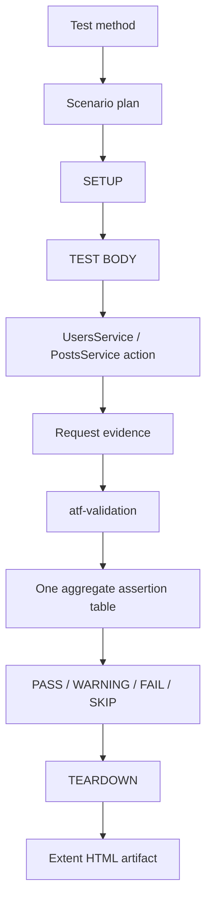

# ATF Tests — scenarii, integrare și dovada end-to-end

`atf-tests` este test layer-ul consumator al framework-ului. Aici sunt definite
scenariile API concrete și testele care demonstrează că API layer-ul,
execuția, validarea și raportarea colaborează corect.

## Ce deține un test

Un test de API deține intenția și contractul scenariului:

```text
test class
  → scenario metadata / tags
  → lifecycle plan
  → API service action
  → validation contract
  → expected report evidence
```

Nu deține implementarea HTTP, construirea manuală a rutelor, CSS-ul sau
politica internă de finalizare a raportului.

## Secvența canonică



În `TEST BODY`, request-ul și validation-ul sunt frați direcți:

```text
TEST BODY
├── GET /public/v2/users/1
│   ├── Technical trace
│   ├── Response details
│   └── Response JSON
└── Validate: item contract
    └── Assertions
```

Validation-ul nu se îngroapă în request, iar fiecare assertion nu primește un
container separat. Tabelul agregat păstrează verdictul și evidence-ul lizibile.

## Exemplu de structură

```java
@Test
void getsUserById() {
    var module = ApiModuleFactory.fromTransport(transport, settings);
    var validator = new ResponseContractReporter();

    try (var report = ExtentReportSession.openConfigured()) {
        var plan = ApiScenarioPlan.scenario("UsersApiTests",
                        "GET user — item contract")
                .tags(List.of("api", "users", "contract"))
                .body(phase -> {
                    var result = module.users().get(1);
                    var request = phase.startRequest(
                            "GET /public/v2/users/1", "GET", "/public/v2/users/1");
                    request.detail("response.status", Integer.toString(result.response().status()));
                    request.detail("response.duration.ms", Long.toString(result.response().duration().toMillis()));
                    request.json("RESPONSE JSON", result.response().body());
                    validator.validate(
                            request,
                            "Validate user contract",
                            result.response(),
                            new ResponseContract().status(200),
                            false);
                    request.complete(AtfReportStatus.PASS);
                    request.close();
                })
                .build();

        new ApiScenarioLifecycleRunner().run(report, plan);
    }
}
```

Numele exacte ale helperelor pot varia, dar responsabilitățile nu se schimbă:

| Pas | Owner |
|---|---|
| acțiune semantică | `atf-execution` service |
| transport, timeout, retry | `atf-core` |
| evaluare contract | `atf-validation` |
| phase order și teardown | `atf-execution` |
| evidence, HTML și Extent | `atf-reporting` |
| scenariu și criteriul de acceptare | `atf-tests` |

## Tipuri de teste

1. **Unit** — verifică o clasă cu fake-uri și fără filesystem sau rețea.
2. **Contract** — verifică porturi, lifecycle, semantic tree și artifact
   invariants.
3. **Acceptance offline** — folosește transport determinist și generează un
   raport complet.
4. **Live API** — este separat și opt-in; nu face buildul normal dependent de
   rețea sau de un server extern.

Testele de reporting verifică și artifactul: `Overview`, `Tests`, `Category`,
`Fails`, filtre, deep-links, collapse, durate `N ms`, statusuri, tags și
`request → validation`. Verificarea vizuală finală se face în TAB MCP, nu într-un
browser Windows.

## Reguli pentru contribuții

- nu modifica testul pentru a ascunde o regresie în framework;
- nu copia logică din `ApiExecutor`, validator sau reporting în fixture-uri;
- păstrează transportul fake determinist pentru testele offline;
- publică rapoarte în staging separat când există execuții active;
- nu trata un raport istoric ca dovadă pentru codul live;
- după o schimbare HTML/CSS/JS, verifică artifactul nou în TAB MCP înainte de
  închiderea lucrării.
