# ATF Tests — scenarii, integrare și dovada end-to-end

`atf-tests` este test layer-ul consumator al framework-ului. Aici sunt definite
scenariile API concrete și testele care demonstrează că API layer-ul,
execuția, validarea și raportarea colaborează corect.

## Organizarea testelor

Modulul separă explicit codul reutilizabil de clasele care chiar execută teste.
Regula de citire este simplă: `src/main/java` descrie scenarii și compoziția
reutilizabilă, iar `src/test/java` conține clasele JUnit care pornesc testele,
host-urile de raport și adaptoarele strict necesare testării. Astfel,
`UsersApiTests` este un test real, iar `UsersApiScenarios` este o proiecție
reutilizabilă pentru raportul agregat — nu un al doilea test ascuns.

Structura este grupată după API și intenție, în aceeași manieră ușor de urmărit
ca un proiect API de consumator:

```text
src/main/java/atf/api/tests
├── api
│   ├── users/UsersApiScenarios              scenarii reutilizabile pentru Users
│   ├── posts/PostsApiScenarios              scenarii reutilizabile pentru Posts
│   ├── requests
│   │   ├── RequestVariantRoutes              request-uri și contracte partajate
│   │   └── RequestVariantsApiScenarios       scenarii pentru request-uri variate
│   └── lifecycle/LifecycleApiScenarios       lifecycle pentru raportul agregat
└── support
    ├── ApiAcceptancePlanBuilder              DSL pentru metadata și lifecycle
    └── ApiAcceptancePublisher                bridge execuție → validation → evidence

src/test/java/atf/api/tests
├── api
│   ├── users/UsersApiTests                    teste efective pentru Users API
│   ├── posts/PostsApiTests                    teste efective pentru Posts API
│   ├── requests/RequestVariantsApiTests      query params, body-uri și auth variat
│   ├── lifecycle/ApiLifecycleAndCombinationsTests  setup → test body → teardown
│   └── reporting
│       ├── ApiAcceptanceReportTest            coordinator pentru artifactul complet
│       ├── ApiReportSmokeTest                 dovadă API → report minimală
│       ├── EndToEndContractTest               rută → service → validation → report
│       └── ApiLiveReportTest                  scenarii live, opt-in
├── architecture/ArchitectureBoundaryTest    reguli de module și source-set-uri
└── support
    ├── ApiTestFixture                         composition root offline pentru teste
    ├── ApiResourceTestBase                    compoziție pentru rularea directă
    ├── ApiReportTestContext                   legătura test → scenario Extent
    ├── AtfExtentReportTestExtension           sesiune Extent per clasă
    ├── RecordingApiTransport                  request semantic pentru evidence
    └── TestReportPaths                        output izolat pentru rulări paralele
```

`ArchitectureBoundaryTest` inventariază și package-urile de producție. Pragul
de coeziune este de 8 clase; orice package nou peste limită face build-ul să
ceară o allow-list motivată. Excepțiile actuale sunt documentate în test și în
`docs/README_Atf_BestPractices.md`, astfel încât o separare viitoare să fie
semantică, nu cosmetică.

`api/reporting` din `src/test/java` conține verificările cross-resource și
boundary-urile de raportare. `ApiAcceptanceReportTest` coordonează suita și
verifică artifactul final; nu conține logica fiecărei resurse. Pachetele
`users` și `posts` păstrează aceeași organizare semantică în ambele source-set-uri:
testul efectiv este în `src/test/java`, iar scenariul reutilizabil este în
`src/main/java`. Astfel, un contributor vede clar ce se execută și ce se
reutilizează, fără să confunde o proiecție de raport cu un test JUnit.
Pachetul `lifecycle` izolează testele care verifică secvența
`SETUP → TEST BODY → TEARDOWN → report`, fără să o amestece cu testele de
resursă. Clasele `*ApiScenarios` păstrează doar proiecția reutilizabilă necesară
artifactului agregat. `src/main/java/.../support` conține DSL-ul de scenarii și
publisher-ul comun, reutilizabile de mai multe host-uri. `src/test/java/.../support`
conține fixture-uri, extensii JUnit și adaptoare strict legate de rularea
testelor; scenariile reutilizabile nu se ascund acolo.

Pachetul `api/requests` verifică variațiile care trebuie să rămână vizibile în
raport, fără să amestece intenția lor cu testele Users sau Posts:

| Scenariu | Ce dovedește |
|---|---|
| `GET /public/v2/search` | query params, Bearer auth și response JSON nested |
| `POST /public/v2/bulk-import` | body JSON mare, API key și status `202` |
| `PUT /public/v2/profiles/1` | body nested, Basic auth și query `expand` |
| `PATCH /public/v2/preferences` | Custom auth, query `locale` și body nested |

Fiecare request este un nod Extent separat, iar `Request details`, `Response
details` și `Contract validation` rămân copii ai aceluiași `TEST BODY`.
Body-urile sunt randate în zone expandabile distincte; pentru payload-uri mari,
containerul JSON rămâne scrollabil fără să lărgească pagina. Technical Trace
include URL-ul complet cu query string, `HTTP STATUS`, `AUTH PROFILE`, `AUTH
TYPE`, `QUERY PARAMS` și headerele request-ului. Testele rulează offline prin
`AtfMockTransport`, dar păstrează URL-ul semantic pentru evidence.

Regula de citire este: caută mai întâi resursa în `api/users` sau `api/posts`,
apoi urmărește publisher-ul din `support` pentru secvența comună. Pentru
comportamentul transversal și fluxul complet, citește `api/lifecycle` și
`api/reporting`. Nu copia transportul, validarea sau randarea în fiecare test.

Testele de resursă sunt clase JUnit executabile direct, nu doar date pentru un
host de raportare:

```text
UsersApiTests / PostsApiTests
    → ApiResourceTestBase
        → ApiTestFixture
            → service API
                → AtfMockTransport
            → contract validation
            → report adapter (dacă reporting.extent.enabled=true)
```

`ApiResourceTestBase` este compoziția comună pentru testele orientate pe
resursă: atașează consola, atașează adaptorul Extent și construiește fixture-ul
izolat. Testul rămâne explicit — apelează serviciul și contractul — iar
`ApiReportTestContext` publică aceeași execuție, request/response evidence și
validation sibling în artifactul Extent. Pachetul `api/reporting` rămâne
rezervat testelor care verifică raportul agregat, contractul visual și rularea
live; nu devine un loc pentru a ascunde testele Users sau Posts.

## Cum se citește un test pe layere

```mermaid
flowchart LR
    Test[UsersApiTests / PostsApiTests] --> Fixture[ApiTestFixture]
    Fixture --> Module[ApiModule]
    Module --> Service[UsersService / PostsService]
    Service --> Executor[ApiExecutor]
    Executor --> Transport[AtfMockTransport sau HTTP live]
    Transport --> Response[ApiExecutionResult / ApiResponse]
    Response --> Contract[ContractValidators / ResponseContract]
    Contract --> Verdict[ValidationDecision]
    Verdict --> Report[ApiAcceptancePublisher → Extent]
```



Într-un test API obișnuit, `ApiTestFixture` compune graph-ul izolat, testul
apelează explicit service-ul, iar contractul validează response-ul. Raportarea
nu este ascunsă în testele unitare; ea este demonstrată separat de
`ApiAcceptanceReportTest` și de testul de lifecycle. Astfel se vede imediat ce
aparține API layer-ului, ce aparține validării și ce aparține reporting-ului.

Pentru rularea directă a unui test JUnit, `AtfConsoleTestExtension` din
subpachetul `atf.api.console.junit` al [`atf-console`](../atf-console/README.md) atașează
observatorul de consolă fără să schimbe API-ul testului. `ApiExecutor` publică
request-ul și response-ul prin `AtfConsoleSink`, iar `ApiTestFixture` publică
validarea ca pas separat. Body-urile trec prin `SensitiveDataRedactor` și sunt
afișate pretty-printed numai când `reporting.console.detailsEnabled` este
`true`.

Formatterul și adapterul JUnit folosite de test sunt în modulul
[`atf-console`](../atf-console/README.md), nu în `atf-reporting`. `atf-tests`
poate compune în continuare și raportarea Extent pentru testele de acceptance,
dar consola și adapterul JUnit rămân dependențe separate și pot fi folosite fără
rendererul HTML.

Forma UTF-8 este:

```text
[ATF] ▶ POST /public/v2/users
[ATF]   • method=POST
[ATF]   • url=https://atf.local/public/v2/users
[ATF]   • request.body
[ATF]     { ... }
[ATF]   • response.status=201
[ATF]   • response.body
[ATF]     { ... }
[ATF]   ✅ PASS: Call completed (N ms)
[ATF] ▶ Validate response contract
[ATF]   • actual=201
[ATF]   ✅ PASS: Validated (N ms)
```

Consolele Windows/CI care nu pot reda glyph-urile folosesc automat fallback
ASCII (`>`, `-`, `PASS`, `WARNING`, `FAIL`), fără caractere corupte. Mesajele
de lifecycle și durata rămân identice semantic.

## Ce deține un test

Un test de API deține intenția și contractul scenariului:

```text
test class
  → scenario metadata / tags
  → lifecycle plan
  → API service action
  → validation contract
  → expected report evidence
```

Nu deține implementarea HTTP, construirea manuală a rutelor, CSS-ul sau
politica internă de finalizare a raportului.

## Secvența canonică

```mermaid
flowchart TD
    Test[Test method] --> Plan[Scenario plan]
    Plan --> Setup[SETUP]
    Setup --> SetupRequest[Setup request(s)]
    Plan --> Body[TEST BODY]
    Body --> Action[UsersService / PostsService action]
    Action --> Request[Request evidence]
    Request --> RequestDetails[Request details + request body]
    Request --> ResponseDetails[Response details + response body]
    Request --> Execution[Execution evidence]
    Body --> Validate[atf-validation sibling]
    Validate --> Assertions[One aggregate assertion table]
    Assertions --> Verdict[PASS / WARNING / FAIL / SKIP]
    Plan --> Teardown[TEARDOWN]
    Teardown --> Cleanup[Cleanup/read-back]
    Plan --> Artifact[Extent HTML artifact after lifecycle]
```

În `TEST BODY`, request-ul și validation-ul sunt frați direcți:

```text
TEST BODY
├── GET /public/v2/users/1
│   ├── Request details
│   │   ├── URL / method / path / headers / params / auth
│   │   └── Request JSON, dacă există
│   ├── Response details
│   │   ├── Technical trace
│   │   └── Response JSON, dacă există
│   └── Execution evidence
└── Validate: item contract
    └── Assertions
```

Validation-ul nu se îngroapă în request, iar fiecare assertion nu primește un
container separat. Tabelul agregat păstrează verdictul și evidence-ul lizibile.

## Exemplu de structură

```java
@Test
void getsUserById() {
    var module = ApiModuleFactory.fromTransport(transport, settings);
    var validator = new ResponseContractReporter();

    try (var report = ExtentReportSession.openConfigured()) {
        var plan = ApiScenarioPlan.scenario("UsersApiTests",
                        "GET user — item contract")
                .tags(List.of("api", "users", "contract"))
                .body(phase -> {
                    var result = module.users().get(1);
                    var request = phase.startRequest(
                            "GET /public/v2/users/1", "GET", "/public/v2/users/1");
                    request.detail("response.status", Integer.toString(result.response().status()));
                    request.detail("response.duration.ms", Long.toString(result.response().duration().toMillis()));
                    request.json("RESPONSE JSON", result.response().body());
                    validator.validate(
                            request,
                            "Validate user contract",
                            result.response(),
                            new ResponseContract().status(200),
                            false);
                    request.complete(AtfReportStatus.PASS);
                    request.close();
                })
                .build();

        new ApiScenarioLifecycleRunner().run(report, plan);
    }
}
```

Numele exacte ale helperelor pot varia, dar responsabilitățile nu se schimbă:

| Pas | Owner |
|---|---|
| acțiune semantică | `atf-execution` service |
| transport, timeout, retry | `atf-core` |
| evaluare contract | `atf-validation` |
| phase order și teardown | `atf-execution` |
| evidence, HTML și Extent | `atf-reporting` |
| scenariu și criteriul de acceptare | `atf-tests` |

## Tipuri de teste

1. **Unit** — verifică o clasă cu fake-uri și fără filesystem sau rețea.
2. **Contract** — verifică porturi, lifecycle, semantic tree și artifact
   invariants.
3. **Acceptance offline** — folosește transport determinist și generează un
   raport complet.
4. **Live API** — este separat și opt-in; nu face buildul normal dependent de
   rețea sau de un server extern.

### Transportul acceptance nu este HTTP real

`ApiAcceptanceReportTest`, `ApiReportSmokeTest`, testele de resurse și
`ApiLifecycleAndCombinationsTests` folosesc intenționat `AtfMockTransport` din
modulul decuplat `atf-mock`. Acesta este un fake determinist injectat la
composition root și produce
`ApiResponse`-uri cunoscute pentru rutele scenariilor. Nu deschide socket,
nu face DNS și nu validează disponibilitatea unui server.

Prin urmare, un URL precum:

```text
https://atf.local/public/v2/users
```

este URL-ul semantic/evidence al cererii din raport; nu este dovada că acel
host există sau că a fost contactat. Păstrăm această abordare pentru ca
raportul, lifecycle-ul, retry-ul și contractele să poată fi verificate
reproductibil, offline și în rulări paralele.

Testul care folosește HTTP real este exclusiv `ApiLiveReportTest`. El este
marcat `@Tag("live")`, este dezactivat implicit și trebuie activat explicit:

```text
-Datf.liveApi.enabled=true
-Datf.liveApi.baseUri=https://host-ul-real
-Datf.liveApi.timeoutSeconds=20
```

În IntelliJ, aceste valori se pun în **Run Configuration → VM options**, iar
testul selectat trebuie să fie `ApiLiveReportTest`, nu
`ApiAcceptanceReportTest`. Host-ul ales trebuie să fie accesibil din mediul
de rulare, să rezolve prin DNS/hosts și, pentru HTTPS, să aibă un certificat
acceptat de JVM. Dacă aceste condiții nu sunt îndeplinite, un eșec live este
un eșec de conectivitate/configurație, nu un rezultat al fake-ului acceptance.

Regula de ownership este strictă:

```text
ApiAcceptanceReportTest -> AtfMockTransport -> raport offline determinist
ApiLiveReportTest       -> HttpClientTransport -> endpoint HTTP real
```

Nu schimbăm transportul acceptance printr-un flag ascuns. Dacă în viitor
transportul va fi selectabil prin YAML, valoarea trebuie rezolvată o singură
dată la composition root, să aibă implicit `acceptance` pentru testele
offline și să declare explicit `live` pentru rețea. O configurație YAML nu
trebuie să transforme accidental un test determinist într-un test extern.

Testele de reporting verifică și artifactul: `Overview`, `Tests`, `Category`,
`Fails`, filtre, deep-links, collapse, durate `N ms`, statusuri, tags și
`request → validation`. Verificarea vizuală finală se face în TAB MCP, nu într-un
browser Windows.

### Rulare directă din IntelliJ

`UsersApiTests` poate fi rulat direct ca suită JUnit. Clasa folosește
`ApiResourceTestBase`, care atașează consola și adaptorul Extent fără un runner
separat. Fiecare metodă creează un scenario sub `UsersApiTests`, publică
request details, response details, body-urile expandabile, validation și
verdictul final. `AtfConsoleTestExtension` proiectează în paralel lifecycle-ul
în consolă (`scenario` → `TEST BODY` → verdict cu durată). Nu se tipăresc
payload-uri implicit. Setările sunt configurabile:

```yaml
reporting:
  console:
    enabled: true
    detailsEnabled: true
  extent:
    enabled: true
    outputDirectory: artifacts/reports
    fileName: api-atf-extent-report.html
    timestampEnabled: true
```

Cu `detailsEnabled: true`, mesajele includ detalii de transport și body-ul JSON
formatat pe mai multe linii, după redacționarea câmpurilor sensibile. Cu
`false`, lifecycle-ul rămâne vizibil, dar body-urile și detaliile sunt omise.
Cu `reporting.extent.enabled: true`, aceeași rulare directă produce și raportul
HTML configurat. Cu `false`, testele rămân executabile și produc numai consola;
nu se schimbă transportul, contractul sau rezultatul testului. Output-ul este
rezolvat relativ la fișierul YAML, iar timestamp-ul trebuie păstrat activ pentru
rulări paralele.

Pentru artifactul agregat Users + Posts + lifecycle, rulează în continuare
`ApiAcceptanceReportTest` din pachetul `api/reporting`. Pentru o singură resursă,
rulează direct `UsersApiTests` sau `PostsApiTests`; raportul este generat de
adaptorul comun și nu trebuie copiată compoziția Extent în fiecare test.

Dacă IntelliJ pornește cu alt working directory, setează VM option-ul
`-Datf.report.config=..\atf.yaml` sau folosește o cale relativă echivalentă.
Păstrează timestamp-ul activ când pot exista rulări paralele.

## Reguli pentru contribuții

- nu modifica testul pentru a ascunde o regresie în framework;
- nu copia logică din `ApiExecutor`, validator sau reporting în fixture-uri;
- păstrează `atf-mock` și transportul fake determinist pentru testele offline;
- publică rapoarte în staging separat când există execuții active;
- nu trata un raport istoric ca dovadă pentru codul live;
- după o schimbare HTML/CSS/JS, verifică artifactul nou în TAB MCP înainte de
  închiderea lucrării.
