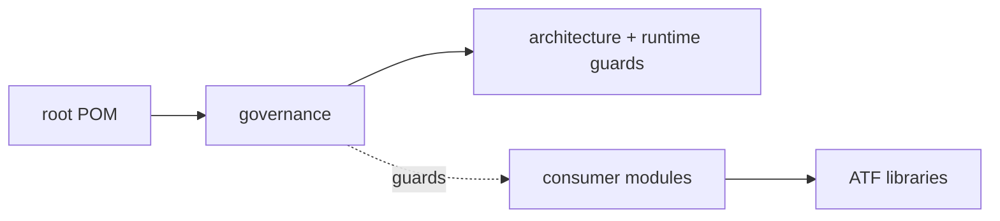

# ATF Tests — guvernanță whole-reactor

## Overall

`atf-tests` este modulul de control al proiectului ATF. Conține doar teste de
guvernanță pentru reactor, boundary-uri Maven/source și gates de arhitectură.
Nu este owner pentru teste de produs și nu conține locatori, page objects sau
flow-uri Practice Shop. În live mai există un adaptor UI de compatibilitate în
`src/test/java/atf/ui/tests/support/reporting`; acesta nu este test executabil,
dar rămâne reziduu de structură și este urmărit prin
[`REP-BOUNDARY-01`](../docs/feedback/README.md) și `TEST-ARCH-07`.



<details>
<summary><strong>Legendă — ce guvernează atf-tests</strong></summary>

- root POM și graph-ul de module intră în gate-ul whole-reactor;
- atf-tests verifică limitele, nu implementează flow-uri de aplicație;
- Practice Shop și reporting composition rămân consumatori separați;
- `Checks` grupează verificările de arhitectură, scope și siguranță runtime;
- muchia punctată arată guard-ul aplicat consumatorilor, nu ownership transferat către governance;
- consumatorii folosesc bibliotecile prin dependințe explicite, iar governance-ul
  verifică această direcție fără să devină runtime.
</details>

| Responsabilitate | Owner | Excludere explicită |
|---|---|---|
| reactor, POM și dependency direction | `atf-tests` | nu modifică production code |
| source/package ownership și module placement | `ArchitectureModuleBoundaryTest`, `ArchitectureOwnershipBoundaryTest` | nu deține selectorii unei aplicații |
| documentație relocabilă și surse coerente | `DynamicPathDocumentationArchitectureTest`, `AtfSourceReadabilityGovernanceTest` | nu validează conținutul unui singur consumer |
| ownership de constante și coeziune de package | `ConstantsOwnershipGovernanceTest`, `AtfPackageCohesionGovernanceTest` | excepțiile trebuie să fie explicite |
| Practice Shop purchase journey | `atf-test-practice-shop` | nu se copiază aici |
| reporting contract/API/UI composition | `atf-reporting-tests` | nu se mută în governance |

## Suita whole-ATF și reziduul de compatibilitate

```text
src/test/java/atf/api/tests/governance/
├── ArchitectureModuleBoundaryTest.java
├── ArchitectureOwnershipBoundaryTest.java
├── AtfPackageCohesionGovernanceTest.java
├── AtfGovernanceRules.java
├── AtfGovernanceTestSupport.java
├── AtfSourceReadabilityGovernanceTest.java
├── ConstantsOwnershipGovernanceTest.java
├── DocumentationDiagramGovernanceTest.java
├── DynamicPathDocumentationArchitectureTest.java
└── WholeAtfGovernanceSuiteTest.java
```

`WholeAtfGovernanceSuiteTest` este entry point-ul explicit pentru verificarea
întregului reactor. El grupează verificările fără să mute responsabilitatea
testelor de reporting în acest modul:

- `ArchitectureModuleBoundaryTest` — reactor, POM, direcția dependențelor,
  importuri interzise, output de proces, stare statică și eliminarea
  `atf-execution`;
- `ArchitectureOwnershipBoundaryTest` — placement-ul modulelor, package roots,
  ownership-ul reporting/UI și absența duplicărilor;
- `AtfPackageCohesionGovernanceTest` — coeziunea package-urilor de producție și
  test, cu excepții revizuite explicit;
- `AtfSourceReadabilityGovernanceTest` — importuri duplicate și invocații
  fully-qualified care ascund intenția testului;
- `ConstantsOwnershipGovernanceTest` — vocabularul de protocol, rute și
  boundary-ul reporting standalone;
- `DynamicPathDocumentationArchitectureTest` — documentație relocabilă, fără
  căi de mașină sau nume de artifact generate concret.
- `DocumentationDiagramGovernanceTest` — orientare `LR`, legendă imediată,
  fence-uri echilibrate și relații etichetate în README-urile non-root.

Astfel, `atf-reporting-tests` nu mai deține verificări care inspectează întregul
repository; păstrează doar boundary-ul API/UI propriu compoziției reporting.

<details>
<summary><strong>Ținta de curățare urmărită în feedback</strong></summary>

- `atf-tests` trebuie să rămână cu guard-ul whole-reactor și suportul strict
  necesar acestuia;
- adaptoarele de reporting/UI se mută sau se elimină numai după dovadă de
  boundary și după verificarea consumerului canonical;
- o dependență test-scope existentă nu este declarată „eliminată” doar pentru
  că ownership-ul dorit este descris în tabel;
- orice schimbare se închide prin POM, import scan și testul de arhitectură.

</details>

## Module consumer separate

Testarea site-ului `https://practicesoftwaretesting.com` este izolată în
`atf-test-practice-shop`. Acolo sunt YAML-ul, configurația checkout-ului,
locators, page objects, flow-urile și testele component/E2E. Flow-ul principal
este guest purchase complet și nu cere un secret; login-ul opțional folosește
doar un fișier extern injectat explicit.

```text
atf-test-practice-shop/src/
├── main/java/atf/ui/practiceshop/
│   ├── api/         client, request factory și screen API flows
│   ├── config/      records typed încărcate din YAML
│   ├── locators/    singurul owner al selectorilor aplicației
│   ├── pages/       page objects
│   ├── flow/        pași de business compuși
│   └── support/     context și evidence adapters
├── test/java/atf/ui/tests/practiceshop/
│   ├── component/       teste rapide de module
│   ├── api/component/   variații fake pozitive/negative
│   ├── api/integration/ precondiție login live, opt-in
│   └── e2e/             purchase journey și lifecycle report/browser
└── test/resources/atf-practice-shop.yaml
```

Nu se adaugă clase Practice Shop în `atf-tests` sau `atf-reporting-tests`. Dacă
un test verifică rendererul/raportul, aparține reporting composition; dacă
verifică aplicația externă, aparține modulului Practice Shop.

## Rulare și staging

```text
mvn -pl atf-tests -am "-Dtest=WholeAtfGovernanceSuiteTest" "-Dsurefire.failIfNoSpecifiedTests=false" test
mvn -pl atf-tests -am test
mvn -pl atf-test-practice-shop -am -Dtest=PracticeShopArchitectureTest,PracticeShopConfigurationTest,PracticeShopCheckoutConfigurationTest test
mvn -pl atf-test-practice-shop -am -Dtest=PracticeShopPurchaseE2eTest test
```

Build-urile se fac într-un staging extern (`${ATF_STAGING_ROOT}/...`), fără a
opri execuții active. Se sincronizează numai fișierele aprobate, după recitirea
live și reconcilierea modificărilor paralele; nu se copiază `target`, `artifacts`
sau cache-uri peste live. Procedura normativă este
[`docs/ATF_Build_And_Execution_Safety.md`](../docs/ATF_Build_And_Execution_Safety.md).

## Regula de ownership

```text
whole reactor / module graph / architecture gates → atf-tests
Practice Shop config / locators / pages / flows / E2E → atf-test-practice-shop
reporting contracts / Extent composition → atf-reporting-tests
renderer / HTML / CSS / public reporting API → atf-reporting
```

Regulile generale OOP, locator boundary și layering sunt în
[`docs/README_Atf_BestPractices.md`](../docs/README_Atf_BestPractices.md), iar
statusul mutării este în [`docs/feedback/README.md`](../docs/feedback/README.md).
