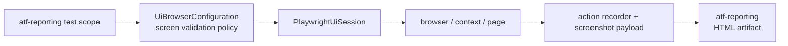

# ATF UI — browser, context și sesiune Playwright

`atf-ui` este infrastructura runtime pentru browserul Playwright. Configurează
browserul, contextul, pagina, timeout-urile, viewport-ul, screenshot-ul și
recorderul de acțiuni. Nu conține testele UI ale raportului, rendererul HTML,
publisherul Extent sau page objects de produs.

## Diagramă de bază



| Responsabilitate | Owner |
|---|---|
| browser, context, page, viewport, timeout | `atf-ui` |
| acțiuni Playwright primitive și recorder neutru | `atf-ui` |
| locatori, page objects, flows și testele declarative | `atf-reporting` test scope |
| snapshot contract și validatori de browser | `atf-reporting` production + test scope |
| HTML, CSS, Extent lifecycle și publisher | `atf-reporting` |
| mock, API scenarios și contract validation | `atf-reporting` test scope + modulele API |

`SectionAuditCheckExecutor` și `ExtentSectionAuditPublisher` NU aparțin
`atf-ui`. Validarea statică și proiecția de raport aparțin `atf-reporting`;
execuția browserului și scenariile E2E apar explicit în
[`atf-reporting/src/test/java/atf/ui/tests/extent/README.md`](../atf-reporting/src/test/java/atf/ui/tests/extent/README.md).
`atf-ui` nu trebuie să importe acele clase, să publice Extent sau să emită
assert-uri de secțiune.

## Componentele runtime

- `UiBrowserConfiguration` — browser, headless, timeout, navigation timeout și
  viewport;
- `UiScreenValidationConfiguration` — politica generică de captură, fără
  cunoașterea raportului, a Extent sau a outputului;
- `PlaywrightUiSession` — lifecycle scoped al unui browser context și page;
- `PlaywrightBrowserActions` / `PlaywrightLocatorActions` — operații primitive;
- `PlaywrightActionSequence` / `UiActionRecorder` — model neutru al operațiilor;
- `UiScreenValidation` — capturează payload-ul PNG Base64 din page.

Sesiunea este idempotentă la close și nu deține serverul Debug UI. `atf-ui` nu
descoperă YAML de proiect, nu rezolvă outputuri și nu primește decizii de audit;
consumerul compune politicile generice și publică artifactul prin
`atf-reporting`.

## Configurație generică, fără flag redundant

`atf-ui` expune doar valori care descriu execuția browserului și capturarea
generică. Nu este owner pentru `report.directory`, `apiSetup`, `audit` sau
`filePrefix`; aceste valori sunt test-only și aparțin configurației interne a
modulului `atf-reporting`:

[`atf-reporting/src/test/resources/atf-reporting-ui.yaml`](../atf-reporting/src/test/resources/atf-reporting-ui.yaml)

```yaml
ui:
  browser: chromium
  baseUrl: about:blank
  headless: false
  timeout: PT10S
  navigationTimeout: PT45S
  viewport: { width: 1440, height: 900 }
  # Page zoom used by Playwright screenshots; 70% shows more report evidence.
  zoomPercent: 70
  screenshotOnFailure: true
  screenValidation:
    enabled: true
    fullPage: false
```

Nu există și nu se adaugă `ui.enabled`. Runtime-ul este construit când
consumerul selectează un test; opțiunile concrete descriu browserul și
evidence-ul.
`ui.screenValidation.enabled` controlează numai capturarea screenshot-ului,
nu activarea testelor sau publicarea raportului.
`ui.zoomPercent` controlează zoom-ul CSS al documentului Playwright pentru
fiecare pagină navigată. Valoarea recomandată pentru rapoarte Extent este
`70`, deoarece încadrează mai multă evidence într-un singur screenshot fără
să schimbe `viewport.width`/`viewport.height`. Valoarea este validată în
intervalul `25..200`; lipsa cheii păstrează zoom-ul neutru `100`.
Încărcarea YAML-ului, override-ul `-Datf.ui.config`/`-Datf.ui.report` și
rezoluția inputului audit sunt responsabilitatea exclusivă a test scope-ului
`atf-reporting`.

## Acțiuni și locatori

`atf-ui` poate executa o operație pe un `AtfLocator`, dar nu decide selectorul
și nu știe intenția business. Locator facade-urile sunt în `atf-reporting` test scope:

```text
Report*Locators
    → AtfLocator(selector + Locator)
    → PlaywrightLocatorActions
    → PlaywrightActionSequence
    → flow / extractor / validator din atf-reporting
```

Testele nu scriu direct `page.locator(...)`, `getByRole(...)` sau `getByText(...)`.
În `TARGET` se publică selectorul efectiv folosit, nu o descriere precum
`"selected owner"` sau `"collapse node"`. Operațiile suportate explicit sunt
`Navigate`, `Click`, `Get text`, `Find element`, `Expect text`, `Focus`,
`Wait for visible`, `Expect visible` și `Wait`.

`PlaywrightActionSequence` este recorderul, nu auditorul: înregistrează ordinea,
target-ul, expected, observed, durata și statusul. Validatorul pur din
`atf-reporting` decide dacă snapshot-ul DOM corespunde proiecției așteptate.

## Screen validation și screenshot

`UiScreenValidation.capture(page, configuration, title)` returnează un payload
PNG Base64 și nu scrie fișier PNG extern. Publisherul din `atf-reporting` îl
expune o singură dată ca link inline `📷 base64 img` cu `data:image/png;base64,...`.
Alinierea pill-ului, separarea tabelului și disclosure-urile sunt contract de
reporting, nu CSS în `atf-ui`.

Un pas `Screen validation` trebuie să păstreze în aceeași stare vizuală:

```text
acțiuni reale Playwright
  → screenshotul acelei stări
  → observații
  → assertions
```

Nu se atașează aceeași imagine la fiecare assertion și nu se folosește un
assert Java care ascunde acțiunea din raport. Contractul complet de cardinalitate,
markup și randare este în
[`atf-reporting/README.md`](../atf-reporting/README.md).

## Ce nu se pune în `atf-ui`

- teste JUnit sau colecții API;
- `UiConfiguration`, `UiAuditSuiteConfiguration`, loaderul YAML și contextul
  pentru `atf.ui.config`/`atf.ui.report` — sunt configurație de test a
  raportării și stau în `atf-reporting/src/test/java/.../support/config`;
- `SectionAuditCheckExecutor`, `SectionAuditCheckPolicy` sau
  `ExtentSectionAuditPublisher`;
- `ReportProjection`, reguli pentru Tests/Fails/Categories sau contractul static HTML;
- HTML/CSS/Extent nodes sau finalizarea artifactului;
- page objects, selectorii produsului și flows de business;
- fallback la un artifact arbitrar sau modificarea inputului API.

Aceste limite sunt intenționate: `atf-ui` rămâne reutilizabil și testabil ca
runtime Playwright, `atf-reporting` rămâne reutilizabil ca librărie de raportare,
iar test scope-ul reporting compune scenariile E2E și adaptorul browser.

## Verificare

Teste runtime/config:

```text
mvn -pl atf-ui -am test
```

Testele de raport UI se rulează din `atf-reporting`, de exemplu:

```text
mvn -pl atf-reporting -am -Dtest=SelectedApiTestsReportUiTest test
```

Build-ul se face în staging extern (`${ATF_STAGING_ROOT}/atf-ui-<id>`) pentru a păstra
rulările curente și serverele intacte. Raportul UI aprobat se copiază numai în
`artifacts/reports/ui/`. Verificarea finală se face pe artifactul HTML rezultat,
prin ATF Debug UI și Playwright/browser MCP: click-uri, expand/collapse,
accessibility tree, console/network și randare. Nu se folosește browser Windows
real.

Pentru procesul de sync și siguranță vezi
[`docs/ATF_Build_And_Execution_Safety.md`](../docs/ATF_Build_And_Execution_Safety.md);
pentru contractul vizual vezi
[`atf-reporting/README.md`](../atf-reporting/README.md).
