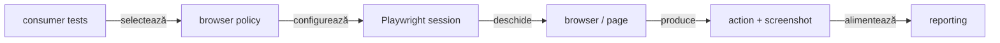
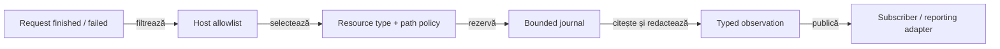

# ATF UI — browser, context și sesiune Playwright

`atf-ui` este infrastructura runtime pentru browserul Playwright. Configurează
browserul, contextul, pagina, timeout-urile, viewport-ul, screenshot-ul și
recorderul de acțiuni. Nu conține testele UI ale raportului, rendererul HTML,
publisherul Extent sau page objects de produs.

## Pe scurt

| Input | Output | Boundary |
|---|---|---|
| YAML browser policy | browser/context/page | runtime generic |
| Playwright actions | neutral action records | fără Extent |
| screenshot/viewport | UI evidence | consumat de reporting la compoziție |

## Diagramă de bază



<details>
<summary><strong>Legendă — runtime browser fără reporting</strong></summary>

- configurația descrie browserul și evidence-ul generic;
- sesiunea compune browser, context și page, apoi înregistrează acțiuni;
- atf-ui livrează payload-ul către consumer, nu decide verdictul și nu construiește HTML/CSS/Extent;
- publisherul și auditul aparțin atf-reporting, iar scenariile concrete aparțin test scope-ului consumator.
</details>

<details>
<summary><strong>Harta de lectură</strong></summary>

- [runtime](#componentele-runtime) și [configurație](#configurație-generică-fără-flag-redundant);
- [acțiuni și locatori](#acțiuni-și-locatori), inclusiv regula CSS;
- [screen validation și capturi](#validarea-ecranului-și-capturi-de-ecran);
- [network inspector](#inspectorul-de-rețea--limită-generică-de-responsabilitate),
  limite și [verificare](#verificare).

</details>

| Responsabilitate | Owner |
|---|---|
| browser, context, page, viewport, timeout | `atf-ui` |
| acțiuni Playwright primitive și recorder neutru | `atf-ui` |
| page objects, flows și testele declarative | modulul consumer; `atf-reporting-tests` pentru propriul audit al rapoartelor |
| snapshot contract și validatori de browser | `atf-reporting` production + `atf-reporting-tests` test scope |
| HTML, CSS, Extent lifecycle și publisher | `atf-reporting` |
| mock, API scenarios și contract validation | `atf-reporting-tests` test scope + modulele API |

`atf-ui` nu importă executorul de audit și publisherul de secțiune: validarea
statică și proiecția raportului aparțin `atf-reporting`, iar scenariile E2E sunt
în [README-ul auditului browser](../atf-reporting-tests/src/test/java/atf/ui/tests/extent/README.md).
Modulul UI nu publică Extent și nu emite assertions de secțiune.

## Componentele runtime

- `UiBrowserConfiguration` — browser, headless, timeout, navigation timeout și
  viewport;
- `UiScreenValidationConfiguration` — politica generică de captură, fără
  cunoașterea raportului, a Extent sau a outputului;
- `PlaywrightUiSession` — lifecycle scoped al unui browser context și page;
- `PlaywrightBrowserActions` / `PlaywrightLocatorActions` — operații primitive;
- `PlaywrightActionSequence` / `UiActionRecorder` — model neutru al operațiilor;
- `UiScreenValidation` — capturează payload-ul PNG Base64 din page.

Sesiunea este idempotentă la close și nu deține serverul Debug UI. `atf-ui` nu
descoperă YAML de proiect, nu rezolvă outputuri și nu primește decizii de audit;
consumerul compune politicile generice și publică artifactul prin
`atf-reporting`.

## Configurație generică, fără flag redundant

`atf-ui` expune doar valori care descriu execuția browserului și capturarea
generică. Nu este owner pentru `report.directory`, `apiSetup`, `audit` sau
`filePrefix`; aceste valori sunt test-only și aparțin configurației interne a
modulului `atf-reporting`:

[`atf-reporting-tests/src/test/resources/atf-reporting-ui.yaml`](../atf-reporting-tests/src/test/resources/atf-reporting-ui.yaml)

```yaml
ui:
  browser: chromium
  baseUrl: about:blank
  headless: false
  timeout: PT10S
  navigationTimeout: PT45S
  viewport: { width: 1440, height: 900 }
  # Page zoom used by Playwright screenshots; 70% shows more report evidence.
  zoomPercent: 70
  screenshotOnFailure: true
  screenValidation:
    enabled: true
    fullPage: false
```

- nu există și nu se adaugă `ui.enabled`;
- runtime-ul se construiește când consumerul selectează un test;
- opțiunile concrete descriu browserul și evidence-ul;
- `ui.screenValidation.enabled` controlează numai capturarea screenshot-ului;
- cheia nu activează testele și nu publică raportul;
- `ui.zoomPercent` controlează zoom-ul CSS al documentului principal navigat;
- scriptul nu aplică zoom suplimentar în iframe-uri; ele sunt deja scalate de container;
- `70` poate fi folosit pentru inspecția rapoartelor Extent fără controale embedded;
- pentru click-uri de pointer în iframe-uri, scara nativă `100` evită limita
  de geometrie cunoscută; activarea DOM explicită descrisă mai jos nu o repară;
- `viewport.width` și `viewport.height` rămân neschimbate;
- valoarea este validată în intervalul `25..200`, iar lipsa cheii păstrează `100`;
- YAML-ul auditului Extent, override-urile `-Datf.ui.config`/`-Datf.ui.report`
  și rezoluția raportului inspectat aparțin harness-ului din
  `atf-reporting-tests`, nu bibliotecii `atf-reporting` sau adaptorului `atf-ui`.
  Fiecare consumer deține separat configurația aplicației sale.

`PlaywrightUiSessionTest` verifică separarea scalei între documente și click-ul
real pe un control embedded la scara nativă. Limitarea coordonatelor la zoom CSS
non-nativ este urmărită separat în
[feedback-ul de geometrie](../docs/feedback/ATF_UI_Browser_Geometry_Feedback.md).
Proba de platformă nu fabrică reclame sau pagini ale unui consumer.

## Acțiuni și locatori

`atf-ui` poate executa o operație pe un `AtfLocator`, dar nu decide selectorul
și nu știe intenția business. Locator facade-urile sunt în `atf-reporting-tests`
test scope:

Vocabularul DOM reutilizabil este însă deținut aici, aproape de runtime-ul UI:

- `HtmlElement` definește tag-urile canonice (`input`, `textarea`, `select`,
  `option`, `button`, `a`, `img` și elementele structurale folosite frecvent);
- `HtmlAttribute` definește atribute HTML/automation stabile și compune selectori
  exacți ori prefixați cu escaping centralizat;
- `CssStringEscaper` escapează valori dinamice pentru contexte CSS între ghilimele;
- `CssPseudoClass` compune pseudo-clasele reutilizabile, de exemplu `:checked`;
- modulele consumatoare păstrează local doar valorile și semantica produsului,
  nu copii ale vocabularului fizic DOM.

Exemplu:

```java
HtmlElement.INPUT.attributeEquals(HtmlAttribute.ID, "email");
HtmlElement.ANCHOR.attributeStartsWith(HtmlAttribute.DATA_TEST, "product-");
CssPseudoClass.CHECKED.applyTo(HtmlElement.OPTION.selector());
```

```text
Report*Locators
    → AtfLocator(selector + Locator)
    → PlaywrightLocatorActions
    → PlaywrightActionSequence
    → flow / extractor / validator din atf-reporting
```

- testele nu scriu direct `page.locator(...)`, `getByRole(...)` sau
  `getByText(...)`;
- în `TARGET` se publică selectorul efectiv folosit, nu descrieri precum
  `"selected owner"` sau `"collapse node"`;
- operațiile suportate sunt `Navigate`, `Click`, `Get text`, `Find element`,
  `Expect text`, `Focus`, `Wait for visible`, `Expect visible` și `Wait`;
- `Get text` returnează textul observat apelantului pentru aserțiuni în memorie;
  pentru locatorii sensibili, action record-ul și trace-ul publică numai
  `[REDACTED]`. `Expect text` compară în runtime valoarea reală și păstrează
  aceeași redacție în evidence;
- stările asincrone folosesc așteptări Playwright cu timeout:
  `waitFor`, `waitForCondition`, `waitForURL`;
- `waitForTimeout` nu este API de stabilizare acceptat.

### Convenții pentru locatori UI

CSS este alegerea implicită pentru contractele DOM stabile. Preferă un selector
exact, ancorat pe element și atribut, de forma `element[atribut='valoare']`, de
exemplu `a[href='/products']` sau `input[data-qa='signup-email']`. Pentru
hook-uri stabile, folosește `data-qa`, `id` ori `name`; pentru navigare, un
`href` exact exprimă mai bine destinația decât poziția sau aspectul vizual.

- Refolosește `HtmlElement` și `HtmlAttribute` pentru tag-uri, atribute și
  escaping când rezultatul rămâne lizibil. `HtmlElement.attributeEquals(String
  name, String value)` acoperă și atribute valide fără enum dedicat, precum
  `data-qa`.
- Păstrează selectori compuși sau specifici aplicației expliciți și numiți în
  consumer; nu extinde vocabularul generic pentru o singură pagină.
- Evită selectori fragili de poziție (`nth`/`first` fără context unic demonstrat),
  clase pur vizuale și XPath. Folosește pseudo-selectori Playwright precum
  `:visible` sau `:has-text(...)` numai când vizibilitatea/textul este o
  precondiție reală și CSS-ul stabil nu poate exprima contractul.
- Nu extrage fiecare literal într-o constantă: centralizează valorile repetate
  sau contractuale și evită constante generice cu un singur consumator.
- Locator wrappers din test scope nu trebuie să ascundă ținta: secvența de
  acțiuni raportează selectorul efectiv folosit, nu o descriere precum
  `"selected owner"` sau `"collapse node"`.

Compoziția selectorilor și escaping-ul generic (`CssStringEscaper`) sunt verificate de testele
componente `atf-ui`; testele consumer verifică apoi selectorii față de markup-ul
aplicației reale.

În CI/ATF Debug, browserul headless provisionat poate fi selectat numai ca
override de bootstrap:

- JVM: `-Datf.ui.playwright.executablePath=<chromium-executable>`;
- environment: `ATF_UI_PLAYWRIGHT_EXECUTABLE_PATH`;
- nu este o cheie de business YAML;
- fără override, launcherul păstrează provisioning-ul Playwright standard și
  fail-closed dacă browserul nu este disponibil.

`PlaywrightActionSequence` este recorderul, nu auditorul:

- înregistrează ordinea, target-ul, expected, observed, durata și statusul;
- redactează valorile sensibile înainte să intre în records sau în trace-ul
  diagnostic. Selectorii uzuali pentru parole, date personale (inclusiv
  `mobile_number`, `postal_code` și `zipcode`) și card/CVC sunt recunoscuți
  automat; pentru un control cu nume opac, consumerul folosește
  `new AtfLocator(locator, selector).withSensitiveData()`. Acțiunea reală
  primește valoarea originală, însă report/replay/trace nu o păstrează, iar
  mesajele de eșec ale locatorului nu sunt propagate cu textul brut;
- ordinalul acțiunii este monoton pentru o secvență și continuă peste `drain()`;
  în E2E, aceeași secvență păstrează identificarea între setup și checkpoint-urile
  body-ului;
- validatorul pur din `atf-reporting` decide dacă snapshot-ul DOM corespunde
  proiecției așteptate.

### Activare JavaScript explicită

`clickWithJavaScript(AtfLocator, String, Runnable)` este opt-in pentru un control
care permite activare DOM. Nu este fallback pentru `click(...)` și nu simulează
un eveniment de pointer trusted. Consumerul justifică alegerea și furnizează
o postcondiție read-only care aruncă eroare dacă efectul așteptat lipsește.

| Contract | Comportament |
|---|---|
| Precondiții | țintă unică, vizibilă și activă; postcondiție obligatorie |
| Execuție | `HTMLElement.click()` o singură dată, apoi postcondiția |
| Evidence | un singur rând `JavaScript click`; PASS numai după postcondiție, cu durată comună |
| Eșec | FAIL la activare sau postcondiție; eroarea propagată, datele sensibile redactate |
| Retry | fără reluare automată a mutației, inclusiv când sunt activate retry-uri read-only |
| Click normal | rămâne pointer Playwright, cu hit testing; nu trece automat pe JavaScript |

`PlaywrightJavaScriptClickComponentTest` verifică aceste reguli la 70%, în
documentul principal și în iframe-uri same-origin/izolate. Fixture-ul este HTML
neutru deținut de `atf-ui`, nu o reclamă sau o pagină business simulată.

## Validarea ecranului și capturi de ecran

`UiScreenValidation.capture(page, configuration, title)` returnează un payload
PNG Base64 și nu scrie fișier PNG extern. Publisherul din `atf-reporting` îl
expune o singură dată ca link inline `📷 base64 img` cu `data:image/png;base64,...`.
Alinierea pill-ului, separarea tabelului și disclosure-urile sunt contract de
reporting, nu CSS în `atf-ui`.

Separarea generică dintre flow mode, screenshot policy și capture source este
documentată în
[`docs/ATF_Evidence_Capture_Contract.md`](../docs/ATF_Evidence_Capture_Contract.md).
`atf-ui` este providerul browser, nu owner-ul policy-ului, al YAML-ului consumerului
sau al publisherului HTML.

Un pas `Screen validation` trebuie să păstreze în aceeași stare vizuală:

```text
acțiuni reale Playwright
  → screenshotul acelei stări
  → observații
  → assertions
```

Nu se atașează aceeași imagine la fiecare assertion și nu se folosește un
assert Java care ascunde acțiunea din raport. Contractul complet de cardinalitate,
markup și randare este în
[`atf-reporting/README.md`](../atf-reporting/README.md).

## Inspectorul de rețea — limită generică de responsabilitate

Fluxul cross-module și baseline-ul setup/causal au un singur owner în
[diagrama arhitecturii](../docs/ATF_Architecture.md#capturarea-și-selecția-traficului-ui).

`UiNetworkInspector` este opt-in și restrâns la host-urile configurate:

- listenerii observă `request-finished` și `request-failed`; nu execută replay și nu
  decid verdictul testului;
- observațiile devin date typed, cu URL/query, headers și body redacted/bounded;
- failure-ul fără response are status `Unavailable` și motiv explicit;
- nu se fabrică un response pentru un request eșuat.

| Contract | Owner |
|---|---|
| stream-ul raw și colapsarea doar a semnăturilor consecutive pentru prezentare | `atf-ui` |
| așteptarea bounded printr-o settlement policy explicită, fără retry/replay de acțiune | `atf-ui` |
| aliasul de serviciu, corelarea cu checkpoint-ul și verdictul business | consumerul |
| cardurile HTML și sumarul agregat | `atf-reporting` |

Selecția precedă citirea body-ului și rezervarea bugetului:



<details>
<summary><strong>Legendă — scope, buget și cursor</strong></summary>

- `UiNetworkCapturePolicy.asynchronous()` selectează XHR/fetch indiferent de
  prefixul rutei sau Content-Type; resursele statice nu consumă jurnalul.
- `includingDocuments()` include explicit navigări și formulare;
  `forPaths(...)` restrânge opțional scope-ul consumerului. Allowlist-ul de
  host rămâne obligatoriu. Constructorii anteriori păstrează `allResources()`
  pentru compatibilitate; consumerul API configurează explicit politica async.
- `UiNetworkObservation.resourceKind()` păstrează clasificarea Playwright;
  `OTHER` menține compatibilitatea fixture-urilor typed anterioare,
  fără să transforme resursele browser cunoscute în trafic API.
- `statistics()` separă accepted, retained, excluded și dropped; inFlight
  numără rezervările de captură în curs, nu toate request-urile browserului.
  `limitReached` indică respingerea la plafon, nu simpla umplere exactă.
- `captureSummary()` păstrează proiecția compatibilă a contorilor anteriori;
  `statistics()` este snapshot-ul extins.
- Captura este completă în scope la snapshot numai dacă nu are observații
  pierdute sau capturi în curs; nu certifică traficul viitor.
- `observationsSince(cursor)` păstrează ordinea append-only și separă setup
  de trafic cauzal. Colapsarea pentru prezentare nu mută cursorul.
- Cookie/Set-Cookie, headerele auth și credentialele cu chei/path-uri cunoscute
  sunt redactate înainte de subscribers; redirecturile și Referer nu publică
  query-uri sau fragmente. Pseudo-headerele HTTP/2 nu dublează URL-ul brut în
  headers/replay. Politica PII specifică aplicației rămâne la consumer.

`UiNetworkInspectorComponentTest` probează și în browser local, cu trafic
interceptat controlat, filtrarea asset-urilor, fetch-ul reușit/eșuat și overflow-ul.
Probele nu depind de un magazin public sau de Reporting.

</details>

`capture(UiNetworkObservation)` acceptă și fixture-uri/adaptoare. Înainte de
storage și notificarea subscriberilor, inspectorul reconstruiește sau limitează
URL/path, headers, body, auth/source, failure, service și signature. Testul
negativ pentru input creat de caller protejează acest boundary.

Read-back după acțiune:

- înainte de acțiune: capturează `observationCursor()`;
- după acțiune: folosește `awaitAfter(cursor, predicate, timeout)`; un GET vechi
  nu poate satisface settlement-ul curent;
- limită: cursorul garantează ordinea, nu payload identity sau idempotency;
  `await(...)` caută în tot jurnalul, iar nicio metodă nu repetă mutația.

Contractul de retry Playwright:

- `UiRetryOperation` permite numai operații read-only; click, submit și alte
  mutații nu sunt configurabile și nu primesc al doilea attempt;
- retry-ul business-specific aparține consumerului și cere identity stabilă,
  payload complet asociat și garanție server-side de idempotency;
- `requestSignature` grupează observații și folosește body redacted/bounded; nu
  reprezintă payload identity pentru replay;
- request observation și cursor temporal nu dovedesc idempotency.

Se redeschide contractul numai dacă o observație caller-supplied poate ocoli
resanitizarea/bounding-ul, un read-back anterior satisface settlement-ul nou,
request-failed inventează un response/verdict sau o mutație este reluată fără
contract de idempotency. Orice extindere de retry rămâne o decizie separată a
consumerului și nu schimbă politica generică fail-closed.

## Ce nu se pune în `atf-ui`

- teste JUnit sau colecții API;
- `UiConfiguration`, `UiAuditSuiteConfiguration`, loaderul YAML și contextul
  pentru `atf.ui.config`/`atf.ui.report` — sunt configurație de test a
  raportării și stau în `atf-reporting-tests/src/test/java/.../support/config`;
- `SectionAuditCheckExecutor`, `SectionAuditCheckPolicy` sau
  `ExtentSectionAuditPublisher`;
- `ReportProjection`, reguli pentru Tests/Fails/Categories sau contractul static HTML;
- HTML/CSS/Extent nodes sau finalizarea artifactului;
- page objects, selectorii produsului și flows de business;
- fallback la un artifact arbitrar sau modificarea inputului API.

Aceste limite sunt intenționate: `atf-ui` rămâne reutilizabil și testabil ca
runtime Playwright, `atf-reporting` rămâne reutilizabil ca librărie de raportare,
iar `atf-reporting-tests` deține compoziția testelor librăriei, de la componentă
și integration până la E2E și adaptoarele browser.

## Verificare

Teste runtime/config:

```text
mvn -pl atf-ui -am test
```

Testele de raport UI se rulează din composition module-ul
`atf-reporting-tests`, de exemplu:

```text
mvn -pl atf-reporting-tests -am -Dtest=SelectedApiTestsReportUiTest test
```

Build și audit:

- build-ul se face în staging extern (`${ATF_STAGING_ROOT}/atf-ui-<id>`);
- rulările curente și serverele rămân intacte;
- raportul UI aprobat se publică numai în directorul configurat al consumerului;
- artifactul HTML rezultat se verifică prin ATF Debug UI și Playwright/browser
  MCP;
- verificarea acoperă click-uri, expand/collapse, accessibility tree,
  console/network și randare;
- browserul Windows real nu se folosește.

Pentru procesul de sync și siguranță vezi
[`docs/ATF_Build_And_Execution_Safety.md`](../docs/ATF_Build_And_Execution_Safety.md);
pentru contractul vizual vezi
[`atf-reporting/README.md`](../atf-reporting/README.md).
