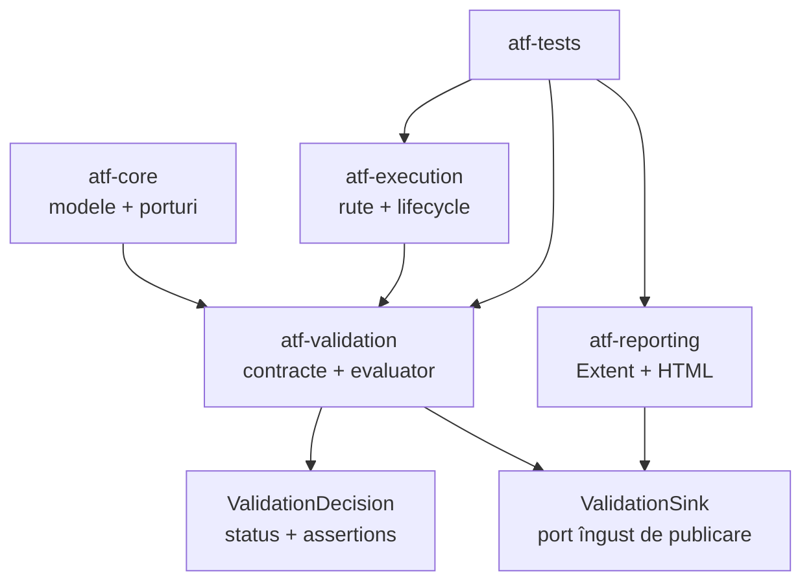
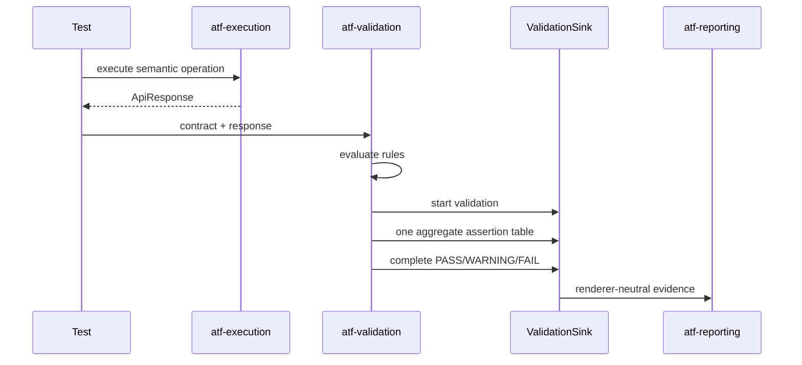

# ATF Validation — contracte independente de renderer

`atf-validation` este modulul care transformă un `ApiResponse` și un contract
de response într-o decizie verificabilă și într-un set de assertions publicabil.
Este un JAR reutilizabil: nu face HTTP, nu cunoaște Extent și nu construiește
HTML/CSS.

## Locul modulului în arhitectură



Direcția este intenționată:

- `atf-core` definește modele neutre și porturi mici;
- `atf-validation` depinde numai de core și de biblioteca JSON necesară evaluării;
- `atf-execution` orchestrează request-ul și folosește validarea, dar nu deține
  regulile de contract;
- `atf-reporting` implementează portul de publicare și deține exclusiv Extent,
  HTML, CSS, asset-urile și finalizarea artifactului;
- `atf-tests` verifică modulele prin fake-uri deterministe și scenarii de
  integrare.

## Responsabilități publice

| Componentă | Responsabilitate | Nu deține |
|---|---|---|
| `ResponseContract` | fațadă fluentă pentru compunerea regulilor și lifecycle one-shot | transport sau UI |
| `ResponseContractRuleSet` | construiește regulile pentru status, headers, JSON path, arrays și schema I/O | duplicate identity sau verdict global |
| `ResponseValidationRule` | descrie o regulă individuală | lifecycle-ul request-ului |
| `ValidationEvaluator` | evaluează regulile și calculează statusul | Extent și markup |
| `ValidationOutcomePolicy` | exprimă politica strictă sau soft-warning fără booleani împrăștiați | transport sau UI |
| `ValidationDecision` | păstrează verdictul, mesajul, assertions și regula soft/fail | publicarea artifactului |
| `ValidationTable` | agregă assertions într-o singură colecție | layout-ul tabelului |
| `ResponseContractReporter` | leagă evaluarea de `ValidationSink` | implementarea sink-ului |
| `SchemaResourceResolver` | rezolvă schema din rădăcini declarate fără traversal | filesystem global sau raportare |

`ResponseContract` nu mai conține mecanica fiecărei reguli. `ResponseContractRuleSet`
producește definiții compozabile (`identity`, `title`, `ResponseValidationRule`),
inclusiv adapterul pentru schema I/O. Fațada păstrează compatibilitatea DSL-ului,
deduplicarea și regula one-shot; `ValidationEvaluator` rămâne singurul owner al
deciziei aggregate și al politicii strict/warning.

## Portul către raportare

Validarea nu primește `ExtentTest`, `ExtentReports` sau un tip concret de request.
Primește doar:

```java
ValidationDecision decision = reporter.validate(
        request,
        "Validate response contract",
        response,
        contract,
        warningMode);
```

`request` trebuie doar să implementeze `ValidationSink`. Portul deschide o
singură zonă de validation, primește toate rândurile într-un tabel agregat,
publică statusul calculat și se închide determinist. În producție,
`AtfReportPorts.Request` extinde acest port și `atf-reporting` îl proiectează în
Extent sau în rendererul HTML fallback.



## Reguli de separare

1. Nu se adaugă importuri Extent, HTML, CSS sau JUnit în `src/main` al acestui
   modul.
2. Regula de contract este pură și testabilă cu un response construit în memorie.
3. `warningMode` poate transforma o încălcare într-un soft assertion `WARNING`,
   dar nu ascunde rândul, mesajul sau actualul din tabel.
4. O validare publică un singur tabel agregat; nu se creează câte un container
   pentru fiecare assertion.
5. Reporterul nu decide business verdictul; folosește rezultatul evaluatorului.
6. Orice resursă de schema se rezolvă numai din rădăcinile declarate și nu poate
   traversa în afara lor.
7. `atf-validation` nu deschide sau închide sesiunea de raportare; lifecycle-ul
   aparține testului/execution, iar rendererul aparține reporting.

## Teste de contract

Testele modulului protejează separat:

- compunerea și evaluarea contractelor;
- statusurile `PASS`, `WARNING` și `FAIL`;
- agregarea tuturor assertions într-o singură tabelă;
- publicarea printr-un fake `ValidationSink`, fără Extent;
- rezolvarea sigură a schemelor și respingerea traversal-ului;
- închiderea scope-ului și publicarea failure-ului când evaluarea aruncă.

Testele sunt ratchet tests: când un contract eșuează, se repară
implementarea, nu se relaxează assertion-ul pentru a face build-ul verde.
Validarea vizuală a artifactului rămâne responsabilitatea suitei din
`atf-reporting` și a verificării finale în TAB MCP.

## Utilizare ca JAR

Un consumator care are nevoie numai de validare depinde de:

```xml
<dependency>
    <groupId>atf.api</groupId>
    <artifactId>atf-validation</artifactId>
    <version>1.0.0-SNAPSHOT</version>
</dependency>
```

Pentru raportare Extent se adaugă separat `atf-reporting` și se furnizează un
`ValidationSink`. Astfel pachetele pot fi versionate și reutilizate fără ca un
consumator de contracte să tragă în classpath rendererul sau asset-urile HTML.
