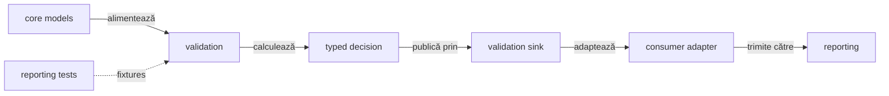
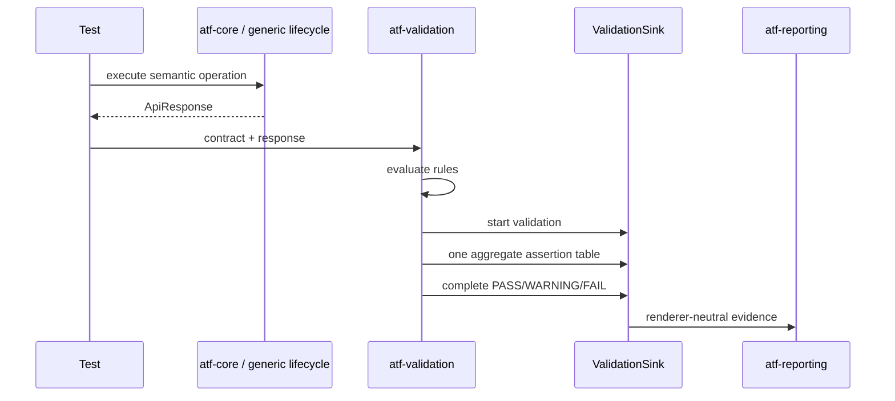

# ATF Validation — contracte independente de motorul de randare

`atf-validation` este modulul care transformă un `ApiResponse` și un contract
de response într-o decizie verificabilă și într-un set de assertions publicabil.
Este un JAR reutilizabil: nu face HTTP, nu cunoaște Extent și nu construiește
HTML/CSS.

## Pe scurt

| Input | Decision | Output |
|---|---|---|
| response + rules | contract evaluation | typed validation outcome |
| outcome + evidence sink | semantic publication | port neutru către reporting |
| invalid payload | failure evidence | fără renderer în runtime |

## Diagramă de bază

Diagrama arată fluxul de date și colaborarea runtime; nu este graful de
dependențe Maven. Graful de module și sensul săgeților sunt în README-ul
rădăcină și în `docs/ATF_Architecture.md`.



<details>
<summary><strong>Legendă — verdict fără renderer</strong></summary>

- `atf-core` oferă modele și porturi neutre;
- `atf-validation` evaluează contractul și produce decizia typed;
- `ValidationSink` este singurul seam către publicare;
- adapterul consumerului mapează evidence-ul spre `atf-reporting`, fără să schimbe verdictul calculat;
- `atf-reporting` rămâne standalone și nu devine dependent de `atf-validation`.
</details>

Direcția este intenționată:

- `atf-core` definește modele neutre și porturi mici;
- `atf-validation` depinde numai de core și de biblioteca JSON necesară evaluării;
- `atf-core` orchestrează mecanica generică a request-ului și lifecycle-ului, dar
  nu deține regulile de contract;
- consumerul mapează decizia către portul reporting folosit de propria compoziție;
- `atf-reporting` deține exclusiv Extent, HTML, CSS, asset-urile și finalizarea
  artifactului, fără dependență de acest modul;
- `atf-reporting-tests` test scope verifică modulele prin fake-uri deterministe și
  scenarii de integrare; `atf-tests` păstrează numai guvernanța globală a reactorului.

## Responsabilități publice

| Componentă | Responsabilitate | Nu deține |
|---|---|---|
| `ResponseContract` | fațadă fluentă pentru compunerea regulilor și lifecycle one-shot | transport sau UI |
| `ResponseContractRuleSet` | construiește regulile pentru status, headers, JSON path, arrays și schema I/O | duplicate identity sau verdict global |
| `ResponseValidationRule` | descrie o regulă individuală | lifecycle-ul request-ului |
| `ValidationEvaluator` | evaluează regulile și calculează statusul | Extent și markup |
| `ValidationOutcomePolicy` | exprimă politica strictă sau soft-warning fără booleani împrăștiați | transport sau UI |
| `ValidationDecision` | păstrează verdictul, mesajul, assertions și regula soft/fail | publicarea artifactului |
| `ValidationTable` | agregă assertions într-o singură colecție | layout-ul tabelului |
| `ResponseContractReporter` | leagă evaluarea de `ValidationSink` | implementarea sink-ului |
| `SchemaResourceResolver` | rezolvă schema din rădăcini declarate fără traversal | filesystem global sau raportare |
| `AiEvaluationCase` + `AiFieldExpectation` | expected versionat, independent de output; fiecare field poate declara o cerință typed de grounding | apelarea unui model, output-ul observat sau decizia consumerului asupra expected-ului business |
| `AiEvaluationEvaluator` + `AiEvaluationPolicy` | comparații typed, score ponderat, threshold explicit și hard-fail critic | provider AI, renderer sau workflow review |
| `AiInvocationEvidence` | clasifică real/mock/fallback/unknown și păstrează referințe opace request/response/output | payload, prompt, token, credential sau invocation efectivă |
| `ai.grounding`: `AiGroundingRequirement`, `AiSourceReference`, `AiGroundingObservation` | allowlist de source IDs și verdict per field fără a copia payload-ul sursei | ambiguitate/run-level ledger sau reporting |
| `AiEvaluationSnapshot` + `AiFieldComparison` | snapshot immutable `COMPLETE` cu policy, timestamp, invocation, comparații, observații de grounding și hard-fails cu expected/observed/reason/evidence reference | run-level evidence ledger și proiecție raport |

`ResponseContract` nu mai conține mecanica fiecărei reguli. `ResponseContractRuleSet`
producește definiții compozabile (`identity`, `title`, `ResponseValidationRule`),
inclusiv adapterul pentru schema I/O. Fațada păstrează compatibilitatea DSL-ului,
deduplicarea și regula one-shot; `ValidationEvaluator` rămâne singurul owner al
deciziei aggregate și al politicii strict/warning.

## Portul către raportare

Validarea nu primește `ExtentTest`, `ExtentReports` sau un tip concret de request.
Primește doar:

```java
ValidationDecision decision = reporter.validate(
        request,
        "Validate response contract",
        response,
        contract,
        warningMode);
```

`request` trebuie doar să implementeze `ValidationSink`. Portul deschide o
singură zonă de validation, primește toate rândurile într-un tabel agregat,
publică statusul calculat și se închide determinist. Consumerul poate adapta
această evidence către portul reporting pe care îl folosește; `atf-reporting`
nu importă acest modul și nu primește direct `ValidationDecision`.

Și testele UI folosesc același contract de assertions:

```text
Playwright check → AtfAssertion → UiExtentReportSession
                 → ASSERTION | EXPECTED | ACTUAL | RESULT
```

API și UI împart forma tabelului, nu verdictul: fiecare test publică propriul
artifact Extent și propriul rezultat.



<details>
<summary><strong>Legendă — secvența unei validări</strong></summary>

- testul execută operația și trimite response-ul către evaluator;
- evaluatorul compune un singur tabel de assertions și un verdict agregat;
- sink-ul primește evidence renderer-neutral, iar reporting-ul doar îl proiectează.
</details>

## Reguli de separare

1. Nu se adaugă importuri Extent, HTML, CSS sau JUnit în `src/main` al acestui
   modul.
2. Regula de contract este pură și testabilă cu un response construit în memorie.
3. `warningMode` poate transforma o încălcare într-un soft assertion `WARNING`,
   dar nu ascunde rândul, mesajul sau actualul din tabel.
4. O validare publică un singur tabel agregat; nu se creează câte un container
   pentru fiecare assertion.
5. Reporterul nu decide business verdictul; folosește rezultatul evaluatorului.
6. Orice resursă de schema se rezolvă numai din rădăcinile declarate și nu poate
   traversa în afara lor.
7. `atf-validation` nu deschide sau închide sesiunea de raportare; lifecycle-ul
   aparține testului/execution, iar rendererul aparține reporting.

## Teste de contract

Testele modulului protejează separat:

- compunerea și evaluarea contractelor;
- statusurile `PASS`, `WARNING` și `FAIL`;
- agregarea tuturor assertions într-o singură tabelă;
- publicarea printr-un fake `ValidationSink`, fără Extent;
- rezolvarea sigură a schemelor și respingerea traversal-ului;
- închiderea scope-ului și publicarea failure-ului când evaluarea aruncă.
- evaluatorul AI pur: expected versionat, comparații typed, missing/invented și
  output nedeclarat, hard-fail critic, threshold configurabil și agregare
  ponderată; fără provider, browser sau renderer.

Testele sunt ratchet tests: când un contract eșuează, se repară
implementarea, nu se relaxează assertion-ul pentru a face build-ul verde.
Validarea vizuală a artifactului rămâne responsabilitatea suitei din
`atf-reporting` și a verificării finale în TAB MCP.

## Comparatorul AI — contract implementat

`atf.api.validation.ai` evaluează output-ul furnizat de consumer. Expected-ul
versionat se construiește separat, iar evaluatorul produce un instantaneu
`COMPLETE` fără să invoce un model sau un renderer.

| Contract | Comportament executabil |
|---|---|
| Comparații | `EXACT`, `NORMALIZED_TEXT`, `SET`, `ORDERED_LIST`, `RANGE`, `ALLOWED_VARIANTS`, `PRESENT`, `ABSENT` |
| Expected / observed | copii defensive inclusiv pentru valori nested; căile expected duplicate sunt respinse |
| Prezența informației | lipsa critică, invenția critică și contradicția dintre sursă și expected au motive distincte |
| Output nedeclarat | hard-fail implicit; când politica permite câmpul extra, mismatch-ul și penalizarea rămân vizibile |
| Scor și verdict | scor ponderat, prag explicit; eșecul critic prevalează asupra scorului |
| Invocare | numai `REAL_AI` cu referințe complete poate primi quality score; mock/fallback sunt `NOT_EVALUATED`; output-ul produs cu mod `UNKNOWN` sau dovezile reale incomplete produc `FAIL` |
| Fundamentare per field | source IDs allowlisted; `SUPPORTED`, `UNSUPPORTED`, `MISSING_REFERENCE`, `NOT_REQUIRED`; fundamentarea obligatorie lipsă/nesuportată produce hard-fail |
| Instantaneu | policy, timestamp din `Clock`, invocation, comparații, grounding și hard-fails cu field/expected/observed/reason/evidence reference |

Responsabilitățile sunt separate între pachetul `ai` (comparator și snapshot),
`ai.grounding` (cerințe și referințe) și `ai.invocation` (proveniența apelului).
`AiEvaluationValues` păstrează intern mecanica de copiere; guvernanța coeziunii
protejează inventarul pachetului și limita de opt clase.

| Probă în `AiEvaluationEvaluatorTest` | Ce protejează |
|---|---|
| comparații, threshold și critical mismatch | evaluare deterministă și precedența hard-fail |
| missing/invented/undeclared output | diagnostice distincte și referința la output |
| real/mock/fallback și invocation incompletă | eligibilitatea scorului și refuzul dovezilor incomplete |
| grounding lipsă sau în afara allowlist-ului | `MISSING_GROUNDING_REFERENCE` / `UNSUPPORTED_GROUNDING` |
| clock injectat și mutații ale valorilor nested | finalizare `COMPLETE` și imuabilitate |

Limita curentă: `AMBIGUOUS` există în enum, dar evaluatorul nu îl produce.
Registrul de dovezi la nivel de run, integrarea lifecycle-ului, review/state,
reporting și regression delta rămân în [feedback-ul AI](../docs/feedback/README_AI_Evaluation.md).
`REGEX_RESTRICTED` cere un matcher cu execuție limitată înainte de implementare;
scorul tehnic existent nu reprezintă încă o rubrică business configurabilă pe caz.

## Utilizare ca JAR

Un consumator care are nevoie numai de validare depinde de:

```xml
<dependency>
    <groupId>atf.api</groupId>
    <artifactId>atf-validation</artifactId>
    <version>1.0.0-SNAPSHOT</version>
</dependency>
```

Pentru raportare Extent se adaugă separat `atf-reporting` și se furnizează un
`ValidationSink`. Astfel pachetele pot fi versionate și reutilizate fără ca un
consumator de contracte să tragă în classpath rendererul sau asset-urile HTML.
