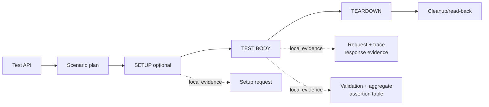

# Ghid pentru adăugarea unui test API în ATF Java

## Overall

- scop: un test API determinist, semantic și reproductibil;
- boundary: testul compune core, transportul configurat și validatorul;
- raportul este verificat separat după contractul Extent;
- arhitectură: [ATF_Architecture.md](ATF_Architecture.md);
- raportare: [ATF_Reporting_Contract.md](ATF_Reporting_Contract.md).

## Pașii obligatorii

- [ ] definește comportamentul API și criteriul de acceptare;
- [ ] verifică ruta, modelul, serviciul și validatorul existente;
- [ ] folosește catalogul ownerului: `MockRoutePaths` pentru acceptance sau
      `ApiLiveTransportCatalog` pentru live opt-in; nu copia endpoint-ul în test;
- [ ] adaugă serviciu semantic numai când operația are sens de domeniu;
- [ ] execută prin executor și transport injectat; testul nu construiește clientul HTTP;
- [ ] grupează verificările response-ului într-un singur tabel de assertions;
- [ ] înregistrează cleanup-ul imediat după dobândirea ownership-ului;
- [ ] adaugă întâi testul unit/component pentru regula nouă;
- [ ] numește scenariul și tag-urile după intenție;
- [ ] generează artifactul și verifică raportul după contract.

<details>
<summary><strong>Flow cu mai multe request-uri</strong></summary>

- contractul de mutație și contractul read-model-ului rămân distincte;
- relația dintre răspunsuri verifică `id/self-link`, versiune sau lineage;
- verificarea se atașează request-ului de read-back ca evidence;
- nu se inventează un request HTTP pentru a explica relația.

</details>

## Structura minimă a unui scenariu



<details>
<summary><strong>Legendă — scenariul API minim</strong></summary>

- linia solidă arată `TEST API → plan → SETUP → TEST BODY → TEARDOWN`;
- ramificațiile punctate arată numai evidence-ul local al fazei;
- `SETUP` pregătește numai precondițiile care există în scenariu;
- `TEST BODY` păstrează request-ul și validation-ul ca responsabilități surori;
- `TEARDOWN` apare doar când există cleanup sau read-back real;
- tabelul de assertions este verdictul semantic, nu un rezumat duplicat în fază.

</details>

Pentru un test simplu, TEST BODY trebuie să conțină request-ul și validarea
lui. Pentru lifecycle, fazele sunt create numai când au conținut real. Un nod
TEST BODY nu repetă failure-urile care apar deja în tabelul de assertions; faza
arată doar sumarul, iar diagnosticul detaliat rămâne sub validation.

## Ce verifică un test API

Un validator poate grupa în același tabel:

| Assertion | Expected | Actual | Result |
|---|---|---|---|
| HTTP status | codul și textul așteptat | răspunsul primit | PASS/FAIL/WARNING |
| Content-Type | tipul acceptat | header-ul primit | PASS/FAIL |
| JSON schema | schema contractului | schema evaluată | PASS/FAIL |
| câmp obligatoriu | valoare sau tip | valoarea primită | PASS/FAIL/WARNING |
| relație | resursa asociată | rezultatul verificării | PASS/FAIL |

Nu se creează câte un nod pentru fiecare assertion. Tabelul este agregat pentru
response-ul curent, astfel încât toate abaterile să fie vizibile împreună.

## Durată și status în raport

Regula vizibilă este:

- durata are unitate explicită (`ms` sau `s`);
- statusul și durata sunt tokens diferite;
- frunza folosește durata măsurată;
- părintele folosește durata proprie și totalurile copiilor direcți;
- o durată Extent inclusivă nu se adună din nou cu descendenții;
- timestamp-ul nu este durată și nu apare ca o coloană în `Tests`.

<details>
<summary><strong>Geometria comună a badge-urilor</strong></summary>

`Pass`, `Warning` și `Fail` păstrează aceeași geometrie în fiecare tab și
proiecție: `18.2px` înălțime, `0 5px` padding, `4px` radius, `9.52px` font,
`18.2px` line-height, `400` weight, fără border.

</details>

## Separarea responsabilităților

```text
MockRoutePaths              -> căi deterministe pentru acceptance
ApiLiveTransportCatalog    -> origini și transport live opt-in
ApiOperationLabel           -> label semantic pentru raport
Service                     -> acțiune semantică
ApiExecutor                 -> transport, retry și durată
Validator                   -> assertions și tabel agregat
Report session              -> arbore și evidence
Scenario                    -> ordine și intenție
```

Dacă testul începe să conțină JSON de infrastructură, CSS, markup Extent,
politici de retry sau endpoint-uri literale, responsabilitatea este în locul
greșit.

## Replay manual și request-uri reale

Raportul API este sursa de pași reproductibili: `METHOD`, `URL`, headers
efective, `REQUEST JSON`, `RESPONSE JSON`, `TRANSPORT PROVENANCE` și
`MANUAL REPLAY`. În acceptance, un URL real configurat este numai metadata a
mock-ului; raportul îl marchează `ACCEPTANCE / MOCK` și `NOT EXECUTABLE`. Nu se
copiează un cURL dintr-un raport mock ca și cum ar fi fost executat.

Request-urile reale sunt separate și opt-in:

```yaml
api:
  transport: live
  baseUri: https://<real-api-host>/<base-path>
```

Rularea mai cere `-Datf.api.live.optIn=true` sau
`ATF_API_LIVE_OPT_IN=true`, apoi deschiderea unui endpoint prin
`ApiLiveTransportCatalog`. După execuție, raportul poate genera cURL-ul de
replay pentru schimbul live; token-urile și header-ele sensibile rămân
redacted. Un test care nu declară explicit `live` nu are voie să deschidă
network-ul doar pentru că `baseUri` arată ca un endpoint public. Catalogul
respinge placeholder-ul acceptance și limitează request-urile la originea
endpoint-ului selectat.

## Cleanup și failure

- resursa creată se înregistrează imediat în registry-ul scenariului;
- teardown-ul se execută și când body-ul eșuează, dacă există ownership;
- failure-ul din cleanup nu ascunde failure-ul primar;
- statusul final respectă aceeași precedence peste tot;
- un test skip nu simulează un pass și nu publică assertions inventate.

## Verificarea raportului

După testele offline și rularea scenariului:

- [ ] deschide artifactul HTML în TAB MCP;
- [ ] verifică `Tests → Category → Fails → Overview`, cu `Overview` implicit;
- [ ] selectează un test pozitiv și unul cu warning/fail/skip;
- [ ] expandează request, trace, JSON și validation;
- [ ] confirmă `validation` ca frate al request-ului și un singur tabel;
- [ ] confirmă JSON scrollabil intern, fără overflow al paginii;
- [ ] verifică tag-urile în detaliile scenariului;
- [ ] verifică Fails: o singură zonă, sumar schematic și link stabil;
- [ ] confirmă că nu apar resurse externe sau folder auxiliar Extent.

Validarea vizuală este parte din testul de raportare. Build-ul verde singur nu
este suficient când schimbarea atinge DOM-ul sau CSS-ul.

